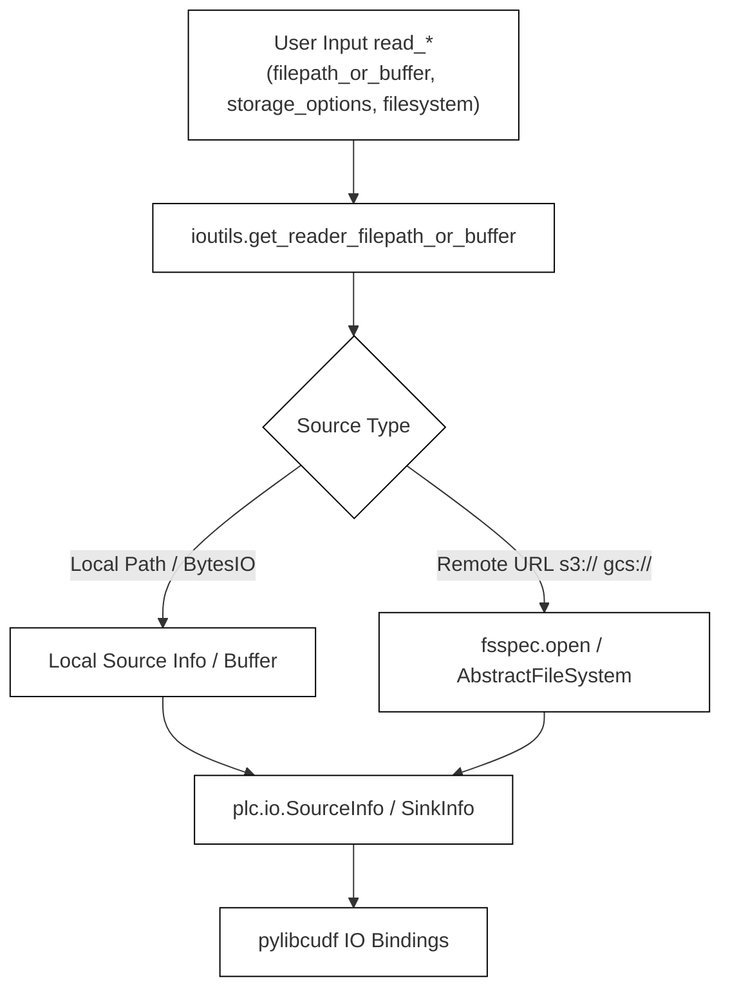
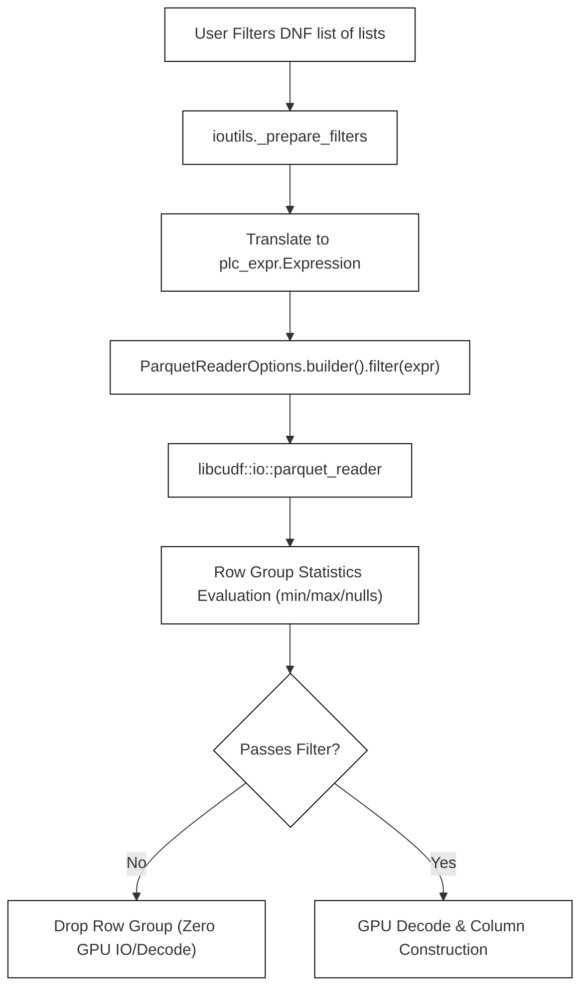

<!-- source: DeepWiki mcp.deepwiki.com · repo NVIDIA/cudf · page 4.3 cudf Python I/O · fetched 2026-10-26 -->

# cudf Python I/O

Relevant source files

The following files were used as context for generating this wiki page:

- [python/cudf/cudf/io/avro.py](python/cudf/cudf/io/avro.py)
- [python/cudf/cudf/io/csv.py](python/cudf/cudf/io/csv.py)
- [python/cudf/cudf/io/json.py](python/cudf/cudf/io/json.py)
- [python/cudf/cudf/io/orc.py](python/cudf/cudf/io/orc.py)
- [python/cudf/cudf/io/parquet.py](python/cudf/cudf/io/parquet.py)
- [python/cudf/cudf/io/text.py](python/cudf/cudf/io/text.py)
- [python/cudf/cudf/tests/input_output/test_csv.py](python/cudf/cudf/tests/input_output/test_csv.py)
- [python/cudf/cudf/tests/input_output/test_dlpack.py](python/cudf/cudf/tests/input_output/test_dlpack.py)
- [python/cudf/cudf/tests/input_output/test_feather.py](python/cudf/cudf/tests/input_output/test_feather.py)
- [python/cudf/cudf/tests/input_output/test_hdf5.py](python/cudf/cudf/tests/input_output/test_hdf5.py)
- [python/cudf/cudf/tests/input_output/test_json.py](python/cudf/cudf/tests/input_output/test_json.py)
- [python/cudf/cudf/tests/input_output/test_orc.py](python/cudf/cudf/tests/input_output/test_orc.py)
- [python/cudf/cudf/tests/input_output/test_parquet.py](python/cudf/cudf/tests/input_output/test_parquet.py)
- [python/cudf/cudf/tests/input_output/test_s3.py](python/cudf/cudf/tests/input_output/test_s3.py)
- [python/cudf/cudf/utils/ioutils.py](python/cudf/cudf/utils/ioutils.py)
- [python/pylibcudf/pylibcudf/io/avro.pxd](python/pylibcudf/pylibcudf/io/avro.pxd)
- [python/pylibcudf/pylibcudf/io/avro.pyi](python/pylibcudf/pylibcudf/io/avro.pyi)
- [python/pylibcudf/pylibcudf/io/avro.pyx](python/pylibcudf/pylibcudf/io/avro.pyx)
- [python/pylibcudf/pylibcudf/io/csv.pxd](python/pylibcudf/pylibcudf/io/csv.pxd)
- [python/pylibcudf/pylibcudf/io/csv.pyi](python/pylibcudf/pylibcudf/io/csv.pyi)
- [python/pylibcudf/pylibcudf/io/csv.pyx](python/pylibcudf/pylibcudf/io/csv.pyx)
- [python/pylibcudf/pylibcudf/io/json.pxd](python/pylibcudf/pylibcudf/io/json.pxd)
- [python/pylibcudf/pylibcudf/io/json.pyi](python/pylibcudf/pylibcudf/io/json.pyi)
- [python/pylibcudf/pylibcudf/io/json.pyx](python/pylibcudf/pylibcudf/io/json.pyx)
- [python/pylibcudf/pylibcudf/io/orc.pxd](python/pylibcudf/pylibcudf/io/orc.pxd)
- [python/pylibcudf/pylibcudf/io/orc.pyi](python/pylibcudf/pylibcudf/io/orc.pyi)
- [python/pylibcudf/pylibcudf/io/orc.pyx](python/pylibcudf/pylibcudf/io/orc.pyx)
- [python/pylibcudf/pylibcudf/io/parquet.pxd](python/pylibcudf/pylibcudf/io/parquet.pxd)
- [python/pylibcudf/pylibcudf/io/parquet.pyi](python/pylibcudf/pylibcudf/io/parquet.pyi)
- [python/pylibcudf/pylibcudf/io/parquet.pyx](python/pylibcudf/pylibcudf/io/parquet.pyx)
- [python/pylibcudf/pylibcudf/json.pyx](python/pylibcudf/pylibcudf/json.pyx)
- [python/pylibcudf/pylibcudf/libcudf/io/csv.pxd](python/pylibcudf/pylibcudf/libcudf/io/csv.pxd)
- [python/pylibcudf/pylibcudf/libcudf/io/json.pxd](python/pylibcudf/pylibcudf/libcudf/io/json.pxd)
- [python/pylibcudf/pylibcudf/libcudf/io/orc.pxd](python/pylibcudf/pylibcudf/libcudf/io/orc.pxd)
- [python/pylibcudf/pylibcudf/libcudf/io/orc_metadata.pxd](python/pylibcudf/pylibcudf/libcudf/io/orc_metadata.pxd)
- [python/pylibcudf/pylibcudf/libcudf/io/parquet.pxd](python/pylibcudf/pylibcudf/libcudf/io/parquet.pxd)

The purpose and scope of `cudf` Python I/O (`cudf.io`) is to provide high-performance, pandas-compatible data loading and serialization APIs for GPU DataFrames. It bridges user-facing Python calls (`read_parquet`, `read_csv`, `read_orc`, `read_json`, `read_avro`, `read_text`, and their corresponding `to_*` counterparts) with the C++ libcudf engine via Cython bindings in `pylibcudf`. It handles heterogeneous sources (local files, in-memory buffers, and remote cloud storage via `fsspec`) and translates high-level query filters into low-level libcudf Abstract Syntax Trees (ASTs) for predicate pushdown.

---

## 1. Path and Storage Handling (`ioutils`)

The `cudf.utils.ioutils` module provides unified infrastructure for resolving file paths, file-like objects, raw bytes, and remote storage connections across all format-specific readers and writers.

When a user passes `filepath_or_buffer`, `storage_options`, or a custom `filesystem` object, `ioutils.get_reader_filepath_or_buffer` processes the target. Remote URLs (such as `s3://`, `gcs://`, or `http://`) are resolved using `fsspec` or `urllib`, enabling seamless cloud integration without requiring users to manually download datasets to host memory.

*Diagram 1: Natural Language Space to Code Entity Space - I/O Source Resolution Pipeline*

Sources: `python/cudf/cudf/utils/ioutils.py:1-179` [pyarrow](), `python/cudf/cudf/io/csv.py:148-154` [python/cudf/cudf/io/csv.py]()

---

## 2. Format Readers and Writers

The Python API organizes format-specific I/O logic into dedicated modules under `cudf/io/`:

| Module | Reader Function | Writer Function | Key Capabilities & Backend |
| :--- | :--- | :--- | :--- |
| `cudf/io/parquet.py` | `read_parquet` | `write_parquet` / `ParquetWriter` | Row-group filtering, chunked reads, stats pushdown |
| `cudf/io/csv.py` | `read_csv` | `to_csv` | Multibyte delimiters, type inference, byte-range slicing |
| `cudf/io/orc.py` | `read_orc` | `write_orc` | Stripe-level statistics, columnar projection |
| `cudf/io/json.py` | `read_json` | `to_json` | JSON lines (`lines=True`), chunked low-memory readers |
| `cudf/io/avro.py` | `read_avro` | — | Record batch decoding, schema mapping |
| `cudf/io/text.py` | `read_text` | — | Multibyte line splitting into string columns |

### Parquet I/O
Parquet integration supports both single-file and multi-file dataset reads. Through `pylibcudf.io.parquet`, options are built using `ParquetReaderOptionsBuilder` and `ParquetWriterOptionsBuilder` [python/pylibcudf/pylibcudf/io/parquet.pyx:64-84](). Chunked reading is exposed via `ChunkedParquetReader` to process large datasets iteratively without exhausting GPU memory [python/pylibcudf/pylibcudf/io/parquet.pyx:86-95]().

### CSV and JSON Readers
`read_csv` and `read_json` parse complex text payloads directly on the GPU. `read_csv` accepts parameters like `sep`, `delimiter`, `dtype`, `na_values`, and `byte_range` [python/cudf/cudf/io/csv.py:93-128](). `read_json` supports `lines=True` (JSON Lines) via low-memory chunked execution paths [python/cudf/cudf/io/json.py:104-204]().

Sources: `python/cudf/cudf/io/parquet.py:82-207` [python/cudf/cudf/io/parquet.py](), `python/cudf/cudf/io/csv.py:93-158` [python/cudf/cudf/io/csv.py](), `python/cudf/cudf/io/orc.py:155-206` [python/cudf/cudf/io/orc.py](), `python/cudf/cudf/io/json.py:104-204` [python/cudf/cudf/io/json.py](), `python/cudf/cudf/io/avro.py:11-51` [python/cudf/cudf/io/avro.py](), `python/pylibcudf/pylibcudf/io/parquet.pyx:64-183` [python/pylibcudf/pylibcudf/io/parquet.pyx]()

---

## 3. Filter-to-AST Translation and Predicate Pushdown

When reading datasets with `filters` specified (e.g., in Parquet or ORC), cuDF translates pandas-style Disjunctive Normal Form (DNF) filter expressions into libcudf Expression AST nodes (`plc_expr`). 

These AST nodes are passed into reader options (`ParquetReaderOptions.set_filter`) [python/pylibcudf/pylibcudf/io/parquet.pyx:55](). The underlying libcudf engine evaluates these filters against row-group statistics (min/max, null counts, bloom filters) to eliminate entire row groups or pages before launching decompression and decoding kernels on the GPU.

*Diagram 2: Natural Language Space to Code Entity Space - Filter-to-AST Translation and Pushdown Pipeline*

Sources: `python/cudf/cudf/utils/ioutils.py:108-115` [python/cudf/cudf/utils/ioutils.py](), `python/pylibcudf/pylibcudf/io/parquet.pyx:46-55` [python/pylibcudf/pylibcudf/io/parquet.pyx](), `python/pylibcudf/pylibcudf/io/parquet.pyi:32` [python/pylibcudf/pylibcudf/io/parquet.pyi]()

---

