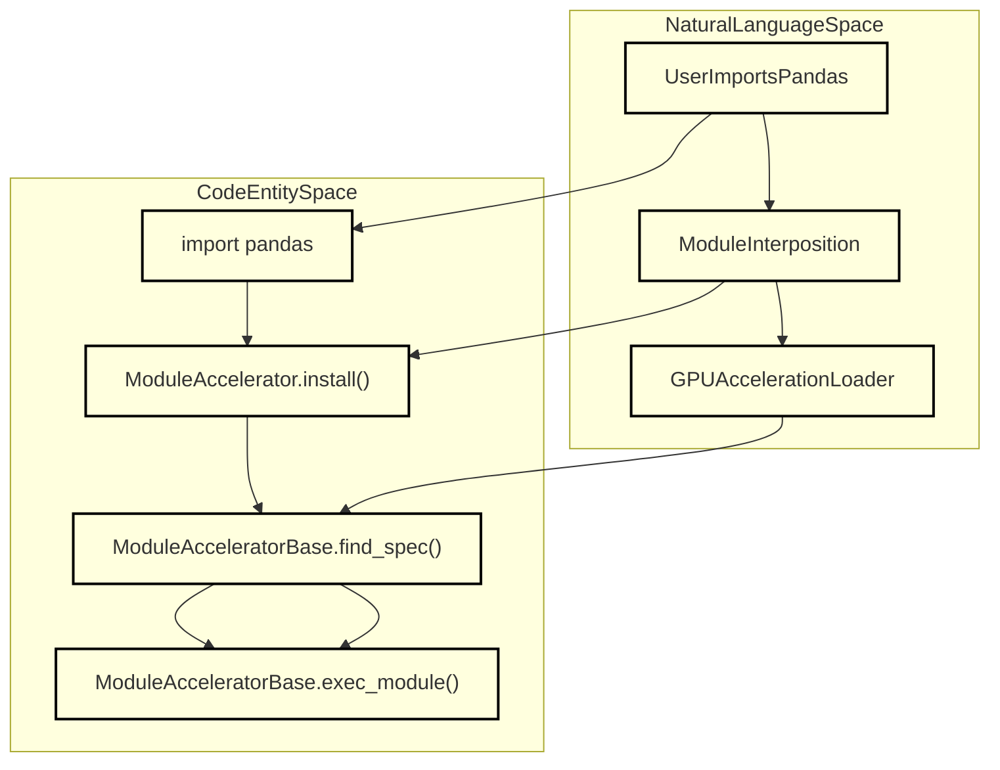
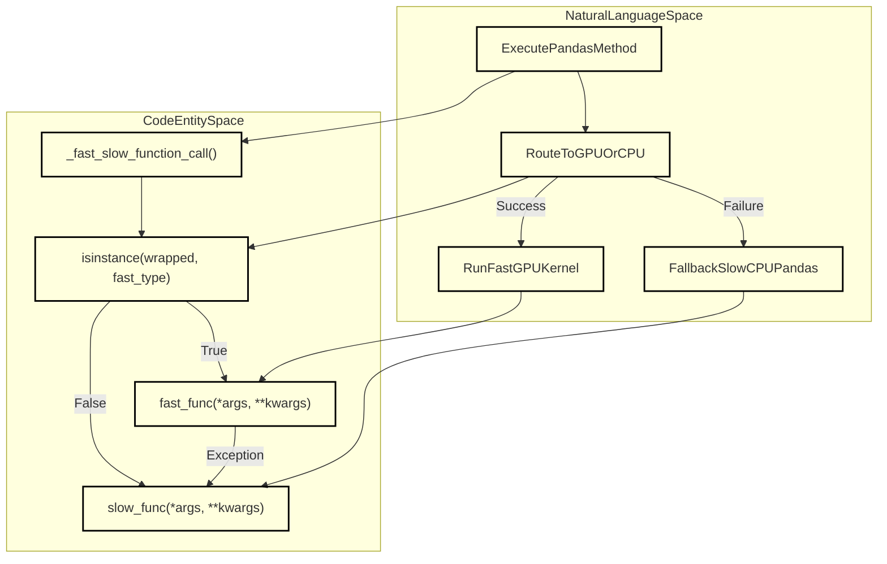

<!-- source: DeepWiki mcp.deepwiki.com · repo NVIDIA/cudf · page 4.4 cudf.pandas Accelerator · fetched 2026-10-26 -->

# cudf.pandas Accelerator

<details>
<summary>Relevant source files</summary>

The following files were used as context for generating this wiki page:

- [.github/ISSUE_TEMPLATE/pandas_function_request.md](.github/ISSUE_TEMPLATE/pandas_function_request.md)
- [docs/cudf/source/_static/colab.png](docs/cudf/source/_static/colab.png)
- [docs/cudf/source/_static/cudf-pandas-line-profile.png](docs/cudf/source/_static/cudf-pandas-line-profile.png)
- [docs/cudf/source/_static/cudf-pandas-profile.png](docs/cudf/source/_static/cudf-pandas-profile.png)
- [docs/cudf/source/_static/duckdb-benchmark-groupby-join.png](docs/cudf/source/_static/duckdb-benchmark-groupby-join.png)
- [docs/cudf/source/cudf_pandas/faq.md](docs/cudf/source/cudf_pandas/faq.md)
- [docs/cudf/source/cudf_pandas/how-it-works.md](docs/cudf/source/cudf_pandas/how-it-works.md)
- [docs/cudf/source/cudf_pandas/index.rst](docs/cudf/source/cudf_pandas/index.rst)
- [docs/cudf/source/cudf_pandas/usage.md](docs/cudf/source/cudf_pandas/usage.md)
- [docs/cudf/source/index.rst](docs/cudf/source/index.rst)
- [python/cudf/cudf/core/groupby/__init__.py](python/cudf/cudf/core/groupby/__init__.py)
- [python/cudf/cudf/pandas/__init__.py](python/cudf/cudf/pandas/__init__.py)
- [python/cudf/cudf/pandas/__main__.py](python/cudf/cudf/pandas/__main__.py)
- [python/cudf/cudf/pandas/_benchmarks/__init__.py](python/cudf/cudf/pandas/_benchmarks/__init__.py)
- [python/cudf/cudf/pandas/_benchmarks/pdsh.py](python/cudf/cudf/pandas/_benchmarks/pdsh.py)
- [python/cudf/cudf/pandas/_benchmarks/utils.py](python/cudf/cudf/pandas/_benchmarks/utils.py)
- [python/cudf/cudf/pandas/_wrappers/__init__.py](python/cudf/cudf/pandas/_wrappers/__init__.py)
- [python/cudf/cudf/pandas/_wrappers/common.py](python/cudf/cudf/pandas/_wrappers/common.py)
- [python/cudf/cudf/pandas/_wrappers/numpy.py](python/cudf/cudf/pandas/_wrappers/numpy.py)
- [python/cudf/cudf/pandas/_wrappers/pandas.py](python/cudf/cudf/pandas/_wrappers/pandas.py)
- [python/cudf/cudf/pandas/annotation.py](python/cudf/cudf/pandas/annotation.py)
- [python/cudf/cudf/pandas/fast_slow_proxy.py](python/cudf/cudf/pandas/fast_slow_proxy.py)
- [python/cudf/cudf/pandas/magics.py](python/cudf/cudf/pandas/magics.py)
- [python/cudf/cudf/pandas/module_accelerator.py](python/cudf/cudf/pandas/module_accelerator.py)
- [python/cudf/cudf/pandas/profiler.py](python/cudf/cudf/pandas/profiler.py)
- [python/cudf/cudf/pandas/proxy_base.py](python/cudf/cudf/pandas/proxy_base.py)
- [python/cudf/cudf/pandas/scripts/pandas-testing-plugin.py](python/cudf/cudf/pandas/scripts/pandas-testing-plugin.py)
- [python/cudf/cudf/tests/dataframe/methods/test_interpolate.py](python/cudf/cudf/tests/dataframe/methods/test_interpolate.py)
- [python/cudf/cudf/tests/dataframe/methods/test_mode.py](python/cudf/cudf/tests/dataframe/methods/test_mode.py)
- [python/cudf/cudf/tests/dataframe/methods/test_pct_change.py](python/cudf/cudf/tests/dataframe/methods/test_pct_change.py)
- [python/cudf/cudf/tests/general_functions/test_date_range.py](python/cudf/cudf/tests/general_functions/test_date_range.py)
- [python/cudf/cudf/tests/general_functions/test_get_dummies.py](python/cudf/cudf/tests/general_functions/test_get_dummies.py)
- [python/cudf/cudf/tests/groupby/test_agg.py](python/cudf/cudf/tests/groupby/test_agg.py)
- [python/cudf/cudf/tests/groupby/test_apply.py](python/cudf/cudf/tests/groupby/test_apply.py)
- [python/cudf/cudf/tests/groupby/test_attributes.py](python/cudf/cudf/tests/groupby/test_attributes.py)
- [python/cudf/cudf/tests/groupby/test_diff.py](python/cudf/cudf/tests/groupby/test_diff.py)
- [python/cudf/cudf/tests/groupby/test_head_tail.py](python/cudf/cudf/tests/groupby/test_head_tail.py)
- [python/cudf/cudf/tests/groupby/test_ngroup.py](python/cudf/cudf/tests/groupby/test_ngroup.py)
- [python/cudf/cudf/tests/groupby/test_nunique.py](python/cudf/cudf/tests/groupby/test_nunique.py)
- [python/cudf/cudf/tests/groupby/test_reductions.py](python/cudf/cudf/tests/groupby/test_reductions.py)
- [python/cudf/cudf/tests/groupby/test_sample.py](python/cudf/cudf/tests/groupby/test_sample.py)
- [python/cudf/cudf/tests/groupby/test_transform.py](python/cudf/cudf/tests/groupby/test_transform.py)
- [python/cudf/cudf/tests/series/methods/test_count.py](python/cudf/cudf/tests/series/methods/test_count.py)
- [python/cudf/cudf/tests/series/methods/test_mode.py](python/cudf/cudf/tests/series/methods/test_mode.py)
- [python/cudf/cudf_pandas_tests/_magics_gpu_test.py](python/cudf/cudf_pandas_tests/_magics_gpu_test.py)
- [python/cudf/cudf_pandas_tests/data/profile_basic.py](python/cudf/cudf_pandas_tests/data/profile_basic.py)
- [python/cudf/cudf_pandas_tests/test_array_function.py](python/cudf/cudf_pandas_tests/test_array_function.py)
- [python/cudf/cudf_pandas_tests/test_cudf_pandas.py](python/cudf/cudf_pandas_tests/test_cudf_pandas.py)
- [python/cudf/cudf_pandas_tests/test_disable_per_thread_safety.py](python/cudf/cudf_pandas_tests/test_disable_per_thread_safety.py)
- [python/cudf/cudf_pandas_tests/test_fast_slow_proxy.py](python/cudf/cudf_pandas_tests/test_fast_slow_proxy.py)
- [python/cudf/cudf_pandas_tests/test_magics.py](python/cudf/cudf_pandas_tests/test_magics.py)
- [python/cudf/cudf_pandas_tests/test_main.py](python/cudf/cudf_pandas_tests/test_main.py)
- [python/cudf/cudf_pandas_tests/test_profiler.py](python/cudf/cudf_pandas_tests/test_profiler.py)

</details>


## Purpose and Scope

The `cudf.pandas` module provides zero-code-change GPU acceleration for pandas workflows. By interposing on Python's module import machinery, `cudf.pandas` transparently wraps pandas objects in high-performance proxy structures that execute operations on NVIDIA GPUs via `cudf` and `pylibcudf` [python/cudf/cudf/pandas/__init__.py:33-39](), [python/cudf/cudf/pandas/module_accelerator.py:95-151](), [python/cudf/cudf/pandas/fast_slow_proxy.py](). When operations are unsupported on the GPU or encounter edge cases, the system falls back seamlessly to standard CPU pandas without raising errors [python/cudf/cudf/pandas/fast_slow_proxy.py:91-112,155-210]().

---

## 1. Module Interposition and `ModuleAccelerator`

To achieve zero-code-change acceleration, `cudf.pandas` hooks into Python's import system using custom meta-path finders and loaders defined in `ModuleAcceleratorBase` [python/cudf/cudf/pandas/module_accelerator.py:95-151]().


*Diagram 1: Module Interposition Mapping from Natural Language to Code Entities.*
Sources: `python/cudf/cudf/pandas/module_accelerator.py:95-187`, `python/cudf/cudf/pandas/__init__.py:33-39`

When a user invokes `cudf.pandas.install()`, the `ModuleAccelerator` registers itself in `sys.meta_path` [python/cudf/cudf/pandas/__init__.py:33-37](). When `import pandas` is executed, `find_spec` intercepts the request if the module matches the target namespace [python/cudf/cudf/pandas/module_accelerator.py:158-187](). The loader then constructs a combined module populated by mapping attributes from the fast library (`cudf`) and the slow fallback library (`pandas`) [python/cudf/cudf/pandas/module_accelerator.py:189-220]().

During installation, `cudf.pandas` also initializes the RAPIDS Memory Manager (`RMM`) using a managed memory or pool resource configuration optimized for available device memory [python/cudf/cudf/pandas/__init__.py:33-114]().

Sources: `python/cudf/cudf/pandas/__init__.py:33-114`, `python/cudf/cudf/pandas/module_accelerator.py:95-220`

---

## 2. Fast-Slow Proxy Architecture (`fast_slow_proxy.py`)

The core execution engine of `cudf.pandas` relies on proxy objects that wrap a fast (GPU-backed `cudf`) representation and a slow (CPU-backed `pandas`) representation [python/cudf/cudf/pandas/fast_slow_proxy.py](). 


*Diagram 2: Fast-Slow Proxy Execution Mapping.*
Sources: `python/cudf/cudf/pandas/fast_slow_proxy.py`

### Key Classes and Functions

* `_fast_slow_function_call`: Executes a function first against the fast (`cudf`) object. If an exception occurs or the feature is unsupported, it catches the error and falls back to the slow (`pandas`) implementation [python/cudf/cudf/pandas/fast_slow_proxy.py]().
* `_State`: An `IntEnum` tracking whether a proxy object is currently wrapping the `SLOW` (`0`) or `FAST` (`1`) representation [python/cudf/cudf/pandas/fast_slow_proxy.py:77-83]().
* `_Unusable`: A placeholder type raised or assigned when a fast implementation is absent, ensuring immediate fallback to the slow object [python/cudf/cudf/pandas/fast_slow_proxy.py:91-112]().
* `__getattr__`: Implements an optimized attribute lookup with a per-instance negative cache (`_fsproxy_missing_attrs`) to avoid repeated conversion pings between fast and slow states [python/cudf/cudf/pandas/fast_slow_proxy.py:133-190]().

Sources: `python/cudf/cudf/pandas/fast_slow_proxy.py:77-190`

---

## 3. API Wrappers (`_wrappers/`)

The `_wrappers` package contains module-specific mappings that translate pandas data structures, indexes, series, accessors, and numpy arrays into their corresponding proxy types [python/cudf/cudf/pandas/_wrappers/pandas.py](), [python/cudf/cudf/pandas/_wrappers/numpy.py]().

| Wrapper Module | Target API | Role / Implementation Details |
| :--- | :--- | :--- |
| `pandas.py` | `pandas.*` | Defines proxy factories (`make_final_proxy_type`, `make_intermediate_proxy_type`), series accessors (`StringMethods`, `DatetimeProperties`, `ListMethods`, `StructAccessor`), and scalar wrappers (`Timestamp`, `Timedelta`) [python/cudf/cudf/pandas/_wrappers/pandas.py:81-222](). |
| `numpy.py` | `numpy.*` / `cupy.*` | Intercepts ndarray operations, maps numpy ufuncs and array functions to CuPy equivalents, and manages array priority [python/cudf/cudf/pandas/_wrappers/numpy.py:70-213](). |
| `common.py` | Shared | Implements common conversion hooks, `__array_interface__`, `__cuda_array_interface__`, and custom iterators [python/cudf/cudf/pandas/_wrappers/common.py](). |

Sources: `python/cudf/cudf/pandas/_wrappers/pandas.py:1-222`, `python/cudf/cudf/pandas/_wrappers/numpy.py:1-213`

---

## 4. Profiler and Diagnostics (`profiler.py`)

The `Profiler` class tracks execution times and pinpoints whether specific pandas operations executed on the GPU (`cudf`) or fell back to the CPU (`pandas`) [python/cudf/cudf/pandas/profiler.py:74-187]().

```python
from cudf.pandas import Profiler
with Profiler() as profiler:
    df = pd.read_csv("data.csv")
    out = df.groupby("a").sum()
profiler.print_per_line_stats()
```

### Key Components

* `Profiler.__enter__` / `__exit__`: Manages `sys.settrace` and frame trace hooks to monitor line execution and function call entry/exit events [python/cudf/cudf/pandas/profiler.py:90-118]().
* `_tracefunc`: Intercepts line events and `_fast_slow_function_call` activations, aggregating cumulative `gpu_time` versus `cpu_time` per source code line and per namespaced function [python/cudf/cudf/pandas/profiler.py:137-187]().

Sources: `python/cudf/cudf/pandas/profiler.py:74-187`

---

## 5. Pandas Test Plugin and Suite Verification (`scripts/pandas-testing-plugin.py`)

To ensure functional correctness against pandas upstream behavior, `cudf.pandas` runs the complete pandas unit test suite via a dedicated pytest plugin (`pandas-testing-plugin.py`) [python/cudf/cudf/pandas/scripts/pandas-testing-plugin.py:1-176]().

### Key Features

* **Deterministic Test Sharding**: Splits test items across CI worker jobs using a stable SHA-256 hash of each test's node ID (`partition_items_by_shard`) [python/cudf/cudf/pandas/scripts/pandas-testing-plugin.py:46-65]().
* **Call Tracing**: Uses `sys.setprofile` during test sessions to record invocation counts for `_fast_function_call` and `_slow_function_call`, writing summary statistics to JSON output files for test analysis [python/cudf/cudf/pandas/scripts/pandas-testing-plugin.py:120-164]().
* **Tolerant Comparisons**: Automatically applies markers and custom tolerance adjustments (`relax_exact_index_compare`) for operations exhibiting minor GPU-versus-CPU floating-point variations [python/cudf/cudf/pandas/scripts/pandas-testing-plugin.py:93-117]().

Sources: `python/cudf/cudf/pandas/scripts/pandas-testing-plugin.py:1-176`

---

