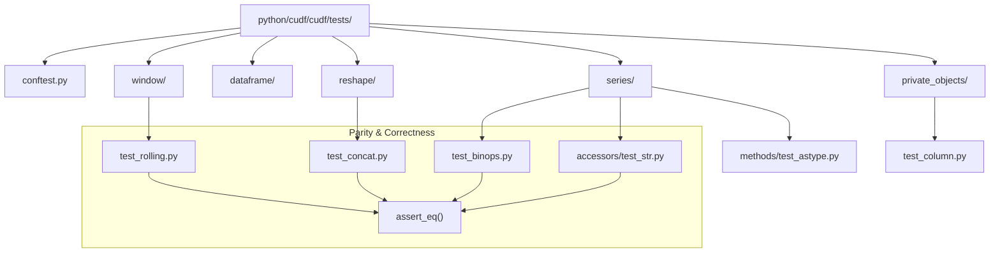
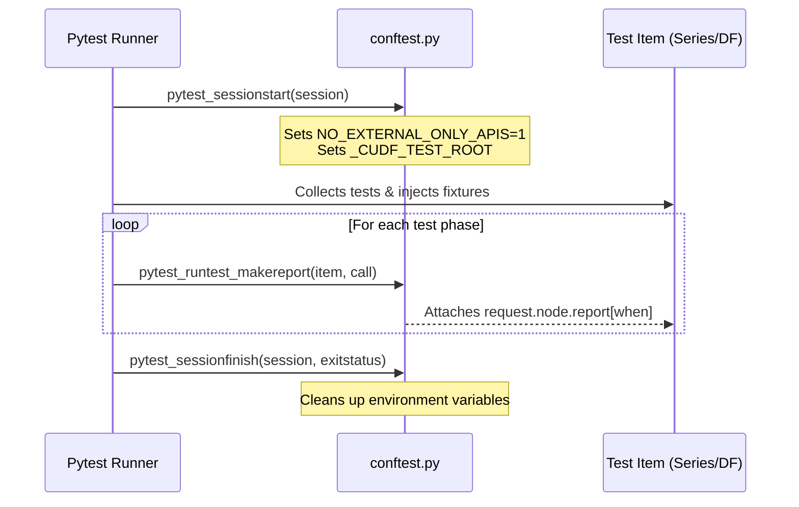
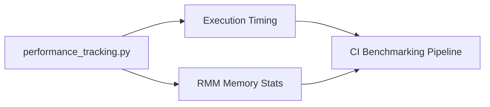

<!-- source: DeepWiki mcp.deepwiki.com · repo NVIDIA/cudf · page 4.5 Python Test Suite · fetched 2026-10-26 -->

# Python Test Suite

Relevant source files

The following files were used as context for generating this wiki page:

- [python/cudf/cudf/core/_internals/aggregation.py](python/cudf/cudf/core/_internals/aggregation.py)
- [python/cudf/cudf/core/accessors/string.py](python/cudf/cudf/core/accessors/string.py)
- [python/cudf/cudf/core/udf/rolling_utils.py](python/cudf/cudf/core/udf/rolling_utils.py)
- [python/cudf/cudf/tests/conftest.py](python/cudf/cudf/tests/conftest.py)
- [python/cudf/cudf/tests/dask/test_serialize.py](python/cudf/cudf/tests/dask/test_serialize.py)
- [python/cudf/cudf/tests/dataframe/indexing/test_getitem.py](python/cudf/cudf/tests/dataframe/indexing/test_getitem.py)
- [python/cudf/cudf/tests/dataframe/indexing/test_setitem.py](python/cudf/cudf/tests/dataframe/indexing/test_setitem.py)
- [python/cudf/cudf/tests/dataframe/methods/test_astype.py](python/cudf/cudf/tests/dataframe/methods/test_astype.py)
- [python/cudf/cudf/tests/dataframe/methods/test_describe.py](python/cudf/cudf/tests/dataframe/methods/test_describe.py)
- [python/cudf/cudf/tests/dataframe/methods/test_insert.py](python/cudf/cudf/tests/dataframe/methods/test_insert.py)
- [python/cudf/cudf/tests/dataframe/methods/test_isna_notnull.py](python/cudf/cudf/tests/dataframe/methods/test_isna_notnull.py)
- [python/cudf/cudf/tests/dataframe/methods/test_pop.py](python/cudf/cudf/tests/dataframe/methods/test_pop.py)
- [python/cudf/cudf/tests/dataframe/methods/test_reductions.py](python/cudf/cudf/tests/dataframe/methods/test_reductions.py)
- [python/cudf/cudf/tests/dataframe/methods/test_reindex.py](python/cudf/cudf/tests/dataframe/methods/test_reindex.py)
- [python/cudf/cudf/tests/dataframe/methods/test_repeat.py](python/cudf/cudf/tests/dataframe/methods/test_repeat.py)
- [python/cudf/cudf/tests/dataframe/methods/test_select_dtypes.py](python/cudf/cudf/tests/dataframe/methods/test_select_dtypes.py)
- [python/cudf/cudf/tests/dataframe/methods/test_set_index.py](python/cudf/cudf/tests/dataframe/methods/test_set_index.py)
- [python/cudf/cudf/tests/dataframe/methods/test_sort_index.py](python/cudf/cudf/tests/dataframe/methods/test_sort_index.py)
- [python/cudf/cudf/tests/dataframe/methods/test_transpose.py](python/cudf/cudf/tests/dataframe/methods/test_transpose.py)
- [python/cudf/cudf/tests/dataframe/test_attributes.py](python/cudf/cudf/tests/dataframe/test_attributes.py)
- [python/cudf/cudf/tests/dataframe/test_constructors.py](python/cudf/cudf/tests/dataframe/test_constructors.py)
- [python/cudf/cudf/tests/indexes/datetimeindex/methods/test_reductions.py](python/cudf/cudf/tests/indexes/datetimeindex/methods/test_reductions.py)
- [python/cudf/cudf/tests/indexes/index/methods/test_astype.py](python/cudf/cudf/tests/indexes/index/methods/test_astype.py)
- [python/cudf/cudf/tests/indexes/multiindex/methods/test_repeat.py](python/cudf/cudf/tests/indexes/multiindex/methods/test_repeat.py)
- [python/cudf/cudf/tests/indexes/timedeltaindex/methods/test_reductions.py](python/cudf/cudf/tests/indexes/timedeltaindex/methods/test_reductions.py)
- [python/cudf/cudf/tests/indexes/timedeltaindex/test_binops.py](python/cudf/cudf/tests/indexes/timedeltaindex/test_binops.py)
- [python/cudf/cudf/tests/private_objects/__init__.py](python/cudf/cudf/tests/private_objects/__init__.py)
- [python/cudf/cudf/tests/private_objects/_rmm_stats_script.py](python/cudf/cudf/tests/private_objects/_rmm_stats_script.py)
- [python/cudf/cudf/tests/private_objects/test_column.py](python/cudf/cudf/tests/private_objects/test_column.py)
- [python/cudf/cudf/tests/private_objects/test_extension_compilation.py](python/cudf/cudf/tests/private_objects/test_extension_compilation.py)
- [python/cudf/cudf/tests/private_objects/test_memory_records_report.py](python/cudf/cudf/tests/private_objects/test_memory_records_report.py)
- [python/cudf/cudf/tests/reshape/test_concat.py](python/cudf/cudf/tests/reshape/test_concat.py)
- [python/cudf/cudf/tests/series/accessors/test_dt.py](python/cudf/cudf/tests/series/accessors/test_dt.py)
- [python/cudf/cudf/tests/series/accessors/test_str.py](python/cudf/cudf/tests/series/accessors/test_str.py)
- [python/cudf/cudf/tests/series/accessors/test_struct.py](python/cudf/cudf/tests/series/accessors/test_struct.py)
- [python/cudf/cudf/tests/series/indexing/test_getitem.py](python/cudf/cudf/tests/series/indexing/test_getitem.py)
- [python/cudf/cudf/tests/series/indexing/test_setitem.py](python/cudf/cudf/tests/series/indexing/test_setitem.py)
- [python/cudf/cudf/tests/series/methods/test_astype.py](python/cudf/cudf/tests/series/methods/test_astype.py)
- [python/cudf/cudf/tests/series/methods/test_cov_corr.py](python/cudf/cudf/tests/series/methods/test_cov_corr.py)
- [python/cudf/cudf/tests/series/methods/test_memory_usage.py](python/cudf/cudf/tests/series/methods/test_memory_usage.py)
- [python/cudf/cudf/tests/series/methods/test_reductions.py](python/cudf/cudf/tests/series/methods/test_reductions.py)
- [python/cudf/cudf/tests/series/methods/test_to_arrow.py](python/cudf/cudf/tests/series/methods/test_to_arrow.py)
- [python/cudf/cudf/tests/series/test_attributes.py](python/cudf/cudf/tests/series/test_attributes.py)
- [python/cudf/cudf/tests/series/test_binops.py](python/cudf/cudf/tests/series/test_binops.py)
- [python/cudf/cudf/tests/series/test_constructors.py](python/cudf/cudf/tests/series/test_constructors.py)
- [python/cudf/cudf/tests/testing/test_assert_series_equal.py](python/cudf/cudf/tests/testing/test_assert_series_equal.py)
- [python/cudf/cudf/tests/window/test_rolling.py](python/cudf/cudf/tests/window/test_rolling.py)
- [python/cudf/cudf/utils/performance_tracking.py](python/cudf/cudf/utils/performance_tracking.py)

The purpose and scope of this page cover the organization, configuration, and execution infrastructure of the cuDF Python test suite. This includes pytest directory layouts, session-level and parameterized fixtures defined in `conftest.py`, pandas parity validation utilities (`assert_eq`), `cudf.pandas` accelerator integration tests, and performance tracking / benchmarking modules.

---

## 1. Pytest Directory Organization and Structure

The cuDF Python test suite is structured around mirrors of the public API namespaces and core internal components. Tests reside under `python/cudf/cudf/tests/` [python/cudf/cudf/tests/conftest.py:23-23]() and are categorized by module type:

* **`series/`**: Validates `cudf.Series` constructors [python/cudf/cudf/tests/series/test_constructors.py:1-224](), attributes [python/cudf/cudf/tests/series/test_attributes.py:1-247](), binary/unary operations [python/cudf/cudf/tests/series/test_binops.py:1-228](), type casting via `astype` [python/cudf/cudf/tests/series/methods/test_astype.py:1-206](), reductions [python/cudf/cudf/tests/series/methods/test_reductions.py:1-225](), and string/datetime/struct accessors [python/cudf/cudf/tests/series/accessors/test_str.py:1-233]().
* **`dataframe/`**: Tests `cudf.DataFrame` initializers [python/cudf/cudf/tests/dataframe/test_constructors.py:1-228](), indexing, join operations, and method chains.
* **`reshape/`**: Covers data reshaping routines such as concatenation (`test_concat.py`) [python/cudf/cudf/tests/reshape/test_concat.py:1-233](), merging, pivoting, and stacking.
* **`window/`**: Verifies rolling window aggregations [python/cudf/cudf/tests/window/test_rolling.py:1-207](), expanding windows, and EWMA computations.
* **`private_objects/`**: Inspects low-level abstractions, buffer management, column manipulations [python/cudf/cudf/tests/private_objects/test_column.py:1-215](), and memory records reporting.

*Sources: [python/cudf/cudf/tests/conftest.py:23-23](), [python/cudf/cudf/tests/series/accessors/test_str.py:1-233](), [python/cudf/cudf/tests/series/test_binops.py:1-228](), [python/cudf/cudf/tests/reshape/test_concat.py:1-233](), [python/cudf/cudf/tests/window/test_rolling.py:1-207](), [python/cudf/cudf/tests/private_objects/test_column.py:1-215]()*

---

## 2. Session and Global Configuration (`conftest.py`)

Global test behavior, environment variable injections, and reusable parametrized fixtures are established in `python/cudf/cudf/tests/conftest.py`.

### Session Lifecycle Hooks
Pytest session start and finish hooks configure runtime options before test collection executes [python/cudf/cudf/tests/conftest.py:31-36]():
* **`pytest_sessionstart(session)`**: Sets the environment variables `NO_EXTERNAL_ONLY_APIS = "1"` and `_CUDF_TEST_ROOT` pointing to the test directory [python/cudf/cudf/tests/conftest.py:36-43]().
* **`pytest_sessionfinish(session, exitstatus)`**: Cleans up session-scoped environment variables upon completion [python/cudf/cudf/tests/conftest.py:45-54]().
* **`pytest_runtest_makereport(item, call)`**: Acts as a hookwrapper to attach execution phase reports (`setup`, `call`, `teardown`) to test nodes via `request.node.report`, enabling fixtures (such as spilling managers) to inspect test outcomes [python/cudf/cudf/tests/conftest.py:69-85]().

### Common Fixtures
* **Bitwidth Parameterization**: `default_integer_bitwidth` and `default_float_bitwidth` parameterize tests across 32-bit and 64-bit default bitwidths using `cudf.option_context` [python/cudf/cudf/tests/conftest.py:57-67]().
* **Timezone Generators**: Dynamic timezones are generated via `_get_all_zones()` and `_get_transition_zones()` to supply parametrized fixtures like `all_timezones`, `ambiguous_timezones`, `nonexistent_timezones`, and `limited_timezones` [python/cudf/cudf/tests/conftest.py:87-160]().
* **Operator Fixtures**: Standard mathematical (`arithmetic_op`, `arithmetic_op_method`), comparison (`comparison_op`), and bitwise operators are exposed as fixtures for systematic binary operation coverage [python/cudf/cudf/tests/conftest.py:181-251]().

*Sources: [python/cudf/cudf/tests/conftest.py:26-160](), [python/cudf/cudf/tests/conftest.py:181-251]()*

---

## 3. Testing Utilities and Parity Validation

To guarantee pandas compatibility, cuDF relies heavily on shared testing helper functions:
* **`assert_eq`**: Provided by `cudf.testing`, this function compares cuDF data structures (`Series`, `DataFrame`, `Index`) against pandas or Pyarrow equivalents, validating values, dtypes, and null structures [python/cudf/cudf/tests/series/accessors/test_str.py:17-17](), [python/cudf/cudf/tests/series/test_binops.py:17-17](), [python/cudf/cudf/tests/reshape/test_concat.py:12-12]().
* **`assert_exceptions_equal`**: Ensures that invalid inputs or operations raise identical exception types across both pandas and cuDF execution paths [python/cudf/cudf/tests/series/accessors/test_str.py:18-20](), [python/cudf/cudf/tests/series/test_binops.py:18-22]().

---

## 4. `cudf.pandas` Acceleration and Test Suite Integration

The `cudf.pandas` accelerator provides zero-code-change pandas acceleration. Its test suite (integrated into the broader testing framework) validates module acceleration, fast-slow proxy switches, and correctness of drop-in pandas workflows against upstream pandas test suites using designated test plugins.

---

## 5. Benchmarks and Performance Tracking

Performance regressions are tracked using dedicated benchmarking harnesses. Utilities such as `python/cudf/cudf/utils/performance_tracking.py` manage performance tracking records, execution timings, and memory consumption reports during continuous integration runs.

*Sources: [python/cudf/cudf/utils/performance_tracking.py:1-1]()`

---

