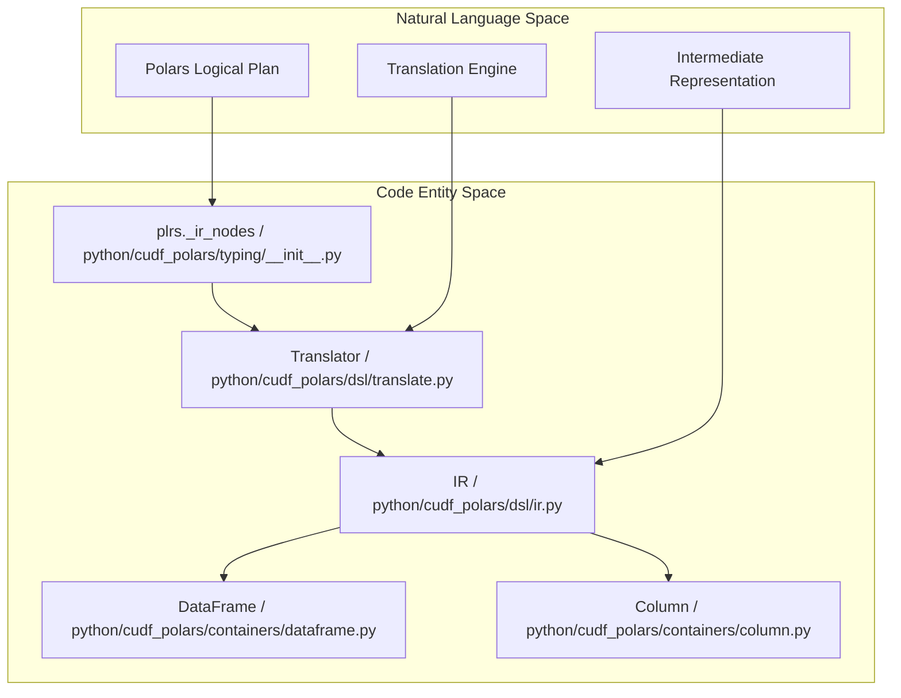
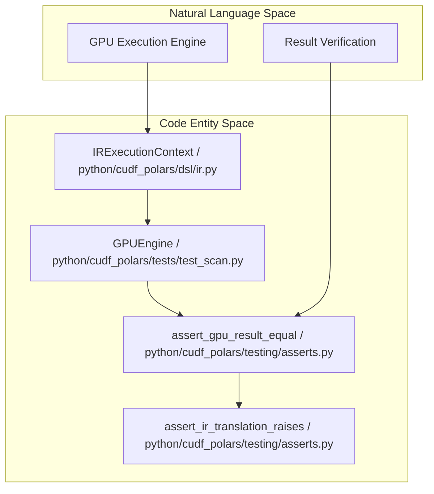

<!-- source: DeepWiki mcp.deepwiki.com · repo NVIDIA/cudf · page 5 cudf-polars GPU Engine · fetched 2026-10-26 -->

# cudf-polars GPU Engine

Relevant source files

The following files were used as context for generating this wiki page:

- [python/cudf_polars/cudf_polars/containers/column.py](python/cudf_polars/cudf_polars/containers/column.py)
- [python/cudf_polars/cudf_polars/containers/dataframe.py](python/cudf_polars/cudf_polars/containers/dataframe.py)
- [python/cudf_polars/cudf_polars/containers/datatype.py](python/cudf_polars/cudf_polars/containers/datatype.py)
- [python/cudf_polars/cudf_polars/dsl/expr.py](python/cudf_polars/cudf_polars/dsl/expr.py)
- [python/cudf_polars/cudf_polars/dsl/expressions/datetime.py](python/cudf_polars/cudf_polars/dsl/expressions/datetime.py)
- [python/cudf_polars/cudf_polars/dsl/ir.py](python/cudf_polars/cudf_polars/dsl/ir.py)
- [python/cudf_polars/cudf_polars/dsl/translate.py](python/cudf_polars/cudf_polars/dsl/translate.py)
- [python/cudf_polars/cudf_polars/testing/asserts.py](python/cudf_polars/cudf_polars/testing/asserts.py)
- [python/cudf_polars/cudf_polars/typing/__init__.py](python/cudf_polars/cudf_polars/typing/__init__.py)
- [python/cudf_polars/cudf_polars/utils/dtypes.py](python/cudf_polars/cudf_polars/utils/dtypes.py)
- [python/cudf_polars/cudf_polars/utils/versions.py](python/cudf_polars/cudf_polars/utils/versions.py)
- [python/cudf_polars/tests/containers/test_column.py](python/cudf_polars/tests/containers/test_column.py)
- [python/cudf_polars/tests/containers/test_dataframe.py](python/cudf_polars/tests/containers/test_dataframe.py)
- [python/cudf_polars/tests/containers/test_datatype.py](python/cudf_polars/tests/containers/test_datatype.py)
- [python/cudf_polars/tests/expressions/test_casting.py](python/cudf_polars/tests/expressions/test_casting.py)
- [python/cudf_polars/tests/expressions/test_datetime_basic.py](python/cudf_polars/tests/expressions/test_datetime_basic.py)
- [python/cudf_polars/tests/expressions/test_datetime_timezone.py](python/cudf_polars/tests/expressions/test_datetime_timezone.py)
- [python/cudf_polars/tests/test_dataframescan.py](python/cudf_polars/tests/test_dataframescan.py)
- [python/cudf_polars/tests/test_join.py](python/cudf_polars/tests/test_join.py)
- [python/cudf_polars/tests/test_scan.py](python/cudf_polars/tests/test_scan.py)
- [python/cudf_polars/tests/test_sink.py](python/cudf_polars/tests/test_sink.py)
- [python/cudf_polars/tests/utils/test_dtypes.py](python/cudf_polars/tests/utils/test_dtypes.py)

The `cudf-polars` package serves as the GPU acceleration engine for the Polars dataframe library. By translating Polars logical plans into custom Intermediate Representation (IR) nodes and executing them via `pylibcudf` and `libcudf`, `cudf-polars` enables high-performance parallel execution of analytical queries on NVIDIA GPUs. 

For detailed information on specific subsystems, consult the child pages linked below.

---

## 5.1 DSL: IR Nodes and Expressions

The translation layer bridges Polars logical plans and expression trees into `cudf-polars` specific IR nodes and expression evaluators. The translation entry point (`python/cudf_polars/cudf_polars/dsl/translate.py:1-61` [python/cudf_polars/cudf_polars/dsl/translate.py:1-61]()) traverses Polars IR nodes and maps them to `cudf-polars` IR node classes defined in `python/cudf_polars/cudf_polars/dsl/ir.py:1-127` [python/cudf_polars/cudf_polars/dsl/ir.py:1-127]().

Data containers such as `DataFrame` and `Column` manage physical device memory through `pylibcudf` (`plc.Table` and `plc.Column`), preserving metadata like sortedness and data types (`python/cudf_polars/cudf_polars/containers/dataframe.py:110-129` [python/cudf_polars/cudf_polars/containers/dataframe.py:110-129](), `python/cudf_polars/cudf_polars/containers/column.py:51-79` [python/cudf_polars/cudf_polars/containers/column.py:51-79]()). Expressions are evaluated within specific namespaces—including string manipulation, datetime operations, aggregations, rolling windows, and boolean logic—using expression classes defined in `python/cudf_polars/cudf_polars/dsl/expr.py:1-72` [python/cudf_polars/cudf_polars/dsl/expr.py:1-71]().

For details, see [DSL: IR Nodes and Expressions](#5.1).

Sources:
- `python/cudf_polars/cudf_polars/dsl/translate.py:1-61`
- `python/cudf_polars/cudf_polars/dsl/ir.py:1-127`
- `python/cudf_polars/cudf_polars/dsl/expr.py:1-72`
- `python/cudf_polars/cudf_polars/containers/dataframe.py:110-129`
- `python/cudf_polars/cudf_polars/containers/column.py:51-79`

---

## 5.2 Engine, Configuration and Execution Backends

Execution is managed by core engine callbacks that interface with Polars via the `GPUEngine` configuration options (`python/cudf_polars/tests/test_scan.py:62-65` [python/cudf_polars/tests/test_scan.py:62-65]()). The engine supports multiple execution backends, ranging from simple in-memory execution to distributed and SPMD frameworks (such as Dask, Ray, and multi-rank SPMD communicators), coordinating stream-ordered memory allocation and kernel execution via `IRExecutionContext` (`python/cudf_polars/cudf_polars/dsl/ir.py:130-161` [python/cudf_polars/cudf_polars/dsl/ir.py:130-161]()).

For details, see [Engine, Configuration and Execution Backends](#5.2).

Sources:
- `python/cudf_polars/cudf_polars/dsl/ir.py:130-161`
- `python/cudf_polars/tests/test_scan.py:62-65`

---

## 5.3 Streaming Executor and Actor Graph

To handle datasets that exceed single-GPU memory capacity, `cudf-polars` provides a streaming execution engine. This engine builds an actor graph comprising distributed operators (such as joins, groupbys, sorts, shuffles, and repartitions) paired with streaming IO sources. Execution is tracked via `ActorTracer` and introspected using query explain plans and runtime statistics (`python/cudf_polars/cudf_polars/dsl/ir.py:130-161` [python/cudf_polars/cudf_polars/dsl/ir.py:130-161]()).

For details, see [Streaming Executor and Actor Graph](#5.3).

Sources:
- `python/cudf_polars/cudf_polars/dsl/ir.py:130-161`

---

## 5.4 Testing and Fallback Diagnostics

Testing correctness and robustness involves specialized assertion helpers like `assert_gpu_result_equal` and `assert_ir_translation_raises` (`python/cudf_polars/testing/asserts.py:30-157` [python/cudf_polars/testing/asserts.py:30-157]()). The test infrastructure integrates with the upstream Polars test suite, applying selective deselections, tracking fallback diagnostics when queries cannot be translated to the GPU, and injecting custom GPU engine configurations.

For details, see [Testing and Fallback Diagnostics](#5.4).

Sources:
- `python/cudf_polars/testing/asserts.py:30-157`

---

## Architecture Overview

### Translator and IR Translation Mapping

Sources:
- `python/cudf_polars/typing/__init__.py:50-68`
- `python/cudf_polars/dsl/translate.py:1-61`
- `python/cudf_polars/dsl/ir.py:1-127`
- `python/cudf_polars/containers/dataframe.py:110-129`
- `python/cudf_polars/containers/column.py:51-79`

### Execution and Verification Pipeline

Sources:
- `python/cudf_polars/dsl/ir.py:130-161`
- `python/cudf_polars/tests/test_scan.py:62-65`
- `python/cudf_polars/testing/asserts.py:30-157`

---

