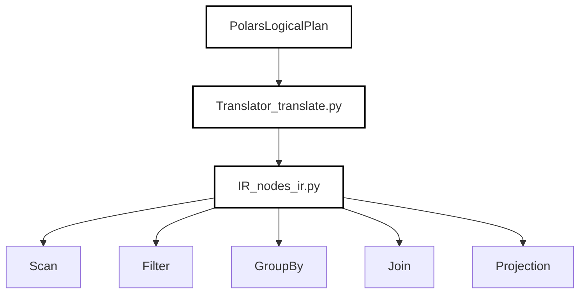
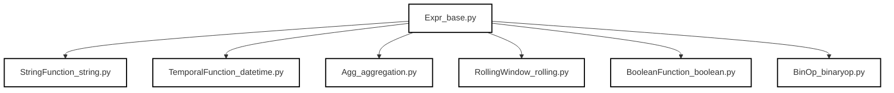

<!-- source: DeepWiki mcp.deepwiki.com · repo NVIDIA/cudf · page 5.1 DSL: IR Nodes and Expressions · fetched 2026-10-26 -->

# DSL: IR Nodes and Expressions

Relevant source files

The following files were used as context for generating this wiki page:

- [ci/run_cudf_polars_pytests.sh](ci/run_cudf_polars_pytests.sh)
- [python/cudf_polars/cudf_polars/containers/column.py](python/cudf_polars/cudf_polars/containers/column.py)
- [python/cudf_polars/cudf_polars/containers/dataframe.py](python/cudf_polars/cudf_polars/containers/dataframe.py)
- [python/cudf_polars/cudf_polars/containers/datatype.py](python/cudf_polars/cudf_polars/containers/datatype.py)
- [python/cudf_polars/cudf_polars/dsl/expr.py](python/cudf_polars/cudf_polars/dsl/expr.py)
- [python/cudf_polars/cudf_polars/dsl/expressions/aggregation.py](python/cudf_polars/cudf_polars/dsl/expressions/aggregation.py)
- [python/cudf_polars/cudf_polars/dsl/expressions/binaryop.py](python/cudf_polars/cudf_polars/dsl/expressions/binaryop.py)
- [python/cudf_polars/cudf_polars/dsl/expressions/boolean.py](python/cudf_polars/cudf_polars/dsl/expressions/boolean.py)
- [python/cudf_polars/cudf_polars/dsl/expressions/datetime.py](python/cudf_polars/cudf_polars/dsl/expressions/datetime.py)
- [python/cudf_polars/cudf_polars/dsl/expressions/literal.py](python/cudf_polars/cudf_polars/dsl/expressions/literal.py)
- [python/cudf_polars/cudf_polars/dsl/expressions/rolling.py](python/cudf_polars/cudf_polars/dsl/expressions/rolling.py)
- [python/cudf_polars/cudf_polars/dsl/expressions/selection.py](python/cudf_polars/cudf_polars/dsl/expressions/selection.py)
- [python/cudf_polars/cudf_polars/dsl/expressions/slicing.py](python/cudf_polars/cudf_polars/dsl/expressions/slicing.py)
- [python/cudf_polars/cudf_polars/dsl/expressions/sorting.py](python/cudf_polars/cudf_polars/dsl/expressions/sorting.py)
- [python/cudf_polars/cudf_polars/dsl/expressions/string.py](python/cudf_polars/cudf_polars/dsl/expressions/string.py)
- [python/cudf_polars/cudf_polars/dsl/expressions/struct.py](python/cudf_polars/cudf_polars/dsl/expressions/struct.py)
- [python/cudf_polars/cudf_polars/dsl/expressions/ternary.py](python/cudf_polars/cudf_polars/dsl/expressions/ternary.py)
- [python/cudf_polars/cudf_polars/dsl/expressions/unary.py](python/cudf_polars/cudf_polars/dsl/expressions/unary.py)
- [python/cudf_polars/cudf_polars/dsl/ir.py](python/cudf_polars/cudf_polars/dsl/ir.py)
- [python/cudf_polars/cudf_polars/dsl/nodebase.py](python/cudf_polars/cudf_polars/dsl/nodebase.py)
- [python/cudf_polars/cudf_polars/dsl/translate.py](python/cudf_polars/cudf_polars/dsl/translate.py)
- [python/cudf_polars/cudf_polars/dsl/utils/aggregations.py](python/cudf_polars/cudf_polars/dsl/utils/aggregations.py)
- [python/cudf_polars/cudf_polars/streaming/utils.py](python/cudf_polars/cudf_polars/streaming/utils.py)
- [python/cudf_polars/cudf_polars/testing/asserts.py](python/cudf_polars/cudf_polars/testing/asserts.py)
- [python/cudf_polars/cudf_polars/typing/__init__.py](python/cudf_polars/cudf_polars/typing/__init__.py)
- [python/cudf_polars/cudf_polars/utils/dtypes.py](python/cudf_polars/cudf_polars/utils/dtypes.py)
- [python/cudf_polars/cudf_polars/utils/versions.py](python/cudf_polars/cudf_polars/utils/versions.py)
- [python/cudf_polars/tests/conftest.py](python/cudf_polars/tests/conftest.py)
- [python/cudf_polars/tests/containers/test_column.py](python/cudf_polars/tests/containers/test_column.py)
- [python/cudf_polars/tests/containers/test_dataframe.py](python/cudf_polars/tests/containers/test_dataframe.py)
- [python/cudf_polars/tests/containers/test_datatype.py](python/cudf_polars/tests/containers/test_datatype.py)
- [python/cudf_polars/tests/dsl/test_nodebase.py](python/cudf_polars/tests/dsl/test_nodebase.py)
- [python/cudf_polars/tests/expressions/test_agg.py](python/cudf_polars/tests/expressions/test_agg.py)
- [python/cudf_polars/tests/expressions/test_booleanfunction.py](python/cudf_polars/tests/expressions/test_booleanfunction.py)
- [python/cudf_polars/tests/expressions/test_casting.py](python/cudf_polars/tests/expressions/test_casting.py)
- [python/cudf_polars/tests/expressions/test_clip.py](python/cudf_polars/tests/expressions/test_clip.py)
- [python/cudf_polars/tests/expressions/test_datetime_basic.py](python/cudf_polars/tests/expressions/test_datetime_basic.py)
- [python/cudf_polars/tests/expressions/test_datetime_timezone.py](python/cudf_polars/tests/expressions/test_datetime_timezone.py)
- [python/cudf_polars/tests/expressions/test_horizontal.py](python/cudf_polars/tests/expressions/test_horizontal.py)
- [python/cudf_polars/tests/expressions/test_numeric_binops.py](python/cudf_polars/tests/expressions/test_numeric_binops.py)
- [python/cudf_polars/tests/expressions/test_numeric_unaryops.py](python/cudf_polars/tests/expressions/test_numeric_unaryops.py)
- [python/cudf_polars/tests/expressions/test_reinterpret.py](python/cudf_polars/tests/expressions/test_reinterpret.py)
- [python/cudf_polars/tests/expressions/test_rolling.py](python/cudf_polars/tests/expressions/test_rolling.py)
- [python/cudf_polars/tests/expressions/test_round_sig_figs.py](python/cudf_polars/tests/expressions/test_round_sig_figs.py)
- [python/cudf_polars/tests/expressions/test_stringfunction.py](python/cudf_polars/tests/expressions/test_stringfunction.py)
- [python/cudf_polars/tests/expressions/test_struct.py](python/cudf_polars/tests/expressions/test_struct.py)
- [python/cudf_polars/tests/expressions/test_top_and_bottom_k.py](python/cudf_polars/tests/expressions/test_top_and_bottom_k.py)
- [python/cudf_polars/tests/streaming/test_ray.py](python/cudf_polars/tests/streaming/test_ray.py)
- [python/cudf_polars/tests/test_dataframescan.py](python/cudf_polars/tests/test_dataframescan.py)
- [python/cudf_polars/tests/test_distinct.py](python/cudf_polars/tests/test_distinct.py)
- [python/cudf_polars/tests/test_drop_nulls.py](python/cudf_polars/tests/test_drop_nulls.py)
- [python/cudf_polars/tests/test_groupby.py](python/cudf_polars/tests/test_groupby.py)
- [python/cudf_polars/tests/test_join.py](python/cudf_polars/tests/test_join.py)
- [python/cudf_polars/tests/test_mapfunction.py](python/cudf_polars/tests/test_mapfunction.py)
- [python/cudf_polars/tests/test_rolling.py](python/cudf_polars/tests/test_rolling.py)
- [python/cudf_polars/tests/test_scan.py](python/cudf_polars/tests/test_scan.py)
- [python/cudf_polars/tests/test_sink.py](python/cudf_polars/tests/test_sink.py)
- [python/cudf_polars/tests/test_slice.py](python/cudf_polars/tests/test_slice.py)
- [python/cudf_polars/tests/test_window_functions.py](python/cudf_polars/tests/test_window_functions.py)
- [python/cudf_polars/tests/utils/test_dtypes.py](python/cudf_polars/tests/utils/test_dtypes.py)

## Purpose and Scope

This section covers the Domain Specific Language (DSL) underlying the `cudf-polars` GPU execution engine. The DSL bridges Polars logical execution plans and libcudf's execution primitives via Python-based Intermediate Representation (IR) nodes and expression trees. We examine `translate.py` for logical plan translation, `ir.py` for IR node categorization, container wrappers (`DataFrame`, `Column`, `DataType`), and the expression namespaces (`string`, `datetime`, `aggregation`, `rolling`, `boolean`).

---

## 1. Plan Translation and IR Architecture

The `cudf-polars` engine consumes Polars logical plans and translates them into a GPU-executable representation defined in `python/cudf_polars/cudf_polars/dsl/ir.py` [python/cudf_polars/cudf_polars/dsl/ir.py:4-12] and orchestrated by `python/cudf_polars/cudf_polars/dsl/translate.py` [python/cudf_polars/cudf_polars/dsl/translate.py:4-48]. 

IR nodes fall into three primary execution categories, conceptualized as functions:
* **Source**: `IO () -> DataFrame` (e.g., `Scan`, `DataFrameScan`) [python/cudf_polars/cudf_polars/dsl/ir.py:6-9].
* **Normal**: `DataFrame -> DataFrame` (e.g., `Filter`, `Projection`, `GroupBy`, `Join`, `Sort`) [python/cudf_polars/cudf_polars/dsl/ir.py:6-10].
* **Sink**: `DataFrame -> IO ()` (e.g., `Sink`, `CallbackSink`) [python/cudf_polars/cudf_polars/dsl/ir.py:6-12].

The `Translator` visitor inspects Polars expression nodes, performs rewriting (such as type aligning decimals and floats via `_align_decimal_float_for_comparison`) [python/cudf_polars/cudf_polars/dsl/translate.py:63-86], and constructs corresponding `cudf_polars.dsl.expr` objects.

*Diagram 1: Translation flow from Polars logical plans to cuDF IR nodes.*

`IRExecutionContext` [python/cudf_polars/cudf_polars/dsl/ir.py:131-161] maintains runtime state during IR evaluation, including thread pools for asynchronous operations (`py_executor`), CUDA stream providers (`get_cuda_stream`), and tracing contexts (`tracer`) [python/cudf_polars/cudf_polars/dsl/ir.py:131-161].

Sources: `python/cudf_polars/cudf_polars/dsl/ir.py:4-161`, `python/cudf_polars/cudf_polars/dsl/translate.py:4-86`.

---

##  2. Container Abstractions (`DataFrame`, `Column`, `DataType`)

The container layer wraps `pylibcudf` primitives (`plc.Table`, `plc.Column`, `plc.DataType`) to provide a Pythonic interface tailored for plan execution.

* **`DataType`**: Encapsulates `plc.DataType` and the corresponding Polars data type (`pl.DataType`), supplying traits like categorical checks and casting rules [python/cudf_polars/cudf_polars/containers/datatype.py()].
* **`Column`**: Wraps `plc.Column` alongside its corresponding `DataType` and optional column name [python/cudf_polars/cudf_polars/containers/column.py()].
* **`DataFrame`**: Implemented in `python/cudf_polars/cudf_polars/containers/dataframe.py` [python/cudf_polars/cudf_polars/containers/dataframe.py:110-184], a `DataFrame` consists of a list of named columns (`NamedColumn`), a primary `plc.Table`, a reference CUDA `stream`, and row counts (`num_rows`) [python/cudf_polars/cudf_polars/containers/dataframe.py:110-129]. It manages Arrow C Data Interface exports (`__arrow_c_array__`) to interoperate with Polars without host roundtrips [python/cudf_polars/cudf_polars/containers/dataframe.py:85-103].

Sources: `python/cudf_polars/cudf_polars/containers/dataframe.py:110-184`, `python/cudf_polars/cudf_polars/containers/column.py()`, `python/cudf_polars/cudf_polars/containers/datatype.py()`.

---

## 3. Expression Namespaces and Evaluation

Expression nodes inherit from `Expr` [python/cudf_polars/cudf_polars/dsl/expressions/base.py] and implement `do_evaluate(df, *, context)` to evaluate a `DataFrame` into a `Column` [python/cudf_polars/cudf_polars/dsl/expressions/unary.py:44-51]. Specialized expression namespaces handle domain-specific functions.

*Diagram 2: Expression evaluation class hierarchy and functional namespaces.*

### String Namespace (`StringFunction`)
Defined in `python/cudf_polars/cudf_polars/dsl/expressions/string.py` [python/cudf_polars/cudf_polars/dsl/expressions/string.py:58-122], `StringFunction` maps Polars string operations (such as `Contains`, `Lowercase`, `Uppercase`, `Replace`, `Slice`, `Split`, `StripChars`, `Strptime`, `ToInteger`, `ToDecimal`) to `pylibcudf` string methods [python/cudf_polars/cudf_polars/dsl/expressions/string.py:59-110]. It parses regex programs or literal matching options during initialization [python/cudf_polars/cudf_polars/dsl/expressions/string.py:171-205].

### Datetime Namespace (`TemporalFunction`)
Defined in `python/cudf_polars/cudf_polars/dsl/expressions/datetime.py` [python/cudf_polars/cudf_polars/dsl/expressions/datetime.py:32], `TemporalFunction` handles temporal extractions (year, month, day, hour, duration total components) [python/cudf_polars/cudf_polars/dsl/expressions/datetime.py()] and time zone transitions using `plc.io.timezone.make_timezone_transition_table` [python/cudf_polars/cudf_polars/dsl/expressions/datetime.py:70-71].

### Aggregation Namespace (`Agg` / `SortedAgg`)
Defined in `python/cudf_polars/cudf_polars/dsl/expressions/aggregation.py`, aggregation expressions construct `pylibcudf` aggregation requests (`plc.aggregation`) utilized within `GroupBy` [python/cudf_polars/cudf_polars/dsl/ir.py:110] and global reduction nodes (`Reduce`) [python/cudf_polars/cudf_polars/dsl/ir.py:119]. Supported operations include `sum`, `mean`, `min`, `max`, `n_unique`, `quantile`, and custom skew/kurtosis measures [python/cudf_polars/cudf_polars/dsl/expr.py:16-16].

### Rolling Windows (`RollingWindow` / `FixedSizeRollingWindow`)
Defined in `python/cudf_polars/cudf_polars/dsl/expressions/rolling.py`, rolling expressions translate windowed aggregations over fixed-size or time-based intervals into grouped or sliding libcudf operations [python/cudf_polars/cudf_polars/dsl/expr.py:28-31].

### Boolean and Binary Operations (`BooleanFunction` / `BinOp`)
Boolean functions and binary operators map logical comparisons (`BooleanFunction`) [python/cudf_polars/cudf_polars/dsl/expressions/boolean.py] and element-wise arithmetic (`BinOp`) [python/cudf_polars/cudf_polars/dsl/expressions/binaryop.py] directly to libcudf binary operations (`plc.binaryop.binary_operation`) [python/cudf_polars/cudf_polars/dsl/expr.py:24-25].

Sources: `python/cudf_polars/cudf_polars/dsl/expressions/string.py:58-205`, `python/cudf_polars/cudf_polars/dsl/expressions/datetime.py:32-124`, `python/cudf_polars/cudf_polars/dsl/expressions/aggregation.py()`, `python/cudf_polars/cudf_polars/dsl/expressions/rolling.py()`, `python/cudf_polars/cudf_polars/dsl/expressions/boolean.py()`, `python/cudf_polars/cudf_polars/dsl/expressions/binaryop.py()`.

---

