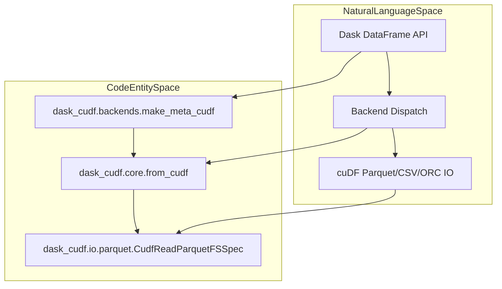
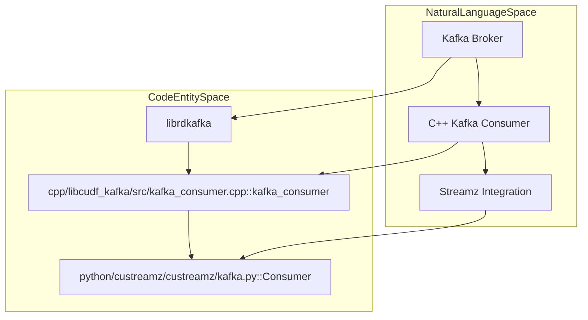

<!-- source: DeepWiki mcp.deepwiki.com · repo NVIDIA/cudf · page 6 Distributed and Streaming Python Packages · fetched 2026-10-26 -->

# Distributed and Streaming Python Packages

Relevant source files

The following files were used as context for generating this wiki page:

- [cpp/libcudf_kafka/include/cudf_kafka/kafka_callback.hpp](cpp/libcudf_kafka/include/cudf_kafka/kafka_callback.hpp)
- [cpp/libcudf_kafka/include/cudf_kafka/kafka_consumer.hpp](cpp/libcudf_kafka/include/cudf_kafka/kafka_consumer.hpp)
- [cpp/libcudf_kafka/src/kafka_consumer.cpp](cpp/libcudf_kafka/src/kafka_consumer.cpp)
- [python/cudf_kafka/cudf_kafka/_lib/kafka.pxd](python/cudf_kafka/cudf_kafka/_lib/kafka.pxd)
- [python/cudf_kafka/cudf_kafka/_lib/kafka.pyx](python/cudf_kafka/cudf_kafka/_lib/kafka.pyx)
- [python/custreamz/custreamz/__init__.py](python/custreamz/custreamz/__init__.py)
- [python/custreamz/custreamz/_version.py](python/custreamz/custreamz/_version.py)
- [python/custreamz/custreamz/kafka.py](python/custreamz/custreamz/kafka.py)
- [python/dask_cudf/dask_cudf/__init__.py](python/dask_cudf/dask_cudf/__init__.py)
- [python/dask_cudf/dask_cudf/_legacy/io/parquet.py](python/dask_cudf/dask_cudf/_legacy/io/parquet.py)
- [python/dask_cudf/dask_cudf/backends.py](python/dask_cudf/dask_cudf/backends.py)
- [python/dask_cudf/dask_cudf/core.py](python/dask_cudf/dask_cudf/core.py)
- [python/dask_cudf/dask_cudf/io/__init__.py](python/dask_cudf/dask_cudf/io/__init__.py)
- [python/dask_cudf/dask_cudf/io/csv.py](python/dask_cudf/dask_cudf/io/csv.py)
- [python/dask_cudf/dask_cudf/io/json.py](python/dask_cudf/dask_cudf/io/json.py)
- [python/dask_cudf/dask_cudf/io/orc.py](python/dask_cudf/dask_cudf/io/orc.py)
- [python/dask_cudf/dask_cudf/io/parquet.py](python/dask_cudf/dask_cudf/io/parquet.py)
- [python/dask_cudf/dask_cudf/io/tests/data/orc/sample.orc](python/dask_cudf/dask_cudf/io/tests/data/orc/sample.orc)
- [python/dask_cudf/dask_cudf/io/tests/data/text/sample.pgn](python/dask_cudf/dask_cudf/io/tests/data/text/sample.pgn)
- [python/dask_cudf/dask_cudf/io/tests/test_csv.py](python/dask_cudf/dask_cudf/io/tests/test_csv.py)
- [python/dask_cudf/dask_cudf/io/tests/test_json.py](python/dask_cudf/dask_cudf/io/tests/test_json.py)
- [python/dask_cudf/dask_cudf/io/tests/test_orc.py](python/dask_cudf/dask_cudf/io/tests/test_orc.py)
- [python/dask_cudf/dask_cudf/io/tests/test_parquet.py](python/dask_cudf/dask_cudf/io/tests/test_parquet.py)
- [python/dask_cudf/dask_cudf/io/tests/test_text.py](python/dask_cudf/dask_cudf/io/tests/test_text.py)
- [python/dask_cudf/dask_cudf/io/text.py](python/dask_cudf/dask_cudf/io/text.py)
- [python/dask_cudf/dask_cudf/tests/test_accessor.py](python/dask_cudf/dask_cudf/tests/test_accessor.py)
- [python/dask_cudf/dask_cudf/tests/test_binops.py](python/dask_cudf/dask_cudf/tests/test_binops.py)
- [python/dask_cudf/dask_cudf/tests/test_core.py](python/dask_cudf/dask_cudf/tests/test_core.py)
- [python/dask_cudf/dask_cudf/tests/test_distributed.py](python/dask_cudf/dask_cudf/tests/test_distributed.py)
- [python/dask_cudf/dask_cudf/tests/test_groupby.py](python/dask_cudf/dask_cudf/tests/test_groupby.py)
- [python/dask_cudf/dask_cudf/tests/test_reductions.py](python/dask_cudf/dask_cudf/tests/test_reductions.py)
- [python/dask_cudf/dask_cudf/tests/test_sort.py](python/dask_cudf/dask_cudf/tests/test_sort.py)
- [python/dask_cudf/dask_cudf/tests/utils.py](python/dask_cudf/dask_cudf/tests/utils.py)

The purpose of this page is to provide a high-level overview of cuDF's distributed and streaming capabilities, spanning multi-GPU scaling via `dask-cudf`, streaming data ingestion from Apache Kafka via `cudf_kafka` and `custreamz`, and GPU-accelerated streaming infrastructure. 

Distributed and streaming frameworks allow cuDF to scale out across multiple nodes and GPUs or handle continuous real-time data feeds, integrating natively with libcudf's execution engine and file format readers.

---

## 6.1 dask-cudf

`dask-cudf` implements GPU-accelerated distributed dataframe operations by integrating Dask's collection and scheduling mechanisms with cuDF data structures. It supports backend dispatch via Dask dataframe entrypoints [python/dask_cudf/dask_cudf/backends.py:1-40](), allowing standard Dask DataFrames to target cuDF seamlessly [python/dask_cudf/dask_cudf/tests/test_core.py:23-35](). 

It provides distributed I/O support for Parquet, CSV, ORC, and JSON formats, utilizing blocksize heuristics based on GPU device memory (`_normalize_blocksize`) and task fusion optimizations [python/dask_cudf/dask_cudf/io/parquet.py:70-90]().

*Figure 1: Mapping Dask distributed dataframe concepts to `dask-cudf` implementation components.*

For details on backend dispatch, collections, I/O task fusion, and blocksize heuristics, see [dask-cudf](#6.1).

Sources: 
- `python/dask_cudf/dask_cudf/backends.py` [python/dask_cudf/dask_cudf/backends.py:1-48]()
- `python/dask_cudf/dask_cudf/core.py` [python/dask_cudf/dask_cudf/core.py:23-36]()
- `python/dask_cudf/dask_cudf/io/parquet.py` [python/dask_cudf/dask_cudf/io/parquet.py:70-90]()
- `python/dask_cudf/dask_cudf/tests/test_core.py` [python/dask_cudf/dask_cudf/tests/test_core.py:23-35]()

---

## 6.2 Kafka and custreamz

Real-time streaming ingestion is provided via `libcudf_kafka`, `cudf_kafka`, and `custreamz`. `libcudf_kafka` wraps `librdkafka` in a C++ datasource abstraction (`kafka_consumer`), enabling high-throughput message consumption directly into GPU memory buffers [cpp/libcudf_kafka/src/kafka_consumer.cpp:17-48](). 

`cudf_kafka` provides Cython bindings over the native consumer, while `custreamz` integrates these consumers with Streamz to process continuous streams into cuDF DataFrames via `Consumer.read_gdf` [python/custreamz/custreamz/kafka.py:65-178]().

*Figure 2: Architecture of Kafka streaming and Streamz integration in `custreamz` and `libcudf_kafka`.*

For details on the `libcudf_kafka` consumer, Cython bindings, and Streamz integration, see [Kafka and custreamz](#6.2).

Sources:
- `python/custreamz/custreamz/kafka.py` [python/custreamz/custreamz/kafka.py:10-178]()
- `cpp/libcudf_kafka/src/kafka_consumer.cpp` [cpp/libcudf_kafka/src/kafka_consumer.cpp:17-98]()

---

---

