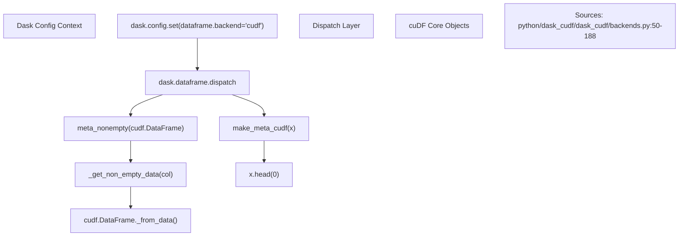
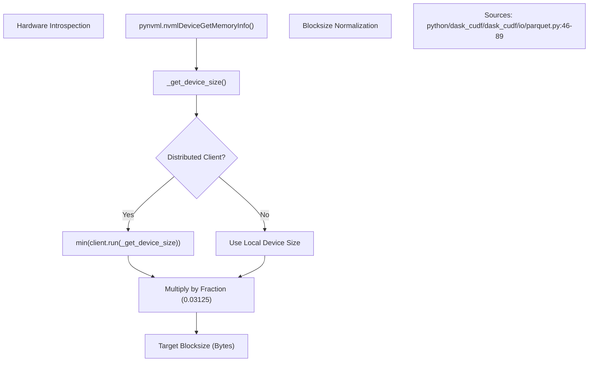

<!-- source: DeepWiki mcp.deepwiki.com · repo NVIDIA/cudf · page 6.1 dask-cudf · fetched 2026-10-26 -->

# dask-cudf

<details>
<summary>Relevant source files</summary>

The following files were used as context for generating this wiki page:

- [python/dask_cudf/dask_cudf/__init__.py](python/dask_cudf/dask_cudf/__init__.py)
- [python/dask_cudf/dask_cudf/_legacy/io/parquet.py](python/dask_cudf/dask_cudf/_legacy/io/parquet.py)
- [python/dask_cudf/dask_cudf/backends.py](python/dask_cudf/dask_cudf/backends.py)
- [python/dask_cudf/dask_cudf/core.py](python/dask_cudf/dask_cudf/core.py)
- [python/dask_cudf/dask_cudf/io/__init__.py](python/dask_cudf/dask_cudf/io/__init__.py)
- [python/dask_cudf/dask_cudf/io/csv.py](python/dask_cudf/dask_cudf/io/csv.py)
- [python/dask_cudf/dask_cudf/io/json.py](python/dask_cudf/dask_cudf/io/json.py)
- [python/dask_cudf/dask_cudf/io/orc.py](python/dask_cudf/dask_cudf/io/orc.py)
- [python/dask_cudf/dask_cudf/io/parquet.py](python/dask_cudf/dask_cudf/io/parquet.py)
- [python/dask_cudf/dask_cudf/io/tests/data/orc/sample.orc](python/dask_cudf/dask_cudf/io/tests/data/orc/sample.orc)
- [python/dask_cudf/dask_cudf/io/tests/data/text/sample.pgn](python/dask_cudf/dask_cudf/io/tests/data/text/sample.pgn)
- [python/dask_cudf/dask_cudf/io/tests/test_csv.py](python/dask_cudf/dask_cudf/io/tests/test_csv.py)
- [python/dask_cudf/dask_cudf/io/tests/test_json.py](python/dask_cudf/dask_cudf/io/tests/test_json.py)
- [python/dask_cudf/dask_cudf/io/tests/test_orc.py](python/dask_cudf/dask_cudf/io/tests/test_orc.py)
- [python/dask_cudf/dask_cudf/io/tests/test_parquet.py](python/dask_cudf/dask_cudf/io/tests/test_parquet.py)
- [python/dask_cudf/dask_cudf/io/tests/test_text.py](python/dask_cudf/dask_cudf/io/tests/test_text.py)
- [python/dask_cudf/dask_cudf/io/text.py](python/dask_cudf/dask_cudf/io/text.py)
- [python/dask_cudf/dask_cudf/tests/test_accessor.py](python/dask_cudf/dask_cudf/tests/test_accessor.py)
- [python/dask_cudf/dask_cudf/tests/test_binops.py](python/dask_cudf/dask_cudf/tests/test_binops.py)
- [python/dask_cudf/dask_cudf/tests/test_core.py](python/dask_cudf/dask_cudf/tests/test_core.py)
- [python/dask_cudf/dask_cudf/tests/test_distributed.py](python/dask_cudf/dask_cudf/tests/test_distributed.py)
- [python/dask_cudf/dask_cudf/tests/test_groupby.py](python/dask_cudf/dask_cudf/tests/test_groupby.py)
- [python/dask_cudf/dask_cudf/tests/test_reductions.py](python/dask_cudf/dask_cudf/tests/test_reductions.py)
- [python/dask_cudf/dask_cudf/tests/test_sort.py](python/dask_cudf/dask_cudf/tests/test_sort.py)
- [python/dask_cudf/dask_cudf/tests/utils.py](python/dask_cudf/dask_cudf/tests/utils.py)

</details>


## Purpose and Scope
`dask-cudf` integrates cuDF with Dask (and Dask-Expr), enabling distributed GPU-accelerated dataframe operations. It provides transparent backend dispatch for zero-code-change pandas/cuDF-backed Dask collections, specialized GPU-optimized file I/O operations (Parquet, ORC, CSV, JSON), and dynamic blocksize heuristics driven by NVML hardware introspection and task fusion.

---

## 1. Backend Dispatch and Metadata Management
To support switching Dask DataFrame backends via `dask.config.set({"dataframe.backend": "cudf"})` [python/dask_cudf/dask_cudf/tests/test_core.py:31-32](), `dask-cudf` registers custom dispatch functions for metadata initialization and non-empty metadata generation. 

- `meta_nonempty` implementations handle cuDF `Index`, `Series`, and `DataFrame` types to infer schema shapes and populate sample data without triggering full execution on host memory [python/dask_cudf/dask_cudf/backends.py:50-175]().
- `make_meta_cudf` constructs empty frame templates (e.g., via `.head(0)`) to propagate column dtypes through expression graphs [python/dask_cudf/dask_cudf/backends.py:178-188]().

### Backend Dispatch Data Flow

Sources: `python/dask_cudf/dask_cudf/backends.py:50-188`

---

## 2. Collections and Expressions
`dask-cudf` defines its distributed collections (`DataFrame`, `Series`, `Index`) by importing expression-backed classes from `dask_cudf._expr.collection` [python/dask_cudf/dask_cudf/core.py:14-18](). 

The utility function `from_cudf` wraps `dask.dataframe.from_pandas` to ingest single-GPU cuDF dataframes into distributed Dask collections, validating against unsupported structures like `MultiIndex` [python/dask_cudf/dask_cudf/core.py:24-35]().

```python
# Ingesting a cudf DataFrame into a dask_cudf collection
ddf = dask_cudf.from_cudf(gdf, npartitions=4)
```

Sources: `python/dask_cudf/dask_cudf/core.py:1-70`

---

## 3. I/O Subsystem and Formats (Parquet, ORC, CSV, JSON)
`dask-cudf` overrides upstream Dask IO functions to leverage cuDF's accelerated readers (`cudf.read_parquet`, `cudf.read_orc`, `cudf.read_csv`, etc.).

### ORC Reader & Writer Implementation
The ORC backend (`python/dask_cudf/dask_cudf/io/orc.py`) maps file stripes directly to Dask partitions. 
- `_read_orc_stripe`: Opens an ORC file using `fsspec` and reads a specific stripe index using `cudf.read_orc` [python/dask_cudf/dask_cudf/io/orc.py:16-25]().
- `read_orc`: Validates schemas across multiple paths, builds stripe-level task mappings (with optional pushdown filters via `_filter_stripes`), and instantiates a Dask map collection [python/dask_cudf/dask_cudf/io/orc.py:28-120]().
- `to_orc`: Resets indices and writes out partition dataframes via `delayed` execution [python/dask_cudf/dask_cudf/io/orc.py:132-196]().

### Parquet File System Integration
Parquet reading relies on `CudfReadParquetFSSpec` (in `python/dask_cudf/dask_cudf/io/parquet.py`), which approximates dataset statistics from file fragments to inform optimization and fusion passes [python/dask_cudf/dask_cudf/io/parquet.py:106-152]().

Sources: `python/dask_cudf/dask_cudf/io/orc.py:1-197`, `python/dask_cudf/dask_cudf/io/parquet.py:106-152`

---

## 4. Task Fusion and Blocksize Heuristics
To prevent out-of-memory (OOM) errors and maximize GPU throughput, `dask-cudf` calculates dynamic reader blocksizes based on GPU device memory queried via NVML [python/dask_cudf/dask_cudf/io/parquet.py:46-89]().

### Blocksize Calculation Heuristics
1. `_get_device_size()`: Inquires total memory on the active GPU device index or MIG UUID using PyNVML, falling back to an 8 GiB default if NVML is unavailable [python/dask_cudf/dask_cudf/io/parquet.py:46-68]().
2. `_normalize_blocksize(fraction)`: Computes a target blocksize as a fraction (default `1/32` or `0.03125`) of the smallest worker device memory in a distributed cluster [python/dask_cudf/dask_cudf/io/parquet.py:70-89]().


Sources: `python/dask_cudf/dask_cudf/io/parquet.py:46-89`

---

