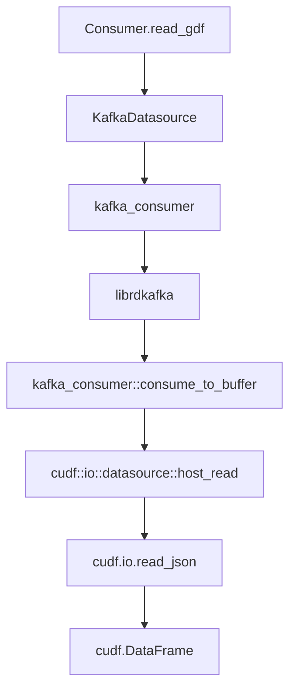
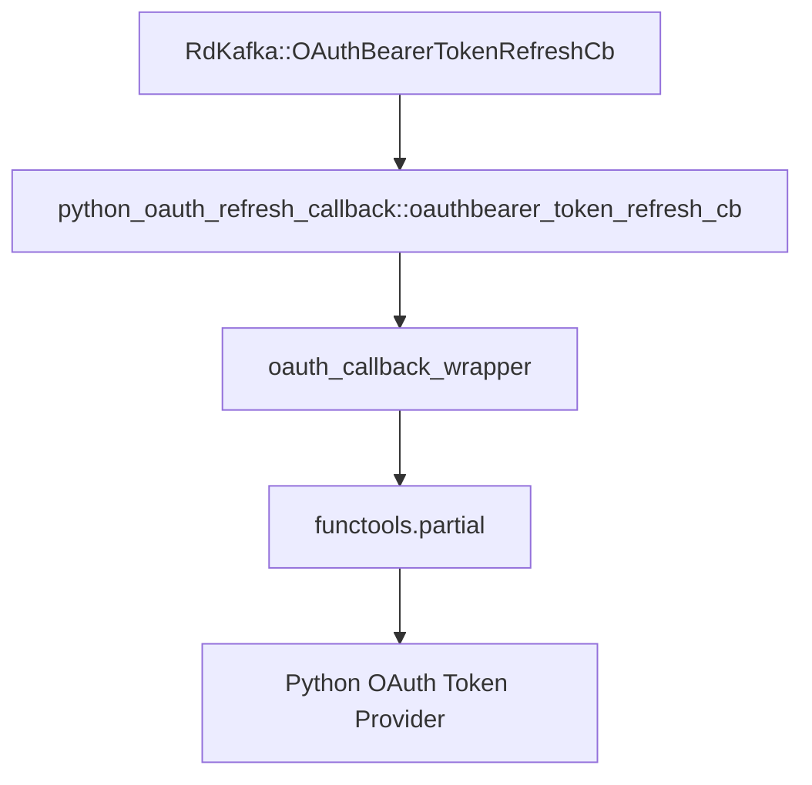

<!-- source: DeepWiki mcp.deepwiki.com · repo NVIDIA/cudf · page 6.2 Kafka and custreamz · fetched 2026-10-26 -->

# Kafka and custreamz

Relevant source files

The following files were used as context for generating this wiki page:

- [cpp/libcudf_kafka/include/cudf_kafka/kafka_callback.hpp](cpp/libcudf_kafka/include/cudf_kafka/kafka_callback.hpp)
- [cpp/libcudf_kafka/include/cudf_kafka/kafka_consumer.hpp](cpp/libcudf_kafka/include/cudf_kafka/kafka_consumer.hpp)
- [cpp/libcudf_kafka/src/kafka_consumer.cpp](cpp/libcudf_kafka/src/kafka_consumer.cpp)
- [python/cudf_kafka/cudf_kafka/_lib/kafka.pxd](python/cudf_kafka/cudf_kafka/_lib/kafka.pxd)
- [python/cudf_kafka/cudf_kafka/_lib/kafka.pyx](python/cudf_kafka/cudf_kafka/_lib/kafka.pyx)
- [python/custreamz/custreamz/__init__.py](python/custreamz/custreamz/__init__.py)
- [python/custreamz/custreamz/_version.py](python/custreamz/custreamz/_version.py)
- [python/custreamz/custreamz/kafka.py](python/custreamz/custreamz/kafka.py)

## Purpose and Scope
The `libcudf_kafka`, `cudf_kafka`, and `custreamz` packages provide high-performance, GPU-accelerated ingestion mechanisms for streaming data from Apache Kafka into cuDF DataFrames. `libcudf_kafka` offers a native C++ `cudf::io::datasource` implementation backed by `librdkafka`. `cudf_kafka` provides Cython bindings that wrap this native datasource, and `custreamz` offers higher-level Python streaming and consumer abstractions that integrate with cuDF I/O readers.

---

## 1. libcudf_kafka C++ Consumer Architecture

The core native engine is implemented in `libcudf_kafka`, exposing a C++ class `kafka_consumer` which inherits from `cudf::io::datasource` [cpp/libcudf_kafka/include/cudf_kafka/kafka_consumer.hpp:29-29](). 

### Key Classes and Functions
* `cudf::io::external::kafka::kafka_consumer`: Inherits from `cudf::io::datasource` [cpp/libcudf_kafka/include/cudf_kafka/kafka_consumer.hpp:29-29]() and acts as an interface between `librdkafka` and libcudf's readers. It handles consumer creation, topic-partition assignment, offset committing, watermark queries, and message consumption into a host buffer.
* `kafka_consumer` constructors: Two primary overloads exist. One initializes a semi-ready consumer for metadata operations [cpp/libcudf_kafka/include/cudf_kafka/kafka_consumer.hpp:50-52](), while the second instantiates a full consumer and pre-fills the internal buffer via `consume_to_buffer()` [cpp/libcudf_kafka/src/kafka_consumer.cpp:50-97]().
* `host_read` and `size`: Overridden datasource methods providing access to the consumed message buffer stored in host memory [cpp/libcudf_kafka/src/kafka_consumer.cpp:99-114]().
* `python_oauth_refresh_callback`: Inherits from `RdKafka::OAuthBearerTokenRefreshCb` to handle OAuth token lifecycle and refresh events by invoking a user-provided callback [cpp/libcudf_kafka/include/cudf_kafka/kafka_callback.hpp:45-70]().

Title: "Kafka Consumption Data Flow"

Sources: `cpp/libcudf_kafka/include/cudf_kafka/kafka_consumer.hpp`, `cpp/libcudf_kafka/src/kafka_consumer.cpp`, `cpp/libcudf_kafka/include/cudf_kafka/kafka_callback.hpp`, `python/custreamz/custreamz/kafka.py`

---

## 2. cudf_kafka Cython Bindings

The `cudf_kafka` package exposes the C++ `kafka_consumer` and related objects to Python via Cython declarations and implementations.

### Cython Modules and Structures
* `cudf_kafka._lib.kafka` (`kafka.pxd`): Declares the external `cppclass kafka_consumer` from `cudf_kafka/kafka_consumer.hpp` and defines the `KafkaDatasource` Python class inheriting from `pylibcudf.io.datasource.Datasource` [python/cudf_kafka/cudf_kafka/_lib/kafka.pxd:19-56]().
* `KafkaDatasource` (`kafka.pyx`): Implements `__cinit__` to parse librdkafka configuration dictionaries, handle `oauth_cb` Python callables, and instantiate `kafka_consumer` wrapped inside a `unique_ptr[datasource]` [python/cudf_kafka/cudf_kafka/_lib/kafka.pyx:26-68]().
* `oauth_callback_wrapper`: A C-compatible wrapper function defined in Cython that translates Python token dictionaries into C++ `std::map<std::string, std::string>`, avoiding the need to link `libcudf_kafka` directly against the Python development libraries [python/cudf_kafka/cudf_kafka/_lib/kafka.pyx:15-23]().

Title: "OAuth Callback Interop Architecture"

Sources: `python/cudf_kafka/cudf_kafka/_lib/kafka.pxd`, `python/cudf_kafka/cudf_kafka/_lib/kafka.pyx`, `cpp/libcudf_kafka/include/cudf_kafka/kafka_callback.hpp`

---

## 3. custreamz Streamz Integration and Python API

The `custreamz` package provides Python classes to interact with Kafka brokers and stream data directly into GPU DataFrames.

### Key Classes and Methods
* `CudfKafkaClient`: Base class for interacting with Apache Kafka. Initializes a `KafkaDatasource` metadata client and a `confluent_kafka.Consumer` instance [python/custreamz/custreamz/kafka.py:10-30](). Provides methods like `list_topics()`, `unsubscribe()`, and `close()` [python/custreamz/custreamz/kafka.py:31-61]().
* `Consumer`: Inherits from `CudfKafkaClient` and implements `read_gdf()` [python/custreamz/custreamz/kafka.py:65-81]().
* `Consumer.read_gdf()`: Instantiates a `KafkaDatasource` for a specific topic, partition, and offset range, invokes the appropriate cuDF I/O reader based on `message_format` (`json`, `csv`, `orc`, `avro`, `parquet`), cleans up the datasource connection, and returns a `cudf.DataFrame` [python/custreamz/custreamz/kafka.py:83-177]().

| Message Format | Reader Function | Default Options |
| :--- | :--- | :--- |
| `json` | `cudf.io.read_json` | `engine="cudf", lines=True` [python/custreamz/custreamz/kafka.py:148-157]() |
| `csv` | `cudf.io.read_csv` | `engine="cudf"` [python/custreamz/custreamz/kafka.py:149-161]() |
| `orc` | `cudf.io.read_orc` | `engine="cudf"` [python/custreamz/custreamz/kafka.py:150-161]() |
| `avro` | `cudf.io.read_avro` | `engine="cudf"` [python/custreamz/custreamz/kafka.py:151-161]() |
| `parquet` | `cudf.io.read_parquet` | `engine="cudf"` [python/custreamz/custreamz/kafka.py:152-161]() |

Sources: `python/custreamz/custreamz/kafka.py`, `python/custreamz/custreamz/__init__.py`

---

