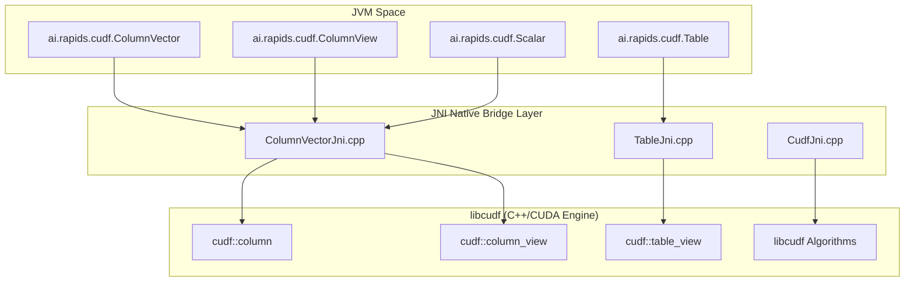

<!-- source: DeepWiki mcp.deepwiki.com · repo NVIDIA/cudf · page 7 Java (JNI) Bindings · fetched 2026-10-26 -->

# Java (JNI) Bindings

Relevant source files

The following files were used as context for generating this wiki page:

- [java/src/main/java/ai/rapids/cudf/ColumnVector.java](java/src/main/java/ai/rapids/cudf/ColumnVector.java)
- [java/src/main/java/ai/rapids/cudf/ColumnView.java](java/src/main/java/ai/rapids/cudf/ColumnView.java)
- [java/src/main/java/ai/rapids/cudf/Cudf.java](java/src/main/java/ai/rapids/cudf/Cudf.java)
- [java/src/main/java/ai/rapids/cudf/DType.java](java/src/main/java/ai/rapids/cudf/DType.java)
- [java/src/main/java/ai/rapids/cudf/HostColumnVector.java](java/src/main/java/ai/rapids/cudf/HostColumnVector.java)
- [java/src/main/java/ai/rapids/cudf/HostColumnVectorCore.java](java/src/main/java/ai/rapids/cudf/HostColumnVectorCore.java)
- [java/src/main/java/ai/rapids/cudf/JCudfSerialization.java](java/src/main/java/ai/rapids/cudf/JCudfSerialization.java)
- [java/src/main/java/ai/rapids/cudf/JSONOptions.java](java/src/main/java/ai/rapids/cudf/JSONOptions.java)
- [java/src/main/java/ai/rapids/cudf/ParquetChunkedReader.java](java/src/main/java/ai/rapids/cudf/ParquetChunkedReader.java)
- [java/src/main/java/ai/rapids/cudf/ParquetWriterOptions.java](java/src/main/java/ai/rapids/cudf/ParquetWriterOptions.java)
- [java/src/main/java/ai/rapids/cudf/Scalar.java](java/src/main/java/ai/rapids/cudf/Scalar.java)
- [java/src/main/java/ai/rapids/cudf/Table.java](java/src/main/java/ai/rapids/cudf/Table.java)
- [java/src/main/java/ai/rapids/cudf/WriterOptions.java](java/src/main/java/ai/rapids/cudf/WriterOptions.java)
- [java/src/main/native/include/jni_utils.hpp](java/src/main/native/include/jni_utils.hpp)
- [java/src/main/native/include/multi_host_buffer_source.hpp](java/src/main/native/include/multi_host_buffer_source.hpp)
- [java/src/main/native/src/ChunkedReaderJni.cpp](java/src/main/native/src/ChunkedReaderJni.cpp)
- [java/src/main/native/src/ColumnVectorJni.cpp](java/src/main/native/src/ColumnVectorJni.cpp)
- [java/src/main/native/src/ColumnViewJni.cpp](java/src/main/native/src/ColumnViewJni.cpp)
- [java/src/main/native/src/CudfJni.cpp](java/src/main/native/src/CudfJni.cpp)
- [java/src/main/native/src/ScalarJni.cpp](java/src/main/native/src/ScalarJni.cpp)
- [java/src/main/native/src/TableJni.cpp](java/src/main/native/src/TableJni.cpp)
- [java/src/main/native/src/cudf_jni_apis.hpp](java/src/main/native/src/cudf_jni_apis.hpp)
- [java/src/test/java/ai/rapids/cudf/ColumnBuilderHelper.java](java/src/test/java/ai/rapids/cudf/ColumnBuilderHelper.java)
- [java/src/test/java/ai/rapids/cudf/ColumnVectorTest.java](java/src/test/java/ai/rapids/cudf/ColumnVectorTest.java)
- [java/src/test/java/ai/rapids/cudf/DecimalColumnVectorTest.java](java/src/test/java/ai/rapids/cudf/DecimalColumnVectorTest.java)
- [java/src/test/java/ai/rapids/cudf/ScalarTest.java](java/src/test/java/ai/rapids/cudf/ScalarTest.java)
- [java/src/test/java/ai/rapids/cudf/TableTest.java](java/src/test/java/ai/rapids/cudf/TableTest.java)

## Purpose and Scope

The `ai.rapids.cudf` package provides Java Virtual Machine (JVM) bindings for `libcudf`, enabling high-performance GPU-accelerated data processing directly from Java, Scala, and other JVM languages. This page serves as a high-level overview of the Java API architecture, native bridge layers, memory management, and build infrastructure. 

For deep technical details on specific subsystems, consult the child pages:
- For Java data structures, views, scalars, types, serialization, and chunked readers, see [ColumnVector, Table and JNI Layer](#7.1).
- For off-heap memory management, RMM integration, and CUDA bindings, see [Java Memory Management](#7.2).
- For analytical aggregation APIs, Maven builds, and native CMake compilation, see [Java Aggregations and Build](#7.3).

---

## Architectural Overview

The Java binding layer bridges JVM memory spaces and execution threads with native C++ `libcudf` and CUDA runtimes. Java user code interacts with high-level abstractions like `ColumnVector` [java/src/main/java/ai/rapids/cudf/ColumnVector.java:24-30]() and `Table` [java/src/main/java/ai/rapids/cudf/Table.java:25-30](), which delegate work across JNI boundaries into native C++ bridge files such as `TableJni.cpp` [java/src/main/native/src/TableJni.cpp:1-50]() and `ColumnVectorJni.cpp` [java/src/main/native/src/ColumnVectorJni.cpp:1-30]().

*Figure 1: High-level architectural mapping between JVM classes, JNI bridges, and libcudf core components.*

Sources: `java/src/main/java/ai/rapids/cudf/ColumnVector.java:24-30` [java/src/main/java/ai/rapids/cudf/ColumnVector.java:24-30](), `java/src/main/java/ai/rapids/cudf/Table.java:25-30` [java/src/main/java/ai/rapids/cudf/Table.java:25-30](), `java/src/main/native/src/CudfJni.cpp:123-174` [java/src/main/native/src/CudfJni.cpp:123-174]()

---

## 7.1. ColumnVector, Table and JNI Layer

The core data structures in the JVM API mirror their `libcudf` counterparts. `ColumnVector` manages immutable GPU memory vectors, while `Table` groups multiple `ColumnVector` instances together to represent relational datasets. Lightweight reference views are handled by `ColumnView` [java/src/main/java/ai/rapids/cudf/ColumnView.java:15-20](), and scalar constants are encapsulated by `Scalar`.

Native functionality is bound through JNI files (`TableJni.cpp`, `ColumnVectorJni.cpp`, `ScalarJni.cpp`, and `ChunkedReaderJni.cpp`), which unpack Java handles and invoke underlying C++ algorithms like joins, sorts, grouping, and stream compaction. Distributed and intra-application data transfers are supported via custom high-speed serialization implemented in `JCudfSerialization`.

For details, see [ColumnVector, Table and JNI Layer](#7.1).

Sources: `java/src/main/java/ai/rapids/cudf/ColumnVector.java:24-30` [java/src/main/java/ai/rapids/cudf/ColumnVector.java:24-30](), `java/src/main/java/ai/rapids/cudf/Table.java:25-30` [java/src/main/java/ai/rapids/cudf/Table.java:25-30](), `java/src/main/java/ai/rapids/cudf/ColumnView.java:15-20` [java/src/main/java/ai/rapids/cudf/ColumnView.java:15-20](), `java/src/main/native/src/TableJni.cpp:1-50` [java/src/main/native/src/TableJni.cpp:1-50]()

---

## 7.2. Java Memory Management

GPU memory allocation and host-device staging in the JVM bindings are managed through RAPIDS Memory Manager (RMM) integrations via `Rmm` and `RmmJni`. Memory buffers are strictly tracked: device allocations reside in `DeviceMemoryBuffer`, while host staging and pinned memory pools are managed through `HostMemoryBuffer` and `HostMemoryAllocator`. 

To prevent off-shore leaks, `MemoryCleaner` hooks into JVM garbage collection and explicit `AutoCloseable` patterns. Low-level CUDA context and stream configurations are exposed via `Cuda` class bindings.

For details, see [Java Memory Management](#7.2).

Sources: `java/src/main/native/src/CudfJni.cpp:123-174` [java/src/main/native/src/CudfJni.cpp:123-174]()

---

## 7.3. Java Aggregations and Build

Complex analytical operations utilize type-safe hierarchy builders for aggregations, including `Aggregation`, `ReductionAggregation`, and `GroupByAggregation`. These configure grouped and windowed reductions executed natively.

The build system utilizes Maven to orchestrate Java compilation alongside a native CMake integration for building the JNI shared libraries (`.so`). Continuous integration (CI) environments utilize containerized Docker workflows to compile CUDA extensions across target architectures.

For details, see [Java Aggregations and Build](#7.3).

Sources: `java/src/main/native/src/CudfJni.cpp:123-174` [java/src/main/native/src/CudfJni.cpp:123-174]()

---

