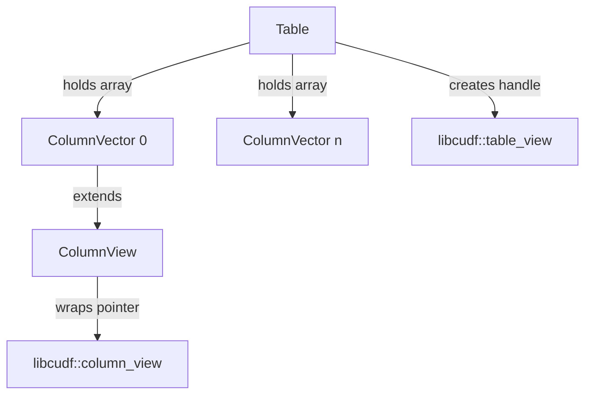
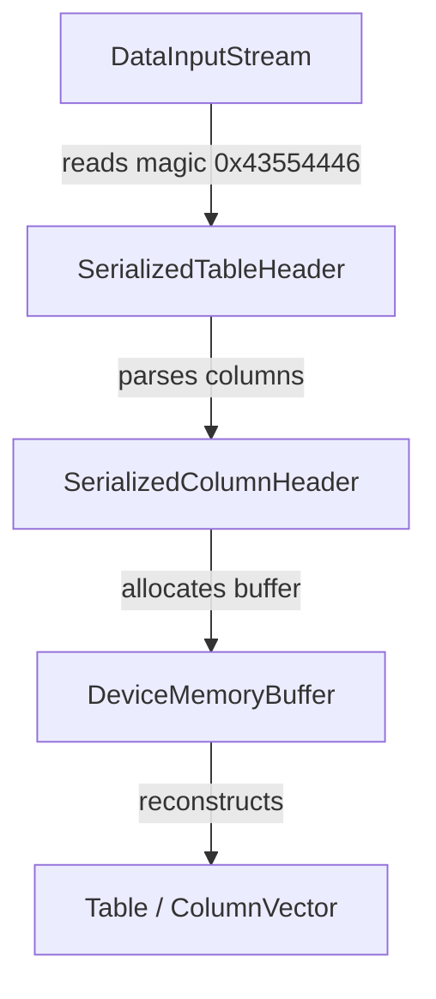
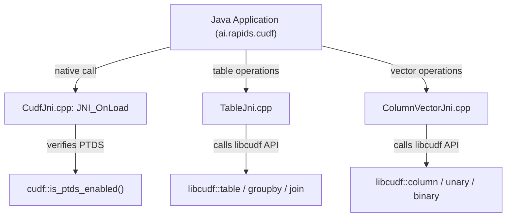

<!-- source: DeepWiki mcp.deepwiki.com · repo NVIDIA/cudf · page 7.1 ColumnVector, Table and JNI Layer · fetched 2026-10-26 -->

# ColumnVector, Table and JNI Layer

Relevant source files

The following files were used as context for generating this wiki page:

- [java/src/main/java/ai/rapids/cudf/BinaryOp.java](java/src/main/java/ai/rapids/cudf/BinaryOp.java)
- [java/src/main/java/ai/rapids/cudf/BinaryOperable.java](java/src/main/java/ai/rapids/cudf/BinaryOperable.java)
- [java/src/main/java/ai/rapids/cudf/ColumnVector.java](java/src/main/java/ai/rapids/cudf/ColumnVector.java)
- [java/src/main/java/ai/rapids/cudf/ColumnView.java](java/src/main/java/ai/rapids/cudf/ColumnView.java)
- [java/src/main/java/ai/rapids/cudf/Cudf.java](java/src/main/java/ai/rapids/cudf/Cudf.java)
- [java/src/main/java/ai/rapids/cudf/DType.java](java/src/main/java/ai/rapids/cudf/DType.java)
- [java/src/main/java/ai/rapids/cudf/HostColumnVector.java](java/src/main/java/ai/rapids/cudf/HostColumnVector.java)
- [java/src/main/java/ai/rapids/cudf/HostColumnVectorCore.java](java/src/main/java/ai/rapids/cudf/HostColumnVectorCore.java)
- [java/src/main/java/ai/rapids/cudf/JCudfSerialization.java](java/src/main/java/ai/rapids/cudf/JCudfSerialization.java)
- [java/src/main/java/ai/rapids/cudf/JSONOptions.java](java/src/main/java/ai/rapids/cudf/JSONOptions.java)
- [java/src/main/java/ai/rapids/cudf/ParquetChunkedReader.java](java/src/main/java/ai/rapids/cudf/ParquetChunkedReader.java)
- [java/src/main/java/ai/rapids/cudf/ParquetWriterOptions.java](java/src/main/java/ai/rapids/cudf/ParquetWriterOptions.java)
- [java/src/main/java/ai/rapids/cudf/Scalar.java](java/src/main/java/ai/rapids/cudf/Scalar.java)
- [java/src/main/java/ai/rapids/cudf/Table.java](java/src/main/java/ai/rapids/cudf/Table.java)
- [java/src/main/java/ai/rapids/cudf/UnaryOp.java](java/src/main/java/ai/rapids/cudf/UnaryOp.java)
- [java/src/main/java/ai/rapids/cudf/WriterOptions.java](java/src/main/java/ai/rapids/cudf/WriterOptions.java)
- [java/src/main/native/include/jni_utils.hpp](java/src/main/native/include/jni_utils.hpp)
- [java/src/main/native/include/multi_host_buffer_source.hpp](java/src/main/native/include/multi_host_buffer_source.hpp)
- [java/src/main/native/src/ChunkedReaderJni.cpp](java/src/main/native/src/ChunkedReaderJni.cpp)
- [java/src/main/native/src/ColumnVectorJni.cpp](java/src/main/native/src/ColumnVectorJni.cpp)
- [java/src/main/native/src/ColumnViewJni.cpp](java/src/main/native/src/ColumnViewJni.cpp)
- [java/src/main/native/src/CudfJni.cpp](java/src/main/native/src/CudfJni.cpp)
- [java/src/main/native/src/ScalarJni.cpp](java/src/main/native/src/ScalarJni.cpp)
- [java/src/main/native/src/TableJni.cpp](java/src/main/native/src/TableJni.cpp)
- [java/src/main/native/src/cudf_jni_apis.hpp](java/src/main/native/src/cudf_jni_apis.hpp)
- [java/src/test/java/ai/rapids/cudf/BinaryOpTest.java](java/src/test/java/ai/rapids/cudf/BinaryOpTest.java)
- [java/src/test/java/ai/rapids/cudf/ColumnBuilderHelper.java](java/src/test/java/ai/rapids/cudf/ColumnBuilderHelper.java)
- [java/src/test/java/ai/rapids/cudf/ColumnVectorTest.java](java/src/test/java/ai/rapids/cudf/ColumnVectorTest.java)
- [java/src/test/java/ai/rapids/cudf/DecimalColumnVectorTest.java](java/src/test/java/ai/rapids/cudf/DecimalColumnVectorTest.java)
- [java/src/test/java/ai/rapids/cudf/ScalarTest.java](java/src/test/java/ai/rapids/cudf/ScalarTest.java)
- [java/src/test/java/ai/rapids/cudf/TableTest.java](java/src/test/java/ai/rapids/cudf/TableTest.java)
- [java/src/test/java/ai/rapids/cudf/TestUtils.java](java/src/test/java/ai/rapids/cudf/TestUtils.java)
- [java/src/test/java/ai/rapids/cudf/UnaryOpTest.java](java/src/test/java/ai/rapids/cudf/UnaryOpTest.java)
- [python/pylibcudf/pylibcudf/libcudf/unary.pxd](python/pylibcudf/pylibcudf/libcudf/unary.pxd)
- [python/pylibcudf/pylibcudf/unary.pyi](python/pylibcudf/pylibcudf/unary.pyi)

This section details the Java API data structures (`ai.rapids.cudf`) and the native C++ Java Native Interface (JNI) bridge layer that connects JVM applications directly to `libcudf` GPU operations without incurring host-roundtrip overheads.

---

## 1. Java Core Data Structures: ColumnVector, ColumnView, Table, and Scalar

The Java API mirrors `libcudf`'s core abstractions using managed JVM objects that wrap off-heap GPU memory pointers and lifecycle states.

### ColumnVector and ColumnView
`ColumnVector` represents an immutable vector of data residing in GPU memory [java/src/main/java/ai/rapids/cudf/ColumnVector.java:25-30](). It inherits from `ColumnView`, which wraps a native `cudf::column_view` [java/src/main/java/ai/rapids/cudf/ColumnVector.java:30-30](), [java/src/main/java/ai/rapids/cudf/ColumnView.java:16-20](). 
- **Reference Counting:** `ColumnVector` instances are reference-counted [java/src/main/java/ai/rapids/cudf/ColumnVector.java:25-28](). Closing a vector decrements its reference count, and when it reaches zero, the underlying off-heap GPU buffers and native `libcudf` column handles are released via `MemoryCleaner` [java/src/main/java/ai/rapids/cudf/ColumnVector.java:65-71]().
- **Constructors:** Vectors can be constructed from existing device buffers (`DeviceMemoryBuffer`, validity buffers, offset buffers) [java/src/main/java/ai/rapids/cudf/ColumnVector.java:73-110](), or by wrapping raw native `cudf::column` pointers (`long nativePointer`) [java/src/main/java/ai/rapids/cudf/ColumnVector.java:62-71]().

### Table
`Table` is a collection of `ColumnVector` instances treated as a tabular relation [java/src/main/java/ai/rapids/cudf/Table.java:25-30](). 
- **Validation:** When a `Table` is instantiated from an array of `ColumnVector`s, it asserts that the vector array is non-empty and that all component vectors share an identical row count [java/src/main/java/ai/rapids/cudf/Table.java:45-53]().
- **Native View Creation:** The constructor extracts the native view handle for each column using `getColumn(int index).getNativeView()` [java/src/main/java/ai/rapids/cudf/Table.java:57-61]() and invokes a native bridge method (`createCudfTableView`) to produce a `libcudf` `table_view` [java/src/main/java/ai/rapids/cudf/Table.java:64-64]().
- **Lifecycle Management:** Closing a `Table` destroys the native `table_view` handle via `deleteCudfTable` and closes all constituent `ColumnVector` instances [java/src/main/java/ai/rapids/cudf/Table.java:127-139]().

*Sources: `java/src/main/java/ai/rapids/cudf/ColumnVector.java:30-71]`, `java/src/main/java/ai/rapids/cudf/ColumnView.java:16-45]`, `java/src/main/java/ai/rapids/cudf/Table.java:30-65]*

---

## 2. Type System (`DType`) and Custom Serialization (`JCudfSerialization`)

### Type Mapping
Data types are defined via the `DType` class, which maps JVM representations to `libcudf` primitive, fixed-point, timestamp, duration, list, struct, and string types. `ColumnView` queries these types using native helper functions to extract type IDs and scales [java/src/main/java/ai/rapids/cudf/ColumnView.java:40-45]().

### Custom Serialization (`JCudfSerialization`)
To support efficient intra-application distributed shuffling and partitioning (such as in Spark-RAPIDS), `JCudfSerialization` provides custom serialization and deserialization routines for tables and columns [java/src/main/java/ai/rapids/cudf/JCudfSerialization.java:24-35]().
- **Format Design:** Uses a custom magic number (`SER_FORMAT_MAGIC_NUMBER = 0x43554446` representing ASCII "CUDF") and version tracking [java/src/main/java/ai/rapids/cudf/JCudfSerialization.java:50-51]().
- **Memory Efficiency:** Slices large contiguous buffers directly into the memory spaces expected by target `ColumnVector` instances without intermediate host deserialization roundtrips [java/src/main/java/ai/rapids/cudf/JCudfSerialization.java:36-43]().
- **Header Parsing:** `SerializedTableHeader` and `SerializedColumnHeader` read metadata streams to calculate expected byte lengths and validate row and column counts before materializing device memory [java/src/main/java/ai/rapids/cudf/JCudfSerialization.java:73-125]().

*Sources: `java/src/main/java/ai/rapids/cudf/JCudfSerialization.java:24-185]*

---

## 3. Native JNI Bridge Layer and Chunked Readers

The native JNI layer consists of C++ source files that bridge Java native method declarations to underlying `libcudf` and `RMM` APIs.

### Library Initialization and PTDS Verification
The JNI library lifecycle is managed inside `CudfJni.cpp`. When `System.loadLibrary("cudf_jni")` is invoked, `JNI_OnLoad` performs critical validation checks [java/src/main/native/src/CudfJni.cpp:121-128]():
- **Per-Thread Default Stream (PTDS):** It compares `libcudf`'s PTDS compilation setting (`cudf::is_ptds_enabled()`) with the JNI layer's compilation flag (`cudf::jni::is_ptds_enabled`), throwing a `RuntimeException` if a mismatch is detected [java/src/main/native/src/CudfJni.cpp:130-138]().
- **Method Caching:** It caches Java class references and method IDs for classes like `HostMemoryBuffer`, `ContiguousTable`, and `DataSource` to accelerate subsequent JNI calls [java/src/main/native/src/CudfJni.cpp:141-172]().

### JNI Bridges (`*Jni.cpp`)
- **`ColumnVectorJni.cpp` & `ColumnViewJni.cpp`:** Handle vector transformations, string operations (`upperStrings`, `lowerStrings`), scalar replacements (`replaceNullsScalar`), and Arrow IPC / C-data bridge conversions (`fromArrow`) [java/src/main/native/src/ColumnVectorJni.cpp:92-150](), [java/src/main/native/src/ColumnViewJni.cpp:137-188]().
- **`TableJni.cpp`:** Manages table-level operations such as joins, group-bys, sorts, partitioners (`hashPartition`, `roundRobinPartition`), contiguous splits, and chunked writers [java/src/main/native/src/TableJni.cpp:16-49]().
- **`ChunkedReaderJni.cpp`:** Implements streaming and chunked file parsing for Parquet, ORC, and other formats, interfacing with `jni_writer_data_sink` and data source abstractions [java/src/main/native/src/TableJni.cpp:69-99]().

### JNI Utilities (`jni_utils.hpp`)
`jni_utils.hpp` provides RAII helper classes and pointer converters to prevent resource leaks across the JNI boundary:
- `ptr_as_jlong` and `release_as_jlong` convert C++ smart pointers (`std::unique_ptr`) into `jlong` handles [java/src/main/native/include/jni_utils.hpp:27-40]().
- `native_jArray` manages Java primitive array acquisition, pinning, and automatic release semantics during destructor execution [java/src/main/native/include/jni_utils.hpp:184-211]().

*Sources: `java/src/main/native/src/CudfJni.cpp:121-174]`, `java/src/main/native/src/TableJni.cpp:16-50]`, `java/src/main/native/src/ColumnVectorJni.cpp:92-150]`, `java/src/main/native/include/jni_utils.hpp:27-50]*

---

