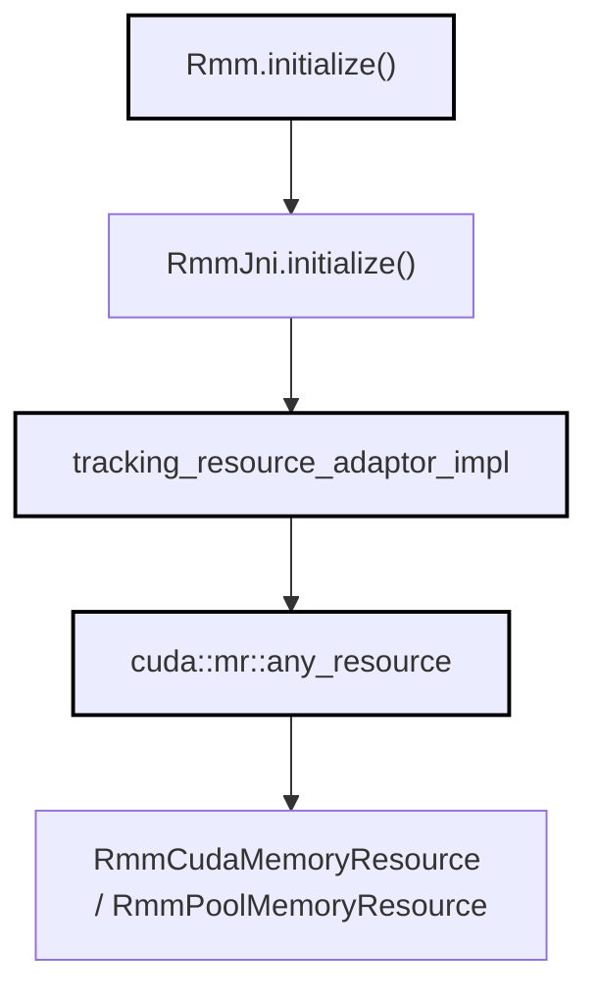
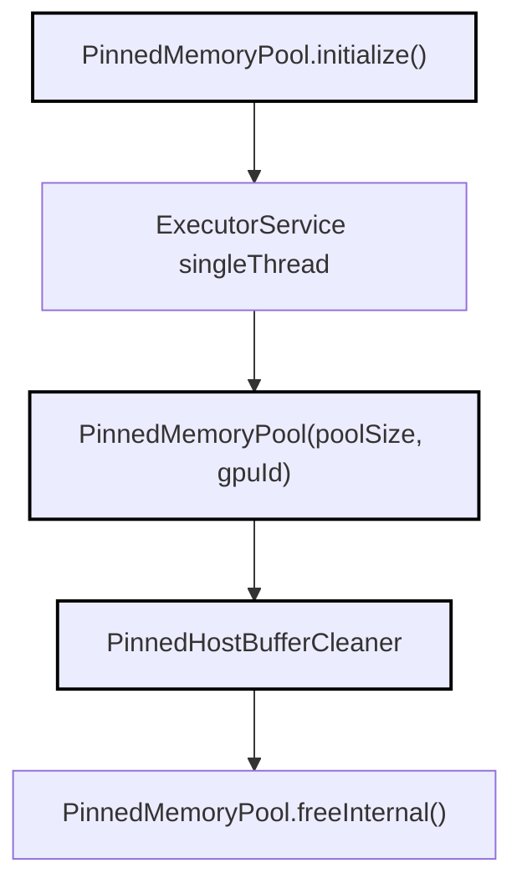

<!-- source: DeepWiki mcp.deepwiki.com · repo NVIDIA/cudf · page 7.2 Java Memory Management · fetched 2026-10-26 -->

# Java Memory Management

Relevant source files

The following files were used as context for generating this wiki page:

- [java/src/main/java/ai/rapids/cudf/BaseDeviceMemoryBuffer.java](java/src/main/java/ai/rapids/cudf/BaseDeviceMemoryBuffer.java)
- [java/src/main/java/ai/rapids/cudf/Cuda.java](java/src/main/java/ai/rapids/cudf/Cuda.java)
- [java/src/main/java/ai/rapids/cudf/CudaException.java](java/src/main/java/ai/rapids/cudf/CudaException.java)
- [java/src/main/java/ai/rapids/cudf/CudaFatalException.java](java/src/main/java/ai/rapids/cudf/CudaFatalException.java)
- [java/src/main/java/ai/rapids/cudf/CudfException.java](java/src/main/java/ai/rapids/cudf/CudfException.java)
- [java/src/main/java/ai/rapids/cudf/DeviceMemoryBuffer.java](java/src/main/java/ai/rapids/cudf/DeviceMemoryBuffer.java)
- [java/src/main/java/ai/rapids/cudf/DeviceMemoryBufferView.java](java/src/main/java/ai/rapids/cudf/DeviceMemoryBufferView.java)
- [java/src/main/java/ai/rapids/cudf/HostMemoryBuffer.java](java/src/main/java/ai/rapids/cudf/HostMemoryBuffer.java)
- [java/src/main/java/ai/rapids/cudf/MemoryBuffer.java](java/src/main/java/ai/rapids/cudf/MemoryBuffer.java)
- [java/src/main/java/ai/rapids/cudf/MemoryCleaner.java](java/src/main/java/ai/rapids/cudf/MemoryCleaner.java)
- [java/src/main/java/ai/rapids/cudf/PinnedMemoryPool.java](java/src/main/java/ai/rapids/cudf/PinnedMemoryPool.java)
- [java/src/main/java/ai/rapids/cudf/Rmm.java](java/src/main/java/ai/rapids/cudf/Rmm.java)
- [java/src/main/java/ai/rapids/cudf/RmmEventHandler.java](java/src/main/java/ai/rapids/cudf/RmmEventHandler.java)
- [java/src/main/java/ai/rapids/cudf/UnsafeMemoryAccessor.java](java/src/main/java/ai/rapids/cudf/UnsafeMemoryAccessor.java)
- [java/src/main/native/src/CudaJni.cpp](java/src/main/native/src/CudaJni.cpp)
- [java/src/main/native/src/RmmJni.cpp](java/src/main/native/src/RmmJni.cpp)
- [java/src/test/java/ai/rapids/cudf/CudaFatalTest.java](java/src/test/java/ai/rapids/cudf/CudaFatalTest.java)
- [java/src/test/java/ai/rapids/cudf/CudaTest.java](java/src/test/java/ai/rapids/cudf/CudaTest.java)
- [java/src/test/java/ai/rapids/cudf/HostMemoryBufferTest.java](java/src/test/java/ai/rapids/cudf/HostMemoryBufferTest.java)
- [java/src/test/java/ai/rapids/cudf/MemoryBufferTest.java](java/src/test/java/ai/rapids/cudf/MemoryBufferTest.java)
- [java/src/test/java/ai/rapids/cudf/PinnedMemoryPoolTest.java](java/src/test/java/ai/rapids/cudf/PinnedMemoryPoolTest.java)
- [java/src/test/java/ai/rapids/cudf/RmmMemoryAccessorTest.java](java/src/test/java/ai/rapids/cudf/RmmMemoryAccessorTest.java)
- [java/src/test/java/ai/rapids/cudf/RmmTest.java](java/src/test/java/ai/rapids/cudf/RmmTest.java)
- [java/src/test/java/ai/rapids/cudf/UnsafeMemoryAccessorTest.java](java/src/test/java/ai/rapids/cudf/UnsafeMemoryAccessorTest.java)

## Overview and Scope
The Java API for cuDF (`ai.rapids.cudf`) provides high-performance JVM bindings to `libcudf` and the RAPIDS Memory Manager (RMM). Because GPU and off-heap host allocations bypass the Java Garbage Collector (GC), custom lifecycle and memory management mechanisms are required to prevent memory leaks and out-of-memory errors. This page covers the architectural design of `Rmm`/`RmmJni`, host and device memory buffer abstractions, the pinned memory pool, leak tracking via `MemoryCleaner`, and native CUDA bindings (`Cuda`/`CudaJni`).

Sources: `java/src/main/java/ai/rapids/cudf/Rmm.java:14-43` [ai/rapids/cudf/Rmm.java](), `java/src/main/java/ai/rapids/cudf/MemoryCleaner.java:28-46` [ai/rapids/cudf/MemoryCleaner.java]()

---

## RMM Integration and `RmmJni`
The RAPIDS Memory Manager (RMM) is managed on the JVM side by `Rmm.java` and bridged to C++ via `RmmJni.cpp`. RMM controls device memory allocation using pluggable resource adaptors (such as pool, arena, async, and tracking memory resources).

### Initialization and Allocation Modes
`Rmm.initialize()` configures the underlying memory resource based on allocation modes (`CUDA_DEFAULT`, `POOL`, `ARENA`, etc.). Thread-safety is enforced via reentrant read-write locks (`readLock` and `writeLock`) [ai/rapids/cudf/Rmm.java:27-43]().

*Figure 1: RMM Initialization Data Flow bridging Java to native CCCL/RMM resources.*

Sources: `java/src/main/java/ai/rapids/cudf/Rmm.java:17-43` [ai/rapids/cudf/Rmm.java](), `java/src/main/native/src/RmmJni.cpp:69-157` [java/src/main/native/src/RmmJni.cpp]()

### Tracking Adaptors
The native bridge implements `tracking_resource_adaptor_impl` to track cumulative allocations, current memory usage, maximum total allocated bytes, and scoped maximums [java/src/main/native/src/RmmJni.cpp:69-157](). This allows JVM applications to monitor GPU memory consumption precisely.

Sources: `java/src/main/native/src/RmmJni.cpp:69-157` [java/src/main/native/src/RmmJni.cpp]()

---

## Host and Device Memory Buffers
`MemoryBuffer` serves as the abstract base class for off-heap buffers [java/src/main/java/ai/rapids/cudf/MemoryBuffer.java:19-47](). Concrete implementations include `HostMemoryBuffer` and `DeviceMemoryBuffer`.

### HostMemoryBuffer and Memory Mapping
`HostMemoryBuffer` handles off-heap CPU allocations, preferring the pinned memory pool by default unless `ai.rapids.cudf.prefer-pinned` is set to `false` [java/src/main/java/ai/rapids/cudf/HostMemoryBuffer.java:22-43](). It also supports file memory mapping (`mmap`) via `HostMemoryBuffer.mapFile()` [java/src/main/java/ai/rapids/cudf/HostMemoryBuffer.java:159-172]().

### DeviceMemoryBuffer and Zero-Copy Slicing
`DeviceMemoryBuffer` represents GPU memory allocations. It supports zero-copy slicing, which increments a shared reference count among parent and child buffers so that underlying RMM memory is only released when all reference-counted views are closed [java/src/main/java/ai/rapids/cudf/DeviceMemoryBuffer.java:13-166]().

Sources: `java/src/main/java/ai/rapids/cudf/MemoryBuffer.java:19-131` [ai/rapids/cudf/MemoryBuffer.java](), `java/src/main/java/ai/rapids/cudf/HostMemoryBuffer.java:22-172` [ai/rapids/cudf/HostMemoryBuffer.java](), `java/src/main/java/ai/rapids/cudf/DeviceMemoryBuffer.java:13-166` [ai/rapids/cudf/DeviceMemoryBuffer.java]()

---

## Pinned Memory Pool
`PinnedMemoryPool` provides an RMM-backed pool of pinned host (page-locked) memory (`cudaHostAlloc`), which accelerates host-device data transfers and is shared with cuIO operations [java/src/main/java/ai/rapids/cudf/PinnedMemoryPool.java:19-125]().

*Figure 2: PinnedMemoryPool initialization and cleanup lifecycle.*

Sources: `java/src/main/java/ai/rapids/cudf/PinnedMemoryPool.java:19-182` [ai/rapids/cudf/PinnedMemoryPool.java]()

---

## Leak Detection and `MemoryCleaner`
Because relying purely on JVM finalizers leads to unpredictable GC pauses and memory exhaustion, `MemoryCleaner` uses a combination of explicit reference counting (`addRef()`, `delRef()`) and `WeakReference` tracking via a background daemon thread (`CleanerThread`) [java/src/main/java/ai/rapids/cudf/MemoryCleaner.java:28-201]().

| Class / Component | Role |
| :--- | :--- |
| `MemoryCleaner` | Central registry for tracking off-heap resource leaks. |
| `MemoryCleaner.Cleaner` | Abstract base class implementing `cleanImpl()` and ref-count logging. |
| `CleanerWeakReference` | Weak reference holding a pointer to the cleaner and tracking clean state. |
| `CleanerThread` | Background thread polling `ReferenceQueue` to catch unclosed leaked buffers. |

Sources: `java/src/main/java/ai/rapids/cudf/MemoryCleaner.java:28-201` [ai/rapids/cudf/MemoryCleaner.java]()

---

## Cuda Bindings and Device Management
The `Cuda` class and `CudaJni.cpp` bridge manage CUDA streams (`Cuda.Stream`), events (`Cuda.Event`), and device context selection [java/src/main/java/ai/rapids/cudf/Cuda.java:10-214](), [java/src/main/native/src/CudaJni.cpp:16-160]().

- **Thread-Local Device Contexts:** `auto_set_device()` ensures that any native thread invoking cuDF operations binds to the designated CUDA device (`Cudf_device`) [java/src/main/native/src/CudaJni.cpp:27-42]().
- **Memory Query:** `Cuda.memGetInfo()` wraps `cudaMemGetInfo()` to return available and total GPU memory [java/src/main/native/src/CudaJni.cpp:49-70]().
- **Pinned Host Allocations:** `Cuda.hostAllocPinned()` and `Cuda.freePinned()` provide direct wrappers around `cudaMallocHost` and `cudaFreeHost` [java/src/main/native/src/CudaJni.cpp:72-92]().

Sources: `java/src/main/java/ai/rapids/cudf/Cuda.java:10-214` [ai/rapids/cudf/Cuda.java](), `java/src/main/native/src/CudaJni.cpp:16-160` [java/src/main/native/src/CudaJni.cpp]()

---

