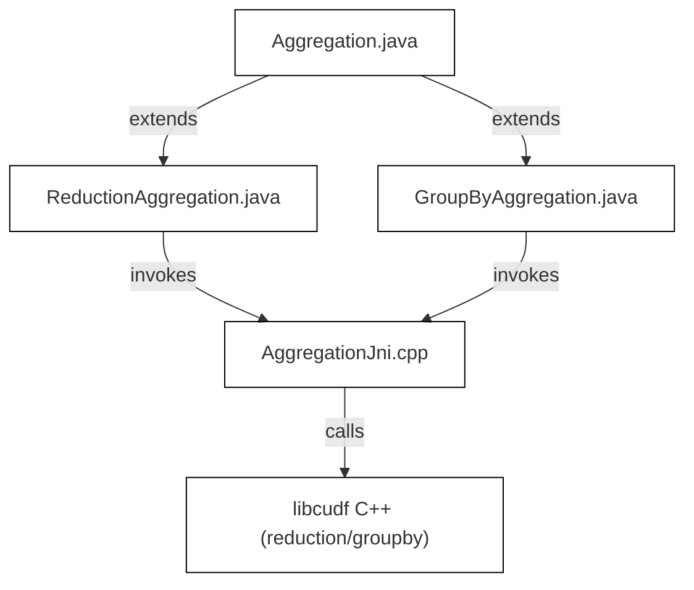
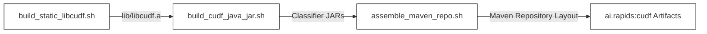

<!-- source: DeepWiki mcp.deepwiki.com · repo NVIDIA/cudf · page 7.3 Java Aggregations and Build · fetched 2026-10-26 -->

# Java Aggregations and Build

<details>
<summary>Relevant source files</summary>

The following files were used as context for generating this wiki page:

- [.github/workflows/build.yaml](.github/workflows/build.yaml)
- [.github/workflows/pandas-tests.yaml](.github/workflows/pandas-tests.yaml)
- [.github/workflows/pr.yaml](.github/workflows/pr.yaml)
- [.github/workflows/pr_issue_status_automation.yml](.github/workflows/pr_issue_status_automation.yml)
- [.github/workflows/test.yaml](.github/workflows/test.yaml)
- [.github/workflows/trigger-breaking-change-alert.yaml](.github/workflows/trigger-breaking-change-alert.yaml)
- [CONTRIBUTING.md](CONTRIBUTING.md)
- [RAPIDS_BRANCH](RAPIDS_BRANCH)
- [README.md](README.md)
- [build.sh](build.sh)
- [cpp/examples/versions.cmake](cpp/examples/versions.cmake)
- [docs/cudf/source/pylibcudf/developer_docs.md](docs/cudf/source/pylibcudf/developer_docs.md)
- [java/README.md](java/README.md)
- [java/ci/Dockerfile.rocky](java/ci/Dockerfile.rocky)
- [java/ci/README.md](java/ci/README.md)
- [java/ci/build-in-docker.sh](java/ci/build-in-docker.sh)
- [java/ci/env.sh](java/ci/env.sh)
- [java/pom.xml](java/pom.xml)
- [java/src/main/java/ai/rapids/cudf/Aggregation.java](java/src/main/java/ai/rapids/cudf/Aggregation.java)
- [java/src/main/java/ai/rapids/cudf/GroupByAggregation.java](java/src/main/java/ai/rapids/cudf/GroupByAggregation.java)
- [java/src/main/java/ai/rapids/cudf/ReductionAggregation.java](java/src/main/java/ai/rapids/cudf/ReductionAggregation.java)
- [java/src/main/native/CMakeLists.txt](java/src/main/native/CMakeLists.txt)
- [java/src/main/native/src/AggregationJni.cpp](java/src/main/native/src/AggregationJni.cpp)
- [java/src/test/java/ai/rapids/cudf/ByteColumnVectorTest.java](java/src/test/java/ai/rapids/cudf/ByteColumnVectorTest.java)
- [java/src/test/java/ai/rapids/cudf/CudfTestBase.java](java/src/test/java/ai/rapids/cudf/CudfTestBase.java)
- [java/src/test/java/ai/rapids/cudf/DoubleColumnVectorTest.java](java/src/test/java/ai/rapids/cudf/DoubleColumnVectorTest.java)
- [java/src/test/java/ai/rapids/cudf/FloatColumnVectorTest.java](java/src/test/java/ai/rapids/cudf/FloatColumnVectorTest.java)
- [java/src/test/java/ai/rapids/cudf/IntColumnVectorTest.java](java/src/test/java/ai/rapids/cudf/IntColumnVectorTest.java)
- [java/src/test/java/ai/rapids/cudf/LongColumnVectorTest.java](java/src/test/java/ai/rapids/cudf/LongColumnVectorTest.java)
- [java/src/test/java/ai/rapids/cudf/ReductionTest.java](java/src/test/java/ai/rapids/cudf/ReductionTest.java)
- [java/src/test/java/ai/rapids/cudf/ShortColumnVectorTest.java](java/src/test/java/ai/rapids/cudf/ShortColumnVectorTest.java)
- [java/src/test/java/ai/rapids/cudf/TimestampColumnVectorTest.java](java/src/test/java/ai/rapids/cudf/TimestampColumnVectorTest.java)
- [python/cudf_polars/docs/overview.md](python/cudf_polars/docs/overview.md)
- [python/custreamz/README.md](python/custreamz/README.md)

</details>


This page details the JVM-side aggregation API provided by `ai.rapids.cudf` (`Aggregation`, `ReductionAggregation`, and `GroupByAggregation`), the native JNI bridge implementation (`AggregationJni.cpp`), the native CMake build configuration, and the Maven/Docker CI packaging infrastructure used to produce GPU-accelerated JAR artifacts.

---

## 1. Java Aggregation API Hierarchy

The cuDF Java API mirrors libcudf's aggregation model through a strongly-typed class hierarchy. These classes define operations such as sum, mean, min, max, count, and quantiles that can be applied to columns, reductions, or grouped tables.

- **`ai.rapids.cudf.Aggregation`** [java/src/main/java/ai/rapids/cudf/Aggregation.java](): The abstract base class representing any aggregation operation. It encapsulates factory methods for creating specific aggregations (e.g., `sum()`, `mean()`, `min()`, `max()`, `count()`) and serializes parameters into native-consumable structures.
- **`ai.rapids.cudf.ReductionAggregation`** [java/src/main/java/ai/rapids/cudf/ReductionAggregation.java](): Subclass specialized for reduction operations (aggregating an entire column or table down to a single scalar value).
- **`ai.rapids.cudf.GroupByAggregation`** [java/src/main/java/ai/rapids/cudf/GroupByAggregation.java](): Subclass specialized for groupby operations, defining how columns are aggregated within distinct partition keys.


*Figure 1: Java-to-Native Aggregation Code Entity Mapping.*

Sources: 
- `java/src/main/java/ai/rapids/cudf/Aggregation.java` []()
- `java/src/main/java/ai/rapids/cudf/ReductionAggregation.java` []()
- `java/src/main/java/ai/rapids/cudf/GroupByAggregation.java` []()

---

## 2. Native JNI Bridge Layer (`AggregationJni.cpp`)

When a Java application invokes an aggregation or reduction method, the control flow crosses the JNI boundary via native bridge files located in `java/src/main/native/src/`.

`AggregationJni.cpp` [java/src/main/native/src/AggregationJni.cpp]() implements the native methods declared by Java classes. It decodes JVM objects (such as aggregation type identifiers, output data types, and auxiliary arguments like quantile ranks or ddof for variance) and constructs the corresponding C++ `cudf::aggregation` objects [java/src/main/native/src/AggregationJni.cpp](). These objects are then forwarded to libcudf execution engines like `cudf::reduce` or `cudf::groupby`.

```mermaid
sequenceDiagram
    participant Java as "ReductionTest.java"
    participant Agg as "ReductionAggregation.java"
    participant JNI as "AggregationJni.cpp"
    participant Core as "libcudf C++ Engine"

    Java->>Agg: sum()
    Agg->>JNI: reduceJni(...)
    JNI->>Core: cudf::reduce(view, aggregation, type, stream)
    Core--->JNI: cudf::scalar result
    JNI--->Java: Native Scalar / Column reference
```
*Figure 2: JNI Data Flow for Column Reductions.*

Sources:
- `java/src/main/native/src/AggregationJni.cpp` []()
- `java/src/test/java/ai/rapids/cudf/ReductionTest.java` []()

---

## 3. Native CMake Build System

The native companion library (`libcudfjni`) is built using CMake [java/src/main/native/CMakeLists.txt:1-171](). The build system integrates with RAPIDS CMake utilities to locate CUDA toolkits, configure compiler definitions, and link against `libcudf`.

### Key CMake Configuration Options

| Option Name | Default | Description |
| :--- | :---: | :--- |
| `USE_NVTX` | `ON` | Enable NVTX profiling ranges in native code [java/src/main/native/CMakeLists.txt:30]() |
| `BUILD_SHARED_LIBS` | `ON` | Build shared libraries for the JNI wrapper [java/src/main/native/CMakeLists.txt:31]() |
| `CUDF_JNI_LIBCUDF_STATIC` | `OFF` | Link statically against `libcudf.a` [java/src/main/native/CMakeLists.txt:35]() |
| `USE_GDS` | `OFF` | Build with GPUDirect Storage (GDS) / cuFile support [java/src/main/native/CMakeLists.txt:34]() |
| `CUDF_USE_PER_THREAD_DEFAULT_STREAM` | `OFF` | Compile with per-thread default CUDA stream semantics [java/src/main/native/CMakeLists.txt:33]() |

The build script expects either an installed libcudf path (`CUDF_INSTALL_DIR`) or a pre-configured libcudf build directory (`CUDF_CPP_BUILD_DIR`) [java/src/main/native/CMakeLists.txt:66-86]().

Sources:
- `java/src/main/native/CMakeLists.txt` [java/src/main/native/CMakeLists.txt:1-171]()

---

## 4. Maven Build and Docker CI Packaging

Java artifacts are managed via Maven (`java/pom.xml`) [java/pom.xml:1-189](). The Maven configuration declares dependencies on SLF4J, JUnit 5, Apache Arrow vectors, and Hadoop common utilities [java/pom.xml:138-189]().

### Dockerized CI Packaging Workflow
To ensure reproducible builds across different CUDA versions and CPU architectures without requiring local CUDA toolchains for packaging, cuDF provides containerized build scripts under `java/ci/` [java/ci/README.md:1-179]().

1. **Static libcudf Compilation**: `build_static_libcudf.sh` compiles libcudf statically inside a container image [java/ci/README.md:24-33].
2. **JNI Packaging**: `build_cudf_java_jar.sh` builds `libcudfjni` against the static libcudf tree and packages classifier-specific JARs (e.g., `cudf-26.12.0-SNAPSHOT-cuda12.jar`) [java/ci/README.md:34-56].
3. **Maven Repository Assembly**: `assemble_maven_repo.sh` gathers classifier subdirectories, creates shared javadoc/sources jars, and structures a complete Maven repository layout [java/ci/README.md:67-90].


*Figure 3: CI Artifact Assembly Pipeline.*

Sources:
- `java/pom.xml` [java/pom.xml:1-189]()
- `java/ci/README.md` [java/ci/README.md:1-179]()
- `java/ci/build-in-docker.sh` [java/ci/build-in-docker.sh:1-98]()

---

