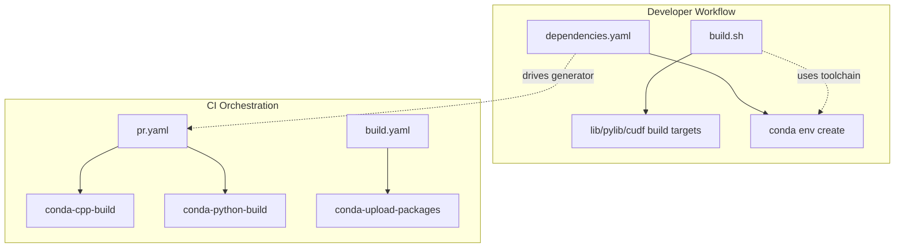
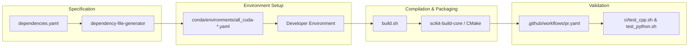

<!-- source: DeepWiki mcp.deepwiki.com · repo NVIDIA/cudf · page 8 Build, CI and Developer Workflow · fetched 2026-10-26 -->

# Build, CI and Developer Workflow

Relevant source files

The following files were used as context for generating this wiki page:

- [.github/workflows/build.yaml](.github/workflows/build.yaml)
- [.github/workflows/pandas-tests.yaml](.github/workflows/pandas-tests.yaml)
- [.github/workflows/pr.yaml](.github/workflows/pr.yaml)
- [.github/workflows/pr_issue_status_automation.yml](.github/workflows/pr_issue_status_automation.yml)
- [.github/workflows/test.yaml](.github/workflows/test.yaml)
- [.github/workflows/trigger-breaking-change-alert.yaml](.github/workflows/trigger-breaking-change-alert.yaml)
- [CONTRIBUTING.md](CONTRIBUTING.md)
- [RAPIDS_BRANCH](RAPIDS_BRANCH)
- [README.md](README.md)
- [build.sh](build.sh)
- [conda/environments/all_cuda-129_arch-aarch64.yaml](conda/environments/all_cuda-129_arch-aarch64.yaml)
- [conda/environments/all_cuda-129_arch-x86_64.yaml](conda/environments/all_cuda-129_arch-x86_64.yaml)
- [conda/environments/all_cuda-133_arch-aarch64.yaml](conda/environments/all_cuda-133_arch-aarch64.yaml)
- [conda/environments/all_cuda-133_arch-x86_64.yaml](conda/environments/all_cuda-133_arch-x86_64.yaml)
- [conda/recipes/libcudf/conda_build_config.yaml](conda/recipes/libcudf/conda_build_config.yaml)
- [cpp/examples/versions.cmake](cpp/examples/versions.cmake)
- [dependencies.yaml](dependencies.yaml)
- [docs/cudf/source/pylibcudf/developer_docs.md](docs/cudf/source/pylibcudf/developer_docs.md)
- [java/README.md](java/README.md)
- [java/ci/Dockerfile.rocky](java/ci/Dockerfile.rocky)
- [java/ci/README.md](java/ci/README.md)
- [java/ci/build-in-docker.sh](java/ci/build-in-docker.sh)
- [java/ci/env.sh](java/ci/env.sh)
- [java/pom.xml](java/pom.xml)
- [java/src/main/native/CMakeLists.txt](java/src/main/native/CMakeLists.txt)
- [python/cudf/pyproject.toml](python/cudf/pyproject.toml)
- [python/cudf_kafka/pyproject.toml](python/cudf_kafka/pyproject.toml)
- [python/cudf_polars/docs/overview.md](python/cudf_polars/docs/overview.md)
- [python/cudf_polars/pyproject.toml](python/cudf_polars/pyproject.toml)
- [python/custreamz/README.md](python/custreamz/README.md)
- [python/custreamz/pyproject.toml](python/custreamz/pyproject.toml)
- [python/dask_cudf/pyproject.toml](python/dask_cudf/pyproject.toml)
- [python/libcudf/pyproject.toml](python/libcudf/pyproject.toml)
- [python/pylibcudf/pyproject.toml](python/pylibcudf/pyproject.toml)

## Purpose and Scope

This page provides a high-level overview of the build orchestration, dependency management, continuous integration (CI) pipelines, and contributor tooling for the NVIDIA cuDF codebase. cuDF is a multi-language project spanning C++/CUDA (`libcudf`), Python (`pylibcudf`, `cudf`, `cudf-polars`, `dask_cudf`), and Java (`cudfjni`), requiring a unified toolchain to manage dependencies, compile native and managed libraries, execute rigorous test suites, and package deliverables.

For detailed information on specific sub-topics, refer to the child pages:
- [Dependency and Packaging System](#8.1)
- [CI Pipelines and Scripts](#8.2)
- [Testing and Benchmarking Infrastructure](#8.3)
- [Documentation, Style and Agent Skills](#8.4)

---

## Build and CI Orchestration Architecture

The cuDF repository coordinates builds via a centralized build script (`build.sh`) [build.sh:1-54], declarative dependency generators (`dependencies.yaml`) [dependencies.yaml:1-10], and GitHub Actions workflow definitions (`.github/workflows/pr.yaml`) [.github/workflows/pr.yaml:1-52]. 

**Figure 1**: High-level mapping of build orchestration and CI components to code entities.

Sources: [build.sh:1-54](), [dependencies.yaml:1-10](), [.github/workflows/pr.yaml:1-52](), [.github/workflows/build.yaml:1-37]()

---

## 8.1. Dependency and Packaging System

Dependency management across conda and PyPI packaging formats is driven by `dependencies.yaml` [dependencies.yaml:1-10], which acts as the single source of truth for library versions and build matrix parameters. The `rapids-dependency-file-generator` tool consumes this file to generate Conda environment YAML files and `pyproject.toml` configuration blocks [python/cudf/pyproject.toml:4-10].

Python packages utilize `rapids-build-backend` combined with `scikit-build-core` to orchestrate CMake builds for underlying C++ components during wheel and source distribution packaging [python/cudf/pyproject.toml:4-10,125-139].

For details, see [Dependency and Packaging System](#8.1).

Sources: [dependencies.yaml:1-10](), [python/cudf/pyproject.toml:4-140]()

---

## 8.2. CI Pipelines and Scripts

Continuous integration is automated via GitHub Actions workflows defined in `.github/workflows/` (such as `pr.yaml` [.github/workflows/pr.yaml:1-52] and `build.yaml` [.github/workflows/build.yaml:1-37]). These workflows invoke shell scripts located in the `ci/` directory to build C++ binaries, execute unit tests across various GPU architectures, run Python test suites, and build documentation.

Pull request validation checks code owners, linting rules, and incremental test shards to ensure code quality before merging [CONTRIBUTING.md:40-62].

For details, see [CI Pipelines and Scripts](#8.2).

Sources: [.github/workflows/pr.yaml:1-52](), [.github/workflows/build.yaml:1-37](), [CONTRIBUTING.md:40-62]()

---

## 8.3. Testing and Benchmarking Infrastructure

cuDF employs distinct testing and benchmarking harnesses across its language bindings:
- **C++ Tests**: Built using Google Test (GTest) alongside custom utilities like `column_wrapper` and stream-identification checkers.
- **Benchmarks**: Powered by the NVBench harness to measure performance regressions across analytical and relational primitives.
- **Python Tests**: Organized via `pytest` with specialized fixtures for pandas compatibility and Polars GPU execution verification.

For details, see [Testing and Benchmarking Infrastructure](#8.3).

Sources: [CONTRIBUTING.md:40-52]()

---

## 8.4. Documentation, Style and Agent Skills

Documentation is generated using Sphinx and Doxygen groups configured via developer guides and CI documentation scripts. Code style and linting are enforced through pre-commit configurations, `flake8`, `ruff`, and `clang-tidy` [conda/environments/all_cuda-129_arch-aarch64.yaml:14-16,81]. Additionally, repository-level `.agents` and `skills` directories provide context and tooling for agentic contributor workflows.

For details, see [Documentation, Style and Agent Skills](#8.4).

Sources: [conda/environments/all_cuda-129_arch-aarch64.yaml:12-115]()

---

## Big Picture Toolchain Flow

**Figure 2**: End-to-end flow from dependency specification to build, packaging, and CI validation.

Sources: [dependencies.yaml:1-10](), [build.sh:1-54](), [.github/workflows/pr.yaml:1-52](), [python/cudf/pyproject.toml:4-140]()

---

