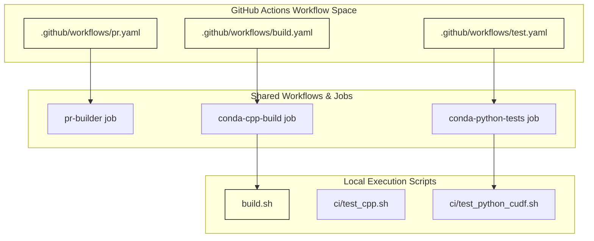
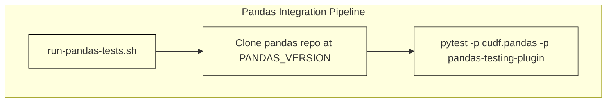

<!-- source: DeepWiki mcp.deepwiki.com · repo NVIDIA/cudf · page 8.2 CI Pipelines and Scripts · fetched 2026-10-26 -->

# CI Pipelines and Scripts

Relevant source files

The following files were used as context for generating this wiki page:

- [.github/CODEOWNERS](.github/CODEOWNERS)
- [.github/labeler.yml](.github/labeler.yml)
- [.github/workflows/auto-assign.yml](.github/workflows/auto-assign.yml)
- [.github/workflows/build.yaml](.github/workflows/build.yaml)
- [.github/workflows/issue-release-scheduled.yml](.github/workflows/issue-release-scheduled.yml)
- [.github/workflows/labeler.yml](.github/workflows/labeler.yml)
- [.github/workflows/pandas-tests.yaml](.github/workflows/pandas-tests.yaml)
- [.github/workflows/pr.yaml](.github/workflows/pr.yaml)
- [.github/workflows/pr_issue_status_automation.yml](.github/workflows/pr_issue_status_automation.yml)
- [.github/workflows/status.yaml](.github/workflows/status.yaml)
- [.github/workflows/test.yaml](.github/workflows/test.yaml)
- [.github/workflows/trigger-breaking-change-alert.yaml](.github/workflows/trigger-breaking-change-alert.yaml)
- [.yamllint.yaml](.yamllint.yaml)
- [CONTRIBUTING.md](CONTRIBUTING.md)
- [RAPIDS_BRANCH](RAPIDS_BRANCH)
- [README.md](README.md)
- [SECURITY.md](SECURITY.md)
- [build.sh](build.sh)
- [ci/build_docs.sh](ci/build_docs.sh)
- [ci/check_style.sh](ci/check_style.sh)
- [ci/cudf_pandas_scripts/pandas-tests/run.sh](ci/cudf_pandas_scripts/pandas-tests/run.sh)
- [ci/cudf_pandas_scripts/run_tests.sh](ci/cudf_pandas_scripts/run_tests.sh)
- [ci/cudf_polars/polars_test_deselections.txt](ci/cudf_polars/polars_test_deselections.txt)
- [ci/cudf_polars/polars_test_deselections_aarch64.txt](ci/cudf_polars/polars_test_deselections_aarch64.txt)
- [ci/cudf_polars/polars_test_deselections_incompatible_glibc.txt](ci/cudf_polars/polars_test_deselections_incompatible_glibc.txt)
- [ci/release/update-version.sh](ci/release/update-version.sh)
- [ci/run_cudf_polars_polars_tests.sh](ci/run_cudf_polars_polars_tests.sh)
- [ci/run_pylibcudf_pytests.sh](ci/run_pylibcudf_pytests.sh)
- [ci/test_cpp.sh](ci/test_cpp.sh)
- [ci/test_cpp_common.sh](ci/test_cpp_common.sh)
- [ci/test_cudf_polars_polars_tests.sh](ci/test_cudf_polars_polars_tests.sh)
- [ci/test_notebooks.sh](ci/test_notebooks.sh)
- [ci/test_python_common.sh](ci/test_python_common.sh)
- [ci/test_python_cudf.sh](ci/test_python_cudf.sh)
- [ci/test_python_other.sh](ci/test_python_other.sh)
- [ci/test_wheel_cudf.sh](ci/test_wheel_cudf.sh)
- [ci/test_wheel_cudf_polars.sh](ci/test_wheel_cudf_polars.sh)
- [ci/test_wheel_dask_cudf.sh](ci/test_wheel_dask_cudf.sh)
- [codecov.yml](codecov.yml)
- [cpp/examples/versions.cmake](cpp/examples/versions.cmake)
- [docs/cudf/source/pylibcudf/developer_docs.md](docs/cudf/source/pylibcudf/developer_docs.md)
- [java/README.md](java/README.md)
- [java/ci/Dockerfile.rocky](java/ci/Dockerfile.rocky)
- [java/ci/README.md](java/ci/README.md)
- [java/ci/build-in-docker.sh](java/ci/build-in-docker.sh)
- [java/ci/env.sh](java/ci/env.sh)
- [java/pom.xml](java/pom.xml)
- [java/src/main/native/CMakeLists.txt](java/src/main/native/CMakeLists.txt)
- [python/cudf/cudf/pandas/scripts/run-pandas-tests.sh](python/cudf/cudf/pandas/scripts/run-pandas-tests.sh)
- [python/cudf_polars/docs/overview.md](python/cudf_polars/docs/overview.md)
- [python/custreamz/README.md](python/custreamz/README.md)
- [python/pylibcudf/.coveragerc](python/pylibcudf/.coveragerc)

This page details the continuous integration (CI) architecture, GitHub Actions workflows, orchestration scripts under `ci/` and `java/ci/`, release version updating mechanisms, and repository automation (codeowners, labelers, and bots) for the cuDF codebase.

---

## 1. GitHub Actions Workflows and Orchestration

cuDF relies heavily on GitHub Actions workflows housed in `.github/workflows/`. These workflows leverage centralized reusable workflows from the `rapidsai/shared-workflows` repository to maintain consistency across the RAPIDS ecosystem.

The primary workflow entrypoints include:
* **`pr.yaml`**: Triggered on pull requests and draft changes. It defines a top-level aggregation job `pr-builder` that depends on all sub-checks, linters, and test suites [`.github/workflows/pr.yaml:1-52]().
* **`build.yaml`**: Triggered on pushes to `main` and release branches. It coordinates C++ and Python conda package builds, documentation generation, and artifact uploads [`.github/workflows/build.yaml:1-136]().
* **`test.yaml`**: Workflow dispatch and post-build test runner that executes comprehensive CUDA C++, python unit tests, benchmark suites, and memory checks [`.github/workflows/test.yaml:1-125]().

Sources: [`.github/workflows/pr.yaml:1-57](), [`.github/workflows/build.yaml:1-136](), [`.github/workflows/test.yaml:1-125]()

---

## 2. Build and Test Scripts (`ci/` and `build.sh`)

The `ci/` directory contains shell scripts that mirror local build processes and execute unit tests within containerized CI runners. Local builds are orchestrated by `build.sh`, which parses arguments for component selection, compilation flags, and custom CMake options [build.sh:1-54]().

### Core Build Script (`build.sh`)
`build.sh` accepts component targets (`libcudf`, `pylibcudf`, `cudf`, `cudf_polars`, `dask_cudf`, `libcudf_kafka`, `libcudf_streaming`, etc.) and configuration flags such as `-g` (debug build), `--ptds` (per-thread default stream), and `--allgpuarch` [build.sh:21-51]().

### CI Test Scripts
* **C++ Tests**: Executed via `ci/test_cpp.sh`, running Google Test suites (`gtest`) for `libcudf` and components. The JIT caching environment (`LIBCUDF_KERNEL_CACHE_PATH`) is preserved across test runs [`.github/workflows/test.yaml:42-83]().
* **Python Tests**: Divided into separate scripts such as `ci/test_python_cudf.sh` for core cuDF tests [`.github/workflows/test.yaml:138-152]() and `ci/test_python_other.sh` for secondary packages (`dask_cudf`, `custreamz`, `cudf_kafka`) [`.github/workflows/test.yaml:155-170]().

Sources: [build.sh:1-140](), [`.github/workflows/test.yaml:28-172]()

---

## 3. Specialized Test Pipelines: Pandas and Polars

cuDF includes specialized integration pipelines to validate zero-code-change pandas acceleration (`cudf.pandas`) and the Polars GPU execution engine (`cudf-polars`).

### Pandas Test Suite Integration
Pandas unit tests are run against `cudf.pandas` using automated scripts that clone the matching upstream pandas repository version, inject testing plugins, and execute filtered test suites [python/cudf/cudf/pandas/scripts/run-pandas-tests.sh:25-104]().

### Polars Upstream Test Suite (`run_cudf_polars_polars_tests.sh`)
The script `ci/run_cudf_polars_polars_tests.sh` executes the full upstream Polars test suite utilizing the GPU engine via `inject_gpu_engine` [ci/run_cudf_polars_polars_tests.sh:131-175](). It handles platform-specific deselections (`polars_test_deselections.txt`, `polars_test_deselections_aarch64.txt`) and configures fallback diagnostic reporting artifacts [ci/run_cudf_polars_polars_tests.sh:14-42]().

Sources: [python/cudf/cudf/pandas/scripts/run-pandas-tests.sh:1-108](), [ci/run_cudf_polars_polars_tests.sh:1-175]()

---

## 4. Release Version Updaters and Branch Automation

Version updates across all packaging configurations, CMake project files, and Python metadata are automated via `ci/release/update-version.sh` [ci/release/update-version.sh:1-146]().

### Version Updater Workflow
1. **Context Parsing**: Accepts `<new_version>` and `--run-context=main|release` via CLI flags or `RAPIDS_RUN_CONTEXT` environment variables [ci/release/update-version.sh:9-53]().
2. **Metadata Synchronization**: Updates centralized version files including `VERSION`, `python/cudf/cudf/VERSION`, and `RAPIDS_BRANCH` [ci/release/update-version.sh:141-146]().
3. **Dependency Pinning**: Scans `dependencies.yaml` and conda recipe files (`conda/recipes/cudf/recipe.yaml`) to update inter-package version pins and external dependencies (such as `numba-cuda`) [ci/release/update-version.sh:100-133]().

Sources: [ci/release/update-version.sh:1-146]()

---

## 5. Repository Automation: Codeowners and Labelers

Pull request routing, auto-assignment, and file labeling are governed by repository automation configuration files under `.github/`:
* **`.github/CODEOWNERS`**: Defines mandatory review requirements. For instance, changes to `libcudf` C++ files require at least 2 approvals from `cudf-cpp-codeowners`, whereas `libcudf_streaming` files require approval from `rapidsmpf-cpp-codeowners` [CONTRIBUTING.md:57-60]().
* **Labelers and Auto-Assignment**: Workflows like `.github/workflows/labeler.yml` and `.github/workflows/auto-assign.yml` automatically apply labels based on modified paths (e.g., triggering documentation, python, or c++ test suites in `changed-files`) [`.github/workflows/pr.yaml:88-206]().

Sources: [`.github/workflows/pr.yaml:88-206](), [CONTRIBUTING.md:57-60]()

---

