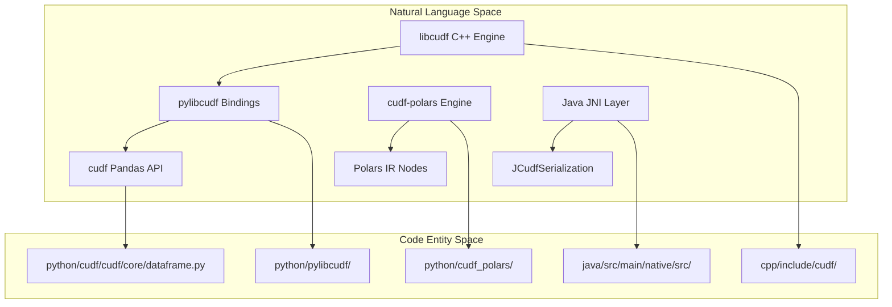
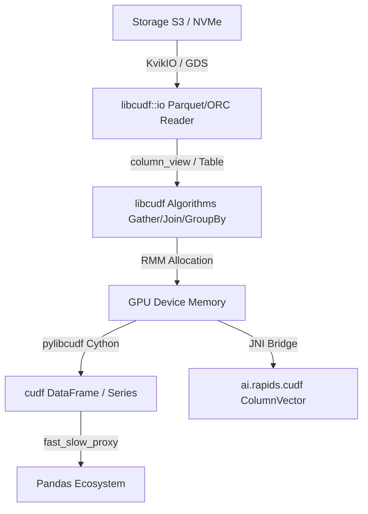

<!-- source: DeepWiki mcp.deepwiki.com · repo NVIDIA/cudf · page 9 Glossary · fetched 2026-10-26 -->

# Glossary

Relevant source files

The following files were used as context for generating this wiki page:

- [CHANGELOG.md](CHANGELOG.md)
- [cpp/CMakeLists.txt](cpp/CMakeLists.txt)
- [cpp/benchmarks/CMakeLists.txt](cpp/benchmarks/CMakeLists.txt)
- [cpp/benchmarks/join/join_common.hpp](cpp/benchmarks/join/join_common.hpp)
- [cpp/include/cudf/detail/transform.hpp](cpp/include/cudf/detail/transform.hpp)
- [cpp/include/cudf/io/detail/parquet.hpp](cpp/include/cudf/io/detail/parquet.hpp)
- [cpp/include/cudf/io/parquet.hpp](cpp/include/cudf/io/parquet.hpp)
- [cpp/include/cudf/io/types.hpp](cpp/include/cudf/io/types.hpp)
- [cpp/include/cudf/transform.hpp](cpp/include/cudf/transform.hpp)
- [cpp/src/io/functions.cpp](cpp/src/io/functions.cpp)
- [cpp/src/io/parquet/decode_fixed.cu](cpp/src/io/parquet/decode_fixed.cu)
- [cpp/src/io/parquet/decode_preprocess.cu](cpp/src/io/parquet/decode_preprocess.cu)
- [cpp/src/io/parquet/delta_binary.cuh](cpp/src/io/parquet/delta_binary.cuh)
- [cpp/src/io/parquet/page_data.cu](cpp/src/io/parquet/page_data.cu)
- [cpp/src/io/parquet/page_data.cuh](cpp/src/io/parquet/page_data.cuh)
- [cpp/src/io/parquet/page_decode.cuh](cpp/src/io/parquet/page_decode.cuh)
- [cpp/src/io/parquet/page_delta_decode.cu](cpp/src/io/parquet/page_delta_decode.cu)
- [cpp/src/io/parquet/page_enc.cu](cpp/src/io/parquet/page_enc.cu)
- [cpp/src/io/parquet/page_hdr.cu](cpp/src/io/parquet/page_hdr.cu)
- [cpp/src/io/parquet/page_state_composed.cuh](cpp/src/io/parquet/page_state_composed.cuh)
- [cpp/src/io/parquet/page_string_decode.cu](cpp/src/io/parquet/page_string_decode.cu)
- [cpp/src/io/parquet/page_string_utils.cuh](cpp/src/io/parquet/page_string_utils.cuh)
- [cpp/src/io/parquet/parquet_gpu.hpp](cpp/src/io/parquet/parquet_gpu.hpp)
- [cpp/src/io/parquet/reader_impl.cpp](cpp/src/io/parquet/reader_impl.cpp)
- [cpp/src/io/parquet/reader_impl.hpp](cpp/src/io/parquet/reader_impl.hpp)
- [cpp/src/io/parquet/reader_impl_chunking.cu](cpp/src/io/parquet/reader_impl_chunking.cu)
- [cpp/src/io/parquet/reader_impl_chunking.hpp](cpp/src/io/parquet/reader_impl_chunking.hpp)
- [cpp/src/io/parquet/reader_impl_preprocess.cu](cpp/src/io/parquet/reader_impl_preprocess.cu)
- [cpp/src/io/parquet/writer_impl.cu](cpp/src/io/parquet/writer_impl.cu)
- [cpp/src/io/parquet/writer_impl.hpp](cpp/src/io/parquet/writer_impl.hpp)
- [cpp/src/transform/bools_to_mask.cu](cpp/src/transform/bools_to_mask.cu)
- [cpp/src/transform/nans_to_nulls.cu](cpp/src/transform/nans_to_nulls.cu)
- [cpp/tests/CMakeLists.txt](cpp/tests/CMakeLists.txt)
- [cpp/tests/io/parquet_reader_test.cpp](cpp/tests/io/parquet_reader_test.cpp)
- [cpp/tests/io/parquet_test.cpp](cpp/tests/io/parquet_test.cpp)
- [cpp/tests/io/parquet_writer_test.cpp](cpp/tests/io/parquet_writer_test.cpp)
- [cpp/tests/transform/nans_to_null_test.cpp](cpp/tests/transform/nans_to_null_test.cpp)
- [java/src/main/java/ai/rapids/cudf/ColumnVector.java](java/src/main/java/ai/rapids/cudf/ColumnVector.java)
- [java/src/main/java/ai/rapids/cudf/ColumnView.java](java/src/main/java/ai/rapids/cudf/ColumnView.java)
- [java/src/main/java/ai/rapids/cudf/Cudf.java](java/src/main/java/ai/rapids/cudf/Cudf.java)
- [java/src/main/java/ai/rapids/cudf/DType.java](java/src/main/java/ai/rapids/cudf/DType.java)
- [java/src/main/java/ai/rapids/cudf/HostColumnVector.java](java/src/main/java/ai/rapids/cudf/HostColumnVector.java)
- [java/src/main/java/ai/rapids/cudf/HostColumnVectorCore.java](java/src/main/java/ai/rapids/cudf/HostColumnVectorCore.java)
- [java/src/main/java/ai/rapids/cudf/JCudfSerialization.java](java/src/main/java/ai/rapids/cudf/JCudfSerialization.java)
- [java/src/main/java/ai/rapids/cudf/JSONOptions.java](java/src/main/java/ai/rapids/cudf/JSONOptions.java)
- [java/src/main/java/ai/rapids/cudf/ParquetChunkedReader.java](java/src/main/java/ai/rapids/cudf/ParquetChunkedReader.java)
- [java/src/main/java/ai/rapids/cudf/ParquetWriterOptions.java](java/src/main/java/ai/rapids/cudf/ParquetWriterOptions.java)
- [java/src/main/java/ai/rapids/cudf/Scalar.java](java/src/main/java/ai/rapids/cudf/Scalar.java)
- [java/src/main/java/ai/rapids/cudf/Table.java](java/src/main/java/ai/rapids/cudf/Table.java)
- [java/src/main/java/ai/rapids/cudf/WriterOptions.java](java/src/main/java/ai/rapids/cudf/WriterOptions.java)
- [java/src/main/native/include/jni_utils.hpp](java/src/main/native/include/jni_utils.hpp)
- [java/src/main/native/include/multi_host_buffer_source.hpp](java/src/main/native/include/multi_host_buffer_source.hpp)
- [java/src/main/native/src/ChunkedReaderJni.cpp](java/src/main/native/src/ChunkedReaderJni.cpp)
- [java/src/main/native/src/ColumnVectorJni.cpp](java/src/main/native/src/ColumnVectorJni.cpp)
- [java/src/main/native/src/ColumnViewJni.cpp](java/src/main/native/src/ColumnViewJni.cpp)
- [java/src/main/native/src/CudfJni.cpp](java/src/main/native/src/CudfJni.cpp)
- [java/src/main/native/src/ScalarJni.cpp](java/src/main/native/src/ScalarJni.cpp)
- [java/src/main/native/src/TableJni.cpp](java/src/main/native/src/TableJni.cpp)
- [java/src/main/native/src/cudf_jni_apis.hpp](java/src/main/native/src/cudf_jni_apis.hpp)
- [java/src/test/java/ai/rapids/cudf/ColumnBuilderHelper.java](java/src/test/java/ai/rapids/cudf/ColumnBuilderHelper.java)
- [java/src/test/java/ai/rapids/cudf/ColumnVectorTest.java](java/src/test/java/ai/rapids/cudf/ColumnVectorTest.java)
- [java/src/test/java/ai/rapids/cudf/DecimalColumnVectorTest.java](java/src/test/java/ai/rapids/cudf/DecimalColumnVectorTest.java)
- [java/src/test/java/ai/rapids/cudf/ScalarTest.java](java/src/test/java/ai/rapids/cudf/ScalarTest.java)
- [java/src/test/java/ai/rapids/cudf/TableTest.java](java/src/test/java/ai/rapids/cudf/TableTest.java)
- [python/cudf/cudf/core/column/categorical.py](python/cudf/cudf/core/column/categorical.py)
- [python/cudf/cudf/core/column/column.py](python/cudf/cudf/core/column/column.py)
- [python/cudf/cudf/core/column/datetime.py](python/cudf/cudf/core/column/datetime.py)
- [python/cudf/cudf/core/column/decimal.py](python/cudf/cudf/core/column/decimal.py)
- [python/cudf/cudf/core/column/interval.py](python/cudf/cudf/core/column/interval.py)
- [python/cudf/cudf/core/column/lists.py](python/cudf/cudf/core/column/lists.py)
- [python/cudf/cudf/core/column/numerical.py](python/cudf/cudf/core/column/numerical.py)
- [python/cudf/cudf/core/column/string.py](python/cudf/cudf/core/column/string.py)
- [python/cudf/cudf/core/column/struct.py](python/cudf/cudf/core/column/struct.py)
- [python/cudf/cudf/core/column/timedelta.py](python/cudf/cudf/core/column/timedelta.py)
- [python/cudf/cudf/core/dataframe.py](python/cudf/cudf/core/dataframe.py)
- [python/cudf/cudf/core/dtypes.py](python/cudf/cudf/core/dtypes.py)
- [python/cudf/cudf/core/frame.py](python/cudf/cudf/core/frame.py)
- [python/cudf/cudf/core/groupby/groupby.py](python/cudf/cudf/core/groupby/groupby.py)
- [python/cudf/cudf/core/index.py](python/cudf/cudf/core/index.py)
- [python/cudf/cudf/core/indexed_frame.py](python/cudf/cudf/core/indexed_frame.py)
- [python/cudf/cudf/core/multiindex.py](python/cudf/cudf/core/multiindex.py)
- [python/cudf/cudf/core/series.py](python/cudf/cudf/core/series.py)
- [python/cudf/cudf/utils/dtypes.py](python/cudf/cudf/utils/dtypes.py)
- [python/cudf_polars/cudf_polars/containers/column.py](python/cudf_polars/cudf_polars/containers/column.py)
- [python/cudf_polars/cudf_polars/containers/dataframe.py](python/cudf_polars/cudf_polars/containers/dataframe.py)
- [python/cudf_polars/cudf_polars/containers/datatype.py](python/cudf_polars/cudf_polars/containers/datatype.py)
- [python/cudf_polars/cudf_polars/dsl/expr.py](python/cudf_polars/cudf_polars/dsl/expr.py)
- [python/cudf_polars/cudf_polars/dsl/expressions/datetime.py](python/cudf_polars/cudf_polars/dsl/expressions/datetime.py)
- [python/cudf_polars/cudf_polars/dsl/ir.py](python/cudf_polars/cudf_polars/dsl/ir.py)
- [python/cudf_polars/cudf_polars/dsl/translate.py](python/cudf_polars/cudf_polars/dsl/translate.py)
- [python/cudf_polars/cudf_polars/testing/asserts.py](python/cudf_polars/cudf_polars/testing/asserts.py)
- [python/cudf_polars/cudf_polars/typing/__init__.py](python/cudf_polars/cudf_polars/typing/__init__.py)
- [python/cudf_polars/cudf_polars/utils/dtypes.py](python/cudf_polars/cudf_polars/utils/dtypes.py)
- [python/cudf_polars/cudf_polars/utils/versions.py](python/cudf_polars/cudf_polars/utils/versions.py)
- [python/cudf_polars/tests/containers/test_column.py](python/cudf_polars/tests/containers/test_column.py)
- [python/cudf_polars/tests/containers/test_dataframe.py](python/cudf_polars/tests/containers/test_dataframe.py)
- [python/cudf_polars/tests/containers/test_datatype.py](python/cudf_polars/tests/containers/test_datatype.py)
- [python/cudf_polars/tests/expressions/test_casting.py](python/cudf_polars/tests/expressions/test_casting.py)
- [python/cudf_polars/tests/expressions/test_datetime_basic.py](python/cudf_polars/tests/expressions/test_datetime_basic.py)
- [python/cudf_polars/tests/expressions/test_datetime_timezone.py](python/cudf_polars/tests/expressions/test_datetime_timezone.py)
- [python/cudf_polars/tests/test_dataframescan.py](python/cudf_polars/tests/test_dataframescan.py)
- [python/cudf_polars/tests/test_join.py](python/cudf_polars/tests/test_join.py)
- [python/cudf_polars/tests/test_scan.py](python/cudf_polars/tests/test_scan.py)
- [python/cudf_polars/tests/test_sink.py](python/cudf_polars/tests/test_sink.py)
- [python/cudf_polars/tests/utils/test_dtypes.py](python/cudf_polars/tests/utils/test_dtypes.py)

## Purpose and Scope
This page provides definitions and technical context for key terms, data structures, abstractions, and architectural concepts specific to cuDF and its sub-projects (`libcudf`, `pylibcudf`, `cudf-polars`, RMM, KvikIO, etc.). Each entry explains the concept, how it is implemented, and points to relevant code entities in the codebase.

---

## 1. Core Engine and Language Bindings

### libcudf
* **Definition**: The C++20/CUDA core data processing engine of the RAPIDS cuDF stack. It provides GPU-accelerated algorithms, columnar data representations, and file I/O operations without depending on Python.
* **Implementation**: Implemented under the `cpp/` directory as a shared/static library exposing public headers in `cpp/include/cudf/` [cpp/CMakeLists.txt:40](). It relies heavily on CCCL (Thrust and CUDA C++ Core Libraries) and modern CUDA streams.
* **Sources**: `cpp/CMakeLists.txt`

### pylibcudf
* **Definition**: A Cython-based Python wrapper library that directly exposes `libcudf` C++ classes and methods with minimal overhead, acting as the foundation for high-level Python APIs.
* **Implementation**: Located under the Python stack, `pylibcudf` translates Python calls into direct `libcudf` function invocations via Cython pxd/pyx declarations and manages resource lifetimes using RMM streams [python/cudf/cudf/core/column/column.py:28]().
* **Sources**: `python/cudf/cudf/core/column/column.py`

### JCudfSerialization
* **Definition**: The Java JNI serialization and bridging mechanism used by `ai.rapids.cudf` to transmit columnar data between JVM heap structures and native GPU buffers.
* **Implementation**: Implemented via JNI bridge classes and native C++ source files under `java/src/main/native/src/` (e.g., `TableJni.cpp`, `ColumnVectorJni.cpp`) interfacing with `libcudf` memory models.
* **Sources**: `java/src/main/native/src/TableJni.cpp`, `java/src/main/native/src/ColumnVectorJni.cpp`

---

## 2. Memory Management and Hardware Interaction

### RMM (RAPIDS Memory Manager)
* **Definition**: A CUDA memory management library providing customizable device memory allocators, memory pooling, and asynchronous stream-ordered allocation strategies.
* **Implementation**: Used across `libcudf`, `pylibcudf`, and Java bindings to prevent synchronization bottlenecks via custom device memory resources (`rmm::mr::device_memory_resource`).
* **Sources**: `cpp/CMakeLists.txt`, `python/cudf/cudf/core/column/column.py`

### CCCL (CUDA C++ Core Libraries)
* **Definition**: A meta-package containing Thrust, CUB, and `cuda::std` (CUDA C++ Standard Library subset), providing parallel algorithms, primitives, and host/device containers.
* **Implementation**: `libcudf` and test suites [cpp/tests/CMakeLists.txt:56]() compile against `libcudf`-bundled CCCL headers to implement primitives like sorts, reductions, and scans.
* **Sources**: `cpp/tests/CMakeLists.txt`, `CHANGELOG.md`

### PTDS (Per-Thread Default Stream)
* **Definition**: A CUDA feature enabling each host thread to have its own independent default CUDA stream (`cudaStreamPerThread`), avoiding implicit synchronization hazards across threads.
* **Implementation**: Configured via CMake options (`CUDF_USE_PER_THREAD_DEFAULT_STREAM`) in `libcudf` [cpp/CMakeLists.txt:46](), allowing concurrent execution across multiple host threads without stream passing.
* **Sources**: `cpp/CMakeLists.txt`

### GDS / KvikIO
* **Definition**: GPU Direct Storage (GDS) and its Python/C++ library wrapper **KvikIO**, enabling direct, zero-copy DMA transfers between storage (NVMe, S3) and GPU memory.
* **Implementation**: Used in `libcudf-IO` data sources and query engines to bypass host CPU staging buffers [cpp/benchmarks/CMakeLists.txt:68]().
* **Sources**: `cpp/benchmarks/CMakeLists.txt`

---

## 3. Columnar Data Layout and Views

### column / column_view / column_device_view
* **Definition**: 
  * `column`: An owning, mutable container for columnar data on the GPU containing data buffers, null masks, and child columns.
  * `column_view`: A non-owning, lightweight reference to a column (pointer to data + size + null mask + offset), cheap to pass to host-side algorithms.
  * `column_device_view`: A device-accessible variant of `column_view` optimized for direct pointer dereferencing inside CUDA kernels.
* **Implementation**: Defined in `cpp/include/cudf/column/` headers and tested via `COLUMN_TEST` targets [cpp/tests/CMakeLists.txt:98]().
* **Sources**: `cpp/tests/CMakeLists.txt`

### null mask
* **Definition**: A contiguous bitmask array where each bit represents the validity (1 = valid, 0 = null) of a corresponding row element in a column.
* **Implementation**: Allocated via RMM and processed using bitwise parallel primitives in `libcudf` to handle missing values efficiently.
* **Sources**: `cpp/CMakeLists.txt`

### table / table_view
* **Definition**: 
  * `table`: An owning collection of `column` objects representing a relational DataFrame.
  * `table_view`: A non-owning collection of `column_view` objects used as input/output parameters for relational operations like joins and groupbys.
* **Implementation**: Core abstractions underpinning all multi-column operations in `libcudf` and bound to Python via `plc.Table` [python/cudf/cudf/core/column/column.py:164]().
* **Sources**: `python/cudf/cudf/core/column/column.py`

### row group, stripe, and page
* **Definition**: Hierarchical chunking constructs used in columnar file formats (Parquet and ORC):
  * **Page**: The smallest contiguous block of encoded values/nulls in Parquet.
  * **Row Group**: A collection of contiguous rows containing column chunks across all columns (Parquet).
  * **Stripe**: The equivalent layout unit in ORC files.
* **Implementation**: Parsed and processed concurrently by `libcudf` reader implementations [cpp/src/io/parquet/reader_impl.cpp]().
* **Sources**: `cpp/src/io/parquet/reader_impl.cpp`

---

## 4. Algorithms and Execution Concepts

### type_dispatcher
* **Definition**: A compile-time mechanism in `libcudf` that dispatches runtime `cudf::type_id` values to strongly-typed template functions using functors.
* **Implementation**: Converts dynamic type information into static C++ types, allowing zero-overhead polymorphic execution inside CUDA kernels.
* **Sources**: `cpp/CMakeLists.txt`

### gather / scatter map
* **Definition**: 
  * `gather`: Reorders elements of a table or column according to an array of target indices (gather map).
  * `scatter`: Places elements from a source table into a destination table at locations specified by a scatter map.
* **Implementation**: Implemented as parallel permutation primitives in `libcudf::copying` and benchmarked via `COPYING_NVBENCH` [cpp/benchmarks/CMakeLists.txt:104]().
* **Sources**: `cpp/benchmarks/CMakeLists.txt`

### dremel levels
* **Definition**: Definition and repetition levels used to flatten and reconstruct nested hierarchical structures (lists and structs) in Parquet files following the Dremel algorithm.
* **Implementation**: Decoded during Parquet reader preprocessing stages to reconstruct multi-level list and struct columns [cpp/src/io/parquet/reader_impl_preprocess.cu]().
* **Sources**: `cpp/src/io/parquet/reader_impl_preprocess.cu`

### LTO-IR (Link-Time Optimization Intermediate Representation)
* **Definition**: Intermediate bytecode generated by the compiler during LTO, allowing cross-module optimizations and inlining.
* **Implementation**: Used during JIT compilation workflows and UDF lowering to optimize device-side code fragments.
* **Sources**: `CHANGELOG.md`

### NVBench
* **Definition**: A Google Test-integrated micro-benchmarking framework designed specifically for CUDA applications.
* **Implementation**: Used by `libcudf` benchmarks (`ConfigureNVBench`) to measure kernel execution times, throughput, and memory bandwidth [cpp/benchmarks/CMakeLists.txt:82]().
* **Sources**: `cpp/benchmarks/CMakeLists.txt`

### hybrid scan and variant
* **Definition**: 
  * `hybrid scan`: An experimental file-reading optimization combining page index statistics, dictionary filters, and bloom filters.
  * `variant`: An Apache-compatible container format for semi-structured data extraction and casting [CHANGELOG.md:12]().
* **Implementation**: Updated in recent releases to optimize Parquet predicate pushdown [CHANGELOG.md:14]() and structural data extraction [CHANGELOG.md:12]().
* **Sources**: `CHANGELOG.md`

---

## 5. Python Stack and Acceleration Concepts

### fast-slow proxy (`fast_slow_proxy`)
* **Definition**: An abstraction layer in `cudf.pandas` that mediates between accelerated cuDF GPU operations and fallback pandas CPU operations.
* **Implementation**: Intercepts pandas API calls, routing supported workloads to GPU-backed cuDF implementations and falling back to standard pandas for unsupported operations.
* **Sources**: `python/cudf/cudf/core/dataframe.py`

### IR (Intermediate Representation) and Actor Graph
* **Definition**: 
  * `IR`: The logical plan representation used by `cudf-polars` to translate Polars expression trees into optimized GPU execution plans.
  * `Actor Graph`: The distributed task dependency graph executed across workers (e.g., via Dask or Ray) in `cudf-polars` [CHANGELOG.md:66]().
* **Implementation**: Located under `python/cudf_polars/` to perform query optimization and distributed execution scheduling.
* **Sources**: `python/cudf/cudf/core/dataframe.py`

### Spilling and Copy-on-Write (CoW)
* **Definition**: 
  * `Spilling`: The ability to automatically offload device memory to host RAM when GPU memory pressure exceeds thresholds.
  * `Copy-on-Write`: A memory management optimization where modifying a view or copy of a data frame defers physical duplication until mutation occurs.
* **Implementation**: Managed by `cudf` buffer and spill manager subsystems to maximize large-scale workload capacity on fixed-size GPUs.
* **Sources**: `python/cudf/cudf/core/dataframe.py`

---

## System to Code Entity Architecture

The following diagram bridges the high-level system components of cuDF to their respective codebase implementation paths:

*Sources: `cpp/CMakeLists.txt`, `python/cudf/cudf/core/dataframe.py`, `java/src/main/native/src/TableJni.cpp`*

---

## Data Flow and Execution Architecture

The following diagram illustrates how data flows from file storage through `libcudf` readers and memory managers into high-level Python and Java APIs:

*Sources: `cpp/CMakeLists.txt`, `cpp/benchmarks/CMakeLists.txt`, `python/cudf/cudf/core/dataframe.py`, `java/src/main/native/src/TableJni.cpp`*

---
Sources: `cpp/CMakeLists.txt`, `CHANGELOG.md`, `python/cudf/cudf/core/dataframe.py`, `cpp/tests/CMakeLists.txt`, `cpp/benchmarks/CMakeLists.txt`, `java/src/main/native/src/TableJni.cpp`