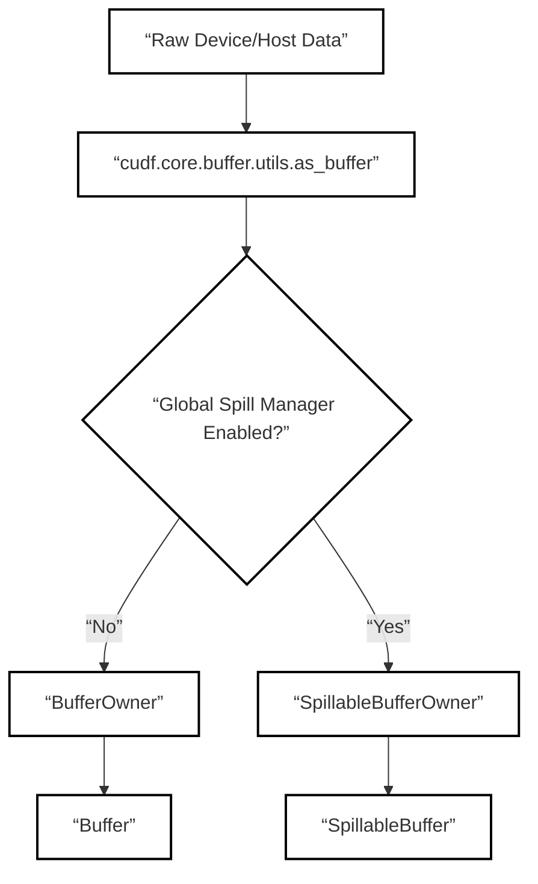
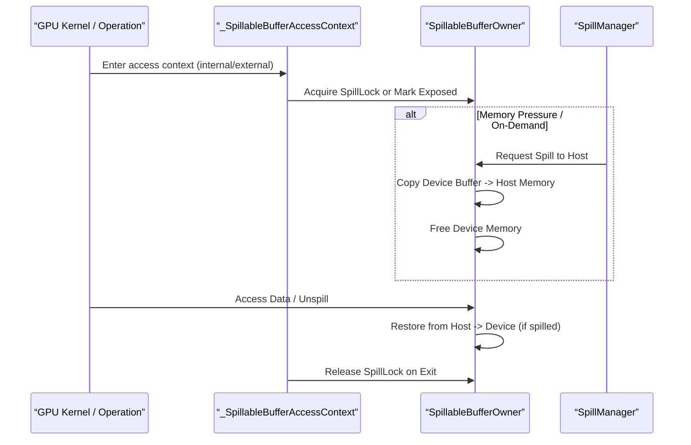

<!-- source: DeepWiki mcp.deepwiki.com · repo NVIDIA/cudf · extra page Buffers, Spilling and Options · fetched 2026-10-26 -->

# Buffers, Spilling and Options

Relevant source files

The following files were used as context for generating this wiki page:

- [python/cudf/cudf/core/buffer/__init__.py](python/cudf/cudf/core/buffer/__init__.py)
- [python/cudf/cudf/core/buffer/buffer.py](python/cudf/cudf/core/buffer/buffer.py)
- [python/cudf/cudf/core/buffer/spill_manager.py](python/cudf/cudf/core/buffer/spill_manager.py)
- [python/cudf/cudf/core/buffer/spillable_buffer.py](python/cudf/cudf/core/buffer/spillable_buffer.py)
- [python/cudf/cudf/core/buffer/utils.py](python/cudf/cudf/core/buffer/utils.py)
- [python/cudf/cudf/options.py](python/cudf/cudf/options.py)
- [python/cudf/cudf/tests/dataframe/methods/test_copy.py](python/cudf/cudf/tests/dataframe/methods/test_copy.py)
- [python/cudf/cudf/tests/options/test_options.py](python/cudf/cudf/tests/options/test_options.py)
- [python/cudf/cudf/tests/test_spilling.py](python/cudf/cudf/tests/test_spilling.py)
- [python/cudf/cudf/utils/utils.py](python/cudf/cudf/utils/utils.py)

## Purpose and Scope
This document details the Python-level memory management infrastructure in cuDF, focusing on untyped memory buffers (`Buffer`, `SpillableBuffer`), the RMM-backed spilling mechanism (`SpillManager`), copy-on-write semantics, global configuration options (`cudf.options`), and performance tracking/utility functions.

---

## 1. Buffer Management and Abstractions

cuDF abstracts raw GPU and host memory allocations using untyped memory buffers. Memory is separated into owning classes (`BufferOwner`, `SpillableBufferOwner`) that manage the lifetime of physical allocations, and view classes (`Buffer`, `SpillableBuffer`) that represent contiguous slices or windows into an owner.

The factory function `as_buffer` [python/cudf/cudf/core/buffer/utils.py:44-119()] inspects inputs (device arrays implementing `__cuda_array_interface__` or host memory via `memoryview`) and instantiates the appropriate buffer type depending on whether global memory spilling is enabled.

*Figure 1: Buffer Abstraction and Factory Dispatch.*

Sources: `python/cudf/cudf/core/buffer/buffer.py`, `python/cudf/cudf/core/buffer/spillable_buffer.py`, `python/cudf/cudf/core/buffer/utils.py`

---

## 2. Spill Manager and Memory Spilling

To prevent Out-Of-Memory (OOM) errors during heavy workloads, cuDF implements an automated memory spilling architecture via `SpillManager` [python/cudf/cudf/core/buffer/spill_manager.py:202-]. 

- **Spillable Buffers**: `SpillableBufferOwner` [python/cudf/cudf/core/buffer/spillable_buffer.py:101-] tracks whether device allocations can be written out to host memory and freed from the GPU.
- **Exposure**: If a device pointer is accessed directly outside controlled contexts (e.g., via `.ptr`), the buffer is permanently marked as *exposed* (`_exposed = True`) and becomes unspillable.
- **Access Contexts**: `_SpillableBufferAccessContext` [python/cudf/cudf/core/buffer/spillable_buffer.py:34-99()] manages temporary spill locks (`SpillLock`) during internal cuDF operations, ensuring buffers are neither spilled nor garbage collected while kernels execute.
- **Statistics**: `SpillStatistics` [python/cudf/cudf/core/buffer/spill_manager.py:62-200()] tracks durations, transferred byte counts, and tracebacks associated with buffer spilling and exposure.

*Figure 2: Spill and Unspill Lifecycle Data Flow.*

Sources: `python/cudf/cudf/core/buffer/spill_manager.py`, `python/cudf/cudf/core/buffer/spillable_buffer.py`

---

## 3. Copy-on-Write and Buffer Immutability

cuDF core objects (such as `Column` and `DataFrame`) enforce immutability semantics. When slicing or performing shallow copies, underlying `Buffer` instances share the same `BufferOwner` [python/cudf/cudf/core/buffer/buffer.py:43-185()] with adjusted offsets and sizes [python/cudf/cudf/core/buffer/utils.py:115-118()]. Write operations trigger copy-on-write (CoW) behaviors or allocate new backing buffers to maintain isolation between mutated structures.

Sources: `python/cudf/cudf/core/buffer/buffer.py`, `python/cudf/cudf/core/buffer/utils.py`, `python/cudf/tests/dataframe/methods/test_copy.py`

---

## 4. Configuration Options (`cudf.options`)

cuDF maintains a centralized configuration registry [python/cudf/cudf/options.py:27-] managed via `Option` data structures [python/cudf/cudf/options.py:17-25()]. 

- **Key Functions**:
  - `get_option(name)` [python/cudf/cudf/options.py:78-100()]: Retrieves the current value of an option.
  - `set_option(name, val)` [python/cudf/cudf/options.py:102-126()]: Validates and updates an option value.
  - `describe_option(name)` [python/cudf/cudf/options.py:135-148()]: Prints descriptions, defaults, and current states.
- **Environment Integration**: Options like `spill`, `spill_on_demand`, and `spill_device_limit` initialize from environment variables via `_env_get_bool` [python/cudf/cudf/options.py:37-48()] and `_env_get_int` [python/cudf/cudf/options.py:30-35()].

Sources: `python/cudf/cudf/options.py`

---

## 5. Performance Tracking and Utilities

General utility functions supporting buffer interactions, compatibility, and execution tracing reside across helper modules:

- **Performance Tracking**: `_performance_tracking` and NVTX domain wrappers (e.g., `_spill_cudf_nvtx_annotate` [python/cudf/cudf/core/buffer/spill_manager.py:28-30()]) inject profiling ranges for spill and memory operations.
- **UFUNCS**: `_array_ufunc` [python/cudf/cudf/utils/utils.py:65-103()] implements NumPy universal function dispatch for cuDF frames and columns.
- **API Guardrails**: `_external_only_api` [python/cudf/cudf/utils/utils.py:125-167()] detects and restricts inefficient internal usages of pandas-compatibility paths when `NO_EXTERNAL_ONLY_APIS` is enabled.
- **Null Checking**: `is_na_like` [python/cudf/cudf/utils/utils.py:170-182()] validates null, `pd.NA`, `pd.NaT`, or PyArrow null scalars.

Sources: `python/cudf/cudf/utils/utils.py`, `python/cudf/cudf/core/buffer/spill_manager.py`

---

