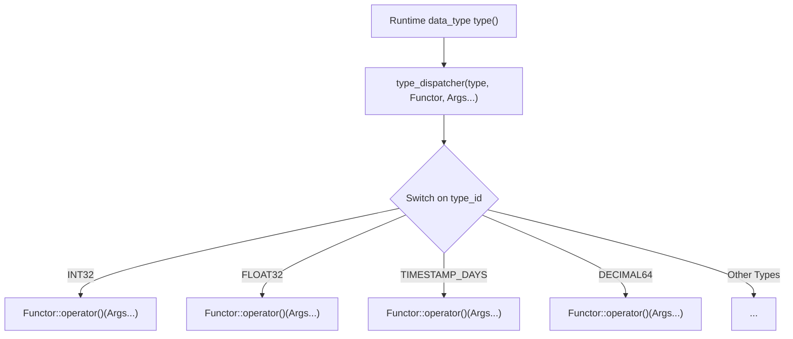
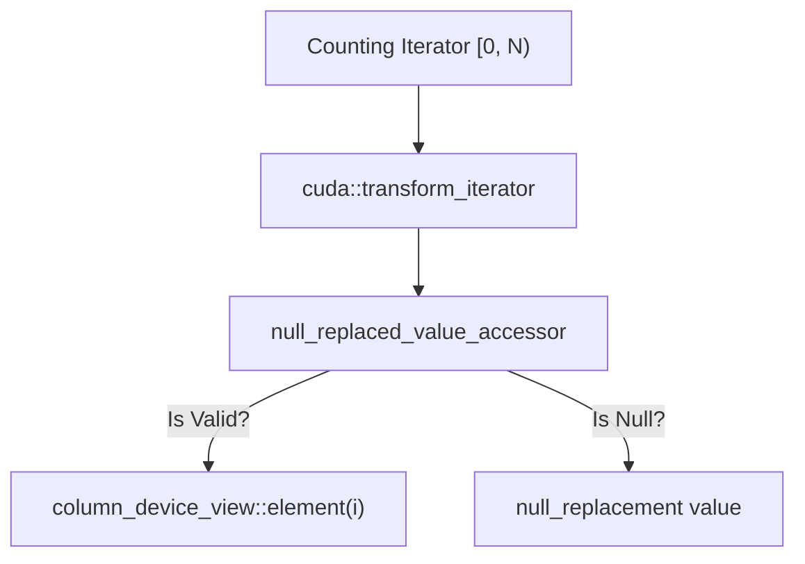

<!-- source: DeepWiki mcp.deepwiki.com · repo NVIDIA/cudf · extra page Type System and Dispatch · fetched 2026-10-26 -->

# Type System and Dispatch

<details>
<summary>Relevant source files</summary>

The following files were used as context for generating this wiki page:

- [cpp/include/cudf/detail/iterator.cuh](cpp/include/cudf/detail/iterator.cuh)
- [cpp/include/cudf/detail/utilities/device_atomics.cuh](cpp/include/cudf/detail/utilities/device_atomics.cuh)
- [cpp/include/cudf/detail/utilities/device_operators.cuh](cpp/include/cudf/detail/utilities/device_operators.cuh)
- [cpp/include/cudf/fixed_point/fixed_point.hpp](cpp/include/cudf/fixed_point/fixed_point.hpp)
- [cpp/include/cudf/scalar/scalar.hpp](cpp/include/cudf/scalar/scalar.hpp)
- [cpp/include/cudf/scalar/scalar_device_view.cuh](cpp/include/cudf/scalar/scalar_device_view.cuh)
- [cpp/include/cudf/scalar/scalar_factories.hpp](cpp/include/cudf/scalar/scalar_factories.hpp)
- [cpp/include/cudf/types.hpp](cpp/include/cudf/types.hpp)
- [cpp/include/cudf/utilities/concepts.hpp](cpp/include/cudf/utilities/concepts.hpp)
- [cpp/include/cudf/utilities/traits.hpp](cpp/include/cudf/utilities/traits.hpp)
- [cpp/include/cudf/utilities/type_dispatcher.hpp](cpp/include/cudf/utilities/type_dispatcher.hpp)
- [cpp/include/cudf/wrappers/durations.hpp](cpp/include/cudf/wrappers/durations.hpp)
- [cpp/include/cudf/wrappers/timestamps.hpp](cpp/include/cudf/wrappers/timestamps.hpp)
- [cpp/src/copying/get_element.cu](cpp/src/copying/get_element.cu)
- [cpp/src/scalar/scalar.cpp](cpp/src/scalar/scalar.cpp)
- [cpp/src/scalar/scalar_factories.cpp](cpp/src/scalar/scalar_factories.cpp)
- [cpp/src/structs/structs_column_factories.cu](cpp/src/structs/structs_column_factories.cu)
- [cpp/tests/device_atomics/device_atomics_test.cu](cpp/tests/device_atomics/device_atomics_test.cu)
- [cpp/tests/fixed_point/fixed_point_tests.cpp](cpp/tests/fixed_point/fixed_point_tests.cpp)
- [cpp/tests/fixed_point/fixed_point_tests.cu](cpp/tests/fixed_point/fixed_point_tests.cu)
- [cpp/tests/iterator/scalar_iterator_test.cu](cpp/tests/iterator/scalar_iterator_test.cu)
- [cpp/tests/scalar/factories_test.cpp](cpp/tests/scalar/factories_test.cpp)
- [cpp/tests/scalar/scalar_device_view_test.cu](cpp/tests/scalar/scalar_device_view_test.cu)
- [cpp/tests/scalar/scalar_test.cpp](cpp/tests/scalar/scalar_test.cpp)
- [cpp/tests/search/search_dictionary_test.cpp](cpp/tests/search/search_dictionary_test.cpp)
- [cpp/tests/search/search_test.cpp](cpp/tests/search/search_test.cpp)
- [cpp/tests/types/traits_test.cpp](cpp/tests/types/traits_test.cpp)
- [cpp/tests/types/type_dispatcher_test.cu](cpp/tests/types/type_dispatcher_test.cu)
- [cpp/tests/wrappers/timestamps_test.cu](cpp/tests/wrappers/timestamps_test.cu)
- [docs/cudf/source/libcudf/api_docs/utility_types.rst](docs/cudf/source/libcudf/api_docs/utility_types.rst)

</details>


## Purpose and Scope

The libcudf type system and dispatch mechanism provide the foundational C++ abstractions required to represent, classify, and dynamically process heterogeneous column and scalar data types on the GPU. Because CUDA is statically typed while dataframes often encounter dynamic, runtime-determined schemas, libcudf bridges this gap using a combination of runtime type identifiers (`cudf::type_id`), compile-time traits, and a high-performance runtime dispatch mechanism (`type_dispatcher`). 

This page details the implementation of logical types, type traits and concepts, the `type_dispatcher` engine, specialized wrappers such as fixed-point decimals, timestamps, and durations, and high-performance device iterators.

Sources: `cpp/include/cudf/types.hpp:185-225`, `cpp/include/cudf/utilities/traits.hpp:1-21`, `cpp/include/cudf/utilities/type_dispatcher.hpp:1-22`

---

## Logical Types and `cudf::type_id`

At the core of libcudf's type system is `cudf::type_id`, an enumeration defined in `cpp/include/cudf/types.hpp` (`[cpp/include/cudf/types.hpp:185-225]()`). Every column and scalar holds a `data_type` object (`[cpp/include/cudf/scalar/scalar.hpp:91-91]()`), which pairs a `type_id` with optional type-specific metadata (such as the scaling factor for fixed-point decimal types).

| `type_id` Category | Enum Values | Underlying C++ / Storage Type |
| :--- | :--- | :--- |
| **Integral** | `INT8`, `INT16`, `INT32`, `INT64`, `UINT8`, `UINT16`, `UINT32`, `UINT64` | `int8_t`, `int16_t`, `int32_t`, `int64_t`, `uint8_t`, `uint16_t`, `uint32_t`, `uint64_t` |
| **Floating Point** | `FLOAT32`, `FLOAT64` | `float`, `double` |
| **Boolean** | `BOOL8` | `bool` |
| **Chrono (Timestamps)** | `TIMESTAMP_DAYS`, `TIMESTAMP_SECONDS`, `TIMESTAMP_MILLISECONDS`, `TIMESTAMP_MICROSECONDS`, `TIMESTAMP_NANOSECONDS` | `cudf::timestamp_D`, `cudf::timestamp_s`, etc. |
| **Chrono (Durations)** | `DURATION_DAYS`, `DURATION_SECONDS`, `DURATION_MILLISECONDS`, `DURATION_MICROSECONDS`, `DURATION_NANOSECONDS` | `cudf::duration_D`, `cudf::duration_s`, etc. |
| **Complex/Nested/Other** | `STRING`, `LIST`, `STRUCT`, `DICTIONARY32`, `DECIMAL32`, `DECIMAL64`, `DECIMAL128` | `cudf::string_view`, `cudf::list_view`, `cudf::struct_view`, `cudf::dictionary32`, `numeric::decimal32`, etc. |

The mapping between runtime `cudf::type_id` values and concrete C++ types is established via explicit template specializations and the `CUDF_TYPE_MAPPING` macro in `cpp/include/cudf/utilities/type_dispatcher.hpp` (`[cpp/include/cudf/utilities/type_dispatcher.hpp:132-179]()`).

Sources: `cpp/include/cudf/types.hpp:185-225`, `cpp/include/cudf/utilities/type_dispatcher.hpp:132-179`

---

## Type Traits and Concepts (`traits.hpp`)

To classify and query properties of column and scalar types at compile time and runtime, libcudf provides a comprehensive suite of traits and C++20 concepts located in `cpp/include/cudf/utilities/traits.hpp` (`[cpp/include/cudf/utilities/traits.hpp:1-21]`) and `cpp/include/cudf/utilities/concepts.hpp` (`[cpp/include/cudf/utilities/concepts.hpp:1-50]()`).

Key trait inspection functions include:
- `cudf::is_numeric(data_type type)` and `is_numeric<T>()`: Identifies fundamental arithmetic types (`[cpp/include/cudf/utilities/traits.hpp:156-180]()`).
- `cudf::is_timestamp<T>()`: Validates whether a type is a chrono timestamp wrapper (`[cpp/include/cudf/utilities/traits.hpp:91-94]()`).
- `cudf::is_duration<T>()`: Validates whether a type is a chrono duration wrapper (`[cpp/include/cudf/utilities/traits.hpp:95-98]()`).
- `cudf::is_fixed_point<T>()`: Checks if a type is a `numeric::fixed_point` specialization.
- `cudf::is_relationally_comparable<L, R>()`: Wraps `cuda::std::totally_ordered_with` to ensure types support relational operators (`[cpp/include/cudf/utilities/traits.hpp:112-117]()`).

Convenience SFINAE macros like `CUDF_ENABLE_IF(...)` are provided to conditionally enable function templates based on type categories (`[cpp/include/cudf/utilities/traits.hpp:39-50]()`):

```cpp
template <typename T, CUDF_ENABLE_IF(std::is_integral_v<T>)>
void foo();
```

Sources: `cpp/include/cudf/utilities/traits.hpp:1-180`, `cpp/include/cudf/utilities/concepts.hpp:1-50`

---

## Runtime-to-Compile-Time Type Dispatching (`type_dispatcher`)

Because libcudf algorithms operate on columns whose types are only known at runtime, kernels and host algorithms utilize `cudf::type_dispatcher` to map a runtime `cudf::type_id` (or `data_type`) to a concrete C++ template parameter `T`.

### Architecture & Data Flow



Diagram: Type Dispatch Execution Flow (`[cpp/include/cudf/utilities/type_dispatcher.hpp:1-124]()`)

The dispatcher invokes the provided functor's templated `operator()<T>()` with any forwarded arguments. For device-side or host-side scalar factory operations, `type_dispatcher` is heavily used to instantiate the appropriate typed structures (e.g., in `cpp/src/scalar/scalar_factories.cpp`, `[cpp/src/scalar/scalar_factories.cpp:18-47]()`).

Sources: `cpp/include/cudf/utilities/type_dispatcher.hpp:1-124`, `cpp/src/scalar/scalar_factories.cpp:18-47`

---

## Specialized Data Wrappers: Fixed-Point Decimals, Timestamps, and Durations

libcudf encapsulates domain-specific scalar and column data inside dedicated wrapper classes to ensure type safety and proper arithmetic semantics.

### Fixed-Point Decimals
Fixed-point decimal types are defined in `cpp/include/cudf/fixed_point/fixed_point.hpp` (`[cpp/include/cudf/fixed_point/fixed_point.hpp:30-205]()`). 
- **Representation**: Backed by `int32_t`, `int64_t`, or `__int128_t` (`[cpp/include/cudf/fixed_point/fixed_point.hpp:60-63]()`).
- **Radix**: Supports `Radix::BASE_2` and `Radix::BASE_10` (`[cpp/include/cudf/fixed_point/fixed_point.hpp:49-49]()`).
- **Scaling**: Managed via `scale_type` and helper constructors such as `scaled_integer` (`[cpp/include/cudf/fixed_point/fixed_point.hpp:38-38, 177-189]()`), which allow construction from pre-scaled integer values.

### Timestamps and Durations
Timestamps and durations leverage `cuda::std::chrono` wrappers (`[cpp/include/cudf/wrappers/timestamps.hpp]`, `[cpp/include/cudf/wrappers/durations.hpp]`). They define distinct epochs and resolution granularities (days, seconds, milliseconds, microseconds, nanoseconds) mapping directly to underlying integer storage types without introducing floating-point precision loss.

Sources: `cpp/include/cudf/fixed_point/fixed_point.hpp:30-205`, `cpp/include/cudf/wrappers/timestamps.hpp:1-50`, `cpp/include/cudf/wrappers/durations.hpp:1-50`

---

## Device Iterators and Accessors (`iterator.cuh`)

For high-performance element retrieval in CUDA kernels (e.g., when integrating with Thrust or CUB), libcudf provides specialized device iterators and accessors in `cpp/include/cudf/detail/iterator.cuh` (`[cpp/include/cudf/detail/iterator.cuh:1-35]()`).

### Key Iterator Components
- `null_replaced_value_accessor<Element>`: A unary functor that checks validity at index `i` via a `column_device_view` (`[cpp/include/cudf/detail/iterator.cuh:81-111]()`). If the element is valid, it returns `column[i]`; if null, it returns a user-supplied `null_replacement` value.
- `validity_accessor<safe>`: A functor that queries the null bitmask state of an element at index `i` (`[cpp/include/cudf/detail/iterator.cuh:121-151]()`).
- `make_null_replacement_iterator(...)`: A factory function returning a `cuda::transform_iterator` wrapping a counting iterator and `null_replaced_value_accessor` (`[cpp/include/cudf/detail/iterator.cuh:171-178]()`).



Diagram: Null-Replacement Iterator Data Flow (`[cpp/include/cudf/detail/iterator.cuh:81-178]()`)

Sources: `cpp/include/cudf/detail/iterator.cuh:1-185`

---

