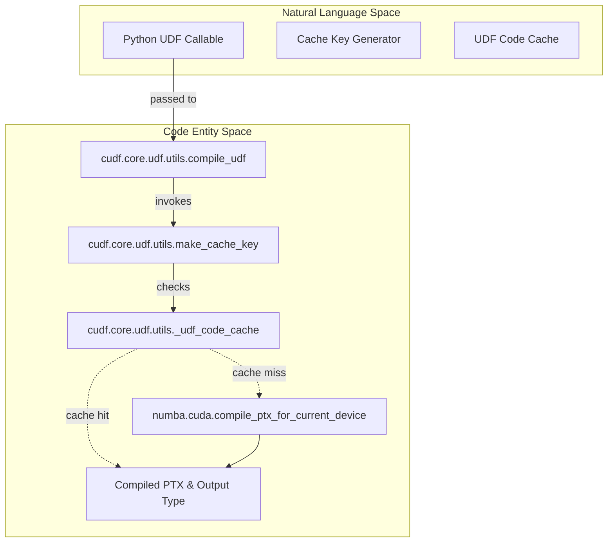
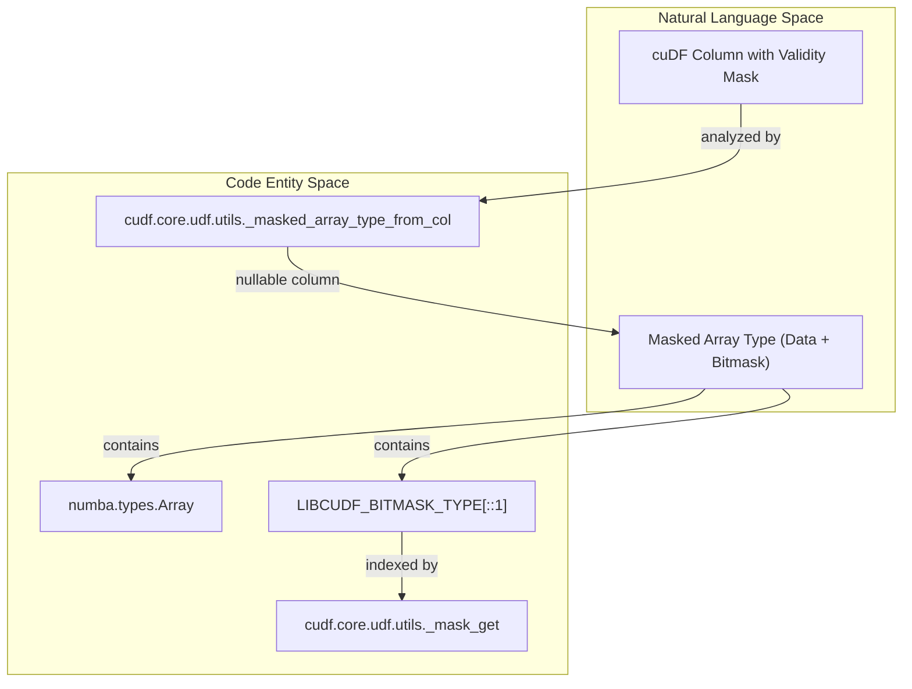
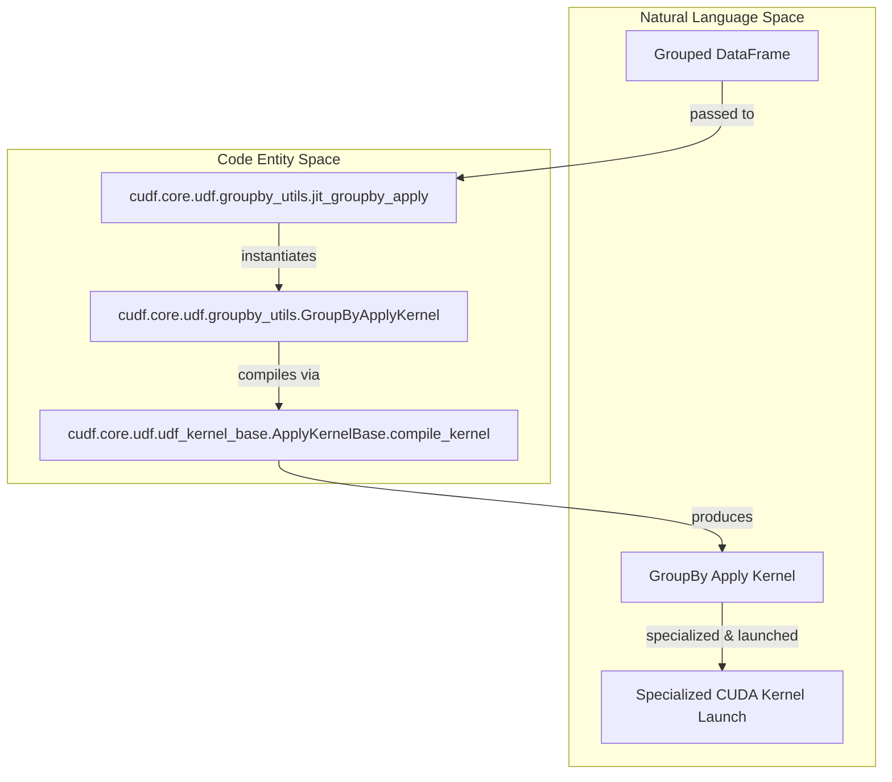

<!-- source: DeepWiki mcp.deepwiki.com · repo NVIDIA/cudf · extra page User-Defined Functions (Numba) · fetched 2026-10-26 -->

# User-Defined Functions (Numba)

Relevant source files

The following files were used as context for generating this wiki page:

- [cpp/include/cudf/strings/utilities.hpp](cpp/include/cudf/strings/utilities.hpp)
- [cpp/include/cudf/utilities/prefetch.hpp](cpp/include/cudf/utilities/prefetch.hpp)
- [cpp/src/utilities/prefetch.cpp](cpp/src/utilities/prefetch.cpp)
- [python/cudf/cudf/_lib/strings_udf.pyx](python/cudf/cudf/_lib/strings_udf.pyx)
- [python/cudf/cudf/core/udf/groupby_lowering.py](python/cudf/cudf/core/udf/groupby_lowering.py)
- [python/cudf/cudf/core/udf/groupby_typing.py](python/cudf/cudf/core/udf/groupby_typing.py)
- [python/cudf/cudf/core/udf/groupby_utils.py](python/cudf/cudf/core/udf/groupby_utils.py)
- [python/cudf/cudf/core/udf/masked_lowering.py](python/cudf/cudf/core/udf/masked_lowering.py)
- [python/cudf/cudf/core/udf/masked_typing.py](python/cudf/cudf/core/udf/masked_typing.py)
- [python/cudf/cudf/core/udf/nrt_utils.py](python/cudf/cudf/core/udf/nrt_utils.py)
- [python/cudf/cudf/core/udf/row_function.py](python/cudf/cudf/core/udf/row_function.py)
- [python/cudf/cudf/core/udf/scalar_function.py](python/cudf/cudf/core/udf/scalar_function.py)
- [python/cudf/cudf/core/udf/strings_lowering.py](python/cudf/cudf/core/udf/strings_lowering.py)
- [python/cudf/cudf/core/udf/strings_typing.py](python/cudf/cudf/core/udf/strings_typing.py)
- [python/cudf/cudf/core/udf/templates.py](python/cudf/cudf/core/udf/templates.py)
- [python/cudf/cudf/core/udf/udf_kernel_base.py](python/cudf/cudf/core/udf/udf_kernel_base.py)
- [python/cudf/cudf/core/udf/utils.py](python/cudf/cudf/core/udf/utils.py)
- [python/cudf/cudf/tests/dataframe/methods/test_to_records.py](python/cudf/cudf/tests/dataframe/methods/test_to_records.py)
- [python/cudf/cudf/tests/indexes/rangeindex/test_constructors.py](python/cudf/cudf/tests/indexes/rangeindex/test_constructors.py)
- [python/cudf/cudf/tests/private_objects/test_compile_udf.py](python/cudf/cudf/tests/private_objects/test_compile_udf.py)
- [python/cudf/cudf/tests/private_objects/test_udf_shim_linking.py](python/cudf/cudf/tests/private_objects/test_udf_shim_linking.py)
- [python/cudf/cudf/utils/_numba.py](python/cudf/cudf/utils/_numba.py)
- [python/cudf/udf_cpp/CMakeLists.txt](python/cudf/udf_cpp/CMakeLists.txt)
- [python/cudf/udf_cpp/shim.cu](python/cudf/udf_cpp/shim.cu)
- [python/cudf/udf_cpp/strings/include/cudf/strings/udf/udf_apis.hpp](python/cudf/udf_cpp/strings/include/cudf/strings/udf/udf_apis.hpp)
- [python/cudf/udf_cpp/strings/src/strings/udf/udf_apis.cu](python/cudf/udf_cpp/strings/src/strings/udf/udf_apis.cu)
- [python/pylibcudf/pylibcudf/libcudf/detail/utilities/stream_pool.pxd](python/pylibcudf/pylibcudf/libcudf/detail/utilities/stream_pool.pxd)

## Purpose and Scope

The cuDF User-Defined Function (UDF) subsystem enables execution of JIT-compiled Python callables on GPU Series and DataFrames via Numba. It translates Python functions into CUDA PTX device code or custom kernels, supporting row-wise operations, scalar functions, and GroupBy apply aggregations. This subsystem coordinates Numba typing, low-level type lowering, validity bitmask management, Numba Runtime (NRT) integration for dynamic string allocations, and a companion C++/CUDA runtime library (`udf_cpp`) supplying string primitives and memory management shims.

---

## 1. Compilation Pipeline and Architecture

The UDF compilation flow intercepts Python callables, extracts their signatures, compiles them to PTX via Numba's CUDA compilation APIs, and caches the results to avoid redundant compilation overhead.

`compile_udf` computes a cache key using `make_cache_key` based on bytecode, constants, names, closure variables, and the type signature [python/cudf/cudf/core/udf/utils.py:149-216](). If not cached, Numba compiles the function to PTX for the current device with `device=True` [python/cudf/cudf/core/udf/utils.py:204-206]().

Sources: 
- `python/cudf/cudf/core/udf/utils.py`

---

## 2. Typing, Masked Types, and Rows

cuDF columns often contain missing values managed via validity bitmasks. Numba UDF typing uses custom extension types to represent rows, masked arrays, and structured views.

### Row and Masked Array Models
- `Row`: A subclass of Numba's `Record` model used for type inference and checking during row-wise operations [python/cudf/cudf/core/udf/utils.py:123-140]().
- `_masked_array_type_from_col`: Constructs a Numba type representing either a raw data array pointer or a `Tuple` of data array and validity bitmask (`LIBCUDF_BITMASK_TYPE`) [python/cudf/cudf/core/udf/utils.py:103-121]().
- `_mask_get`: A device helper function that extracts validity bit states from bitmask buffers [python/cudf/cudf/core/udf/utils.py:143-146]().

Sources:
- `python/cudf/cudf/core/udf/utils.py`

---

## 3. Row and GroupBy Kernels

UDF execution on Series, DataFrames, and GroupBys is orchestrated by specialized kernel classes inheriting from `ApplyKernelBase` [python/cudf/cudf/core/udf/udf_kernel_base.py:32-37]().

### Kernel Infrastructure and GroupBy Apply
- `ApplyKernelBase`: Handles signature construction (`_construct_signature`), return type probing (`_get_udf_return_type`), and NRT usage tracking (`CaptureNRTUsage`) [python/cudf/cudf/core/udf/udf_kernel_base.py:32-158]().
- `GroupByApplyKernel`: Specializes `ApplyKernelBase` for GroupBy apply operations, modeling incoming groups via `_get_frame_groupby_type` [python/cudf/cudf/core/udf/groupby_utils.py:39-83, 186-209]().
- `jit_groupby_apply`: Main entry point that sets up output columns, specializes kernels based on block sizes, configures `_CUDFNumbaConfig`, and launches the CUDA kernel [python/cudf/cudf/core/udf/groupby_utils.py:86-162]().
- `GroupType`: Numba extension type backing individual group iterations in GroupBy apply, maintaining pointers to group data, sizes, and indices [python/cudf/cudf/core/udf/groupby_typing.py:50-75, 112-126]().

Sources:
- `python/cudf/cudf/core/udf/groupby_utils.py`
- `python/cudf/cudf/core/udf/groupby_typing.py`
- `python/cudf/cudf/core/udf/udf_kernel_base.py`

---

## 4. String UDFs, Shim, and NRT (`udf_cpp`)

String columns in UDFs require complex memory management and specialized string view representations because standard Numba types cannot natively map libcudf string structures.

### String Types and Lowering
- `StringView`, `UDFString`, `ManagedUDFString`: Numba type definitions mirroring libcudf string views and managed heap strings [python/cudf/cudf/core/udf/strings_typing.py:20-112]().
- `StrViewArgHandler`: Preprocesses incoming arguments to convert `string_view*` pointers into raw uint64 pointer arguments for Numba execution [python/cudf/cudf/core/udf/strings_typing.py:115-138]().
- `strings_lowering.py`: Declares external device functions (`len`, `contains`, `replace`, `startswith`, `endswith`, etc.) and registers casts between string literals, string views, and managed UDF strings [python/cudf/cudf/core/udf/strings_lowering.py:30-212]().

### C++ Shim and `udf_cpp`
- `shim.cu`: Implements NRT-compatible destructors (`udf_str_dtor`), memory info initializers (`make_meminfo_for_new_udf_string`), decref wrappers, and extern "C" CUDA device bindings for string operations [python/cudf/udf_cpp/shim.cu:34-209]().
- `CMakeLists.txt`: Compiles `cudf_strings_udf` shared library and compiles `shim.cu` into a fatbin object (`shim.fatbin`) installed under `cudf/core/udf/` [python/cudf/udf_cpp/CMakeLists.txt:40-103]().
- `strings_udf.pyx`: Cython wrapper providing host/device buffer conversion utilities (`column_to_string_view_array`, `column_from_managed_udf_string_array`) and character table pointers [python/cudf/cudf/_lib/strings_udf.pyx:26-62]().
- `nrt_utils.py`: Manages NRT enablement (`nrt_enabled`) and locates libcudf rapids include directories for NVRTC compilation [python/cudf/cudf/core/udf/nrt_utils.py:17-82]().

Sources:
- `python/cudf/cudf/core/udf/strings_typing.py`
- `python/cudf/cudf/core/udf/strings_lowering.py`
- `python/cudf/cudf/core/udf/nrt_utils.py`
- `python/cudf/udf_cpp/CMakeLists.txt`
- `python/cudf/udf_cpp/shim.cu`
- `python/cudf/cudf/_lib/strings_udf.pyx`

---

