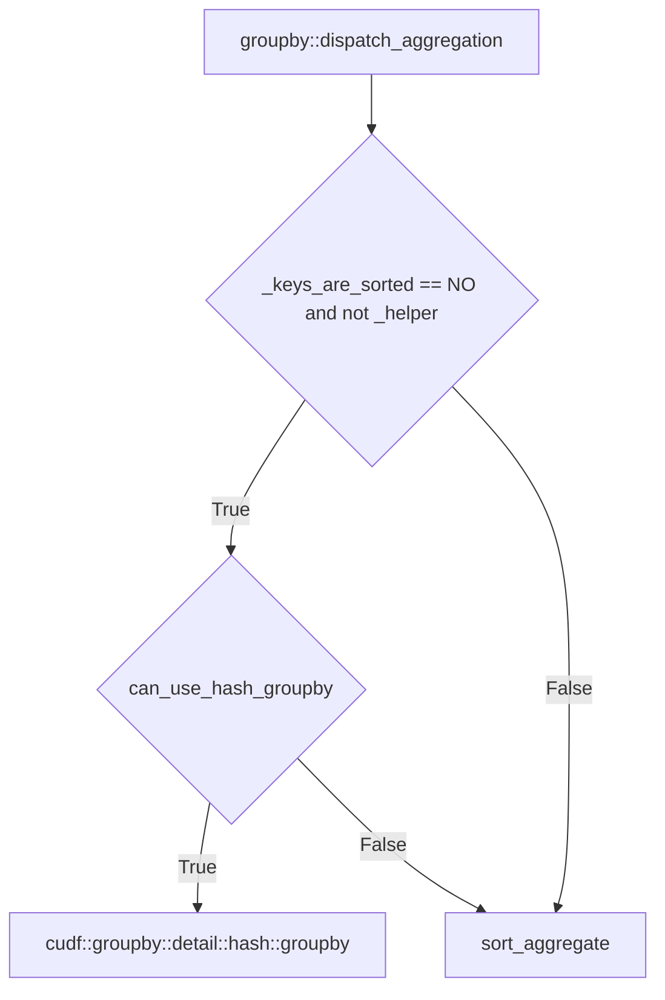

<!-- source: DeepWiki mcp.deepwiki.com · repo NVIDIA/cudf · extra page GroupBy and Aggregations · fetched 2026-10-26 -->

# GroupBy and Aggregations

<details>
<summary>Relevant source files</summary>

The following files were used as context for generating this wiki page:

- [ci/run_cudf_memcheck_ctests.sh](ci/run_cudf_memcheck_ctests.sh)
- [cpp/include/cudf/aggregation.hpp](cpp/include/cudf/aggregation.hpp)
- [cpp/include/cudf/detail/aggregation/aggregation.cuh](cpp/include/cudf/detail/aggregation/aggregation.cuh)
- [cpp/include/cudf/detail/aggregation/aggregation.hpp](cpp/include/cudf/detail/aggregation/aggregation.hpp)
- [cpp/include/cudf/detail/aggregation/device_aggregators.cuh](cpp/include/cudf/detail/aggregation/device_aggregators.cuh)
- [cpp/include/cudf/detail/groupby.hpp](cpp/include/cudf/detail/groupby.hpp)
- [cpp/include/cudf/detail/groupby/sort_helper.hpp](cpp/include/cudf/detail/groupby/sort_helper.hpp)
- [cpp/include/cudf/detail/scan.hpp](cpp/include/cudf/detail/scan.hpp)
- [cpp/include/cudf/groupby.hpp](cpp/include/cudf/groupby.hpp)
- [cpp/src/aggregation/aggregation.cpp](cpp/src/aggregation/aggregation.cpp)
- [cpp/src/aggregation/aggregation.cu](cpp/src/aggregation/aggregation.cu)
- [cpp/src/binaryop/compiled/struct_binary_ops.cuh](cpp/src/binaryop/compiled/struct_binary_ops.cuh)
- [cpp/src/groupby/groupby.cu](cpp/src/groupby/groupby.cu)
- [cpp/src/groupby/hash/groupby.cu](cpp/src/groupby/hash/groupby.cu)
- [cpp/src/groupby/sort/aggregate.cpp](cpp/src/groupby/sort/aggregate.cpp)
- [cpp/src/groupby/sort/functors.hpp](cpp/src/groupby/sort/functors.hpp)
- [cpp/src/groupby/sort/group_count.cu](cpp/src/groupby/sort/group_count.cu)
- [cpp/src/groupby/sort/group_max.cu](cpp/src/groupby/sort/group_max.cu)
- [cpp/src/groupby/sort/group_min.cu](cpp/src/groupby/sort/group_min.cu)
- [cpp/src/groupby/sort/group_nth_element.cu](cpp/src/groupby/sort/group_nth_element.cu)
- [cpp/src/groupby/sort/group_nunique.cu](cpp/src/groupby/sort/group_nunique.cu)
- [cpp/src/groupby/sort/group_quantiles.cu](cpp/src/groupby/sort/group_quantiles.cu)
- [cpp/src/groupby/sort/group_rank_scan.cu](cpp/src/groupby/sort/group_rank_scan.cu)
- [cpp/src/groupby/sort/group_reductions.hpp](cpp/src/groupby/sort/group_reductions.hpp)
- [cpp/src/groupby/sort/group_scan.hpp](cpp/src/groupby/sort/group_scan.hpp)
- [cpp/src/groupby/sort/group_scan_util.cuh](cpp/src/groupby/sort/group_scan_util.cuh)
- [cpp/src/groupby/sort/group_single_pass_reduction_util.cuh](cpp/src/groupby/sort/group_single_pass_reduction_util.cuh)
- [cpp/src/groupby/sort/group_std.cu](cpp/src/groupby/sort/group_std.cu)
- [cpp/src/groupby/sort/group_sum.cu](cpp/src/groupby/sort/group_sum.cu)
- [cpp/src/groupby/sort/scan.cpp](cpp/src/groupby/sort/scan.cpp)
- [cpp/src/groupby/sort/sort_helper.cu](cpp/src/groupby/sort/sort_helper.cu)
- [cpp/src/reductions/scan/rank_scan.cu](cpp/src/reductions/scan/rank_scan.cu)
- [cpp/src/reductions/scan/scan.cpp](cpp/src/reductions/scan/scan.cpp)
- [cpp/src/reductions/scan/scan.cuh](cpp/src/reductions/scan/scan.cuh)
- [cpp/src/reductions/scan/scan_exclusive.cu](cpp/src/reductions/scan/scan_exclusive.cu)
- [cpp/src/reductions/scan/scan_inclusive.cu](cpp/src/reductions/scan/scan_inclusive.cu)
- [cpp/src/reductions/segmented/nunique.cu](cpp/src/reductions/segmented/nunique.cu)
- [cpp/src/reductions/segmented/reductions.cpp](cpp/src/reductions/segmented/reductions.cpp)
- [cpp/src/reductions/unique_count_column.cu](cpp/src/reductions/unique_count_column.cu)
- [cpp/tests/groupby/rank_scan_tests.cpp](cpp/tests/groupby/rank_scan_tests.cpp)
- [cpp/tests/groupby/std_tests.cpp](cpp/tests/groupby/std_tests.cpp)
- [cpp/tests/groupby/sum_tests.cpp](cpp/tests/groupby/sum_tests.cpp)
- [cpp/tests/groupby/var_tests.cpp](cpp/tests/groupby/var_tests.cpp)
- [cpp/tests/identify_stream_usage/test_default_stream_identification.cu](cpp/tests/identify_stream_usage/test_default_stream_identification.cu)
- [cpp/tests/iterator/value_iterator_test_numeric.cu](cpp/tests/iterator/value_iterator_test_numeric.cu)
- [cpp/tests/reductions/list_rank_test.cpp](cpp/tests/reductions/list_rank_test.cpp)
- [cpp/tests/reductions/rank_tests.cpp](cpp/tests/reductions/rank_tests.cpp)
- [cpp/tests/reductions/scan_tests.cpp](cpp/tests/reductions/scan_tests.cpp)
- [cpp/tests/reductions/segmented_reduction_tests.cpp](cpp/tests/reductions/segmented_reduction_tests.cpp)

</details>


## Purpose and Scope
This page details the implementation of GroupBy and aggregations within `libcudf`. It covers the request/result model (`aggregation_request` and `aggregation_result`), the dispatch logic selecting between hash-based and sort-based execution paths, per-group reductions and scans using segmented primitives, and the internal result cache infrastructure.

---

## 1. Aggregation Request Model
The grouping and aggregation interface is anchored around request structures that define which keys are grouped, which value columns are aggregated, and what operations (`aggregation` kinds) are applied.

- **`aggregation_request`**: Associates a `column_view` of values with a vector of unique pointers to `groupby_aggregation` objects [cpp/include/cudf/groupby.hpp:54-57]().
- **`aggregation_result`**: Holds the resulting `column` vectors returned for each request [cpp/include/cudf/groupby.hpp:81-84]().
- **`aggregation` Base Hierarchy**: All aggregation types inherit from `aggregation` [cpp/include/cudf/aggregation.hpp:76-173]() or specialized subtypes such as `groupby_aggregation` [cpp/include/cudf/aggregation.hpp:183-183]() and `groupby_scan_aggregation` [cpp/include/cudf/aggregation.hpp:188-188](). Factories such as `make_sum_aggregation()` construct specific aggregation instances [cpp/src/aggregation/aggregation.cpp:21-37]().

```mermaid
graph TD
    subcode["Code Entity Space"]
        G["cudf::groupby::groupby"] --> AR["cudf::groupby::aggregation_request"]
        AR --> V["cudf::column_view (values)"]
        AR --> AGG["std::vector<std::unique_ptr<groupby_aggregation>>"]
        AGG --> BASE["cudf::aggregation"]
        BASE --> SUB["cudf::detail::sum_aggregation"]
        G --> RES["cudf::groupby::aggregation_result"]
        RES --> COL["std::vector<std::unique_ptr<cudf::column>>"]
    end

    subgraph NL["Natural Language Space"]
        N1["GroupBy API Consumer"] --> N2["Request Definition"]
        N2 --> N3["Aggregation Factory"]
        N3 --> N4["Result Extraction"]
    end

    N1 -.-> G
    N2 -.-> AR
    N3 -.-> BASE
    N4 -.-> RES
```
*Diagram 1: Bridging natural language groupby concepts to libcudf code entities.*

**Sources:**
- `cpp/include/cudf/groupby.hpp` [cpp/include/cudf/groupby.hpp:54-84]()
- `cpp/include/cudf/aggregation.hpp` [cpp/include/cudf/aggregation.hpp:76-188]()
- `cpp/src/aggregation/aggregation.cpp` [cpp/src/aggregation/aggregation.cpp:21-37]()

---

## 2. Hash vs. Sort GroupBy Paths
When `groupby::aggregate` is invoked, libcudf dynamically chooses between a hash-based path and a sort-based path inside `groupby::dispatch_aggregation()` [cpp/src/groupby/groupby.cu:53-70]().

### Selection Heuristics
1. **Hash GroupBy**: Used if keys are not pre-sorted (`_keys_are_sorted == sorted::NO`), no existing helper is active, and all requested aggregations satisfy `can_use_hash_groupby()` [cpp/src/groupby/groupby.cu:64-66]().
2. **Sort GroupBy**: Used otherwise (e.g., if keys are pre-sorted, complex aggregations require ordering, or a sort helper has already been bound) [cpp/src/groupby/groupby.cu:67-67]().

`can_use_hash_groupby()` evaluates whether every requested aggregation is supported by single-pass hash aggregation logic [cpp/src/groupby/hash/groupby.cu:72-88]().


*Diagram 2: Decision flow for hash vs. sort groupby execution paths.*

**Sources:**
- `cpp/src/groupby/groupby.cu` [cpp/src/groupby/groupby.cu:53-70]()
- `cpp/src/groupby/hash/groupby.cu` [cpp/src/groupby/hash/groupby.cu:72-88]()

---

## 3. Per-Group Reductions and Scans
Both hash and sort groupby pathways delegate actual computations on grouped value columns to per-group reduction and scan utilities.

### Segmented Reductions
For sort-based groupby, group segments are identified via `sort_groupby_helper` [cpp/include/cudf/detail/groupby/sort_helper.hpp:31-56](). Group offsets are computed [cpp/src/groupby/sort/sort_helper.cu:121-144]() and used to launch segmented operations via `thrust::reduce_by_key` inside `group_reduction_functor` [cpp/src/groupby/sort/group_single_pass_reduction_util.cuh:130-140]().

- **Reductions**: Functions like `group_sum`, `group_min`, and `group_max` take `column_view values`, group count, and `device_span<size_type const> group_labels` [cpp/src/groupby/sort/group_reductions.hpp:41-134]().
- **Scans**: Grouped scans compute prefix sums or minimums within each group partition while maintaining boundary constraints.

```mermaid
graph TD
    subcode["Code Entity Space"]
        GRF["cudf::groupby::detail::group_reduction_functor"] --> TRB["thrust::reduce_by_key"]
        GRF --> LARG["cudf::groupby::detail::launch_argminmax_reduction"]
        SLH["cudf::groupby::detail::sort::sort_groupby_helper"] --> GO["group_offsets"]
        SLH --> GL["group_labels"]
    end

    subgraph NL["Natural Language Space"]
        N1["Segmented Input Values"] --> N2["Key Sorting & Labeling"]
        N2 --> N3["Parallel Reduction per Segment"]
    end

    N1 -.-> SLH
    N2 -.-> GL
    N3 -.-> TRB
```
*Diagram 3: Code entities involved in executing per-group reductions.*

**Sources:**
- `cpp/include/cudf/detail/groupby/sort_helper.hpp` [cpp/include/cudf/detail/groupby/sort_helper.hpp:31-56]()
- `cpp/src/groupby/sort/sort_helper.cu` [cpp/src/groupby/sort/sort_helper.cu:121-144]()
- `cpp/src/groupby/sort/group_reductions.hpp` [cpp/src/groupby/sort/group_reductions.hpp:41-134]()
- `cpp/src/groupby/sort/group_single_pass_reduction_util.cuh` [cpp/src/groupby/sort/group_single_pass_reduction_util.cuh:65-161]()

---

## 4. Result Cache
To avoid redundant calculations when multiple aggregations share common intermediate states (e.g., computing both `MEAN` from `SUM` and `COUNT`), libcudf utilizes `cudf::detail::result_cache`.

- **Lifecycle**: Initialized with the number of requests [cpp/src/groupby/hash/groupby.cu:98-98](), passed into the hash computation engine [cpp/src/groupby/hash/groupby.cu:32-38](), and queried to retrieve or store intermediate column results.
- **Extraction**: Once group keys and primary aggregates are evaluated, `extract_results` collects final columns from the cache [cpp/src/groupby/hash/groupby.cu:103-104]().

**Sources:**
- `cpp/src/groupby/hash/groupby.cu` [cpp/src/groupby/hash/groupby.cu:32-105]()

---

