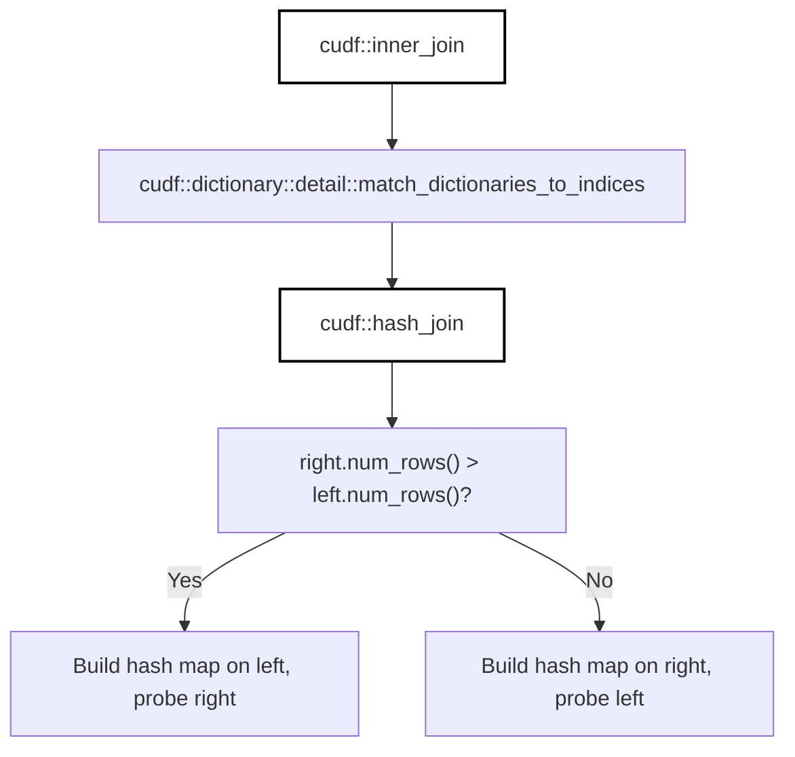
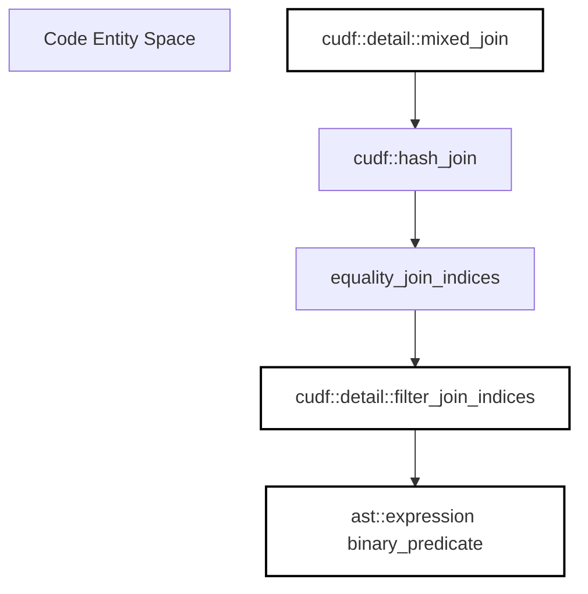

<!-- source: DeepWiki mcp.deepwiki.com · repo NVIDIA/cudf · extra page Joins · fetched 2026-10-26 -->

# Joins

Relevant source files

The following files were used as context for generating this wiki page:

- [cpp/benchmarks/common/ndsh_data_generator/random_column_generator.cu](cpp/benchmarks/common/ndsh_data_generator/random_column_generator.cu)
- [cpp/benchmarks/hashing/hash.cpp](cpp/benchmarks/hashing/hash.cpp)
- [cpp/benchmarks/join/direct_join.cu](cpp/benchmarks/join/direct_join.cu)
- [cpp/benchmarks/join/generate_input_tables.cu](cpp/benchmarks/join/generate_input_tables.cu)
- [cpp/benchmarks/join/join_on_int32.cu](cpp/benchmarks/join/join_on_int32.cu)
- [cpp/include/cudf/detail/join/filtered_join.cuh](cpp/include/cudf/detail/join/filtered_join.cuh)
- [cpp/include/cudf/detail/join/hash_join.hpp](cpp/include/cudf/detail/join/hash_join.hpp)
- [cpp/include/cudf/detail/row_operator/hashing.cuh](cpp/include/cudf/detail/row_operator/hashing.cuh)
- [cpp/include/cudf/detail/row_operator/spark_hashing.cuh](cpp/include/cudf/detail/row_operator/spark_hashing.cuh)
- [cpp/include/cudf/detail/utilities/integer_utils.hpp](cpp/include/cudf/detail/utilities/integer_utils.hpp)
- [cpp/include/cudf/hashing.hpp](cpp/include/cudf/hashing.hpp)
- [cpp/include/cudf/hashing/detail/hashing.hpp](cpp/include/cudf/hashing/detail/hashing.hpp)
- [cpp/include/cudf/join/filtered_join.hpp](cpp/include/cudf/join/filtered_join.hpp)
- [cpp/include/cudf/join/hash_join.hpp](cpp/include/cudf/join/hash_join.hpp)
- [cpp/include/cudf/join/join.hpp](cpp/include/cudf/join/join.hpp)
- [cpp/include/cudf/join/mark_join.hpp](cpp/include/cudf/join/mark_join.hpp)
- [cpp/include/cudf/join/sort_merge_join.hpp](cpp/include/cudf/join/sort_merge_join.hpp)
- [cpp/include/cudf/join/streaming_hash_join.hpp](cpp/include/cudf/join/streaming_hash_join.hpp)
- [cpp/src/hash/murmurhash3_x86_32.cuh](cpp/src/hash/murmurhash3_x86_32.cuh)
- [cpp/src/hash/spark_murmurhash3_x86_32.cu](cpp/src/hash/spark_murmurhash3_x86_32.cu)
- [cpp/src/io/parquet/rle_stream.cuh](cpp/src/io/parquet/rle_stream.cuh)
- [cpp/src/join/conditional_join.cu](cpp/src/join/conditional_join.cu)
- [cpp/src/join/conditional_join_kernels.cuh](cpp/src/join/conditional_join_kernels.cuh)
- [cpp/src/join/filter_join_indices/filter_join_indices.cu](cpp/src/join/filter_join_indices/filter_join_indices.cu)
- [cpp/src/join/filter_join_indices/filter_join_indices_jit.cu](cpp/src/join/filter_join_indices/filter_join_indices_jit.cu)
- [cpp/src/join/filter_join_indices/filter_join_indices_output_size_kernel.cuh](cpp/src/join/filter_join_indices/filter_join_indices_output_size_kernel.cuh)
- [cpp/src/join/filter_join_indices/filter_join_indices_output_size_kernel.hpp](cpp/src/join/filter_join_indices/filter_join_indices_output_size_kernel.hpp)
- [cpp/src/join/filter_join_indices/filter_join_indices_output_size_kernel_complex.cu](cpp/src/join/filter_join_indices/filter_join_indices_output_size_kernel_complex.cu)
- [cpp/src/join/filter_join_indices/filter_join_indices_output_size_kernel_null_complex.cu](cpp/src/join/filter_join_indices/filter_join_indices_output_size_kernel_null_complex.cu)
- [cpp/src/join/filter_join_indices/filter_join_indices_output_size_kernel_null_primitive.cu](cpp/src/join/filter_join_indices/filter_join_indices_output_size_kernel_null_primitive.cu)
- [cpp/src/join/filter_join_indices/filter_join_indices_output_size_kernel_primitive.cu](cpp/src/join/filter_join_indices/filter_join_indices_output_size_kernel_primitive.cu)
- [cpp/src/join/filter_join_indices/full_join.hpp](cpp/src/join/filter_join_indices/full_join.hpp)
- [cpp/src/join/filtered_join/filtered_join_common.cuh](cpp/src/join/filtered_join/filtered_join_common.cuh)
- [cpp/src/join/filtered_join/filtered_join_flat.cu](cpp/src/join/filtered_join/filtered_join_flat.cu)
- [cpp/src/join/filtered_join/filtered_join_nested.cu](cpp/src/join/filtered_join/filtered_join_nested.cu)
- [cpp/src/join/filtered_join/filtered_join_nested_query.cu](cpp/src/join/filtered_join/filtered_join_nested_query.cu)
- [cpp/src/join/hash_join/common.cuh](cpp/src/join/hash_join/common.cuh)
- [cpp/src/join/join.cu](cpp/src/join/join.cu)
- [cpp/src/join/join_common_utils.cuh](cpp/src/join/join_common_utils.cuh)
- [cpp/src/join/join_common_utils.hpp](cpp/src/join/join_common_utils.hpp)
- [cpp/src/join/mark_join.cu](cpp/src/join/mark_join.cu)
- [cpp/src/join/mark_join.cuh](cpp/src/join/mark_join.cuh)
- [cpp/src/join/mixed_join.cu](cpp/src/join/mixed_join.cu)
- [cpp/src/join/mixed_join_common_utils.cuh](cpp/src/join/mixed_join_common_utils.cuh)
- [cpp/src/join/mixed_join_kernels_semi.cu](cpp/src/join/mixed_join_kernels_semi.cu)
- [cpp/src/join/mixed_join_kernels_semi.cuh](cpp/src/join/mixed_join_kernels_semi.cuh)
- [cpp/src/join/mixed_join_semi.cu](cpp/src/join/mixed_join_semi.cu)
- [cpp/src/join/sort_merge_join.cu](cpp/src/join/sort_merge_join.cu)
- [cpp/src/join/sort_merge_join.hpp](cpp/src/join/sort_merge_join.hpp)
- [cpp/tests/hashing/spark_murmurhash3_x86_32_test.cpp](cpp/tests/hashing/spark_murmurhash3_x86_32_test.cpp)
- [cpp/tests/join/conditional_join_tests.cu](cpp/tests/join/conditional_join_tests.cu)
- [cpp/tests/join/join_tests.cpp](cpp/tests/join/join_tests.cpp)
- [cpp/tests/join/mixed_join_tests.cu](cpp/tests/join/mixed_join_tests.cu)
- [cpp/tests/join/semi_anti_join_tests.cpp](cpp/tests/join/semi_anti_join_tests.cpp)
- [cpp/tests/row_operator/row_operator_tests.cu](cpp/tests/row_operator/row_operator_tests.cu)
- [cpp/tests/streams/hash_test.cpp](cpp/tests/streams/hash_test.cpp)
- [cpp/tests/streams/join_test.cpp](cpp/tests/streams/join_test.cpp)
- [python/cudf_streaming/cudf_streaming/partition.pyi](python/cudf_streaming/cudf_streaming/partition.pyi)
- [python/cudf_streaming/cudf_streaming/partition.pyx](python/cudf_streaming/cudf_streaming/partition.pyx)
- [python/cudf_streaming/cudf_streaming/partition_utils.pxd](python/cudf_streaming/cudf_streaming/partition_utils.pxd)
- [python/cudf_streaming/cudf_streaming/partition_utils.pyi](python/cudf_streaming/cudf_streaming/partition_utils.pyi)
- [python/cudf_streaming/cudf_streaming/partition_utils.pyx](python/cudf_streaming/cudf_streaming/partition_utils.pyx)
- [python/pylibcudf/pylibcudf/join.pxd](python/pylibcudf/pylibcudf/join.pxd)
- [python/pylibcudf/pylibcudf/join.pyi](python/pylibcudf/pylibcudf/join.pyi)
- [python/pylibcudf/pylibcudf/join.pyx](python/pylibcudf/pylibcudf/join.pyx)
- [python/pylibcudf/pylibcudf/libcudf/join.pxd](python/pylibcudf/pylibcudf/libcudf/join.pxd)
- [python/pylibcudf/pylibcudf/libcudf/join.pyx](python/pylibcudf/pylibcudf/libcudf/join.pyx)

## Purpose and Scope
This page documents libcudf's relational join and hashing infrastructure (`cpp/include/cudf/join/` and `cpp/include/cudf/hashing.hpp`). It details the implementation, data flow, and architecture of hash joins, sort-merge joins, conditional/mixed joins, semi/anti joins, mark/filtered joins, and hashing utilities executed on NVIDIA GPUs.

Sources: `cpp/include/cudf/join/join.hpp`(), `cpp/include/cudf/hashing.hpp`()

---

## 1. Core Join Architectures and APIs

libcudf provides several join variants controlled by the `cudf::join_kind` enum (`INNER_JOIN`, `LEFT_JOIN`, `FULL_JOIN`, `LEFT_SEMI_JOIN`, `LEFT_ANTI_JOIN`) defined in `cpp/include/cudf/join/join.hpp`. Join APIs accept `table_view` inputs for left and right keys, a `null_equality` specifier (`EQUAL` or `UNEQUAL`), a CUDA stream, and an RMM memory resource.

*Diagram 1: Join Execution Dispatch and Dictionary Alignment*  
Sources: `cpp/src/join/join.cu`(), `cpp/include/cudf/join/join.hpp`()

---

## 2. Hash Join Implementation

The `cudf::hash_join` class (`cpp/include/cudf/join/hash_join.hpp`) builds an open-addressing hash table (leveraging `cuco` data structures) using the build-side table (`right_keys`). 

### Data Flow and Implementation Details
1. **Dictionary Matching**: Prior to building the hash table, `cudf::dictionary::detail::match_dictionaries_to_indices` ensures dictionary columns share unified key sets across left and right tables [cpp/src/join/join.cu:37-38]().
2. **Hash Table Construction**: The build table rows are hashed using row hashers. If `nullable_join::YES` is specified, null keys are handled according to `compare_nulls`.
3. **Probing**: The probe table (`left_keys`) is streamed through the hash table to generate output index pairs (`left_indices`, `right_indices`) as `rmm::device_uvector<size_type>`.
4. **Streaming Hash Join**: For out-of-core or continuous streaming workflows, `cudf::streaming_hash_join` provides stateful matching over partitioned blocks.

Sources: `cpp/include/cudf/join/hash_join.hpp`(), `cpp/src/join/join.cu`()

---

## 3. Sort-Merge Join

`cudf::sort_merge_join` (`cpp/include/cudf/include/cudf/join/sort_merge_join.hpp`) implements equality joins via sorting or leveraging pre-sorted inputs (`cudf::sorted::YES` or `cudf::sorted::NO`) [cpp/tests/join/join_tests.cpp:121]().

### Implementation Steps
1. **Run Identification**: `build_right_run_index` identifies distinct key runs in the sorted right table using custom lexicographic row comparators and CUB transform/select primitives [cpp/src/join/sort_merge_join.cu:135-185]().
2. **Merge & Search**: Binary search and range scans evaluate matching rows between left and right sorted boundaries on device.

Sources: `cpp/include/cudf/join/sort_merge_join.hpp`(), `cpp/src/join/sort_merge_join.cu`()

---

## 4. Conditional, Mixed, Semi, and Anti Joins

When join predicates involve arbitrary expressions (inequalities, arithmetic combinations) rather than simple equality, libcudf uses conditional and mixed join infrastructure.

*Diagram 2: Mixed Join Execution Flow Using Equality Hash Join and AST Filtering*  
Sources: `cpp/src/join/mixed_join.cu`(), `cpp/include/cudf/join/mixed_join.hpp`()

### Mixed and Conditional Joins
* **`cudf::mixed_join`**: Combines a hash-based equality join to generate candidate index pairs, followed by an Abstract Syntax Tree (`cudf::ast::expression`) evaluation step (`filter_join_indices`) to filter pairs matching complex conditions [cpp/src/join/mixed_join.cu:61-131]().
* **`cudf::conditional_join`**: Evaluates purely conditional predicates across all pairs (or via spatial/block caching) when no equality keys are available [cpp/src/join/conditional_join.cu:130-136]().
* **Semi and Anti Joins**: `mixed_join_semi` and `conditional_join_anti_semi` optimize execution for `LEFT_SEMI_JOIN` and `LEFT_ANTI_JOIN` by short-circuiting output generation as soon as a match is verified or rejected [cpp/src/join/mixed_join_semi.cu:39-48](), [cpp/src/join/conditional_join.cu:34-41]().

Sources: `cpp/src/join/mixed_join.hpp`(), `cpp/src/join/conditional_join.hpp`(), `cpp/src/join/mixed_join_semi.cu`()

---

## 5. Mark and Filtered Joins

* **Mark Joins**: `cudf::mark_join` evaluates whether left table rows have matches in the right table, returning a boolean column indicating match status (supporting null handling via row bitmasks) [cpp/src/join/mark_join.cu:43-61]().
* **Filtered Joins**: `filtered_join` and related utilities [cpp/include/cudf/detail/join/filtered_join.cuh]() optimize candidate reduction using bloom filters before launching full join or probe kernels [cpp/src/join/mark_join.cu:83-124]().

Sources: `cpp/include/cudf/join/mark_join.hpp`(), `cpp/src/join/mark_join.cu`()

---

## 6. Hashing Utilities

Hashing utilities in `cudf::hashing` (`cpp/include/cudf/hashing.hpp`) provide row-wise hashing functions utilized by hash joins, groupbys, and partitioning:
* **`murmurhash3_x86_32`**: Standard 32-bit MurmurHash3 implementation across table rows [cpp/include/cudf/hashing.hpp:58-62]().
* **`spark_murmurhash3_x86_32`**: Apache Spark-compatible MurmurHash3 implementation matching Spark's type-specific canonicalization rules, floating-point handling (`-0.0` vs `+0.0`, NaN normalization), and partial-block sign extension [cpp/include/cudf/hashing.hpp:96-100]().
* **Cryptographic Hashes**: `md5`, `sha1`, `sha224`, `sha256`, `sha384`, and `sha512` row-wise hashing functions [cpp/include/cudf/hashing.hpp:130-167]().

Sources: `cpp/include/cudf/hashing.hpp`()

---

