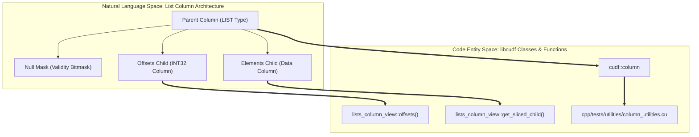
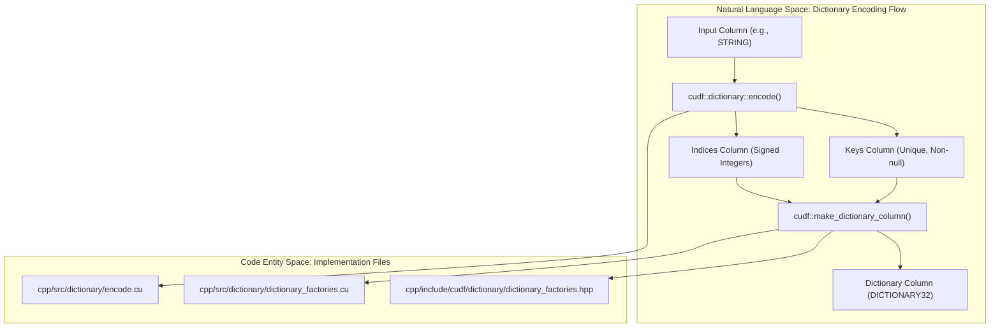

<!-- source: DeepWiki mcp.deepwiki.com · repo NVIDIA/cudf · extra page Nested and Dictionary Types · fetched 2026-10-26 -->

# Nested and Dictionary Types

Relevant source files

The following files were used as context for generating this wiki page:

- [cpp/include/cudf/detail/gather.hpp](cpp/include/cudf/detail/gather.hpp)
- [cpp/include/cudf/dictionary/detail/concatenate.hpp](cpp/include/cudf/dictionary/detail/concatenate.hpp)
- [cpp/include/cudf/dictionary/detail/encode.hpp](cpp/include/cudf/dictionary/detail/encode.hpp)
- [cpp/include/cudf/dictionary/detail/merge.hpp](cpp/include/cudf/dictionary/detail/merge.hpp)
- [cpp/include/cudf/dictionary/detail/replace.hpp](cpp/include/cudf/dictionary/detail/replace.hpp)
- [cpp/include/cudf/dictionary/detail/search.hpp](cpp/include/cudf/dictionary/detail/search.hpp)
- [cpp/include/cudf/dictionary/detail/update_keys.hpp](cpp/include/cudf/dictionary/detail/update_keys.hpp)
- [cpp/include/cudf/dictionary/dictionary_column_view.hpp](cpp/include/cudf/dictionary/dictionary_column_view.hpp)
- [cpp/include/cudf/dictionary/dictionary_factories.hpp](cpp/include/cudf/dictionary/dictionary_factories.hpp)
- [cpp/include/cudf/dictionary/encode.hpp](cpp/include/cudf/dictionary/encode.hpp)
- [cpp/include/cudf/dictionary/search.hpp](cpp/include/cudf/dictionary/search.hpp)
- [cpp/include/cudf/dictionary/update_keys.hpp](cpp/include/cudf/dictionary/update_keys.hpp)
- [cpp/include/cudf/lists/combine.hpp](cpp/include/cudf/lists/combine.hpp)
- [cpp/include/cudf/lists/detail/concatenate.hpp](cpp/include/cudf/lists/detail/concatenate.hpp)
- [cpp/include/cudf/lists/detail/lists_column_factories.hpp](cpp/include/cudf/lists/detail/lists_column_factories.hpp)
- [cpp/include/cudf/lists/lists_column_view.hpp](cpp/include/cudf/lists/lists_column_view.hpp)
- [cpp/include/cudf_test/column_wrapper.hpp](cpp/include/cudf_test/column_wrapper.hpp)
- [cpp/include/doxygen_groups.h](cpp/include/doxygen_groups.h)
- [cpp/src/dictionary/add_keys.cu](cpp/src/dictionary/add_keys.cu)
- [cpp/src/dictionary/decode.cu](cpp/src/dictionary/decode.cu)
- [cpp/src/dictionary/detail/concatenate.cu](cpp/src/dictionary/detail/concatenate.cu)
- [cpp/src/dictionary/dictionary_column_view.cpp](cpp/src/dictionary/dictionary_column_view.cpp)
- [cpp/src/dictionary/dictionary_factories.cu](cpp/src/dictionary/dictionary_factories.cu)
- [cpp/src/dictionary/encode.cu](cpp/src/dictionary/encode.cu)
- [cpp/src/dictionary/match_keys.cu](cpp/src/dictionary/match_keys.cu)
- [cpp/src/dictionary/remove_keys.cu](cpp/src/dictionary/remove_keys.cu)
- [cpp/src/dictionary/search.cu](cpp/src/dictionary/search.cu)
- [cpp/src/dictionary/set_keys.cu](cpp/src/dictionary/set_keys.cu)
- [cpp/src/groupby/sort/group_argmax.cu](cpp/src/groupby/sort/group_argmax.cu)
- [cpp/src/groupby/sort/group_argmin.cu](cpp/src/groupby/sort/group_argmin.cu)
- [cpp/src/lists/combine/concatenate_list_elements.cu](cpp/src/lists/combine/concatenate_list_elements.cu)
- [cpp/src/lists/combine/concatenate_rows.cu](cpp/src/lists/combine/concatenate_rows.cu)
- [cpp/src/lists/copying/concatenate.cu](cpp/src/lists/copying/concatenate.cu)
- [cpp/src/lists/copying/scatter_helper.cu](cpp/src/lists/copying/scatter_helper.cu)
- [cpp/src/lists/dremel.cu](cpp/src/lists/dremel.cu)
- [cpp/src/lists/explode.cu](cpp/src/lists/explode.cu)
- [cpp/src/lists/interleave_columns.cu](cpp/src/lists/interleave_columns.cu)
- [cpp/src/lists/lists_column_factories.cu](cpp/src/lists/lists_column_factories.cu)
- [cpp/src/lists/lists_column_view.cu](cpp/src/lists/lists_column_view.cu)
- [cpp/src/lists/reverse.cu](cpp/src/lists/reverse.cu)
- [cpp/src/lists/set_operations.cu](cpp/src/lists/set_operations.cu)
- [cpp/src/reshape/byte_cast.cu](cpp/src/reshape/byte_cast.cu)
- [cpp/src/strings/copying/copying.cu](cpp/src/strings/copying/copying.cu)
- [cpp/tests/dictionary/add_keys_test.cpp](cpp/tests/dictionary/add_keys_test.cpp)
- [cpp/tests/dictionary/encode_test.cpp](cpp/tests/dictionary/encode_test.cpp)
- [cpp/tests/dictionary/factories_test.cpp](cpp/tests/dictionary/factories_test.cpp)
- [cpp/tests/dictionary/fill_test.cpp](cpp/tests/dictionary/fill_test.cpp)
- [cpp/tests/dictionary/remove_keys_test.cpp](cpp/tests/dictionary/remove_keys_test.cpp)
- [cpp/tests/dictionary/search_test.cpp](cpp/tests/dictionary/search_test.cpp)
- [cpp/tests/dictionary/set_keys_test.cpp](cpp/tests/dictionary/set_keys_test.cpp)
- [cpp/tests/encode/encode_tests.cpp](cpp/tests/encode/encode_tests.cpp)
- [cpp/tests/io/parquet_chunked_writer_test.cpp](cpp/tests/io/parquet_chunked_writer_test.cpp)
- [cpp/tests/io/parquet_misc_test.cpp](cpp/tests/io/parquet_misc_test.cpp)
- [cpp/tests/io/parquet_v2_test.cpp](cpp/tests/io/parquet_v2_test.cpp)
- [cpp/tests/lists/combine/concatenate_list_elements_tests.cpp](cpp/tests/lists/combine/concatenate_list_elements_tests.cpp)
- [cpp/tests/lists/combine/concatenate_rows_tests.cpp](cpp/tests/lists/combine/concatenate_rows_tests.cpp)
- [cpp/tests/lists/explode_tests.cpp](cpp/tests/lists/explode_tests.cpp)
- [cpp/tests/reshape/byte_cast_tests.cpp](cpp/tests/reshape/byte_cast_tests.cpp)
- [cpp/tests/streams/dictionary_test.cpp](cpp/tests/streams/dictionary_test.cpp)
- [cpp/tests/streams/io/csv_test.cpp](cpp/tests/streams/io/csv_test.cpp)
- [cpp/tests/streams/io/orc_test.cpp](cpp/tests/streams/io/orc_test.cpp)
- [cpp/tests/streams/io/parquet_test.cpp](cpp/tests/streams/io/parquet_test.cpp)
- [cpp/tests/structs/structs_column_tests.cpp](cpp/tests/structs/structs_column_tests.cpp)
- [cpp/tests/utilities/column_utilities.cu](cpp/tests/utilities/column_utilities.cu)
- [cpp/tests/utilities_tests/column_utilities_tests.cpp](cpp/tests/utilities_tests/column_utilities_tests.cpp)
- [cpp/tests/utilities_tests/column_wrapper_tests.cpp](cpp/tests/utilities_tests/column_wrapper_tests.cpp)
- [cpp/tests/utilities_tests/lists_column_wrapper_tests.cpp](cpp/tests/utilities_tests/lists_column_wrapper_tests.cpp)

## Purpose and Scope
This page details the implementation, data structures, factories, and operations for complex, hierarchical, and encoded types within `libcudf`. This covers list columns (`lists_column_view`), struct columns (`struct_view`/`struct_column_view`), and dictionary-encoded columns (`dictionary_column_view`), along with their associated creation, encoding, and mutation APIs.

Sources: `cpp/include/doxygen_groups.h:20-41`

---

## 1. List Columns and Operations

List columns represent variable-length arrays of elements for each row. In `libcudf`, a list column is structured as a parent column with a null mask and two children:
1. **Offsets child**: A fixed-width integer column (typically `INT32`) containing `num_rows + 1` entries defining the start and end boundaries for each row's elements in the child column.
2. **Elements child**: An arbitrary cuDF column containing the packed data elements for all lists.

### Key Classes and Functions
* `cudf::lists_column_view`: Provides a lightweight, non-owning view into a list column, exposing accessors for offsets, child elements, and null masks.
* `generate_child_row_indices`: Utility function used during testing and list transformations to map parent list rows to underlying element positions [cpp/tests/utilities/column_utilities.cu:91-101]().

Diagram: List Column Memory Layout to Code Entities

Sources: `cpp/tests/utilities/column_utilities.cu:91-101`, `cpp/include/doxygen_groups.h:148-160`

---

## 2. Struct Columns and Operations

Struct columns represent composite records where each row contains a fixed set of named fields. Each field is stored as a separate child column of the struct column.

### Implementation and Structure
* A struct column has `N` children corresponding to `N` fields.
* All child columns share the same logical row count and are governed by the parent struct column's null mask.
* `cudf::struct_view` and `cudf::struct_column_view` provide device and host-side accessors to retrieve child columns by index or field name.

Sources: `cpp/include/doxygen_groups.h:33`, `cpp/tests/structs/structs_column_tests.cpp`

---

## 3. Dictionary Encoding and Operations

Dictionary encoding compresses repetitive data by storing unique values (keys) once in a separate column and replacing the original data with integer references (indices) pointing to those keys.

### Core Architecture
A dictionary column (`type_id::DICTIONARY32`) owns two child columns:
1. **Indices Column**: A signed integer column (`INT8`, `INT16`, or `INT32`) containing references to the keys.
2. **Keys Column**: A non-null column containing unique, sorted values representing the dictionary domain.

Sources: `cpp/src/dictionary/encode.cu:55-59`, `cpp/src/dictionary/dictionary_factories.cu:43-67`, `cpp/include/cudf/dictionary/dictionary_factories.hpp:55-60`

### Key Factories and Manipulation APIs

* **Creation**: 
  - `cudf::dictionary::encode(column_view const& input, data_type indices_type, ...)`: Constructs a dictionary column from an arbitrary input column [cpp/src/dictionary/encode.cu:55-59]().
  - `cudf::make_dictionary_column(column_view const& keys_column, column_view const& indices_column, ...)`: Factory building a dictionary column by copying keys and indices [cpp/include/cudf/dictionary/dictionary_factories.hpp:55-60]().
  - `cudf::make_dictionary_column(std::unique_ptr<column> keys_column, std::unique_ptr<column> indices_column, ...)`: Factory taking ownership of keys and indices [cpp/include/cudf/dictionary/dictionary_factories.hpp:77-80]().

* **Key Management & Mutation**:
  - `cudf::dictionary::add_keys(dictionary_column_view const& input, column_view const& new_keys, ...)`: Appends new keys to the dictionary [cpp/src/dictionary/add_keys.cu:60-64]().
  - `cudf::dictionary::remap_indices(dictionary_column_view const& input, column_view const& new_keys, ...)`: Re-indexes the dictionary against a new set of keys [cpp/src/dictionary/set_keys.cu:167-170]().
  - `cudf::dictionary::detail::remove_keys_fn`: Internal utility removing specified keys and updating index mappings [cpp/src/dictionary/remove_keys.cu:50-55]().
  - `cudf::dictionary::detail::concatenate`: Concatenates multiple dictionary columns by merging their key spaces and remapping indices [cpp/src/dictionary/detail/concatenate.cu:165-167]().

Sources: `cpp/include/cudf/dictionary/dictionary_factories.hpp:55-108`, `cpp/src/dictionary/encode.cu:55-164`, `cpp/src/dictionary/add_keys.cu:60-67`, `cpp/src/dictionary/set_keys.cu:167-170`, `cpp/src/dictionary/remove_keys.cu:50-55`, `cpp/src/dictionary/detail/concatenate.cu:165-167`

---

