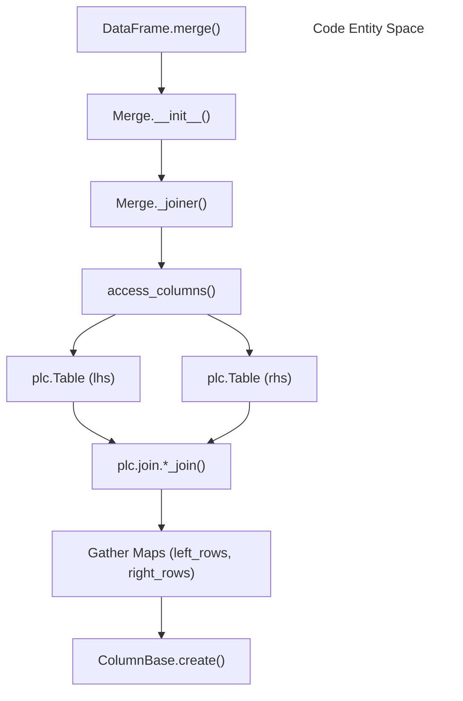
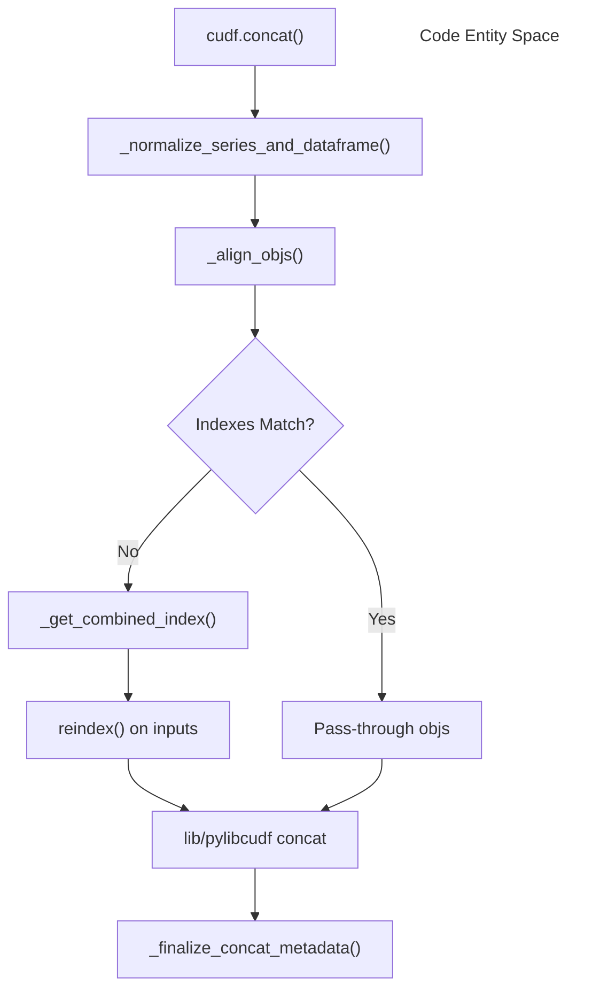
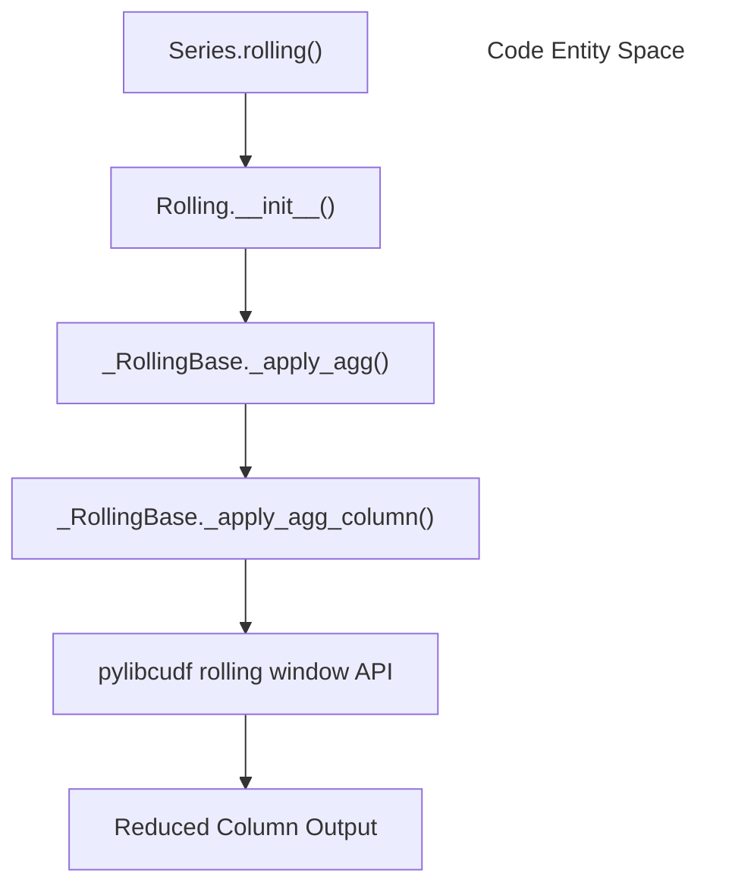
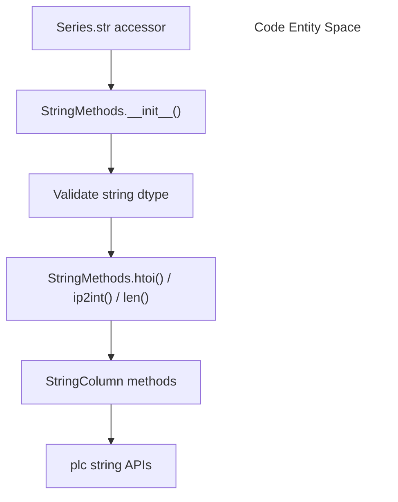

<!-- source: DeepWiki mcp.deepwiki.com · repo NVIDIA/cudf · extra page Operations: GroupBy, Join, Reshape, Rolling, Datetime Tools · fetched 2026-10-26 -->

# Operations: GroupBy, Join, Reshape, Rolling, Datetime Tools

Relevant source files

The following files were used as context for generating this wiki page:

- [python/cudf/cudf/core/accessors/string.py](python/cudf/cudf/core/accessors/string.py)
- [python/cudf/cudf/core/join/join.py](python/cudf/cudf/core/join/join.py)
- [python/cudf/cudf/core/reshape.py](python/cudf/cudf/core/reshape.py)
- [python/cudf/cudf/core/tools/datetimes.py](python/cudf/cudf/core/tools/datetimes.py)
- [python/cudf/cudf/core/window/rolling.py](python/cudf/cudf/core/window/rolling.py)
- [python/cudf/cudf/tests/dataframe/methods/test_describe.py](python/cudf/cudf/tests/dataframe/methods/test_describe.py)
- [python/cudf/cudf/tests/dataframe/methods/test_isna_notnull.py](python/cudf/cudf/tests/dataframe/methods/test_isna_notnull.py)
- [python/cudf/cudf/tests/dataframe/methods/test_pop.py](python/cudf/cudf/tests/dataframe/methods/test_pop.py)
- [python/cudf/cudf/tests/dataframe/methods/test_select_dtypes.py](python/cudf/cudf/tests/dataframe/methods/test_select_dtypes.py)
- [python/cudf/cudf/tests/dataframe/methods/test_sort_index.py](python/cudf/cudf/tests/dataframe/methods/test_sort_index.py)
- [python/cudf/cudf/tests/private_objects/__init__.py](python/cudf/cudf/tests/private_objects/__init__.py)
- [python/cudf/cudf/tests/private_objects/_rmm_stats_script.py](python/cudf/cudf/tests/private_objects/_rmm_stats_script.py)
- [python/cudf/cudf/tests/private_objects/test_extension_compilation.py](python/cudf/cudf/tests/private_objects/test_extension_compilation.py)
- [python/cudf/cudf/tests/private_objects/test_memory_records_report.py](python/cudf/cudf/tests/private_objects/test_memory_records_report.py)
- [python/cudf/cudf/tests/reshape/test_concat.py](python/cudf/cudf/tests/reshape/test_concat.py)
- [python/cudf/cudf/tests/series/accessors/test_str.py](python/cudf/cudf/tests/series/accessors/test_str.py)
- [python/cudf/cudf/tests/series/methods/test_cov_corr.py](python/cudf/cudf/tests/series/methods/test_cov_corr.py)
- [python/cudf/cudf/tests/series/methods/test_to_arrow.py](python/cudf/cudf/tests/series/methods/test_to_arrow.py)
- [python/cudf/cudf/tests/testing/test_assert_series_equal.py](python/cudf/cudf/tests/testing/test_assert_series_equal.py)
- [python/cudf/cudf/utils/performance_tracking.py](python/cudf/cudf/utils/performance_tracking.py)

This wiki page covers the technical implementation and architecture of core operations modules in `cudf.core`, including GroupBy, Join (`cudf.core.join`), Reshape (`cudf.core.reshape`), Rolling/Window operations (`cudf.core.window.rolling`), Datetime parsing tools (`cudf.core.tools.datetimes`), and accessor classes (`StringMethods` under `cudf.core.accessors.string`). These modules translate pandas-compatible high-level API calls into high-performance GPU execution paths powered by `pylibcudf` and `libcudf`.

---

## 1. Joins and Merges (`cudf.core.join`)

The `cudf.core.join` module manages relational table merges through the `Merge` class. It maps pandas merge parameters (`how`, `on`, `left_on`, `right_on`, `left_index`, `right_index`) to underlying `pylibcudf` join routines.

### Implementation and Data Flow

When executing a join, `Merge._joiner` extracts raw column pointers from `ColumnBase` objects using `access_columns`, constructs a `plc.Table` for both left and right operands, and invokes the appropriate `plc.join` function (e.g., `inner_join`, `full_join`, `left_join`, `leftsemi_join`, `leftanti_join`).

Sources: `python/cudf/cudf/core/join/join.py:36-64`

The join engine tracks whether unmatched rows are introduced, triggering pandas-compatible upcasts or null-filling semantics. Depending on `mode.pandas_compatible` options and sort requirements, output rows are reordered or sorted lexicographically.

Sources: `python/cudf/cudf/core/join/join.py:36-184`

---

## 2. Reshaping and Alignment (`cudf.core.reshape`)

The `cudf.core.reshape` module implements operations such as `concat`, `_align_objs`, and index combination utilities.

### Object Alignment and Concat Workflow

`_align_objs` checks whether input Series, DataFrames, or Indices share identical indexes. If they diverge, it verifies uniqueness, computes a combined index via `_get_combined_index`, and reindexes the objects accordingly.

Sources: `python/cudf/cudf/core/reshape.py:44-172`, `python/cudf/cudf/core/reshape.py:174-202`

Metadata propagation ensures that user attributes (`attrs`) and flags (`allows_duplicate_labels`) are preserved across concatenation results according to pandas conventions.

Sources: `python/cudf/cudf/core/reshape.py:44-202`

---

## 3. Window and Rolling Calculations (`cudf.core.window.rolling`)

Rolling window operations are driven by the `_RollingBase` and `Rolling` classes in `cudf.core.window.rolling`. 

### Rolling Execution Model

The `Rolling` class accepts fixed integer window sizes or variable time-based offsets (for datetime-indexed series/dataframes). It implements standard statistical reductions (`sum`, `min`, `max`, `mean`, `var`, `std`) and supports custom user-defined aggregations via `.apply()`.

Sources: `python/cudf/cudf/core/window/rolling.py:42-63`, `python/cudf/cudf/core/window/rolling.py:64-233`

Sources: `python/cudf/cudf/core/window/rolling.py:42-233`

---

## 4. Datetime Tools (`cudf.core.tools.datetimes`)

The `cudf.core.tools.datetimes` module exposes `to_datetime` for converting scalars, lists, Series, or DataFrames into GPU-backed datetime columns or indices.

### Parsing and Validation Pipeline

Before parsing, format directives are verified using `_validate_format_directives`, which checks for conflicting date/time specifiers (such as combining `%j` day-of-year with ISO year `%G`, or validating ISO week `%V` dependencies).

Sources: `python/cudf/cudf/core/tools/datetimes.py:74-120`, `python/cudf/cudf/core/tools/datetimes.py:121-196`

---

## 5. Accessors (`str`, `dt`, `cat`, `list`, `struct`)

Vectorized accessor properties enable namespace-specific operations on `Series` and `Index` objects. 

### String Methods (`StringMethods`)

`StringMethods` validates that the underlying column contains string data (or categorical data with string categories) and delegates vector operations to `StringColumn` and underlying `pylibcudf` string primitives.

Sources: `python/cudf/cudf/core/accessors/string.py:74-122`, `python/cudf/cudf/core/accessors/string.py:123-205`

Key conversion methods include `.htoi()` (hex string to integer) and `.ip2int()` (IPv4 string to integer representation), which map directly to `StringColumn.hex_to_integers()` and `StringColumn.ipv4_to_integers()`.

Sources: `python/cudf/cudf/core/accessors/string.py:123-176`

---

