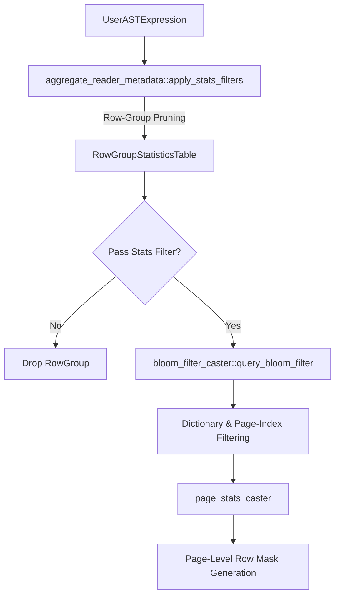
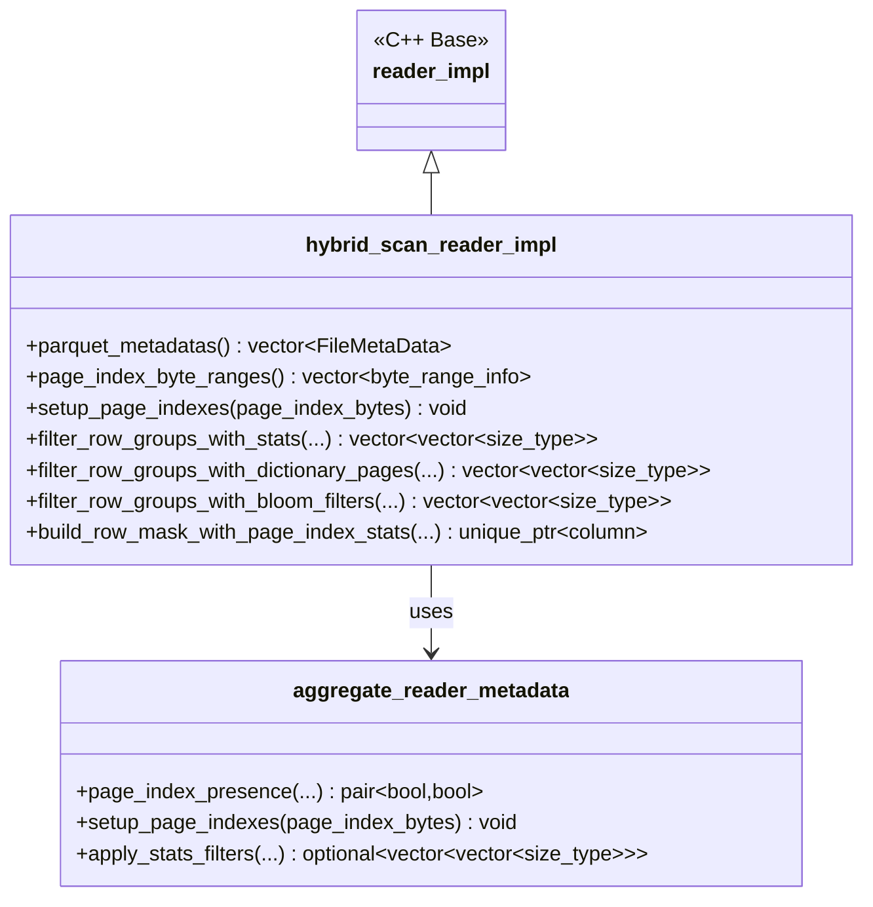
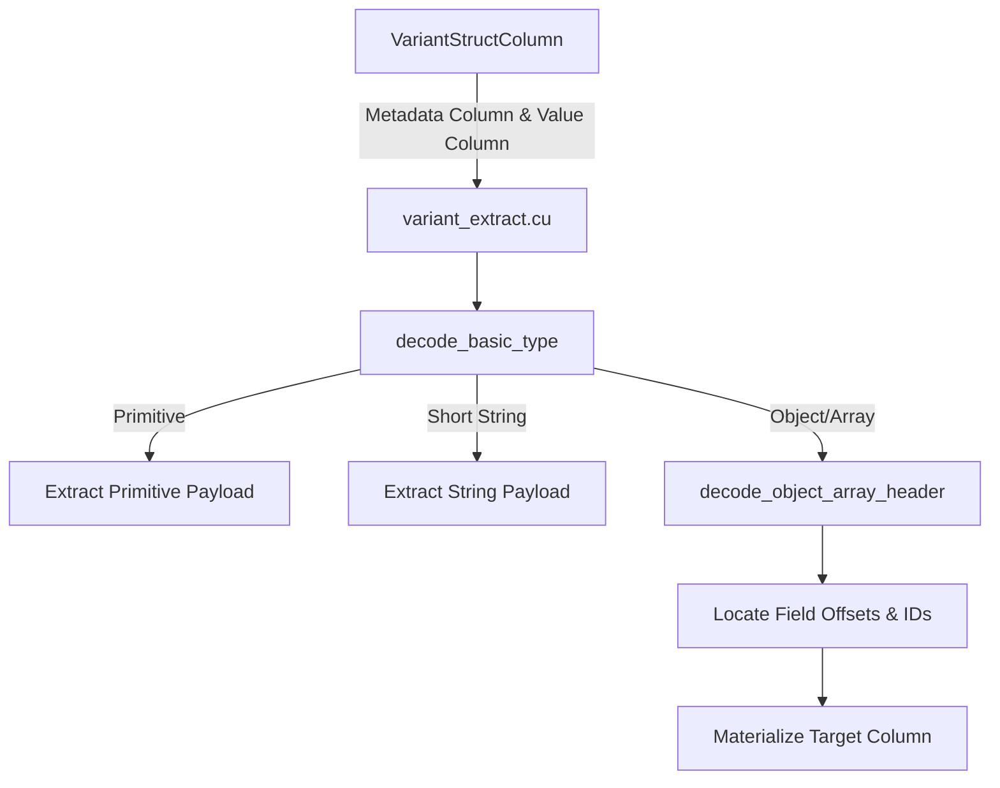

<!-- source: DeepWiki mcp.deepwiki.com · repo NVIDIA/cudf · extra page Predicate Pushdown, Hybrid Scan and Variant · fetched 2026-10-26 -->

# Predicate Pushdown, Hybrid Scan and Variant

Relevant source files

The following files were used as context for generating this wiki page:

- [cpp/benchmarks/io/parquet/experimental/variant/extract.cpp](cpp/benchmarks/io/parquet/experimental/variant/extract.cpp)
- [cpp/include/cudf/io/experimental/hybrid_scan.hpp](cpp/include/cudf/io/experimental/hybrid_scan.hpp)
- [cpp/include/cudf/io/experimental/hybrid_scan_multifile.hpp](cpp/include/cudf/io/experimental/hybrid_scan_multifile.hpp)
- [cpp/include/cudf/io/experimental/variant.hpp](cpp/include/cudf/io/experimental/variant.hpp)
- [cpp/include/cudf/io/experimental/variant_spec.hpp](cpp/include/cudf/io/experimental/variant_spec.hpp)
- [cpp/src/io/parquet/bloom_filter_reader.cu](cpp/src/io/parquet/bloom_filter_reader.cu)
- [cpp/src/io/parquet/experimental/dictionary_page_filter.cu](cpp/src/io/parquet/experimental/dictionary_page_filter.cu)
- [cpp/src/io/parquet/experimental/hybrid_scan.cpp](cpp/src/io/parquet/experimental/hybrid_scan.cpp)
- [cpp/src/io/parquet/experimental/hybrid_scan_helpers.cpp](cpp/src/io/parquet/experimental/hybrid_scan_helpers.cpp)
- [cpp/src/io/parquet/experimental/hybrid_scan_helpers.hpp](cpp/src/io/parquet/experimental/hybrid_scan_helpers.hpp)
- [cpp/src/io/parquet/experimental/hybrid_scan_impl.cpp](cpp/src/io/parquet/experimental/hybrid_scan_impl.cpp)
- [cpp/src/io/parquet/experimental/hybrid_scan_impl.hpp](cpp/src/io/parquet/experimental/hybrid_scan_impl.hpp)
- [cpp/src/io/parquet/experimental/hybrid_scan_multifile.cpp](cpp/src/io/parquet/experimental/hybrid_scan_multifile.cpp)
- [cpp/src/io/parquet/experimental/page_index_filter.cu](cpp/src/io/parquet/experimental/page_index_filter.cu)
- [cpp/src/io/parquet/experimental/page_index_filter_utils.cu](cpp/src/io/parquet/experimental/page_index_filter_utils.cu)
- [cpp/src/io/parquet/experimental/page_index_filter_utils.hpp](cpp/src/io/parquet/experimental/page_index_filter_utils.hpp)
- [cpp/src/io/parquet/experimental/variant_extract.cu](cpp/src/io/parquet/experimental/variant_extract.cu)
- [cpp/src/io/parquet/experimental/variant_path.cpp](cpp/src/io/parquet/experimental/variant_path.cpp)
- [cpp/src/io/parquet/experimental/variant_path.hpp](cpp/src/io/parquet/experimental/variant_path.hpp)
- [cpp/src/io/parquet/expression_transform_helpers.cpp](cpp/src/io/parquet/expression_transform_helpers.cpp)
- [cpp/src/io/parquet/expression_transform_helpers.hpp](cpp/src/io/parquet/expression_transform_helpers.hpp)
- [cpp/src/io/parquet/predicate_pushdown.cpp](cpp/src/io/parquet/predicate_pushdown.cpp)
- [cpp/src/io/parquet/reader_impl_helpers.cpp](cpp/src/io/parquet/reader_impl_helpers.cpp)
- [cpp/src/io/parquet/reader_impl_helpers.hpp](cpp/src/io/parquet/reader_impl_helpers.hpp)
- [cpp/src/io/parquet/stats_filter_helpers.cpp](cpp/src/io/parquet/stats_filter_helpers.cpp)
- [cpp/src/io/parquet/stats_filter_helpers.hpp](cpp/src/io/parquet/stats_filter_helpers.hpp)
- [cpp/tests/io/experimental/apache_variant_fixtures.hpp](cpp/tests/io/experimental/apache_variant_fixtures.hpp)
- [cpp/tests/io/experimental/hybrid_scan_common.cpp](cpp/tests/io/experimental/hybrid_scan_common.cpp)
- [cpp/tests/io/experimental/hybrid_scan_common.hpp](cpp/tests/io/experimental/hybrid_scan_common.hpp)
- [cpp/tests/io/experimental/hybrid_scan_filters_test.cpp](cpp/tests/io/experimental/hybrid_scan_filters_test.cpp)
- [cpp/tests/io/experimental/hybrid_scan_multifile_filters_test.cpp](cpp/tests/io/experimental/hybrid_scan_multifile_filters_test.cpp)
- [cpp/tests/io/experimental/hybrid_scan_multifile_test.cpp](cpp/tests/io/experimental/hybrid_scan_multifile_test.cpp)
- [cpp/tests/io/experimental/hybrid_scan_test.cpp](cpp/tests/io/experimental/hybrid_scan_test.cpp)
- [cpp/tests/io/experimental/variant_extract_test.cpp](cpp/tests/io/experimental/variant_extract_test.cpp)
- [java/src/main/java/ai/rapids/cudf/VariantLogicalType.java](java/src/main/java/ai/rapids/cudf/VariantLogicalType.java)
- [java/src/main/java/ai/rapids/cudf/VariantUtils.java](java/src/main/java/ai/rapids/cudf/VariantUtils.java)
- [java/src/main/native/src/VariantUtilsJni.cpp](java/src/main/native/src/VariantUtilsJni.cpp)
- [java/src/test/java/ai/rapids/cudf/VariantUtilsTest.java](java/src/test/java/ai/rapids/cudf/VariantUtilsTest.java)

## Purpose and Scope
This page details the advanced GPU-accelerated Parquet filtering architecture in `libcudf`, including multi-stage predicate pushdown (row-group statistics, bloom filters, dictionary pages, and page-index stats), the experimental `hybrid_scan` API for decoupled metadata and data scanning across multi-source datasets, and the Apache Parquet VARIANT support for extracting and casting unstructured or semi-structured variant data.

---

## 1. Parquet Filtering and Predicate Pushdown Architecture

To avoid unnecessary host-to-device transfers and disk I/O, `libcudf` implements a hierarchical, multi-phase filtering pipeline that evaluates user-provided AST expressions against Parquet metadata before launching data decoding kernels.

### Row-Group Statistics Filtering
Row-group filtering evaluates column chunk metadata (min, max, and null count statistics) against filter expressions. 
- `aggregate_reader_metadata::apply_stats_filters` inspects the input row groups and constructs a metadata table representing column statistics using `row_group_stats_caster` [cpp/src/io/parquet/predicate_pushdown.cpp:58-151]().
- `row_group_info` tracks row group offsets and metadata per source [cpp/src/io/parquet/reader_impl_helpers.hpp:132-142]().
- Expressions are transformed via `stats_expression_converter` into a domain where column references point to statistics bounds tables, allowing row groups whose bounds contradict the predicate to be pruned entirely.

### Bloom Filter Probing
For equality predicates, Parquet bloom filters can be probed directly on the GPU.
- `bloom_filter_reader.cu` uses cuCollections (`cuco::bloom_filter_ref`) with `arrow_filter_policy` to match Apache Arrow/Parquet block-split bloom filter specifications [cpp/src/io/parquet/bloom_filter_reader.cu:51-65]().
- `bloom_filter_caster::query_bloom_filter` maps physical Parquet types (`INT32`, `INT64`, `FLOAT`, `DOUBLE`, `BYTE_ARRAY`, `FIXED_LEN_BYTE_ARRAY`) to hashed keys using `XXHash_64` and generates a boolean device column indicating possible row group presence [cpp/src/io/parquet/bloom_filter_reader.cu:72-165]().

### Dictionary and Page-Index Level Filtering
When row-group stats are inconclusive, finer-grained filtering operates at the page level:
- **Dictionary Filters**: `aggregate_reader_metadata::apply_dictionary_filter` evaluates dictionary pages against equality and inequality predicates using host-device span descriptors [cpp/src/io/parquet/experimental/hybrid_scan_helpers.hpp:69-79]().
- **Page-Index Stats**: `page_stats_caster` extracts page-level min/max and all-null statistics from Parquet column indexes (`ColumnIndex` and `OffsetIndex`) to construct per-page row masks, bypassing individual pages that do not satisfy the query [cpp/src/io/parquet/experimental/page_index_filter.cu:48-84]().

*Sources: [cpp/src/io/parquet/predicate_pushdown.cpp:58-151](), [cpp/src/io/parquet/bloom_filter_reader.cu:51-165](), [cpp/src/io/parquet/experimental/hybrid_scan_helpers.hpp:69-79](), [cpp/src/io/parquet/experimental/page_index_filter.cu:48-84]()`

---

## 2. Experimental Hybrid Scan API

The experimental hybrid scan API separates metadata inspection, index fetching, row-group filtering, and chunk decoding into discrete operations. This design supports multi-file distributed execution engines where metadata and indexes are fetched lazily or out-of-band.

### Key Classes and Interfaces
- `hybrid_scan_reader_impl`: Implements the core execution logic, inheriting from `parquet::detail::reader_impl` [cpp/src/io/parquet/experimental/hybrid_scan_impl.hpp:40-76]().
- `aggregate_reader_metadata`: Manages aggregate metadata across multiple data sources, handling page-index byte ranges and presence checks (`page_index_presence`, `setup_page_indexes`) [cpp/src/io/parquet/experimental/hybrid_scan_helpers.hpp:49-160]().

### Workflow Methods in `hybrid_scan_reader_impl`
The reader provides explicit hooks for granular pipeline control:
- `filter_row_groups_with_stats(...)` [cpp/src/io/parquet/experimental/hybrid_scan_impl.hpp:120-124]()
- `filter_row_groups_with_dictionary_pages(...)` [cpp/src/io/parquet/experimental/hybrid_scan_impl.hpp:141-147]()
- `filter_row_groups_with_bloom_filters(...)` [cpp/src/io/parquet/experimental/hybrid_scan_impl.hpp:150-156]()
- `build_row_mask_with_page_index_stats(...)` [cpp/src/io/parquet/experimental/hybrid_scan_impl.hpp:170-174]()

*Sources: [cpp/src/io/parquet/experimental/hybrid_scan_impl.hpp:40-175](), [cpp/src/io/parquet/experimental/hybrid_scan_helpers.hpp:49-160]()`

---

## 3. Apache Variant Extraction

Apache Parquet VARIANT encoding stores semi-structured and schemaless data via two components: a metadata binary column and a value binary column. `libcudf` provides GPU device functions and column operations to extract fields, inspect types, and cast variant values without host round-trips.

### Variant Binary Layout and Headers
Every variant value begins with a 1-byte value metadata header containing a 2-bit basic type and a 6-bit value header [cpp/tests/io/experimental/variant_extract_test.cpp:38-55]().
- **Basic Types (`variant_basic_type`)**: `PRIMITIVE` (0), `SHORT_STRING` (1), `OBJECT` (2), `ARRAY` (3) [cpp/tests/io/experimental/variant_extract_test.cpp:54-55]()
- **Decoding Functions**:
  - `decode_basic_type(uint8_t value_metadata)` extracts the basic type [cpp/src/io/parquet/experimental/variant_extract.cu:91-94]().
  - `variant_value_header(uint8_t value_metadata)` extracts the 6-bit sub-header [cpp/src/io/parquet/experimental/variant_extract.cu:96-99]().
  - `decode_object_array_header(uint8_t value_header, bool is_object)` parses offsets, field-ID sizes, and large-container flags [cpp/src/io/parquet/experimental/variant_extract.cu:124-132]().
  - `variant_value_length(device_span<uint8_t const> enc)` computes total encoded byte length [cpp/src/io/parquet/experimental/variant_extract.cu:151-152]().

### Extraction and Casting Execution
- Field extraction (`get_variant_field`) navigates object key dictionaries and offset tables on the device to materialize typed columns.
- Type casting (`cast_variant`) converts variant payloads into standard libcudf data types (such as numeric, string, list, or struct columns) while propagating operational status codes (`variant_operation_status`) [cpp/tests/io/experimental/variant_extract_test.cpp:145-165]().

*Sources: [cpp/tests/io/experimental/variant_extract_test.cpp:38-55](), [cpp/src/io/parquet/experimental/variant_extract.cu:91-152]()`

---

