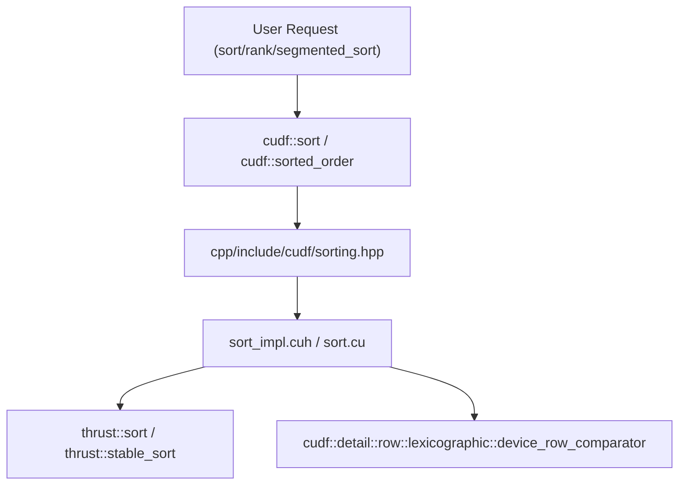
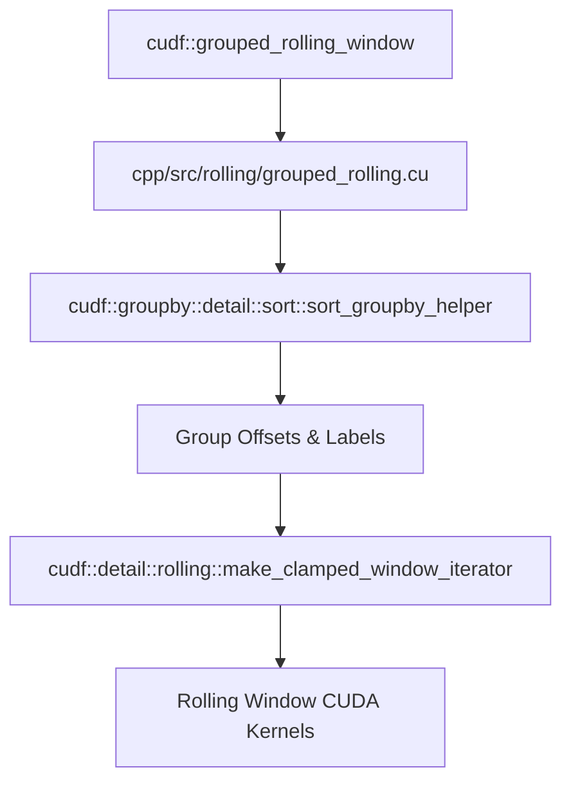

<!-- source: DeepWiki mcp.deepwiki.com · repo NVIDIA/cudf · extra page Sorting, Reductions and Rolling Windows · fetched 2026-10-26 -->

# Sorting, Reductions and Rolling Windows

Relevant source files

The following files were used as context for generating this wiki page:

- [cpp/benchmarks/common/generate_nested_types.cpp](cpp/benchmarks/common/generate_nested_types.cpp)
- [cpp/benchmarks/common/generate_nested_types.hpp](cpp/benchmarks/common/generate_nested_types.hpp)
- [cpp/benchmarks/merge/merge_lists.cpp](cpp/benchmarks/merge/merge_lists.cpp)
- [cpp/benchmarks/merge/merge_structs.cpp](cpp/benchmarks/merge/merge_structs.cpp)
- [cpp/benchmarks/sort/rank_lists.cpp](cpp/benchmarks/sort/rank_lists.cpp)
- [cpp/benchmarks/sort/rank_structs.cpp](cpp/benchmarks/sort/rank_structs.cpp)
- [cpp/benchmarks/sort/segmented_sort.cpp](cpp/benchmarks/sort/segmented_sort.cpp)
- [cpp/benchmarks/sort/sort_lists.cpp](cpp/benchmarks/sort/sort_lists.cpp)
- [cpp/benchmarks/sort/sort_structs.cpp](cpp/benchmarks/sort/sort_structs.cpp)
- [cpp/include/cudf/detail/merge.hpp](cpp/include/cudf/detail/merge.hpp)
- [cpp/include/cudf/detail/replace/nulls.cuh](cpp/include/cudf/detail/replace/nulls.cuh)
- [cpp/include/cudf/detail/rolling.hpp](cpp/include/cudf/detail/rolling.hpp)
- [cpp/include/cudf/detail/sorting.hpp](cpp/include/cudf/detail/sorting.hpp)
- [cpp/include/cudf/lists/detail/copying.hpp](cpp/include/cudf/lists/detail/copying.hpp)
- [cpp/include/cudf/lists/detail/scatter.cuh](cpp/include/cudf/lists/detail/scatter.cuh)
- [cpp/include/cudf/merge.hpp](cpp/include/cudf/merge.hpp)
- [cpp/include/cudf/partitioning.hpp](cpp/include/cudf/partitioning.hpp)
- [cpp/include/cudf/quantiles.hpp](cpp/include/cudf/quantiles.hpp)
- [cpp/include/cudf/reduction.hpp](cpp/include/cudf/reduction.hpp)
- [cpp/include/cudf/reduction/detail/reduction_functions.hpp](cpp/include/cudf/reduction/detail/reduction_functions.hpp)
- [cpp/include/cudf/rolling.hpp](cpp/include/cudf/rolling.hpp)
- [cpp/include/cudf/sorting.hpp](cpp/include/cudf/sorting.hpp)
- [cpp/src/lists/copying/copying.cu](cpp/src/lists/copying/copying.cu)
- [cpp/src/merge/merge.cu](cpp/src/merge/merge.cu)
- [cpp/src/partitioning/partitioning.cu](cpp/src/partitioning/partitioning.cu)
- [cpp/src/partitioning/round_robin.cu](cpp/src/partitioning/round_robin.cu)
- [cpp/src/quantiles/quantile.cu](cpp/src/quantiles/quantile.cu)
- [cpp/src/quantiles/quantiles.cu](cpp/src/quantiles/quantiles.cu)
- [cpp/src/quantiles/quantiles_util.hpp](cpp/src/quantiles/quantiles_util.hpp)
- [cpp/src/reductions/all.cu](cpp/src/reductions/all.cu)
- [cpp/src/reductions/any.cu](cpp/src/reductions/any.cu)
- [cpp/src/reductions/compound.cuh](cpp/src/reductions/compound.cuh)
- [cpp/src/reductions/max.cu](cpp/src/reductions/max.cu)
- [cpp/src/reductions/mean.cu](cpp/src/reductions/mean.cu)
- [cpp/src/reductions/min.cu](cpp/src/reductions/min.cu)
- [cpp/src/reductions/minmax.cu](cpp/src/reductions/minmax.cu)
- [cpp/src/reductions/product.cu](cpp/src/reductions/product.cu)
- [cpp/src/reductions/reductions.cpp](cpp/src/reductions/reductions.cpp)
- [cpp/src/reductions/simple.cuh](cpp/src/reductions/simple.cuh)
- [cpp/src/reductions/sum.cu](cpp/src/reductions/sum.cu)
- [cpp/src/reductions/sum_of_squares.cu](cpp/src/reductions/sum_of_squares.cu)
- [cpp/src/rolling/detail/range_window_bounds.hpp](cpp/src/rolling/detail/range_window_bounds.hpp)
- [cpp/src/rolling/detail/rolling_utils.cuh](cpp/src/rolling/detail/rolling_utils.cuh)
- [cpp/src/rolling/grouped_rolling.cu](cpp/src/rolling/grouped_rolling.cu)
- [cpp/src/rolling/range_window_bounds.cpp](cpp/src/rolling/range_window_bounds.cpp)
- [cpp/src/sort/is_sorted.cu](cpp/src/sort/is_sorted.cu)
- [cpp/src/sort/rank.cu](cpp/src/sort/rank.cu)
- [cpp/src/sort/segmented_sort.cu](cpp/src/sort/segmented_sort.cu)
- [cpp/src/sort/segmented_sort_impl.cuh](cpp/src/sort/segmented_sort_impl.cuh)
- [cpp/src/sort/segmented_top_k.cu](cpp/src/sort/segmented_top_k.cu)
- [cpp/src/sort/sort.cu](cpp/src/sort/sort.cu)
- [cpp/src/sort/sort.hpp](cpp/src/sort/sort.hpp)
- [cpp/src/sort/sort_column.cu](cpp/src/sort/sort_column.cu)
- [cpp/src/sort/sort_column_impl.cuh](cpp/src/sort/sort_column_impl.cuh)
- [cpp/src/sort/sort_impl.cuh](cpp/src/sort/sort_impl.cuh)
- [cpp/src/sort/sort_radix.cu](cpp/src/sort/sort_radix.cu)
- [cpp/src/sort/sorted_order_radix.cu](cpp/src/sort/sorted_order_radix.cu)
- [cpp/src/sort/stable_sort.cu](cpp/src/sort/stable_sort.cu)
- [cpp/src/sort/top_k.cu](cpp/src/sort/top_k.cu)
- [cpp/tests/copying/slice_tests.cuh](cpp/tests/copying/slice_tests.cuh)
- [cpp/tests/merge/merge_string_test.cpp](cpp/tests/merge/merge_string_test.cpp)
- [cpp/tests/merge/merge_test.cpp](cpp/tests/merge/merge_test.cpp)
- [cpp/tests/partitioning/hash_partition_test.cpp](cpp/tests/partitioning/hash_partition_test.cpp)
- [cpp/tests/partitioning/partition_test.cpp](cpp/tests/partitioning/partition_test.cpp)
- [cpp/tests/partitioning/round_robin_test.cpp](cpp/tests/partitioning/round_robin_test.cpp)
- [cpp/tests/quantiles/quantile_test.cpp](cpp/tests/quantiles/quantile_test.cpp)
- [cpp/tests/reductions/reduction_tests.cpp](cpp/tests/reductions/reduction_tests.cpp)
- [cpp/tests/replace/replace_nulls_tests.cpp](cpp/tests/replace/replace_nulls_tests.cpp)
- [cpp/tests/rolling/empty_input_test.cpp](cpp/tests/rolling/empty_input_test.cpp)
- [cpp/tests/rolling/grouped_rolling_range_test.cpp](cpp/tests/rolling/grouped_rolling_range_test.cpp)
- [cpp/tests/rolling/grouped_rolling_test.cpp](cpp/tests/rolling/grouped_rolling_test.cpp)
- [cpp/tests/rolling/lead_lag_test.cpp](cpp/tests/rolling/lead_lag_test.cpp)
- [cpp/tests/rolling/nth_element_test.cpp](cpp/tests/rolling/nth_element_test.cpp)
- [cpp/tests/rolling/range_rolling_window_test.cpp](cpp/tests/rolling/range_rolling_window_test.cpp)
- [cpp/tests/rolling/range_window_bounds_test.cpp](cpp/tests/rolling/range_window_bounds_test.cpp)
- [cpp/tests/rolling/rolling_test.cpp](cpp/tests/rolling/rolling_test.cpp)
- [cpp/tests/rolling/rolling_test.hpp](cpp/tests/rolling/rolling_test.hpp)
- [cpp/tests/sort/is_sorted_tests.cpp](cpp/tests/sort/is_sorted_tests.cpp)
- [cpp/tests/sort/rank_test.cpp](cpp/tests/sort/rank_test.cpp)
- [cpp/tests/sort/segmented_sort_tests.cpp](cpp/tests/sort/segmented_sort_tests.cpp)
- [cpp/tests/sort/sort_test.cpp](cpp/tests/sort/sort_test.cpp)
- [cpp/tests/sort/top_k_tests.cpp](cpp/tests/sort/top_k_tests.cpp)
- [cpp/tests/streams/merge_test.cpp](cpp/tests/streams/merge_test.cpp)

This page covers the advanced relational and analytical algorithms implemented in `libcudf`, specifically focusing on sorting, ranking, segmented sorting, reductions, scans, quantiles, rolling and grouped rolling windows, merge operations, and table partitioning. These routines leverage underlying Thrust, CUB, and custom CUDA kernels to execute parallel primitives efficiently on GPU hardware.

---

## 1. Sorting, Ranking, and Segmented Sorting

The sorting subsystem provides lexicographical ordering, key-value sorting, ranking, and segmented sorting routines over tables and columns. These functions construct permuted index arrays or reorder underlying column buffers.

- `cudf::sorted_order()` and `cudf::stable_sorted_order()` compute row indices that produce a lexicographical sorted order [cpp/include/cudf/sorting.hpp:44-64]().
- `cudf::sort()` and `cudf::stable_sort()` perform direct lexicographical sorting of table rows [cpp/include/cudf/sorting.hpp:103-121]().
- `cudf::sort_by_key()` and `cudf::stable_sort_by_key()` reorder a `values` table based on the lexicographic order of a separate `keys` table [cpp/include/cudf/sorting.hpp:144-164]().
- Segmented sort operations sort independent segments within columns or tables based on segment offset boundaries.
- Ranking routines compute relative ranks (e.g., dense, min, max, average) across rows or groups.

Title: "Sorting Subsystem Code and Entity Mapping"

Sources: [cpp/include/cudf/sorting.hpp:1-165](), [cpp/src/merge/merge.cu:52-88]()

---

## 2. Reductions and Scans

Reductions compute a scalar summary statistic across all rows (or segments) of a column, while scans compute prefix sums or running aggregates.

- `cudf::reduce()` aggregates column values into a single output `scalar` using operations such as `SUM`, `PRODUCT`, `MIN`, `MAX`, `ANY`, `ALL`, `SUM_OF_SQUARES`, `MEAN`, `VARIANCE`, and `STD` [cpp/include/cudf/reduction.hpp:33-94]().
- `SUM_OVERFLOW` detects integer or decimal overflows and returns a struct containing the result and a boolean overflow flag [cpp/include/cudf/reduction.hpp:39-41]().
- Reductions support optional initial values (`init`) for accumulation [cpp/include/cudf/reduction.hpp:104-130]().
- Underlying kernel execution paths include `simple_reduction`, `fixed_point_reduction`, and `dictionary_reduction` [cpp/src/reductions/simple.cuh:46-165]().

Sources: [cpp/include/cudf/reduction.hpp:1-148](), [cpp/src/reductions/reductions.cpp:1-175](), [cpp/src/reductions/simple.cuh:1-171]()

---

## 3. Quantiles

Quantile functions compute exact or approximate percentiles and order statistics.

- `cudf::quantile()` computes specified quantiles using interpolation strategies (`LINEAR`, `LOWER`, `HIGHER`, `NEAREST`, etc.) over single columns with optional pre-computed sorted indices [cpp/include/cudf/quantiles.hpp:50-58]().
- `cudf::quantiles()` computes table rows corresponding to requested quantiles using non-arithmetic interpolation strategies [cpp/include/cudf/quantiles.hpp:90-98]().
- `cudf::percentile_approx()` queries approximate percentiles from compressed `tdigest` column representations [cpp/include/cudf/quantiles.hpp:123-127]().
- The underlying implementation utilizes sorted order lookups combined with `cudf::detail::gather` [cpp/src/quantiles/quantiles.cu:30-55]().

Sources: [cpp/include/cudf/quantiles.hpp:1-130](), [cpp/src/quantiles/quantiles.cu:1-100]()

---

## 4. Rolling and Grouped Rolling Windows

Rolling window operations evaluate windowed aggregations across sliding intervals defined by row counts or range deltas.

- `cudf::rolling_window()` computes moving aggregations over an input column given preceding and following window bounds [cpp/include/cudf/rolling.hpp:193-210]().
- Range-based rolling windows accept scalar deltas (`bounded_closed`, `bounded_open`) or per-row delta columns (`bounded_closed_column`, `bounded_open_column`) [cpp/include/cudf/rolling.hpp:46-150]().
- `cudf::grouped_rolling_window()` applies rolling aggregations independently within partitions defined by `group_keys` [cpp/src/rolling/grouped_rolling.cu:34-42]().
- Fully unbounded group windows bypass sliding iteration via `optimized_unbounded_window()` [cpp/src/rolling/grouped_rolling.cu:56-62]().

Title: "Rolling Window and Grouping Architecture"

Sources: [cpp/include/cudf/rolling.hpp:1-194](), [cpp/src/rolling/grouped_rolling.cu:1-150](), [cpp/tests/rolling/rolling_test.cpp:1-66]()

---

## 5. Merge and Partitioning

Merge and partitioning primitives reorganize table rows to support join, groupby, and distributed shuffle operations.

- `cudf::merge()` combines two or more sorted tables into a single sorted table based on lexicographic column order [cpp/src/merge/merge.cu:10-25](). It materializes validity bitmasks using `materialize_merged_bitmask_kernel` [cpp/src/merge/merge.cu:113-120]().
- `cudf::hash_partition()` splits a table into multiple partitions by hashing row keys using `compute_row_partition_numbers` and modulo or bitwise partitioners [cpp/src/partitioning/partitioning.cu:55-128]().
- `cudf::round_robin_partition()` distributes table rows evenly across a specified number of output partitions in cyclic order [cpp/src/partitioning/round_robin.cu:1-50]().

Sources: [cpp/src/merge/merge.cu:1-173](), [cpp/src/partitioning/partitioning.cu:1-181]()

---

