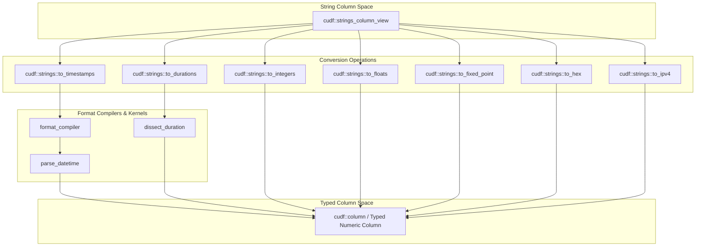
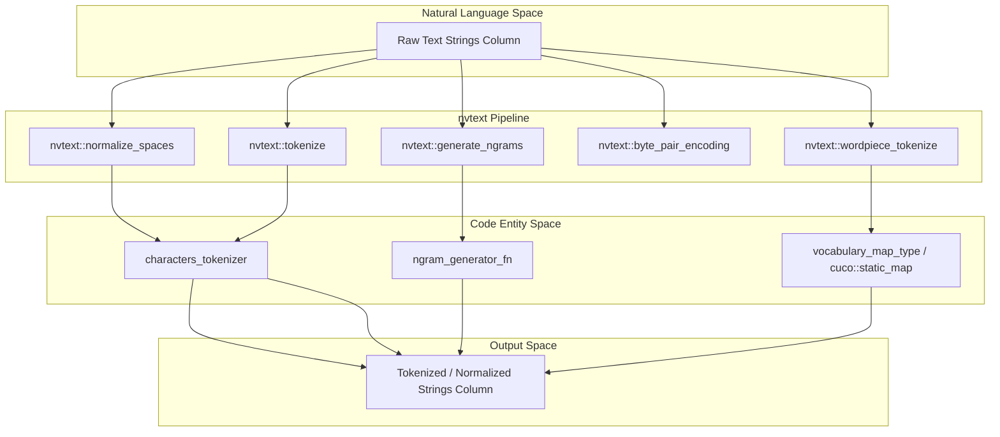

<!-- source: DeepWiki mcp.deepwiki.com · repo NVIDIA/cudf · extra page String Conversions and nvtext · fetched 2026-10-26 -->

# String Conversions and nvtext

<details>
<summary>Relevant source files</summary>

The following files were used as context for generating this wiki page:

- [cpp/benchmarks/text/hash_ngrams.cpp](cpp/benchmarks/text/hash_ngrams.cpp)
- [cpp/benchmarks/text/jaccard.cpp](cpp/benchmarks/text/jaccard.cpp)
- [cpp/benchmarks/text/ngrams.cpp](cpp/benchmarks/text/ngrams.cpp)
- [cpp/benchmarks/text/normalize.cpp](cpp/benchmarks/text/normalize.cpp)
- [cpp/benchmarks/text/replace.cpp](cpp/benchmarks/text/replace.cpp)
- [cpp/benchmarks/text/subword.cpp](cpp/benchmarks/text/subword.cpp)
- [cpp/benchmarks/text/tokenize.cpp](cpp/benchmarks/text/tokenize.cpp)
- [cpp/benchmarks/text/vocab.cpp](cpp/benchmarks/text/vocab.cpp)
- [cpp/include/cudf/strings/convert/convert_booleans.hpp](cpp/include/cudf/strings/convert/convert_booleans.hpp)
- [cpp/include/cudf/strings/convert/convert_datetime.hpp](cpp/include/cudf/strings/convert/convert_datetime.hpp)
- [cpp/include/cudf/strings/convert/convert_durations.hpp](cpp/include/cudf/strings/convert/convert_durations.hpp)
- [cpp/include/cudf/strings/convert/convert_floats.hpp](cpp/include/cudf/strings/convert/convert_floats.hpp)
- [cpp/include/cudf/strings/convert/convert_integers.hpp](cpp/include/cudf/strings/convert/convert_integers.hpp)
- [cpp/include/cudf/strings/convert/convert_ipv4.hpp](cpp/include/cudf/strings/convert/convert_ipv4.hpp)
- [cpp/include/cudf/strings/detail/convert/fixed_point.cuh](cpp/include/cudf/strings/detail/convert/fixed_point.cuh)
- [cpp/include/cudf/strings/detail/convert/string_to_float.cuh](cpp/include/cudf/strings/detail/convert/string_to_float.cuh)
- [cpp/include/cudf_test/file_utilities.hpp](cpp/include/cudf_test/file_utilities.hpp)
- [cpp/include/nvtext/byte_pair_encoding.hpp](cpp/include/nvtext/byte_pair_encoding.hpp)
- [cpp/include/nvtext/detail/tokenize.hpp](cpp/include/nvtext/detail/tokenize.hpp)
- [cpp/include/nvtext/generate_ngrams.hpp](cpp/include/nvtext/generate_ngrams.hpp)
- [cpp/include/nvtext/ngrams_tokenize.hpp](cpp/include/nvtext/ngrams_tokenize.hpp)
- [cpp/include/nvtext/normalize.hpp](cpp/include/nvtext/normalize.hpp)
- [cpp/include/nvtext/replace.hpp](cpp/include/nvtext/replace.hpp)
- [cpp/include/nvtext/tokenize.hpp](cpp/include/nvtext/tokenize.hpp)
- [cpp/include/nvtext/wordpiece_tokenize.hpp](cpp/include/nvtext/wordpiece_tokenize.hpp)
- [cpp/src/search/contains_table.cu](cpp/src/search/contains_table.cu)
- [cpp/src/strings/convert/convert_booleans.cu](cpp/src/strings/convert/convert_booleans.cu)
- [cpp/src/strings/convert/convert_datetime.cu](cpp/src/strings/convert/convert_datetime.cu)
- [cpp/src/strings/convert/convert_durations.cu](cpp/src/strings/convert/convert_durations.cu)
- [cpp/src/strings/convert/convert_fixed_point.cu](cpp/src/strings/convert/convert_fixed_point.cu)
- [cpp/src/strings/convert/convert_floats.cu](cpp/src/strings/convert/convert_floats.cu)
- [cpp/src/strings/convert/convert_hex.cu](cpp/src/strings/convert/convert_hex.cu)
- [cpp/src/strings/convert/convert_integers.cu](cpp/src/strings/convert/convert_integers.cu)
- [cpp/src/strings/convert/convert_ipv4.cu](cpp/src/strings/convert/convert_ipv4.cu)
- [cpp/src/text/bpe/byte_pair_encoding.cu](cpp/src/text/bpe/byte_pair_encoding.cu)
- [cpp/src/text/bpe/byte_pair_encoding.cuh](cpp/src/text/bpe/byte_pair_encoding.cuh)
- [cpp/src/text/bpe/load_merge_pairs.cu](cpp/src/text/bpe/load_merge_pairs.cu)
- [cpp/src/text/detokenize.cu](cpp/src/text/detokenize.cu)
- [cpp/src/text/generate_ngrams.cu](cpp/src/text/generate_ngrams.cu)
- [cpp/src/text/jaccard.cu](cpp/src/text/jaccard.cu)
- [cpp/src/text/ngrams_tokenize.cu](cpp/src/text/ngrams_tokenize.cu)
- [cpp/src/text/normalize.cu](cpp/src/text/normalize.cu)
- [cpp/src/text/normalize.cuh](cpp/src/text/normalize.cuh)
- [cpp/src/text/replace.cu](cpp/src/text/replace.cu)
- [cpp/src/text/tokenize.cu](cpp/src/text/tokenize.cu)
- [cpp/src/text/utilities/tokenize_ops.cuh](cpp/src/text/utilities/tokenize_ops.cuh)
- [cpp/src/text/vocabulary_tokenize.cu](cpp/src/text/vocabulary_tokenize.cu)
- [cpp/src/text/wordpiece_tokenize.cu](cpp/src/text/wordpiece_tokenize.cu)
- [cpp/tests/streams/text/ngrams_test.cpp](cpp/tests/streams/text/ngrams_test.cpp)
- [cpp/tests/strings/datetime_tests.cpp](cpp/tests/strings/datetime_tests.cpp)
- [cpp/tests/strings/durations_tests.cpp](cpp/tests/strings/durations_tests.cpp)
- [cpp/tests/strings/fixed_point_tests.cpp](cpp/tests/strings/fixed_point_tests.cpp)
- [cpp/tests/strings/floats_tests.cpp](cpp/tests/strings/floats_tests.cpp)
- [cpp/tests/strings/ipv4_tests.cpp](cpp/tests/strings/ipv4_tests.cpp)
- [cpp/tests/text/ngrams_tests.cpp](cpp/tests/text/ngrams_tests.cpp)
- [cpp/tests/text/ngrams_tokenize_tests.cpp](cpp/tests/text/ngrams_tokenize_tests.cpp)
- [cpp/tests/text/normalize_tests.cpp](cpp/tests/text/normalize_tests.cpp)
- [cpp/tests/text/replace_tests.cpp](cpp/tests/text/replace_tests.cpp)
- [cpp/tests/text/subword_tests.cpp](cpp/tests/text/subword_tests.cpp)
- [cpp/tests/text/tokenize_tests.cpp](cpp/tests/text/tokenize_tests.cpp)
- [python/cudf/cudf/core/character_normalizer.py](python/cudf/cudf/core/character_normalizer.py)
- [python/cudf/cudf/tests/data/text/vocab.txt](python/cudf/cudf/tests/data/text/vocab.txt)
- [python/cudf/cudf/tests/text/test_subword_tokenizer.py](python/cudf/cudf/tests/text/test_subword_tokenizer.py)
- [python/pylibcudf/pylibcudf/libcudf/nvtext/CMakeLists.txt](python/pylibcudf/pylibcudf/libcudf/nvtext/CMakeLists.txt)
- [python/pylibcudf/pylibcudf/libcudf/nvtext/normalize.pxd](python/pylibcudf/pylibcudf/libcudf/nvtext/normalize.pxd)
- [python/pylibcudf/pylibcudf/libcudf/nvtext/normalize.pyx](python/pylibcudf/pylibcudf/libcudf/nvtext/normalize.pyx)
- [python/pylibcudf/pylibcudf/nvtext/normalize.pxd](python/pylibcudf/pylibcudf/nvtext/normalize.pxd)
- [python/pylibcudf/pylibcudf/nvtext/normalize.pyi](python/pylibcudf/pylibcudf/nvtext/normalize.pyi)
- [python/pylibcudf/pylibcudf/nvtext/normalize.pyx](python/pylibcudf/pylibcudf/nvtext/normalize.pyx)
- [python/pylibcudf/tests/test_nvtext_normalize.py](python/pylibcudf/tests/test_nvtext_normalize.py)

</details>


Purpose: convert_datetime/durations/integers/floats/hex/ipv4/fixed_point; tokenize, normalize, ngrams, BPE, wordpiece/subword vocabularies.

---

## 1. String Conversions (`cudf::strings`)

libcudf provides comprehensive GPU-accelerated string conversion routines to translate string columns into typed data columns (and vice versa) supporting integers, floating-point numbers, timestamps, time durations, fixed-point decimals, hexadecimals, and IPv4 addresses.

### Conversion Subsystem Architecture

The following diagram illustrates how raw string columns map to typed scalar representations and parsed device structures via libcudf routines and format compilers.



Sources: 
- `cpp/src/strings/convert/convert_datetime.cu`
- `cpp/src/strings/convert/convert_durations.cu`
- `cpp/src/strings/convert/convert_integers.cu`
- `cpp/src/strings/convert/convert_floats.cu`

---

### Datetime and Duration Conversions

Dates and durations are parsed using custom format compilers (`format_compiler`) that parse format strings (similar to C++20 `std::chrono` or strftime specifiers) into array representations stored in device memory (`d_items`).

- **Timestamps**: `cudf::strings::to_timestamps` parses strings into fixed-width timestamp columns (e.g., `timestamp_s`, `timestamp_ms`, `timestamp_us`, `timestamp_ns`) using specifiers like `%Y`, `%m`, `%d`, `%H`, `%M`, `%S`, and subsecond precisions (`%6f`).
- **Durations**: `cudf::strings::to_durations` converts string representations into duration types (`duration_D`, `duration_s`, `duration_ms`, etc.) via `duration_component` dissection structures.

```cpp
// Example: Parsing timestamps from a string column
auto results = cudf::strings::to_timestamps(
  strings_view, 
  cudf::data_type{cudf::type_id::TIMESTAMP_SECONDS}, 
  "%Y-%m-%dT%H:%M:%SZ"
);
```

Sources:
- `cpp/src/strings/convert/convert_datetime.cu`
- `cpp/src/strings/convert/convert_durations.cu`
- `cpp/tests/strings/datetime_tests.cpp`

---

### Numeric, Fixed-Point, Hex, and IPv4 Conversions

- **Integers**: `to_integers` and `is_integer` validate and convert strings to signed/unsigned integers with overflow checks (`string_to_integer_check_fn`) [cpp/src/strings/convert/convert_integers.cu:43]().
- **Floats**: `to_floats` utilizes `string_to_float_fn` to dispatch string parsing into single or double-precision floating point columns [cpp/src/strings/convert/convert_floats.cu:41]().
- **Fixed-Point**: `to_fixed_point` handles scaling factor representations using fixed-point arithmetic helpers (`fixed_point.cuh`).
- **Hex & IPv4**: Specialized routines convert hexadecimal character sequences and dotted-quad IPv4 strings into binary integer representations.

Sources:
- `cpp/src/strings/convert/convert_integers.cu`
- `cpp/src/strings/convert/convert_floats.cu`
- `cpp/src/strings/convert/convert_hex.cu`
- `cpp/src/strings/convert/convert_ipv4.cu`

---

## 2. Natural Language Processing Primitives (`nvtext`)

The `nvtext` namespace supplies GPU-accelerated NLP primitives built on top of libcudf strings columns. These include tokenization, text normalization, n-gram generation, Byte-Pair Encoding (BPE), and Subword/WordPiece vocabularies.

### nvtext Subsystem Data Flow

The following diagram bridges natural language input text columns to processed token and vocabulary representations within `nvtext`.



Sources:
- `cpp/src/text/normalize.cu`
- `cpp/src/text/tokenize.cu`
- `cpp/src/text/generate_ngrams.cu`
- `cpp/src/text/vocabulary_tokenize.cu`

---

### Tokenization and Normalization

- **Normalization**: `nvtext::normalize_spaces` collapses repeated whitespaces (code-point `<= ' '`) and trims leading/trailing spaces using `normalize_spaces_fn` [cpp/src/text/normalize.cu:57]().
- **Tokenization**: `nvtext::tokenize` splits strings based on single character delimiters, multi-character strings, or multiple delimiter columns via `characters_tokenizer` and `strings_tokenizer` [cpp/src/text/tokenize.cu:96](), [cpp/src/text/utilities/tokenize_ops.cuh:33]().
- **Vocabulary Tokenization**: `nvtext::load_vocabulary` and `tokenize_vocabulary` map input strings to integer token IDs utilizing `cuco::static_map` for high-performance GPU hash-table lookups [cpp/src/text/vocabulary_tokenize.cu:88]().

```cpp
// Example: Tokenizing strings with a delimiter scalar
auto tokens = nvtext::tokenize(strings, delimiter, stream, mr);
```

Sources:
- `cpp/src/text/normalize.cu`
- `cpp/src/text/tokenize.cu`
- `cpp/src/text/utilities/tokenize_ops.cuh`
- `cpp/src/text/vocabulary_tokenize.cu`

---

### n-grams and Subword Tokenization (BPE & WordPiece)

- **n-grams**: `nvtext::generate_ngrams` and `nvtext::ngrams_tokenize` construct adjacent text combinations (bigrams, trigrams) joined by configurable separators via `ngram_generator_fn` and `ngram_builder_fn` [cpp/src/text/generate_ngrams.cu:51](), [cpp/src/text/ngrams_tokenize.cu:79]().
- **Byte-Pair Encoding (BPE)**: `nvtext::byte_pair_encoding` merges frequent pairs of bytes or characters iteratively using merge-pair tables loaded via `load_merge_pairs.cu`.
- **WordPiece**: `wordpiece_tokenize` applies subword vocabulary matching to segment rare words into known subword components.

Sources:
- `cpp/src/text/generate_ngrams.cu`
- `cpp/src/text/ngrams_tokenize.cu`
- `cpp/src/text/bpe/byte_pair_encoding.cu`
- `cpp/src/text/wordpiece_tokenize.cu`

---

