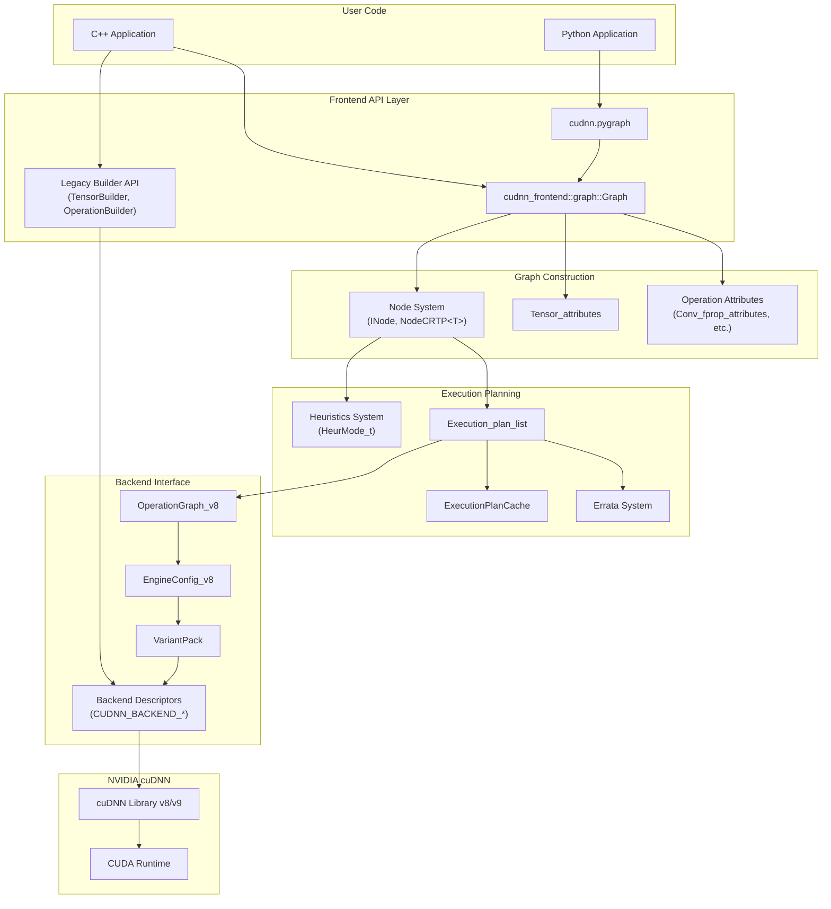
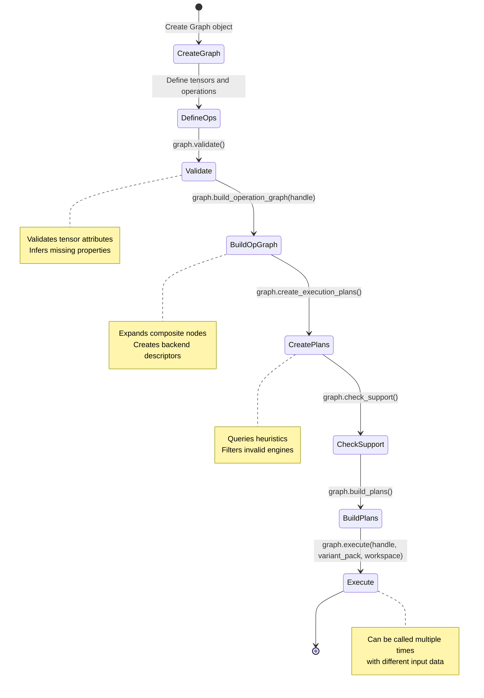

<!-- source: DeepWiki mcp.deepwiki.com · repo NVIDIA/cudnn-frontend · page 1 Overview · fetched 2026-10-26 -->

# Overview

<details>
<summary>Relevant source files</summary>

The following files were used as context for generating this wiki page:

- [CMakeLists.txt](CMakeLists.txt)
- [README.md](README.md)
- [include/cudnn_frontend.h](include/cudnn_frontend.h)
- [include/cudnn_frontend/cudnn_interface.h](include/cudnn_frontend/cudnn_interface.h)
- [include/cudnn_frontend/graph_helpers.h](include/cudnn_frontend/graph_helpers.h)
- [include/cudnn_frontend/graph_interface.h](include/cudnn_frontend/graph_interface.h)
- [include/cudnn_frontend/node/sdpa_fp8_bwd.h](include/cudnn_frontend/node/sdpa_fp8_bwd.h)
- [samples/cpp/convolution/fprop.cpp](samples/cpp/convolution/fprop.cpp)
- [samples/cpp/sdpa/fp16_fwd_with_custom_dropout.cpp](samples/cpp/sdpa/fp16_fwd_with_custom_dropout.cpp)
- [samples/cpp/sdpa/fp8_fwd.cpp](samples/cpp/sdpa/fp8_fwd.cpp)
- [setup.py](setup.py)

</details>


## Purpose and Scope

This page provides a high-level introduction to the cuDNN Frontend library, explaining its architecture, key components, and how it interfaces with NVIDIA's cuDNN library. For detailed installation instructions, see [Installation & Setup](#1.1). For architectural deep-dives, see [Architecture Overview](#1.2). For API-specific documentation, see [API Reference](#2) and [Python Interface](#4).

**Sources:** [README.md:1-100]()

## What is cuDNN Frontend

**cuDNN Frontend (FE)** is a modern, open-source C++ header-only library and Python package that provides a simplified interface to NVIDIA's cuDNN deep learning primitives library. It abstracts the complexity of the cuDNN backend API while enabling advanced features like graph-based operation fusion, automatic kernel selection, and execution plan caching.

The library serves two primary audiences:
- **C++ developers** who include [include/cudnn_frontend.h:1-147]() to access the full API
- **Python developers** who install via `pip install nvidia_cudnn_frontend`

Key capabilities:
- **Graph API**: Build reusable, fusible operation graphs via `cudnn_frontend::graph::Graph`
- **Automatic Optimization**: Built-in heuristics for engine selection and autotuning
- **Multi-Precision Support**: FP32, FP16, BF16, FP8, and integer types
- **OSS Kernels**: Access to open-source high-performance kernel implementations

**Sources:** [README.md:1-100](), [include/cudnn_frontend.h:25-98]()

## System Architecture

The cuDNN Frontend operates as a layered system that translates high-level graph descriptions into optimized cuDNN backend operations.

### Layered Architecture



**Sources:** [include/cudnn_frontend/graph_interface.h:38-320](), [include/cudnn_frontend/cudnn_interface.h:100-206]()

### Core Components

| Component | Class/Type | Purpose |
|-----------|-----------|---------|
| **Graph Container** | `cudnn_frontend::graph::Graph` | Top-level container for operations, tensors, and execution plans |
| **Node System** | `INode`, `NodeCRTP<T>` | Base for operation nodes; uses CRTP pattern for zero-cost polymorphism |
| **Tensor Representation** | `Tensor_attributes` | Describes tensor shape, stride, data type, and memory properties |
| **Execution Plans** | `Execution_plan_list` | Container for compiled execution strategies with workspace requirements |
| **Backend Bridge** | `ICudnn` | Interface to cuDNN backend API, manages descriptors and operations |
| **Kernel Cache** | `KernelCache` | Caches compiled kernels for dynamic shape scenarios (cuDNN 9.4+) |

**Sources:** [include/cudnn_frontend/graph_interface.h:40-49](), [include/cudnn_frontend/cudnn_interface.h:100-127]()

## API Approaches

cuDNN Frontend provides two distinct API styles, both ultimately using the same backend infrastructure.

### Graph API (Modern)

The **Graph API** is the recommended approach, providing a functional-style interface for building reusable operation graphs:

```cpp
// Example: Creating a graph
auto graph = std::make_shared<fe::graph::Graph>();
graph->set_io_data_type(fe::DataType_t::HALF)
     .set_compute_data_type(fe::DataType_t::FLOAT);

auto X = graph->tensor(fe::graph::Tensor_attributes()
                          .set_dim({n, c, h, w})
                          .set_stride({c*h*w, 1, c*w, c}));

auto Y = graph->conv_fprop(X, W, conv_options);
```

The Graph API is defined in [include/cudnn_frontend/graph_interface.h:40-1484]() and supports:
- Automatic operation fusion
- Composite operations (SDPA, LayerNorm, BatchNorm)
- Dynamic shapes (cuDNN 9.4+)
- Serialization to JSON

**Sources:** [samples/cpp/convolution/fprop.cpp:28-90]()

### Legacy Builder API

The **Legacy API** uses a builder pattern for direct descriptor creation:

```cpp
auto tensor = cudnn_frontend::TensorBuilder()
                  .setDim(dim.size(), dim.data())
                  .setStrides(stride.size(), stride.data())
                  .setId(uid)
                  .setDataType(data_type)
                  .build();
```

This API provides finer control but requires more boilerplate. It maps directly to cuDNN backend descriptors.

**Sources:** [include/cudnn_frontend.h:77-86]()

## Typical Workflow

The standard workflow for using the Graph API follows these phases:



### Phase Details

**1. Graph Construction** ([include/cudnn_frontend/graph_interface.h:630-655]())
- Create `Graph` object and set global data types
- Define `Tensor_attributes` for inputs/outputs
- Add operations (convolution, matmul, SDPA, etc.)

**2. Validation** ([include/cudnn_frontend/graph_interface.h:630-655]())
- Validates tensor properties and operation attributes
- Infers missing tensor dimensions and strides
- Performed by `graph->validate()`

**3. Operation Graph Building** ([include/cudnn_frontend/graph_interface.h:669-712]())
- Expands composite nodes into primitive operations
- Creates cuDNN backend tensor and operation descriptors
- Assigns unique IDs (UIDs) to all tensors
- Performed by `graph->build_operation_graph(handle)`

**4. Execution Plan Creation** ([include/cudnn_frontend/plans.h]())
- Queries heuristics for candidate engine configurations
- Filters engines based on workspace, numerical notes, and errata
- Selects or profiles plans for optimal performance
- Performed by `graph->create_execution_plans()` and `graph->build_plans()`

**5. Execution** ([include/cudnn_frontend/graph_interface.h:850-1060]())
- Binds device pointers via `variant_pack` (UID → pointer map)
- Allocates workspace memory
- Executes selected plan
- Can be called repeatedly with different data

**Sources:** [samples/cpp/convolution/fprop.cpp:37-90](), [include/cudnn_frontend/graph_interface.h:630-712]()

## Language Bindings

### C++ Interface

The C++ API is **header-only**, requiring no linking beyond cuDNN itself. Key headers:

- **Main Header**: [include/cudnn_frontend.h:1-147]() - Includes all components
- **Graph Interface**: [include/cudnn_frontend/graph_interface.h:1-40]() - Graph API
- **Node Definitions**: [include/cudnn_frontend/node/]() - Operation node types

Configuration via CMake ([CMakeLists.txt:1-108]()):
- Minimum C++17 required ([CMakeLists.txt:46]())
- Interface library target: `cudnn_frontend`
- Optional JSON serialization support

### Python Interface

The Python bindings wrap the C++ Graph API using `pybind11`:

- **Installation**: `pip install nvidia_cudnn_frontend`
- **Build Process**: [setup.py:1-119]() - Custom CMake integration
- **Python Module**: `cudnn` with `pygraph` class for graph construction
- **Native Extension**: `_compiled_module.so` compiled from pybind11 sources

The Python API provides the same Graph API functionality with Pythonic syntax, including integration with PyTorch and other frameworks.

**Sources:** [README.md:22-73](), [setup.py:1-119](), [CMakeLists.txt:1-108]()

## Key Concepts

### Tensors and UIDs

Every tensor in a graph is identified by a **unique ID (UID)**, which serves as the key in the variant pack during execution. Tensors are represented by `Tensor_attributes` objects that describe:
- **Dimensions** (`dim`) and **strides** (`stride`)
- **Data type** (`DataType_t`)
- **Memory category**: physical (user-managed), virtual (framework-managed), or pass-by-value (scalar)
- **UID** for binding to device memory

**Sources:** [include/cudnn_frontend/graph_interface.h:42-43](), [include/cudnn_frontend/cudnn_interface.h:22-32]()

### Composite vs Primitive Nodes

The node system distinguishes two categories:

**Composite Nodes** expand into multiple primitive operations:
- `SDPANode` - Scaled Dot-Product Attention
- `LayerNormNode` - Layer normalization
- `BatchNormNode` - Batch normalization
- Expansion occurs during `build_operation_graph()`

**Primitive Nodes** map directly to cuDNN backend operations:
- `MatmulNode` - Matrix multiplication
- `PointwiseNode` - Element-wise operations
- `ConvolutionNode` - Convolution operations
- `ReductionNode` - Reduction operations

For detailed node documentation, see [Node Types](#3).

**Sources:** Diagrams provided in prompt, [include/cudnn_frontend/node/]()

### Execution Plans and Heuristics

cuDNN provides multiple **engines** (kernel implementations) for each operation. The frontend selects engines using:

**Heuristic Modes** ([include/cudnn_frontend/plans.h]()):
- `HeurMode_t::A` - Fast heuristics, returns top candidates
- `HeurMode_t::B` - Exhaustive search, returns all valid engines
- `HeurMode_t::FALLBACK` - Guaranteed valid fallback engine

**Filtering Pipeline**:
1. Query heuristics for candidate engines
2. Filter by workspace size limit
3. Filter by numerical notes (e.g., tensor core usage)
4. Filter by behavioral notes (e.g., runtime compilation)
5. Check errata database for known issues
6. Verify device support

For detailed execution plan documentation, see [Execution Plans](#2.4) and [Heuristics & Engine Selection](#2.5).

**Sources:** Diagram 4 from prompt

### Workspace Management

Execution requires two types of workspace:

**cuDNN Workspace**: Required by backend execution plans, queried via `get_workspace_size()` ([include/cudnn_frontend/graph_interface.h:726-741]())

**Frontend Workspace**: Used for auxiliary operations like constant tensor initialization, tracked internally as `fe_workspace_size` ([include/cudnn_frontend/graph_interface.h:44]())

Total workspace = cuDNN workspace + FE workspace

**Sources:** [include/cudnn_frontend/graph_interface.h:44](), [include/cudnn_frontend/graph_interface.h:726-741]()

## Version Compatibility

cuDNN Frontend supports cuDNN versions 8.x and 9.x, with version-specific features:

- **cuDNN 8.9+**: Full Graph API support, SDPA operations
- **cuDNN 9.0+**: FP8 support, improved errata system
- **cuDNN 9.1+**: FP8 backward SDPA
- **cuDNN 9.4+**: Dynamic shapes, kernel caching
- **cuDNN 9.7+**: Bottom-right causal masking

Version detection occurs at runtime via `detail::get_backend_version()`. For detailed version requirements, see [Version Compatibility](#1.3).

**Sources:** [include/cudnn_frontend/graph_interface.h:85-97](), [samples/cpp/sdpa/fp8_fwd.cpp:103-108]()

## Next Steps

- For installation instructions, see [Installation & Setup](#1.1)
- For understanding the layered architecture in depth, see [Architecture Overview](#1.2)
- For Graph API usage, see [Graph API](#2.1)
- For Python-specific information, see [Python Interface](#4)
- For example code, see [Examples & Samples](#6)

---

