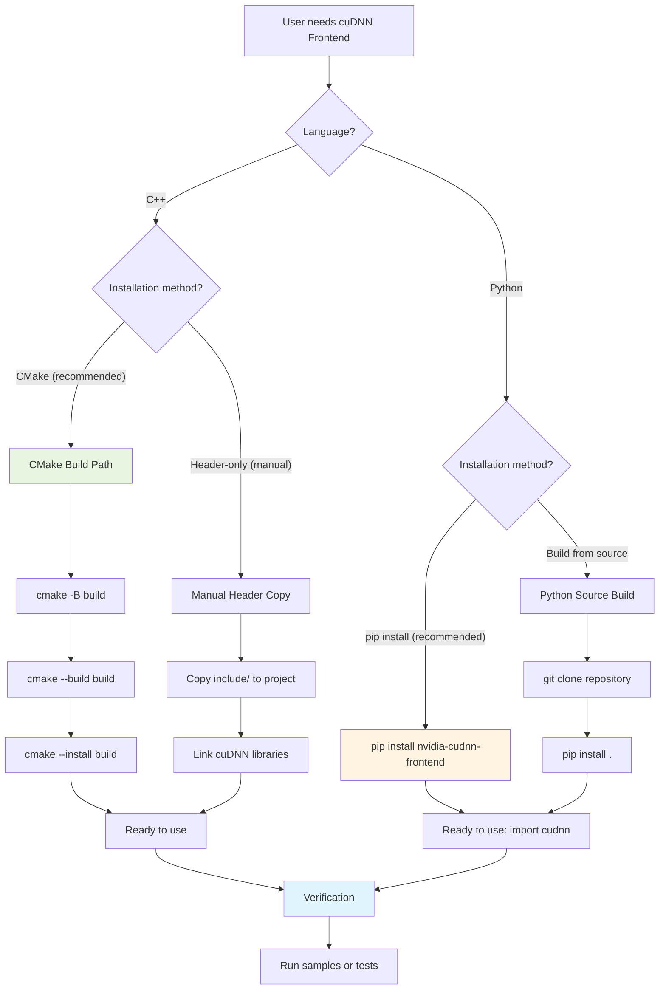
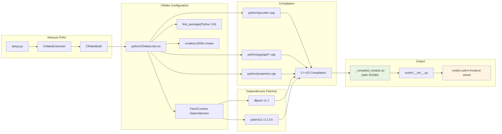
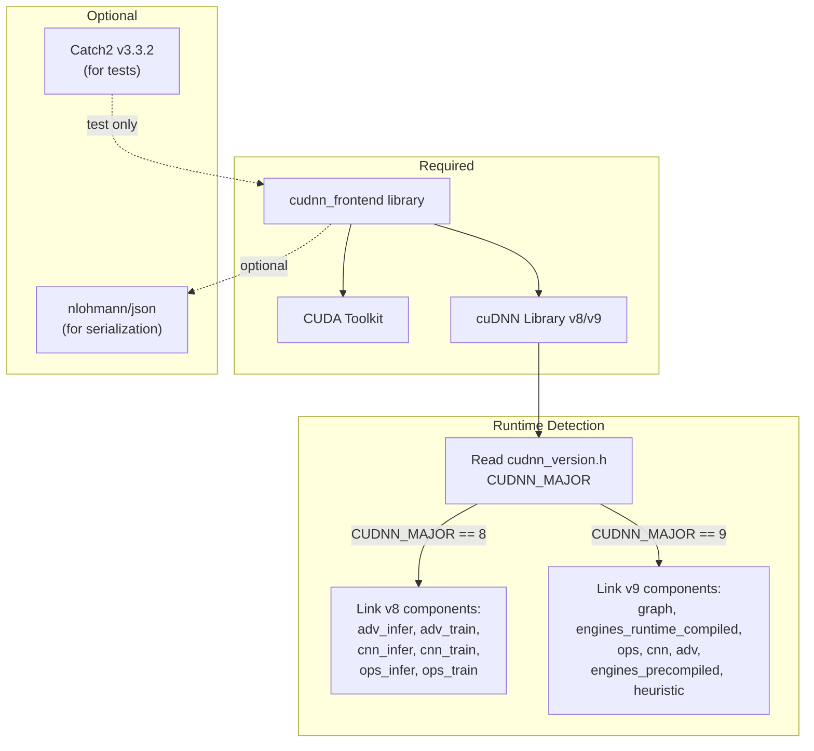
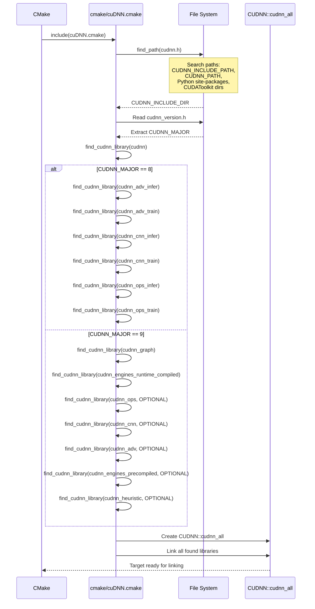

<!-- source: DeepWiki mcp.deepwiki.com · repo NVIDIA/cudnn-frontend · page 1.1 Installation & Setup · fetched 2026-10-26 -->

# Installation & Setup

<details>
<summary>Relevant source files</summary>

The following files were used as context for generating this wiki page:

- [CMakeLists.txt](CMakeLists.txt)
- [cmake/cuDNN.cmake](cmake/cuDNN.cmake)
- [dlpack_version.txt](dlpack_version.txt)
- [include/cudnn_frontend.h](include/cudnn_frontend.h)
- [include/cudnn_frontend/node/moe_grouped_matmul.h](include/cudnn_frontend/node/moe_grouped_matmul.h)
- [python/CMakeLists.txt](python/CMakeLists.txt)
- [python/pycudnn.cpp](python/pycudnn.cpp)
- [requirements.txt](requirements.txt)
- [samples/CMakeLists.txt](samples/CMakeLists.txt)
- [samples/python/00_introduction.ipynb](samples/python/00_introduction.ipynb)
- [setup.py](setup.py)

</details>


This document provides detailed instructions for installing and configuring the cuDNN Frontend library for both C++ and Python environments. The cuDNN Frontend is a header-only C++ library that provides a modern, graph-based API to NVIDIA's cuDNN library, with optional Python bindings for seamless integration with Python-based workflows.

For information about cuDNN version compatibility and feature support across versions, see [Version Compatibility](#1.3). For architectural details about how the build system works, see [Architecture Overview](#1.2).

---

## Prerequisites

### System Requirements

| Component | Requirement |
|-----------|-------------|
| **CMake** | ≥ 3.23 (C++ builds) or ≥ 3.18 (Python builds) |
| **C++ Compiler** | C++17 support (C++20 for Python bindings) |
| **CUDA Toolkit** | Required for both C++ and Python |
| **cuDNN Library** | Version 8.x or 9.x |
| **Python** | ≥ 3.8 (Python installation only) |
| **Operating System** | Linux, Windows (MSVC, MSYS, MinGW) |

### CUDA Toolkit

The CUDA Toolkit must be installed and accessible on your system. The build system uses CMake's `find_package(CUDAToolkit REQUIRED)` to locate CUDA headers and libraries.

**Installation options:**
- Download from [NVIDIA Developer Downloads](https://developer.nvidia.com/cuda-downloads)
- Set `CUDA_PATH` or `CUDAToolkit_ROOT` environment variable if installed in non-standard location

### cuDNN Library

The cuDNN library provides the backend computation kernels. The frontend library dynamically detects the installed version (v8 or v9) and links appropriate components.

**Version-specific libraries:**

cuDNN 8.x components:
- `libcudnn.so.8` (or `cudnn.dll`)
- `libcudnn_adv_infer.so.8`, `libcudnn_adv_train.so.8`
- `libcudnn_cnn_infer.so.8`, `libcudnn_cnn_train.so.8`
- `libcudnn_ops_infer.so.8`, `libcudnn_ops_train.so.8`

cuDNN 9.x components:
- `libcudnn.so.9`
- `libcudnn_graph.so.9`, `libcudnn_engines_runtime_compiled.so.9`
- `libcudnn_ops.so.9`, `libcudnn_cnn.so.9`, `libcudnn_adv.so.9`
- `libcudnn_engines_precompiled.so.9` (optional)
- `libcudnn_heuristic.so.9` (optional)

Set `CUDNN_PATH` environment variable if installed in non-standard location.

**Sources:** [cmake/cuDNN.cmake:77-115]()

---

## Installation Decision Flow



**Sources:** [CMakeLists.txt:1-108](), [setup.py:1-119]()

---

## C++ Installation

The cuDNN Frontend is a **header-only library** defined as a CMake `INTERFACE` target. No compilation is required for the library itself, but samples and tests can optionally be built.

### Using CMake (Recommended)

#### Step 1: Clone the Repository

```bash
git clone https://github.com/NVIDIA/cudnn-frontend.git
cd cudnn-frontend
```

#### Step 2: Configure the Build

```bash
cmake -B build \
  -DCUDNN_FRONTEND_BUILD_SAMPLES=ON \
  -DCUDNN_FRONTEND_BUILD_TESTS=ON \
  -DCUDNN_PATH=/path/to/cudnn \
  -DCUDAToolkit_ROOT=/path/to/cuda
```

**Build options:**

| CMake Option | Default | Description |
|--------------|---------|-------------|
| `CUDNN_FRONTEND_SKIP_JSON_LIB` | `OFF` | Exclude nlohmann/json.hpp (disables serialization) |
| `CUDNN_FRONTEND_BUILD_SAMPLES` | `ON` | Build C++ sample programs |
| `CUDNN_FRONTEND_BUILD_TESTS` | `ON` | Build unit tests |
| `CUDNN_FRONTEND_BUILD_PYTHON_BINDINGS` | `OFF` | Build Python bindings (see Python section) |

#### Step 3: Build (Optional, for Samples/Tests)

```bash
cmake --build build --parallel
```

This compiles the sample programs in [samples/cpp/]() and test suite in [test/]().

#### Step 4: Install

```bash
sudo cmake --install build --prefix /usr/local
```

This installs:
- Headers to `${CMAKE_INSTALL_INCLUDEDIR}/cudnn_frontend/`
- CMake package config to `${CMAKE_INSTALL_LIBDIR}/cmake/cudnn_frontend/`
- Sample binaries to `${CMAKE_INSTALL_BINDIR}/` (if built)

**Sources:** [CMakeLists.txt:1-108](), [samples/CMakeLists.txt:1-27]()

### CMake Build System Architecture

```mermaid
graph TB
    subgraph "Root CMakeLists.txt"
        ROOT_CMAKE["CMakeLists.txt"]
        CUDNN_FE["cudnn_frontend<br/>(INTERFACE library)"]
        PCH["_cudnn_frontend_pch<br/>(Precompiled headers)"]
    end
    
    subgraph "Dependencies"
        CUDA_TOOLKIT["CUDAToolkit"]
        CUDNN_CMAKE["cmake/cuDNN.cmake"]
        CUDNN_ALL["CUDNN::cudnn_all"]
    end
    
    subgraph "Build Targets"
        SAMPLES_DIR["samples/CMakeLists.txt"]
        TESTS_DIR["test/CMakeLists.txt"]
        PYTHON_DIR["python/CMakeLists.txt"]
        
        SAMPLES["samples<br/>(C++ samples)"]
        LEGACY_SAMPLES["legacy_samples"]
        TESTS["tests"]
        COMPILED_MODULE["_compiled_module.so<br/>(Python bindings)"]
    end
    
    subgraph "External Dependencies"
        CATCH2["Catch2 v3.3.2<br/>(FetchContent)"]
        DLPACK["dlpack v1.1<br/>(FetchContent)"]
        PYBIND11["pybind11 v2.13.6<br/>(FetchContent)"]
    end
    
    subgraph "Install Artifacts"
        HEADERS["include/cudnn_frontend/*.h"]
        CMAKE_CONFIG["cudnn_frontend-config.cmake"]
        TARGETS_FILE["cudnn_frontend-targets.cmake"]
    end
    
    ROOT_CMAKE --> CUDNN_FE
    ROOT_CMAKE --> PCH
    ROOT_CMAKE --> SAMPLES_DIR
    ROOT_CMAKE --> TESTS_DIR
    ROOT_CMAKE --> PYTHON_DIR
    
    CUDA_TOOLKIT --> CUDNN_FE
    CUDNN_CMAKE --> CUDNN_ALL
    CUDNN_ALL --> SAMPLES
    CUDNN_ALL --> TESTS
    CUDNN_ALL --> COMPILED_MODULE
    
    SAMPLES_DIR --> SAMPLES
    SAMPLES_DIR --> LEGACY_SAMPLES
    TESTS_DIR --> TESTS
    PYTHON_DIR --> COMPILED_MODULE
    
    SAMPLES_DIR --> CATCH2
    PYTHON_DIR --> DLPACK
    PYTHON_DIR --> PYBIND11
    
    CUDNN_FE --> HEADERS
    ROOT_CMAKE --> CMAKE_CONFIG
    ROOT_CMAKE --> TARGETS_FILE
```



**Sources:** [CMakeLists.txt:1-108](), [cmake/cuDNN.cmake:1-116](), [samples/CMakeLists.txt:1-27](), [python/CMakeLists.txt:1-128]()

### Integrating with Your C++ Project

#### Method 1: Using Installed Package

After installation, use `find_package` in your CMakeLists.txt:

```cmake
cmake_minimum_required(VERSION 3.18)
project(my_project)

find_package(cudnn_frontend REQUIRED)
find_package(CUDAToolkit REQUIRED)

add_executable(my_app main.cpp)
target_link_libraries(my_app PRIVATE 
    cudnn_frontend 
    CUDA::cudart
)
```

#### Method 2: Adding as Subdirectory

```cmake
add_subdirectory(cudnn-frontend)
target_link_libraries(my_app PRIVATE cudnn_frontend)
```

#### Method 3: Header-Only Manual Integration

Copy the `include/` directory to your project and add to include path:

```cmake
target_include_directories(my_app PRIVATE /path/to/cudnn-frontend/include)
```

**Required compiler flags:**
- C++17: `-std=c++17` (or `target_compile_features(... cxx_std_17)`)
- Warning flags from [CMakeLists.txt:11-14]()

**Sources:** [CMakeLists.txt:16-46](), [include/cudnn_frontend.h:1-147]()

---

## Python Installation

The Python package `nvidia-cudnn-frontend` provides a `cudnn` module with both high-level wrapper (`cudnn.Graph`) and low-level bindings (`cudnn.pygraph`).

### Using pip (Recommended)

#### Prerequisites

Install cuDNN Python package first (provides backend library):

```bash
pip install nvidia-cudnn-cu12  # For CUDA 12.x
# OR
pip install nvidia-cudnn-cu11  # For CUDA 11.x
```

#### Install cuDNN Frontend

```bash
pip install nvidia-cudnn-frontend
```

This installs the pre-built wheel with compiled Python bindings.

#### Verification

```python
import cudnn
print(cudnn.backend_version())  # Should print version like 90000
```

**Sources:** [samples/python/00_introduction.ipynb:54-56]()

### Building from Source

#### Step 1: Install Dependencies

```bash
pip install -r requirements.txt
```

Key Python dependencies from [requirements.txt:1-9]():
- `pybind11[global]` - C++/Python binding generator (v2.13.6)
- `numpy<2.0.0` - NumPy arrays
- `pytest`, `pytest-xdist` - Testing framework

#### Step 2: Clone and Build

```bash
git clone https://github.com/NVIDIA/cudnn-frontend.git
cd cudnn-frontend
pip install .
```

#### Step 3: Environment Variables (Optional)

Control build behavior with environment variables:

| Variable | Purpose | Example |
|----------|---------|---------|
| `CUDA_PATH` or `CUDAToolkit_ROOT` | CUDA location | `/usr/local/cuda` |
| `CUDNN_PATH` | cuDNN location | `/usr/local/cudnn` |
| `FETCHCONTENT_SOURCE_DIR_DLPACK` | Local DLPack path | `/path/to/dlpack` |
| `CMAKE_BUILD_PARALLEL_LEVEL` | Parallel build jobs | `8` |
| `DEBUG` | Debug build | `1` |

**Sources:** [setup.py:59-71]()

### Python Build Pipeline



**Sources:** [setup.py:1-119](), [python/CMakeLists.txt:1-128]()

### Python Module Structure

The compiled module exports the following:

| Component | Description | Source File |
|-----------|-------------|-------------|
| `backend_version()` | Returns cuDNN version as integer | [python/pycudnn.cpp:84]() |
| `backend_version_string()` | Returns version string | [python/pycudnn.cpp:85]() |
| `pygraph` | Low-level graph construction class | [python/pygraph/pygraph.cpp]() |
| `create_handle()` / `destroy_handle()` | cuDNN handle management | Defined in Python wrapper |
| `data_type`, `heur_mode`, etc. | Enums and properties | [python/properties.cpp]() |
| `cudnnGraphNotSupportedError` | Custom exception | [python/pycudnn.cpp:92]() |

**Dynamic loading:** The Python bindings are compiled with `NV_CUDNN_FRONTEND_USE_DYNAMIC_LOADING` ([python/CMakeLists.txt:80]()), enabling runtime loading of cuDNN libraries without static linking.

**Sources:** [python/pycudnn.cpp:1-97](), [python/CMakeLists.txt:56-94]()

---

## Dependency Resolution

### C++ Dependencies



**Sources:** [cmake/cuDNN.cmake:10-115](), [CMakeLists.txt:5-6]()

### Python Dependencies

**Build-time dependencies:**
- CMake ≥ 3.18
- C++20 compiler
- pybind11 ≥ 2.13.6
- DLPack 1.1 (for tensor interoperability)

**Runtime dependencies:**
- numpy < 2.0.0
- nvidia-cudnn-cu12 (or cu11)
- Optional: PyTorch, TensorFlow, JAX (for tensor support)

**DLPack version:** The exact version is specified in [dlpack_version.txt:1]() as `1.1`.

**Sources:** [requirements.txt:1-9](), [python/CMakeLists.txt:21-31](), [dlpack_version.txt:1]()

---

## Library Detection Process

The cuDNN detection mechanism in [cmake/cuDNN.cmake]() performs the following steps:



**Search paths for libraries** ([cmake/cuDNN.cmake:25]()):
- `$CUDNN_LIBRARY_PATH` / `$CUDNN_PATH` environment variables
- Python site-packages (`${Python_SITEARCH}/nvidia/cudnn`)
- CUDA Toolkit library directory
- Standard system paths: `lib64`, `lib/x64`, `lib`

**Sources:** [cmake/cuDNN.cmake:1-116]()

---

## Verification

### C++ Verification

After building samples, run a simple test:

```bash
# Run convolution sample
./build/bin/samples

# Or run unit tests
./build/bin/tests
```

Expected output: Tests pass without errors, confirming proper installation and linking.

### Python Verification

Create a test script `verify.py`:

```python
import cudnn
import torch

# Check version
print(f"cuDNN backend version: {cudnn.backend_version()}")
print(f"cuDNN version string: {cudnn.backend_version_string()}")

# Test basic functionality
handle = cudnn.create_handle()
print("Handle created successfully")

# Create a simple graph
graph = cudnn.pygraph(
    handle=handle,
    name="test_graph",
    io_data_type=cudnn.data_type.HALF
)
print("Graph created successfully")

cudnn.destroy_handle(handle)
print("All checks passed!")
```

Run: `python verify.py`

Expected output:
```
cuDNN backend version: 90000
cuDNN version string: 9.0.0
Handle created successfully
Graph created successfully
All checks passed!
```

**Sources:** [samples/python/00_introduction.ipynb:79-82]()

---

## Troubleshooting Common Issues

### Issue: CMake Cannot Find cuDNN

**Symptom:** `CMake Error: Could not find CUDNN_INCLUDE_DIR`

**Solution:**
```bash
export CUDNN_PATH=/path/to/cudnn
cmake -B build -DCUDNN_PATH=$CUDNN_PATH
```

### Issue: Python Import Error

**Symptom:** `ImportError: cannot import name '_compiled_module'`

**Solution:** Ensure nvidia-cudnn-cu12 is installed:
```bash
pip install nvidia-cudnn-cu12
pip install --force-reinstall nvidia-cudnn-frontend
```

### Issue: Version Mismatch

**Symptom:** Runtime error about unsupported operations

**Solution:** Check version compatibility:
```python
import cudnn
print(cudnn.backend_version())  # Should be >= 80000 for v8, >= 90000 for v9
```

### Issue: Dynamic Loading Failure

**Symptom:** `dlopen failed` or similar runtime errors

**Solution:** Set LD_LIBRARY_PATH (Linux) or PATH (Windows):
```bash
export LD_LIBRARY_PATH=/usr/local/cuda/lib64:$LD_LIBRARY_PATH
export LD_LIBRARY_PATH=/path/to/cudnn/lib:$LD_LIBRARY_PATH
```

**Sources:** [python/CMakeLists.txt:80](), [python/pycudnn.cpp:75-81]()

---

## Next Steps

After successful installation:

1. **Learn the API:** See [Graph API](#2.1) for the modern C++ interface or [Python API Overview](#4.1) for Python usage
2. **Run Examples:** Explore [C++ Examples](#6.1) and [Python Notebook Examples](#6.2)
3. **Understand Architecture:** Read [Architecture Overview](#1.2) to understand the library's design
4. **Check Compatibility:** Review [Version Compatibility](#1.3) for feature availability

**Sources:** [CMakeLists.txt:1-108](), [setup.py:1-119](), [cmake/cuDNN.cmake:1-116](), [python/CMakeLists.txt:1-128](), [samples/python/00_introduction.ipynb:1-440]()

---

