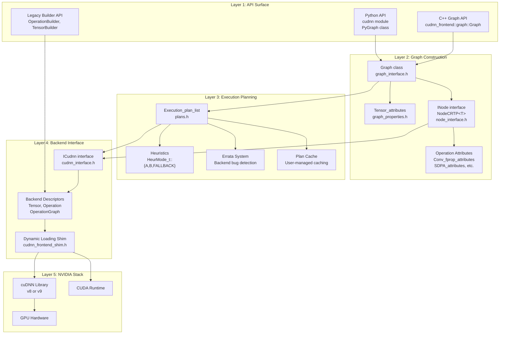
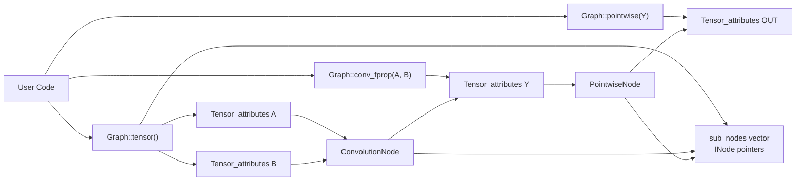
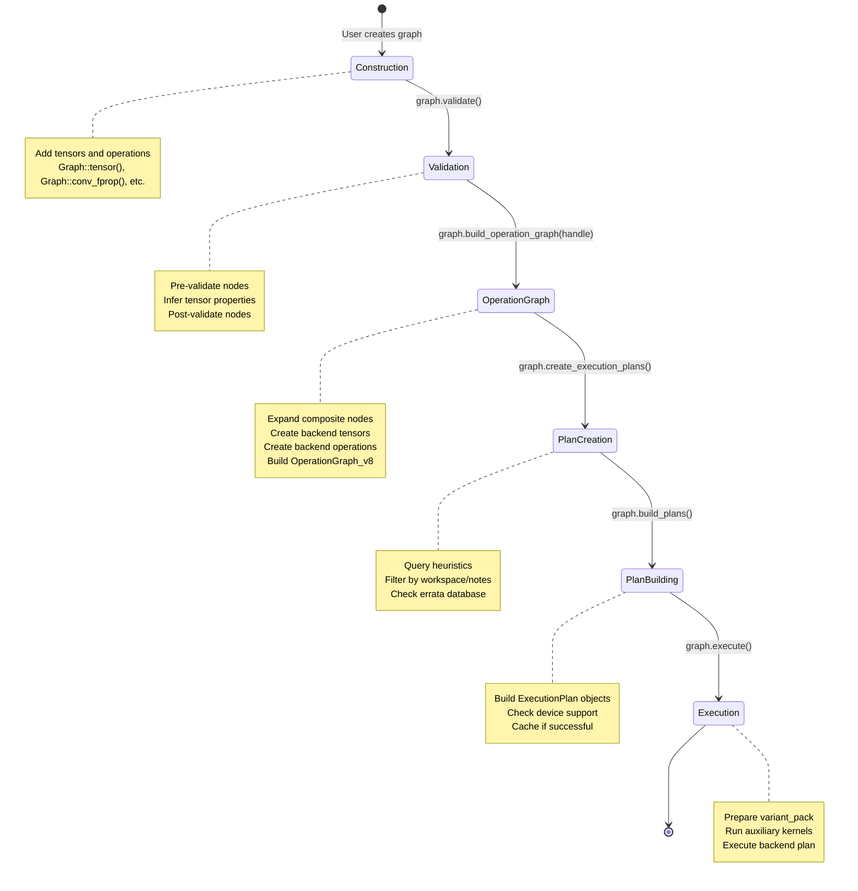
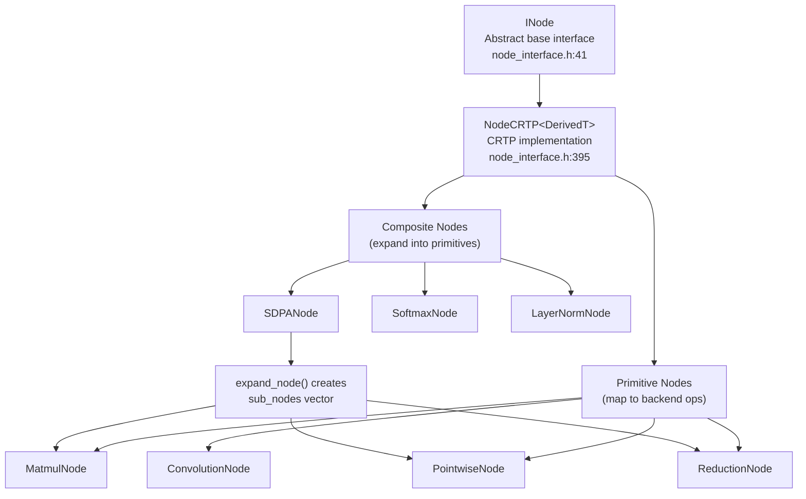
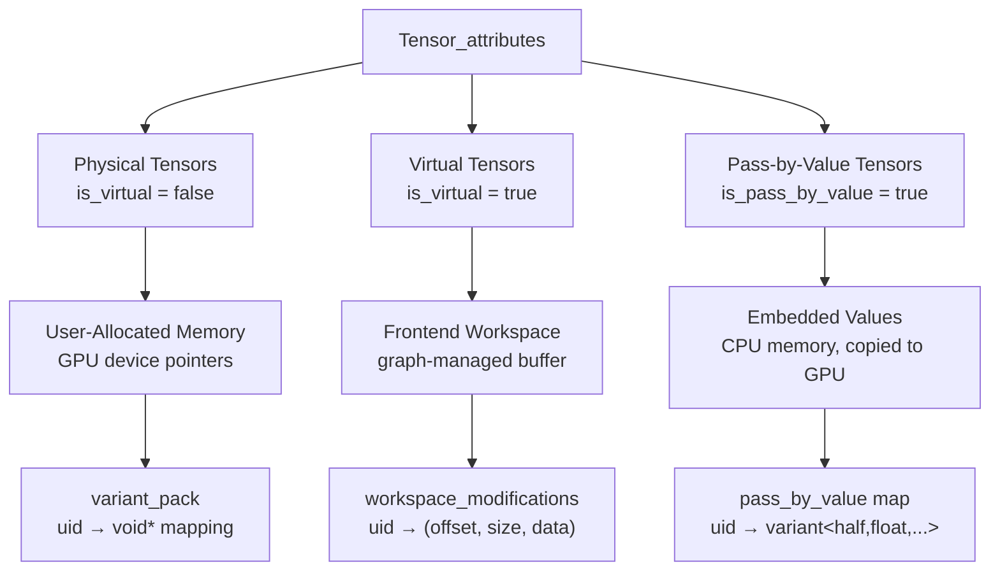
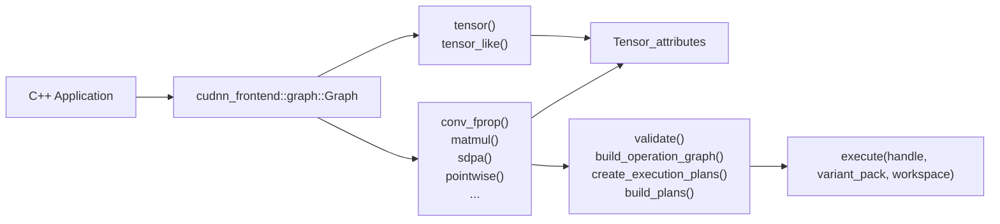
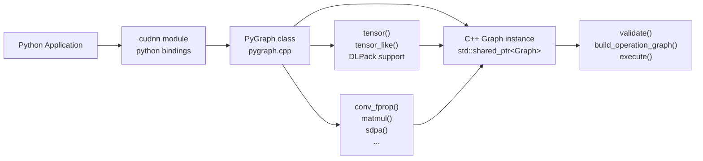
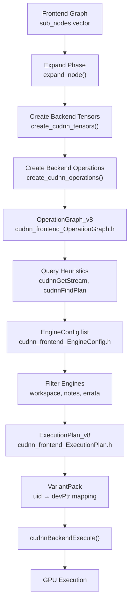

<!-- source: DeepWiki mcp.deepwiki.com · repo NVIDIA/cudnn-frontend · page 1.2 Architecture Overview · fetched 2026-10-26 -->

# Architecture Overview

<details>
<summary>Relevant source files</summary>

The following files were used as context for generating this wiki page:

- [README.md](README.md)
- [include/cudnn_frontend/cudnn_interface.h](include/cudnn_frontend/cudnn_interface.h)
- [include/cudnn_frontend/graph_helpers.h](include/cudnn_frontend/graph_helpers.h)
- [include/cudnn_frontend/graph_interface.h](include/cudnn_frontend/graph_interface.h)
- [include/cudnn_frontend/node/sdpa_fp8_bwd.h](include/cudnn_frontend/node/sdpa_fp8_bwd.h)
- [include/cudnn_frontend/node_interface.h](include/cudnn_frontend/node_interface.h)
- [include/cudnn_frontend/utils/serialize.h](include/cudnn_frontend/utils/serialize.h)
- [include/cudnn_frontend_utils.h](include/cudnn_frontend_utils.h)
- [python/pygraph/pygraph.cpp](python/pygraph/pygraph.cpp)
- [python/pygraph/sdpa.cpp](python/pygraph/sdpa.cpp)
- [samples/cpp/convolution/fprop.cpp](samples/cpp/convolution/fprop.cpp)
- [samples/cpp/sdpa/fp16_fwd_with_custom_dropout.cpp](samples/cpp/sdpa/fp16_fwd_with_custom_dropout.cpp)
- [samples/cpp/sdpa/fp8_fwd.cpp](samples/cpp/sdpa/fp8_fwd.cpp)

</details>


## Purpose and Scope

This page describes the high-level architecture of the cuDNN Frontend library, including its layered design, core components, and data flow. It covers the structural organization of the codebase and how different subsystems interact to provide a modern interface to NVIDIA's cuDNN library.

For installation details, see [Installation & Setup](#1.1). For version-specific features and compatibility, see [Version Compatibility](#1.3). For detailed API documentation, see [API Reference](#2). For node-specific details, see [Node Types](#3).

---

## System Layers

The cuDNN Frontend is organized into five distinct architectural layers, each with specific responsibilities:



**Sources:** [include/cudnn_frontend/graph_interface.h:40-41](), [include/cudnn_frontend/node_interface.h:41](), [include/cudnn_frontend/cudnn_interface.h:100](), [python/pygraph/pygraph.cpp:1-30]()

### Layer Responsibilities

| Layer | Components | Responsibilities |
|-------|-----------|------------------|
| **API Surface** | `PyGraph`, `Graph`, Legacy Builders | User-facing interfaces for graph construction |
| **Graph Construction** | `INode`, `Tensor_attributes`, Operation Attributes | Internal graph representation and node system |
| **Execution Planning** | `Execution_plan_list`, Heuristics, Errata | Engine selection, filtering, optimization |
| **Backend Interface** | `ICudnn`, Backend Descriptors, Shim | Translation to cuDNN backend API |
| **NVIDIA Stack** | cuDNN Library, CUDA Runtime | Low-level execution on GPU hardware |

**Sources:** [README.md:1-100](), [include/cudnn_frontend/graph_interface.h:100-712]()

---

## Graph Construction Model

The cuDNN Frontend uses a functional graph construction API where operations create and return tensor objects:



**Sources:** [include/cudnn_frontend/graph_interface.h:320-321](), [samples/cpp/convolution/fprop.cpp:37-68]()

### Core Graph Components

The `Graph` class ([include/cudnn_frontend/graph_interface.h:40]()) serves as the primary entry point and manages:

- **Tensor Creation**: `tensor()` and `tensor_like()` methods create `Tensor_attributes` objects
- **Operation Methods**: `conv_fprop()`, `matmul()`, `sdpa()`, etc. create nodes and return output tensors
- **Subgraph Tracking**: Maintains a `sub_nodes` vector of all operations in topological order
- **Global State**: `full_graph_inputs`, `full_graph_outputs`, `used_uids`

```cpp
// Example from graph construction
auto X = graph->tensor(Tensor_attributes().set_dim({n, c, h, w})...);
auto W = graph->tensor(Tensor_attributes().set_dim({k, c, r, s})...);
auto Y = graph->conv_fprop(X, W, Conv_fprop_attributes()...);
Y->set_output(true);
```

**Sources:** [samples/cpp/convolution/fprop.cpp:41-55](), [include/cudnn_frontend/graph_interface.h:320-656]()

---

## Execution Model

Graph execution follows a distinct multi-phase lifecycle:



**Sources:** [include/cudnn_frontend/graph_interface.h:630-712](), [samples/cpp/convolution/fprop.cpp:57-89]()

### Execution Phases in Detail

| Phase | Method | Key Activities | Error Conditions |
|-------|--------|----------------|------------------|
| **Validation** | `validate()` | `pre_validate_node()`, `infer_properties_node()`, `post_validate_node()` on all nodes | Missing attributes, incompatible dimensions |
| **Operation Graph** | `build_operation_graph()` | `expand_node()`, `create_cudnn_tensors()`, `create_cudnn_operations()` | Unsupported operation combinations |
| **Plan Creation** | `create_execution_plans()` | Query heuristics, filter by workspace/notes, check errata | No suitable engines found |
| **Plan Building** | `build_plans()` | Finalize plans, check support | Device doesn't support operation |
| **Execution** | `execute()` | Run kernels with variant pack | Runtime errors, insufficient workspace |

**Sources:** [include/cudnn_frontend/graph_interface.h:630-796](), [include/cudnn_frontend/node_interface.h:232-330]()

---

## Node System Architecture

The node system uses a two-tier hierarchy with the **Curiously Recurring Template Pattern (CRTP)** for type-safe polymorphism:



**Sources:** [include/cudnn_frontend/node_interface.h:41-457](), [include/cudnn_frontend/graph_interface.h:8-30]()

### Node Interface Methods

The `INode` interface defines virtual methods called during graph processing:

| Method | Phase | Purpose |
|--------|-------|---------|
| `pre_validate_node()` | Validation | Check attributes are set, validate constraints |
| `infer_properties_node()` | Validation | Deduce output tensor properties from inputs |
| `expand_node()` | Build | Composite nodes expand into primitive operations |
| `post_validate_node()` | Validation | Final validation after property inference |
| `create_cudnn_tensors_node()` | Build | Create backend `Tensor` descriptors |
| `create_cudnn_operations()` | Build | Create backend `Operation` descriptors |
| `collect_pass_by_value_tensors_node()` | Execution | Collect scalar constants |
| `collect_tensors_in_workspace_node()` | Execution | Identify workspace-allocated tensors |

**Sources:** [include/cudnn_frontend/node_interface.h:60-106](), [include/cudnn_frontend/node_interface.h:232-330]()

### CRTP Pattern Implementation

The `NodeCRTP<DerivedT>` template ([include/cudnn_frontend/node_interface.h:395]()) provides common implementations:

```cpp
template <typename DerivedT>
class NodeCRTP : public INode {
    DerivedT& self() { return *static_cast<DerivedT*>(this); }
    
    error_t create_cudnn_tensors_node(...) override {
        // Automatically handles self().attributes.inputs and outputs
        for (auto const& [name, tensor] : self().attributes.inputs) {
            create_cudnn_tensor(tensor, ...);
        }
        // ...
    }
};
```

This pattern eliminates code duplication while maintaining type safety. Each node type (e.g., `ConvolutionNode`, `SDPANode`) inherits from `NodeCRTP<ConvolutionNode>`.

**Sources:** [include/cudnn_frontend/node_interface.h:395-457]()

---

## Memory Management Architecture

The frontend categorizes tensors into three types based on memory ownership:



**Sources:** [include/cudnn_frontend/graph_interface.h:141-169](), [include/cudnn_frontend/graph_interface.h:770-788]()

### Memory Categories

| Category | `is_virtual` | `is_pass_by_value` | Memory Source | Use Case |
|----------|--------------|-------------------|---------------|----------|
| **Physical** | `false` | `false` | User provides device pointer in `variant_pack` | Graph inputs/outputs, user-managed tensors |
| **Virtual** | `true` | `false` | Allocated from `workspace` by frontend | Intermediate results, temporary buffers |
| **Pass-by-Value** | - | `true` | Scalar value embedded in graph, copied to GPU | Constants like epsilon, scale factors |

**Example Usage:**

```cpp
// Physical tensor (user provides memory)
auto X = graph->tensor(Tensor_attributes()
    .set_dim({n, c, h, w})
    .set_is_virtual(false));  // User must provide devPtr

// Virtual tensor (framework manages memory)
auto intermediate = graph->pointwise(...);  // is_virtual=true by default

// Pass-by-value scalar
auto epsilon = graph->tensor(Tensor_attributes()
    .set_dim({1,1,1,1})
    .set_is_pass_by_value(true));  // Value embedded in graph
```

**Sources:** [samples/cpp/convolution/fprop.cpp:41-55](), [include/cudnn_frontend/graph_properties.h]()

---

## API Surfaces

The frontend provides two primary API surfaces targeting different user needs:

### C++ Graph API

The modern C++ interface centered on `cudnn_frontend::graph::Graph`:



**Sources:** [include/cudnn_frontend/graph_interface.h:40-1300](), [samples/cpp/convolution/fprop.cpp:28-90]()

### Python API

The Python interface wraps the C++ Graph API via `pybind11`:



**Sources:** [python/pygraph/pygraph.cpp:22-700](), [python/pygraph/pygraph.h]()

### API Comparison

| Feature | C++ Graph API | Python API |
|---------|--------------|------------|
| **Entry Point** | `cudnn_frontend::graph::Graph` | `cudnn.pygraph(handle, ...)` |
| **Tensor Creation** | `graph->tensor(Tensor_attributes()...)` | `graph.tensor(dim, stride, dtype)` |
| **Interoperability** | Native C++ pointers | DLPack protocol (`__dlpack__`) |
| **Error Handling** | `error_t` struct with `is_good()/is_bad()` | Python exceptions |
| **Memory Model** | Explicit `variant_pack` with UIDs | DLPack capsules or UID mapping |

**Sources:** [include/cudnn_frontend/graph_interface.h:320-1300](), [python/pygraph/pygraph.cpp:80-353]()

---

## Backend Integration

The frontend translates user graphs into cuDNN backend API calls through a multi-step lowering process:



**Sources:** [include/cudnn_frontend/cudnn_interface.h:128-163](), [include/cudnn_frontend/graph_interface.h:669-712]()

### Backend Descriptor Hierarchy

The frontend creates these backend descriptors during the build phase:

| Frontend Type | Backend Descriptor | Backend API Type | Created By |
|---------------|-------------------|------------------|------------|
| `Tensor_attributes` | `cudnn_frontend::Tensor` | `CUDNN_BACKEND_TENSOR_DESCRIPTOR` | `create_cudnn_tensors_node()` |
| `ConvolutionNode` | `cudnn_frontend::Operation` | `CUDNN_BACKEND_OPERATION_CONVOLUTION_FORWARD_DESCRIPTOR` | `create_cudnn_operations()` |
| Graph | `cudnn_frontend::OperationGraph_v8` | `CUDNN_BACKEND_OPERATIONGRAPH_DESCRIPTOR` | `create_cudnn_operation_graph()` |
| Plan candidate | `cudnn_frontend::EngineConfig` | `CUDNN_BACKEND_ENGINECFG_DESCRIPTOR` | Heuristics query |
| Executable plan | `cudnn_frontend::ExecutionPlan_v8` | `CUDNN_BACKEND_EXECUTION_PLAN_DESCRIPTOR` | `build_plans()` |

**Sources:** [include/cudnn_frontend/cudnn_interface.h:128-206](), [include/cudnn_frontend_utils.h:440-482]()

### Dynamic Loading Shim

The frontend uses dynamic library loading to support multiple cuDNN versions without recompilation:

```cpp
// Shim loads symbols at runtime
namespace detail {
    cudnnStatus_t (*cudnnCreate)(cudnnHandle_t*);
    cudnnStatus_t (*cudnnBackendExecute)(cudnnHandle_t, ...);
    // ... loaded via dlopen/dlsym
}
```

This enables:
- **Version flexibility**: Same binary works with cuDNN v8 and v9
- **Symbol resolution**: Missing symbols cause runtime errors, not link errors  
- **Deployment simplicity**: No need to rebuild for different cuDNN versions

**Sources:** [include/cudnn_frontend_shim.h](), [README.md:58]()

---

## Key Architectural Patterns

### 1. Builder Pattern (Legacy API)

The legacy API uses method chaining for descriptor construction:

```cpp
auto tensor = cudnn_frontend::TensorBuilder()
    .setDim(4, dims)
    .setStride(4, strides)
    .setDataType(CUDNN_DATA_HALF)
    .build();
```

**Sources:** [include/cudnn_frontend/cudnn_interface.h:56-94]()

### 2. Functional Graph Construction (Modern API)

Operations return tensors that can be chained:

```cpp
auto Y = graph->conv_fprop(X, W, ...);
auto Z = graph->pointwise(Y, ...);
```

**Sources:** [samples/cpp/convolution/fprop.cpp:41-65]()

### 3. Property Inference with Context

The `detail::Context` object carries global defaults through the graph:

```cpp
graph->set_io_data_type(DataType_t::HALF)
     .set_compute_data_type(DataType_t::FLOAT);
// Context propagated to all nodes during fill_from_context()
```

**Sources:** [include/cudnn_frontend/graph_interface.h:52-54](), [include/cudnn_frontend/graph_properties.h]()

### 4. Error Handling with Result Types

All operations return `error_t` structs instead of throwing exceptions (unless `NV_CUDNN_DISABLE_EXCEPTION` is not defined):

```cpp
auto status = graph->validate();
if (status.is_bad()) {
    std::cout << status.get_message() << std::endl;
    return;
}
```

**Sources:** [include/cudnn_frontend/graph_helpers.h:54-90](), [include/cudnn_frontend/graph_helpers.h:99-144]()

---

This architecture enables the cuDNN Frontend to provide a high-level, type-safe API while maintaining flexibility for different deployment scenarios and cuDNN versions.

---

