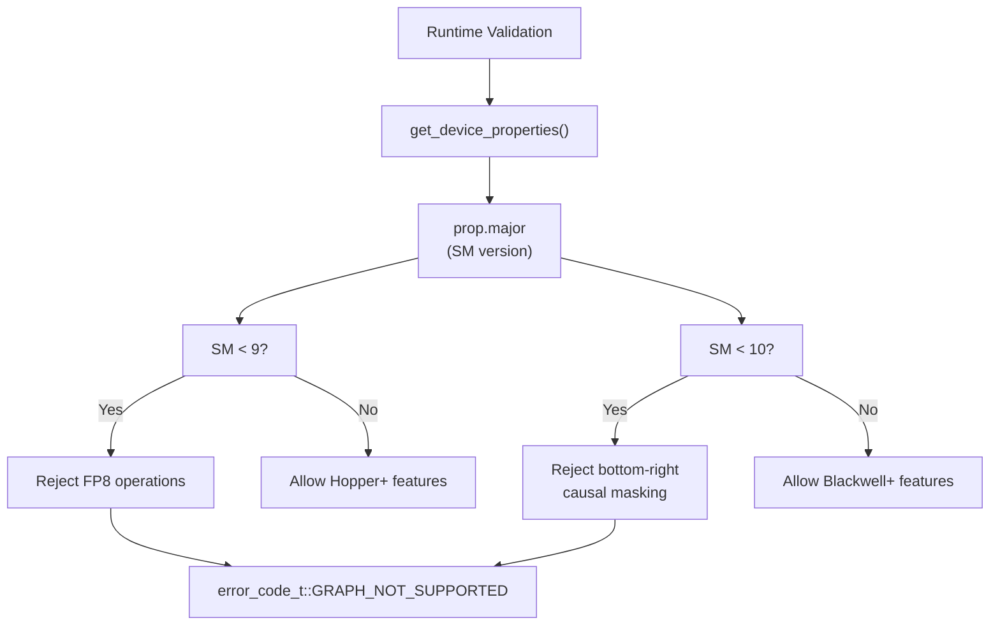
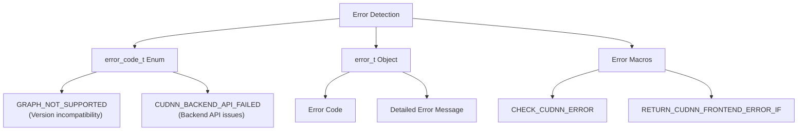

<!-- source: DeepWiki mcp.deepwiki.com · repo NVIDIA/cudnn-frontend · page 1.3 Version Compatibility · fetched 2026-10-26 -->

# Version Compatibility

<details>
<summary>Relevant source files</summary>

The following files were used as context for generating this wiki page:

- [CMakeLists.txt](CMakeLists.txt)
- [cmake/cuDNN.cmake](cmake/cuDNN.cmake)
- [include/cudnn_frontend.h](include/cudnn_frontend.h)
- [include/cudnn_frontend/node/scaled_dot_product_flash_attention.h](include/cudnn_frontend/node/scaled_dot_product_flash_attention.h)
- [include/cudnn_frontend_version.h](include/cudnn_frontend_version.h)
- [python/cudnn/__init__.py](python/cudnn/__init__.py)
- [samples/python/00_introduction.ipynb](samples/python/00_introduction.ipynb)
- [setup.py](setup.py)

</details>


This page documents compatibility requirements between the cuDNN Frontend library and the cuDNN backend library, CUDA runtime, and supported hardware. The cuDNN Frontend is a header-only C++ library that wraps the cuDNN backend API, providing both C++ and Python interfaces. Understanding version compatibility is critical for building and deploying applications.

## Overview

The cuDNN Frontend library has three primary compatibility dimensions:

1. **cuDNN Backend Version**: The underlying cuDNN library (v8 or v9)
2. **CUDA Version**: The CUDA Toolkit version
3. **GPU Architecture**: Hardware compute capability (SM version)

Version mismatches can result in compilation errors, runtime errors, or missing features. The frontend library performs both compile-time and runtime version checks to ensure compatibility.

## cuDNN Backend Version Requirements

### Minimum Version

The cuDNN Frontend library requires **cuDNN 8.5.0 or newer**. The library detects the cuDNN version at build time and runtime.

### cuDNN v8 vs v9 Architecture

cuDNN v8 and v9 have significantly different architectures, with different component libraries:

**Title: cuDNN Version Architecture Comparison**

```mermaid
graph TB
    subgraph "cuDNN v8 Components"
        V8_MAIN["cudnn (main library)"]
        V8_ADV_INFER["cudnn_adv_infer"]
        V8_ADV_TRAIN["cudnn_adv_train"]
        V8_CNN_INFER["cudnn_cnn_infer"]
        V8_CNN_TRAIN["cudnn_cnn_train"]
        V8_OPS_INFER["cudnn_ops_infer"]
        V8_OPS_TRAIN["cudnn_ops_train"]
    end
    
    subgraph "cuDNN v9 Components"
        V9_MAIN["cudnn (main library)"]
        V9_GRAPH["cudnn_graph"]
        V9_ENGINES_RT["cudnn_engines_runtime_compiled"]
        V9_OPS["cudnn_ops (optional)"]
        V9_CNN["cudnn_cnn (optional)"]
        V9_ADV["cudnn_adv (optional)"]
        V9_ENGINES_PRE["cudnn_engines_precompiled (optional)"]
        V9_HEURISTIC["cudnn_heuristic (optional)"]
    end
    
    FE["cuDNN Frontend"] --> V8_MAIN
    FE --> V9_MAIN
    
    V8_MAIN --> V8_ADV_INFER
    V8_MAIN --> V8_ADV_TRAIN
    V8_MAIN --> V8_CNN_INFER
    V8_MAIN --> V8_CNN_TRAIN
    V8_MAIN --> V8_OPS_INFER
    V8_MAIN --> V8_OPS_TRAIN
    
    V9_MAIN --> V9_GRAPH
    V9_MAIN --> V9_ENGINES_RT
    V9_MAIN --> V9_OPS
    V9_MAIN --> V9_CNN
    V9_MAIN --> V9_ADV
    V9_MAIN --> V9_ENGINES_PRE
    V9_MAIN --> V9_HEURISTIC
```



Sources: [cmake/cuDNN.cmake:77-115]()

The build system automatically detects the cuDNN major version from `cudnn_version.h` and links the appropriate libraries:

- **cuDNN v8**: Links all six component libraries (required)
- **cuDNN v9**: Links `cudnn_graph` and `cudnn_engines_runtime_compiled` (required), with optional components

Sources: [cmake/cuDNN.cmake:10-12](), [cmake/cuDNN.cmake:77-115]()

### Version Detection at Build Time

The CMake build system extracts the cuDNN major version from the header file:

```cmake
file(READ "${CUDNN_INCLUDE_DIR}/cudnn_version.h" cudnn_version_header)
string(REGEX MATCH "#define CUDNN_MAJOR [1-9]+" macrodef "${cudnn_version_header}")
string(REGEX MATCH "[1-9]+" CUDNN_MAJOR_VERSION "${macrodef}")
```

This version number determines which component libraries to link against.

Sources: [cmake/cuDNN.cmake:10-12]()

## CUDA Version Requirements

The cuDNN Frontend requires the CUDA Toolkit for compilation and runtime:

- **Build Requirement**: CUDA Toolkit must be installed and discoverable via CMake
- **Runtime Requirement**: CUDA runtime libraries must be available
- **C++ Standard**: C++17 or newer

The CMake configuration searches for the CUDA Toolkit:

```cmake
find_package(CUDAToolkit REQUIRED)
target_compile_features(cudnn_frontend INTERFACE cxx_std_17)
```

Sources: [CMakeLists.txt:39](), [CMakeLists.txt:46]()

For Python installations, the CUDA Toolkit path can be specified via environment variables:

- `CUDA_PATH`: Path to CUDA installation
- `CUDAToolkit_ROOT`: Alternative specification for CUDA root

Sources: [setup.py:59-63]()

## Feature-Specific Version Requirements

Many cuDNN operations require specific backend versions or GPU architectures. The library performs runtime validation using `detail::get_backend_version()` and device properties.

**Title: Feature Version Requirements Matrix**

| Feature | Min cuDNN Version | Min GPU Architecture | Validation Location |
|---------|-------------------|---------------------|---------------------|
| SDPA with sink token | 9.13.0 | Any | `SDPANodeBase::pre_validate_node` |
| SDPA with s_kv%64!=0 workaround | < 9.0.0 | Any | `CompositeSDPANode::expand_node` |
| FP8 SDPA operations | 9.1.0+ | Hopper (SM 9.0+) | Node validation |
| Bottom-right causal masking | 9.7.0+ | Blackwell (SM 10.0+) | Node validation |
| Kernel cache for dynamic shapes | 9.4.0+ | Any | Kernel cache system |

### Example: SDPA Sink Token Version Check

The SDPA node validates that sink token support is available:

```cpp
RETURN_CUDNN_FRONTEND_ERROR_IF(
    detail::get_backend_version() < 91300 &&
    attributes.inputs.find(input_names::SINK_TOKEN) != attributes.inputs.end(),
    error_code_t::ATTRIBUTE_NOT_SET,
    "SDPA with sink_token is not supported before 9.13."
);
```

Sources: [include/cudnn_frontend/node/scaled_dot_product_flash_attention.h:231-234]()

### Example: Workaround for cuDNN < 9.0.0

Earlier cuDNN versions had a limitation when sequence length is not a multiple of 64:

```cpp
if ((s_kv % 64 != 0) && (!(attributes.padding_mask)) && (detail::get_backend_version() < 90000)) {
    // Apply workaround: generate column indices and compare with max_seq_kv
    // ...
}
```

Sources: [include/cudnn_frontend/node/scaled_dot_product_flash_attention.h:500]()

## Hardware Compatibility

GPU architecture requirements are validated at runtime using device properties:

**Title: GPU Architecture Version Checks**



### FP8 Operations - Hopper Required

FP8 operations require Hopper architecture (SM 9.0+):

```cpp
RETURN_CUDNN_FRONTEND_ERROR_IF(
    prop.major < 9,
    error_code_t::GRAPH_NOT_SUPPORTED,
    "sdpa fp8 forward operation is only supported on Hopper architecture and newer..."
);
```

### Causal Masking - Blackwell Required

Bottom-right causal masking requires Blackwell architecture (SM 10.0+):

```cpp
RETURN_CUDNN_FRONTEND_ERROR_IF(
    attributes.causal_mask_bottom_right && prop.major < 10,
    error_code_t::GRAPH_NOT_SUPPORTED,
    "sdpa fp8 forward operation is only supported on Blackwell architecture..."
);
```

Sources: Hardware validation occurs in node validation methods throughout the codebase.

## Python Bindings Compatibility

The Python bindings for cuDNN Frontend require:

- Python 3.8 or newer
- Only the v1.0 API is exposed via Python bindings

Sources: [README.md:35](), [README.md:68]()

## Version Error Handling

When incompatible versions are detected at runtime, the library uses a consistent error reporting mechanism:



Sources: [include/cudnn_frontend/graph_helpers.h:35-50](), [include/cudnn_frontend/graph_helpers.h:107-120](), [include/cudnn_frontend/graph_helpers.h:122-132]()

## Checking Version Information

To programmatically check the version of the cuDNN Frontend library, you can access the version macros:

```cpp
#include <cudnn_frontend.h>
#include <iostream>

int main() {
    std::cout << "cuDNN Frontend Version: "
              << CUDNN_FRONTEND_MAJOR_VERSION << "."
              << CUDNN_FRONTEND_MINOR_VERSION << "."
              << CUDNN_FRONTEND_PATCH_VERSION << std::endl;
    
    std::cout << "cuDNN Frontend Version (numeric): "
              << CUDNN_FRONTEND_VERSION << std::endl;
    
    return 0;
}
```

Sources: [include/cudnn_frontend_version.h:25-29]()

## API Version Evolution

The cuDNN Frontend API has evolved over time:

- **v1.0**: Introduced a persistent `cudnn_frontend::graph::Graph` object for describing multiple operations as a subgraph
- **Pre-v1.0**: Earlier versions used a more verbose API style
- **v1.0 and later**: All API through Python bindings

For most users, it is recommended to use v1.0 or later as it provides a simplified workflow compared to earlier versions.

Sources: [README.md:13-15]()

---

