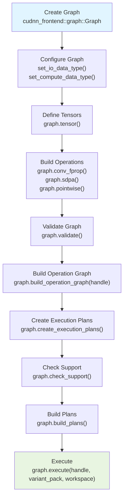
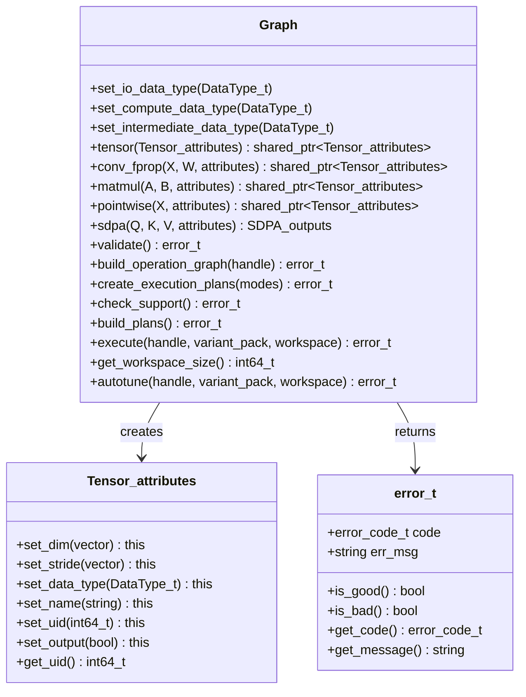
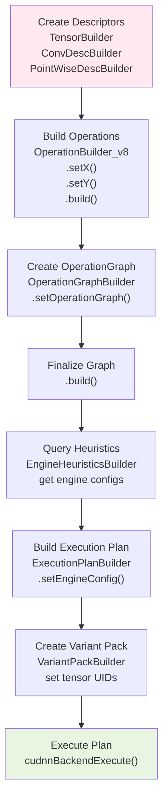
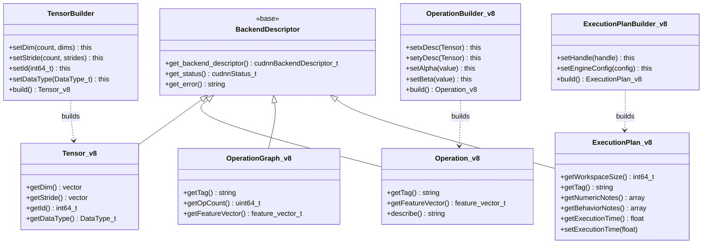
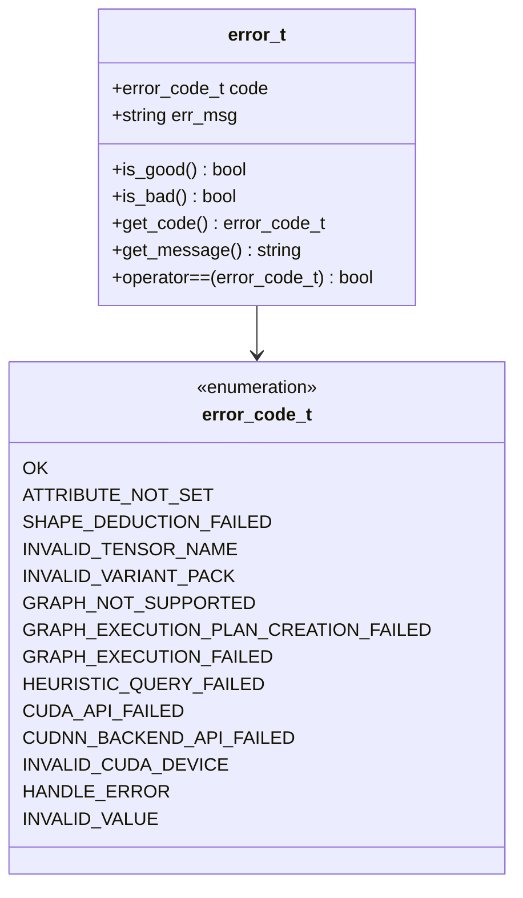

<!-- source: DeepWiki mcp.deepwiki.com · repo NVIDIA/cudnn-frontend · page 2 API Reference · fetched 2026-10-26 -->

# API Reference

<details>
<summary>Relevant source files</summary>

The following files were used as context for generating this wiki page:

- [include/cudnn_frontend/cudnn_interface.h](include/cudnn_frontend/cudnn_interface.h)
- [include/cudnn_frontend/graph_helpers.h](include/cudnn_frontend/graph_helpers.h)
- [include/cudnn_frontend/graph_interface.h](include/cudnn_frontend/graph_interface.h)
- [include/cudnn_frontend/node/sdpa_fp8_bwd.h](include/cudnn_frontend/node/sdpa_fp8_bwd.h)
- [include/cudnn_frontend_EngineFallbackList.h](include/cudnn_frontend_EngineFallbackList.h)
- [include/cudnn_frontend_ExecutionPlan.h](include/cudnn_frontend_ExecutionPlan.h)
- [include/cudnn_frontend_Operation.h](include/cudnn_frontend_Operation.h)
- [include/cudnn_frontend_PointWiseDesc.h](include/cudnn_frontend_PointWiseDesc.h)
- [samples/cpp/convolution/fprop.cpp](samples/cpp/convolution/fprop.cpp)
- [samples/cpp/sdpa/fp16_fwd_with_custom_dropout.cpp](samples/cpp/sdpa/fp16_fwd_with_custom_dropout.cpp)
- [samples/cpp/sdpa/fp8_fwd.cpp](samples/cpp/sdpa/fp8_fwd.cpp)

</details>


## Purpose and Scope

This section provides comprehensive documentation for the cuDNN Frontend library's public APIs. The library offers two distinct API styles for building and executing cuDNN operations:

1. **Graph API** (Modern, Recommended) - A high-level, composable interface centered around the `cudnn_frontend::graph::Graph` class
2. **Legacy Builder API** - A lower-level builder pattern interface using descriptor classes

This page provides an overview of both API styles and their usage patterns. For detailed documentation on specific components:
- Graph API details: [Graph API](#2.1)
- Tensor attributes and memory management: [Tensor System](#2.2)
- Operation-specific configuration: [Operation Attributes](#2.3)
- Execution plan management: [Execution Plans](#2.4)
- Engine selection and optimization: [Heuristics & Engine Selection](#2.5)

For higher-level architectural context, see [Architecture Overview](#1.2).

---

## API Comparison

The cuDNN Frontend provides two API paradigms with different design philosophies:

| Aspect | Graph API | Legacy Builder API |
|--------|-----------|-------------------|
| **Primary Class** | `cudnn_frontend::graph::Graph` | `cudnn_frontend::OperationBuilder_v8` |
| **Design Pattern** | Declarative graph construction | Imperative builder pattern |
| **Abstraction Level** | High (composite operations) | Low (primitive operations) |
| **Type Safety** | C++ templates with type inference | Explicit descriptor management |
| **Recommended For** | New applications, complex graphs | Migration from legacy code |
| **Python Support** | Full support via `cudnn.pygraph` | Limited |
| **Version** | cuDNN 8.0+ (mature in 8.9+) | cuDNN 8.0+ |

**Sources:** [include/cudnn_frontend/graph_interface.h:40-41](), [include/cudnn_frontend_Operation.h:77-201]()

---

## Graph API Architecture

### Overview

The Graph API provides a modern, composable interface for building cuDNN operation graphs. It automatically handles graph construction, tensor attribute inference, and execution plan generation.

**Key Class:** `cudnn_frontend::graph::Graph`

**Sources:** [include/cudnn_frontend/graph_interface.h:40-320]()

### Typical Workflow



**Graph API Execution Flow**

**Sources:** [include/cudnn_frontend/graph_interface.h:631-712](), [samples/cpp/convolution/fprop.cpp:37-68]()

### Code Example: Convolution with Graph API

```cpp
// 1. Create and configure graph
auto graph = std::make_shared<fe::graph::Graph>();
graph->set_io_data_type(fe::DataType_t::HALF)
     .set_compute_data_type(fe::DataType_t::FLOAT);

// 2. Define input tensors
auto X = graph->tensor(fe::graph::Tensor_attributes()
                          .set_dim({n, c, h, w})
                          .set_stride({c*h*w, 1, c*w, c}));
auto W = graph->tensor(fe::graph::Tensor_attributes()
                          .set_dim({k, c, r, s})
                          .set_stride({c*r*s, 1, c*s, c}));

// 3. Build operation
auto Y = graph->conv_fprop(X, W, 
    fe::graph::Conv_fprop_attributes()
        .set_padding({0, 0})
        .set_stride({1, 1}));
Y->set_output(true);

// 4. Validate and build
graph->validate();
graph->build_operation_graph(handle);
graph->create_execution_plans({fe::HeurMode_t::A});
graph->build_plans();

// 5. Execute
std::unordered_map<int64_t, void*> variant_pack = {
    {X->get_uid(), x_ptr},
    {W->get_uid(), w_ptr},
    {Y->get_uid(), y_ptr}
};
graph->execute(handle, variant_pack, workspace_ptr);
```

**Sources:** [samples/cpp/convolution/fprop.cpp:28-90]()

### Graph API Core Methods



**Graph API Class Structure**

**Sources:** [include/cudnn_frontend/graph_interface.h:320-1454](), [include/cudnn_frontend/graph_properties.h:1-300](), [include/cudnn_frontend/graph_helpers.h:36-90]()

---

## Legacy Builder API Architecture

### Overview

The Legacy Builder API uses a builder pattern where each operation is constructed using descriptor classes. Users manually manage backend descriptors and operation graphs.

**Key Classes:**
- `OperationBuilder_v8` - Builds individual operations
- `OperationGraph_v8` - Container for operations  
- `ExecutionPlan_v8` - Compiled execution plan
- Descriptor builders: `TensorBuilder`, `ConvDescBuilder`, `PointWiseDescBuilder`, etc.

**Sources:** [include/cudnn_frontend_Operation.h:77-201](), [include/cudnn_frontend_ExecutionPlan.h:52-328]()

### Typical Workflow



**Legacy Builder API Execution Flow**

**Sources:** [include/cudnn_frontend_Operation.h:207-535](), [include/cudnn_frontend_ExecutionPlan.h:333-466]()

### Code Example: Pointwise with Legacy Builder API

```cpp
// 1. Create tensor descriptors
auto xTensor = TensorBuilder()
    .setDim(4, xDim)
    .setStride(4, xStride)
    .setId('x')
    .setAlignment(16)
    .setDataType(CUDNN_DATA_HALF)
    .build();

auto yTensor = TensorBuilder()
    .setDim(4, yDim)
    .setStride(4, yStride)
    .setId('y')
    .setAlignment(16)
    .setDataType(CUDNN_DATA_HALF)
    .build();

// 2. Create pointwise descriptor
auto pwDesc = PointWiseDescBuilder()
    .setMode(CUDNN_POINTWISE_RELU_FWD)
    .setComputeType(CUDNN_DATA_FLOAT)
    .build();

// 3. Create operation
auto op = OperationBuilder(CUDNN_BACKEND_OPERATION_POINTWISE_DESCRIPTOR)
    .setxDesc(xTensor)
    .setyDesc(yTensor)
    .setpwDesc(pwDesc)
    .build();

// 4. Create operation graph
auto opGraph = OperationGraphBuilder()
    .setHandle(handle)
    .setOperationGraph(1, &op)
    .build();

// 5. Query heuristics and build plan
auto heuristics = EngineHeuristicsBuilder()
    .setOperationGraph(opGraph)
    .setHeurMode(CUDNN_HEUR_MODE_INSTANT)
    .build();

auto& engine_config = heuristics.getEngineConfig(1)[0];
auto plan = ExecutionPlanBuilder()
    .setHandle(handle)
    .setEngineConfig(engine_config)
    .build();

// 6. Create variant pack and execute
auto variantPack = VariantPackBuilder()
    .setWorkspacePointer(workspace)
    .setDataPointers(2, data_ptrs)
    .setUids(2, uids)
    .build();

cudnnBackendExecute(handle, plan.get_raw_desc(), variantPack.get_raw_desc());
```

**Sources:** [include/cudnn_frontend_PointWiseDesc.h:106-399](), [include/cudnn_frontend_Operation.h:392-535]()

### Legacy Builder API Class Hierarchy



**Legacy Builder API Class Relationships**

**Sources:** [include/cudnn_frontend_Operation.h:77-201](), [include/cudnn_frontend_ExecutionPlan.h:52-158](), [include/cudnn_frontend_Tensor.h:1-100]()

---

## Error Handling

Both APIs use a consistent error handling mechanism based on the `error_t` structure.

### Error Type Definitions



**Error Handling Types**

### Error Checking Patterns

**Graph API (Recommended):**
```cpp
// Check return value
auto status = graph->validate();
if (status.is_bad()) {
    std::cerr << "Validation failed: " 
              << status.get_message() << std::endl;
    return;
}

// Or use macro for automatic error propagation
CHECK_CUDNN_FRONTEND_ERROR(graph->validate());
CHECK_CUDNN_FRONTEND_ERROR(graph->build_operation_graph(handle));
CHECK_CUDNN_FRONTEND_ERROR(graph->execute(handle, variant_pack, workspace));
```

**Legacy Builder API:**
```cpp
// Check descriptor status after build
auto tensor = TensorBuilder().setDim(...).build();
if (tensor.get_status() != CUDNN_STATUS_SUCCESS) {
    std::cerr << "Tensor creation failed: " 
              << tensor.get_error() << std::endl;
    return;
}

// With exception handling (if not using NV_CUDNN_DISABLE_EXCEPTION)
try {
    auto plan = ExecutionPlanBuilder()
                    .setEngineConfig(config)
                    .build();
} catch (cudnn_frontend::cudnnException& e) {
    std::cerr << "Plan build failed: " << e.what() << std::endl;
}
```

**Sources:** [include/cudnn_frontend/graph_helpers.h:36-194](), [samples/cpp/convolution/fprop.cpp:57-65]()

---

## Common Operation Patterns

### Variant Pack Construction

Both APIs require mapping tensor UIDs to device memory pointers for execution.

**Graph API:**
```cpp
std::unordered_map<int64_t, void*> variant_pack = {
    {Q->get_uid(), q_device_ptr},
    {K->get_uid(), k_device_ptr},
    {V->get_uid(), v_device_ptr},
    {O->get_uid(), o_device_ptr}
};

// Or using shared_ptr to Tensor_attributes
std::unordered_map<std::shared_ptr<Tensor_attributes>, void*> variant_pack = {
    {Q, q_device_ptr},
    {K, k_device_ptr},
    {V, v_device_ptr},
    {O, o_device_ptr}
};

graph->execute(handle, variant_pack, workspace_ptr);
```

**Legacy Builder API:**
```cpp
void* data_ptrs[] = {x_ptr, y_ptr};
int64_t uids[] = {'x', 'y'};

auto variantPack = VariantPackBuilder()
    .setWorkspacePointer(workspace)
    .setDataPointers(2, data_ptrs)
    .setUids(2, uids)
    .build();

cudnnBackendExecute(handle, plan_desc, variantPack.get_raw_desc());
```

**Sources:** [include/cudnn_frontend/graph_interface.h:801-812](), [samples/cpp/sdpa/fp8_fwd.cpp:132-155](), [samples/cpp/sdpa/fp16_fwd_with_custom_dropout.cpp:173-194]()

### Workspace Management

Both APIs require users to allocate workspace memory for temporary data.

```cpp
// Query workspace size
int64_t workspace_size = 0;
graph->get_workspace_size(workspace_size);

// Allocate workspace
void* workspace_ptr;
cudaMalloc(&workspace_ptr, workspace_size);

// Execute with workspace
graph->execute(handle, variant_pack, workspace_ptr);

// Clean up
cudaFree(workspace_ptr);
```

The workspace size may vary depending on:
- Selected execution plan (different engines may require different amounts)
- Graph complexity (number of operations, intermediate tensors)
- FE-managed tensors (e.g., dropout masks, auxiliary data)

**Sources:** [include/cudnn_frontend/graph_interface.h:726-765](), [samples/cpp/convolution/fprop.cpp:83-89]()

---

## API Selection Guidelines

### Choose Graph API When:
- Building new applications from scratch
- Using Python (required for Python bindings)
- Working with composite operations (SDPA, layer normalization, etc.)
- Wanting automatic tensor property inference
- Needing dynamic shape support (cuDNN 9.4+)
- Preferring declarative graph construction

### Choose Legacy Builder API When:
- Migrating existing cuDNN backend code
- Requiring fine-grained control over descriptors
- Working with cuDNN versions < 8.9 (limited Graph API support)
- Building custom wrappers around raw backend descriptors

**Note:** The Graph API is the recommended and actively developed interface. New features and optimizations are primarily targeted at the Graph API.

**Sources:** [include/cudnn_frontend/graph_interface.h:1-40](), [include/cudnn_frontend_Operation.h:43-76]()

---

## Detailed Component Documentation

For in-depth coverage of specific API components, refer to the following sections:

- **[Graph API](#2.1)** - Complete Graph API reference including all operation types
- **[Tensor System](#2.2)** - Tensor attributes, data types, memory categories (physical/virtual/pass-by-value)
- **[Operation Attributes](#2.3)** - Configuration classes for convolution, matmul, SDPA, normalization operations
- **[Execution Plans](#2.4)** - Plan creation, workspace requirements, caching, and autotuning
- **[Heuristics & Engine Selection](#2.5)** - Heuristic modes, engine filtering, numeric/behavioral notes, errata system

For implementation examples, see [Examples & Samples](#6).

**Sources:** [include/cudnn_frontend/graph_interface.h](), [include/cudnn_frontend_Operation.h](), [include/cudnn_frontend_ExecutionPlan.h]()

---

