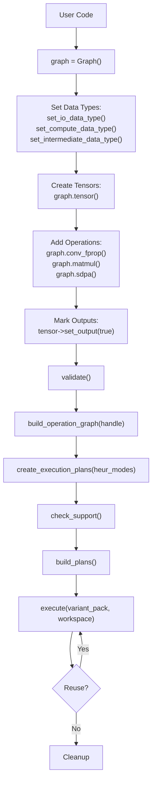
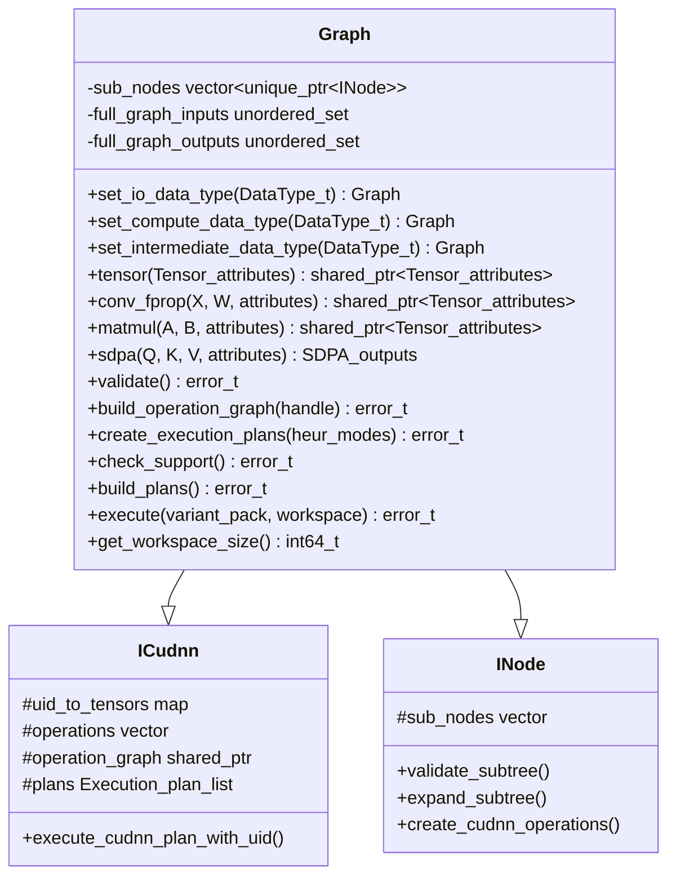
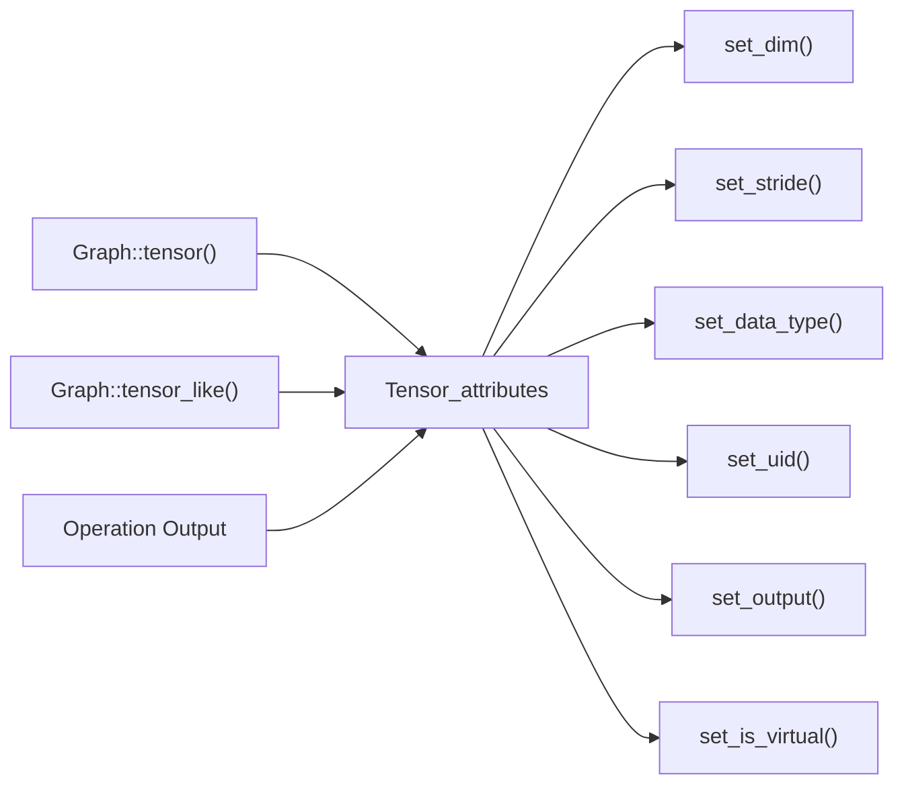
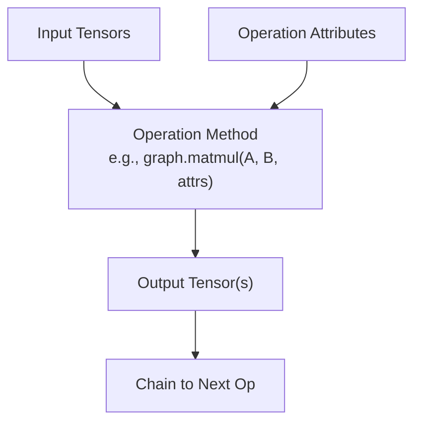
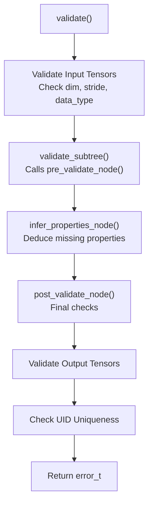
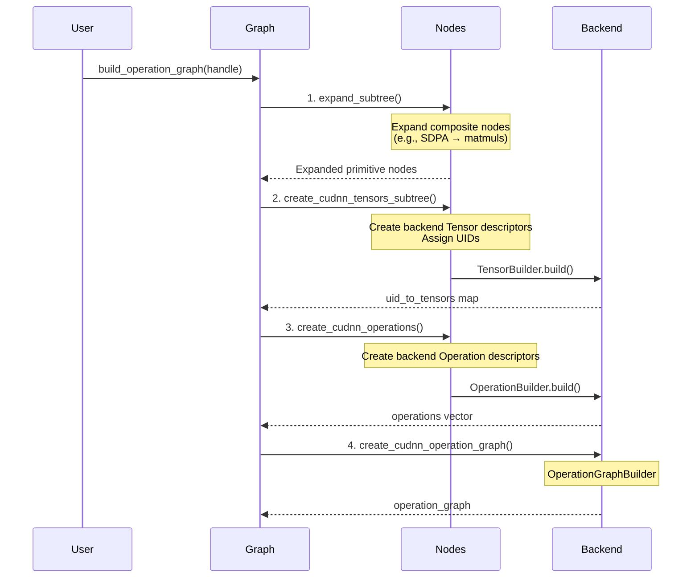
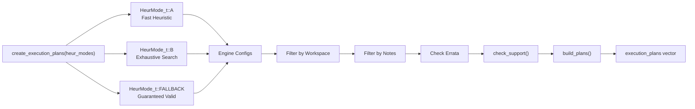
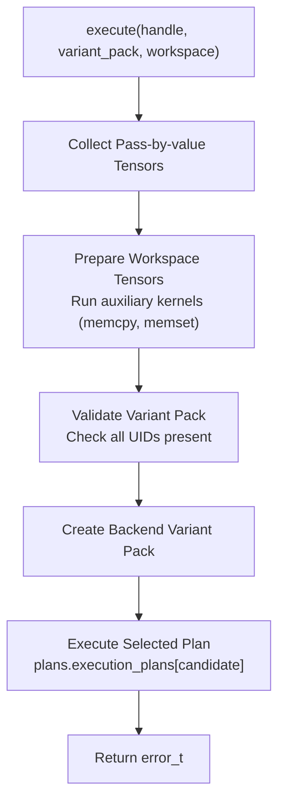

<!-- source: DeepWiki mcp.deepwiki.com · repo NVIDIA/cudnn-frontend · page 2.1 Graph API · fetched 2026-10-26 -->

# Graph API

<details>
<summary>Relevant source files</summary>

The following files were used as context for generating this wiki page:

- [include/cudnn_frontend/cudnn_interface.h](include/cudnn_frontend/cudnn_interface.h)
- [include/cudnn_frontend/graph_helpers.h](include/cudnn_frontend/graph_helpers.h)
- [include/cudnn_frontend/graph_interface.h](include/cudnn_frontend/graph_interface.h)
- [include/cudnn_frontend/graph_properties.h](include/cudnn_frontend/graph_properties.h)
- [include/cudnn_frontend/node/sdpa_fp8_bwd.h](include/cudnn_frontend/node/sdpa_fp8_bwd.h)
- [python/pygraph/pygraph.h](python/pygraph/pygraph.h)
- [samples/cpp/CMakeLists.txt](samples/cpp/CMakeLists.txt)
- [samples/cpp/convolution/fprop.cpp](samples/cpp/convolution/fprop.cpp)
- [samples/cpp/sdpa/fp16_fwd_with_custom_dropout.cpp](samples/cpp/sdpa/fp16_fwd_with_custom_dropout.cpp)
- [samples/cpp/sdpa/fp8_fwd.cpp](samples/cpp/sdpa/fp8_fwd.cpp)
- [test/python/test_matmul_bias_relu.py](test/python/test_matmul_bias_relu.py)

</details>


The Graph API is the primary interface for constructing and executing cuDNN operations in cudnn-frontend. It provides a modern, composable approach to building neural network operations by representing computations as dataflow graphs. Users construct a graph by adding tensors and operations, validate the graph structure, build execution plans, and execute them on the GPU.

For information about the underlying node system that powers graph construction, see [Node Types](#3). For details about execution plan generation and optimization, see [Execution Plans](#2.4) and [Heuristics & Engine Selection](#2.5). For tensor properties and memory management, see [Tensor System](#2.2).

---

## Graph Construction Workflow

The Graph API follows a multi-phase workflow that separates graph definition from execution. This design enables graph reuse across multiple executions with different input data.



**Graph Lifecycle Phases**

Sources: [include/cudnn_frontend/graph_interface.h:631-712](), [samples/cpp/convolution/fprop.cpp:37-89]()

---

## Core Graph Class

The `cudnn_frontend::graph::Graph` class is the central abstraction for the Graph API. It inherits from both `ICudnn` (backend interface) and `INode` (node system interface).



**Key Responsibilities**

| Responsibility | Methods | Description |
|----------------|---------|-------------|
| **Configuration** | `set_io_data_type()`, `set_compute_data_type()` | Set global data types for the graph |
| **Tensor Creation** | `tensor()`, `tensor_like()` | Create tensor attributes for inputs/outputs |
| **Operation Addition** | `conv_fprop()`, `matmul()`, `sdpa()`, `pointwise()` | Add operations to the graph |
| **Validation** | `validate()` | Check graph structure and tensor properties |
| **Backend Lowering** | `build_operation_graph()` | Convert to backend descriptors |
| **Plan Management** | `create_execution_plans()`, `build_plans()` | Generate and build execution plans |
| **Execution** | `execute()`, `autotune()` | Execute the graph with data |

Sources: [include/cudnn_frontend/graph_interface.h:40-320](), [include/cudnn_frontend/cudnn_interface.h:100-207]()

---

## Tensor Creation

Tensors in the Graph API are represented by `Tensor_attributes` objects. Each tensor has properties like dimensions, strides, data type, and a unique identifier (UID).

### Tensor Creation Methods



**Example: Creating Tensors**

```cpp
// Create graph and set data types
auto graph = std::make_shared<fe::graph::Graph>();
graph->set_io_data_type(fe::DataType_t::HALF)
     .set_compute_data_type(fe::DataType_t::FLOAT);

// Create input tensor with explicit dimensions
auto X = graph->tensor(
    fe::graph::Tensor_attributes()
        .set_name("input")
        .set_dim({n, c, h, w})
        .set_stride({c*h*w, 1, c*w, c})
);

// Create tensor from existing tensor (for PyTorch/etc)
auto Y = graph->tensor_like(existing_tensor);

// Mark tensor as output
Y->set_output(true);
```

### Tensor Categories

| Category | `is_virtual` | `is_pass_by_value` | Memory Management |
|----------|--------------|-------------------|-------------------|
| **Physical** | `false` | `false` | User-allocated, provided via variant pack |
| **Virtual** | `true` | `false` | Framework-managed, allocated in workspace |
| **Pass-by-value** | N/A | `true` | Scalar constant embedded in graph or passed at execution |

Sources: [include/cudnn_frontend/graph_interface.h:1079-1164](), [include/cudnn_frontend/graph_properties.h:22-296]()

---

## Operation Methods

The Graph API provides high-level methods for adding operations. Each method returns output tensor(s) that can be connected to subsequent operations.

### Operation Method Signature Pattern



### Common Operations

| Operation Category | Methods | Input Attributes Class |
|-------------------|---------|----------------------|
| **Convolution** | `conv_fprop()`, `conv_dgrad()`, `conv_wgrad()` | `Conv_fprop_attributes` |
| **Matrix Multiplication** | `matmul()`, `matmul_fp8()` | `Matmul_attributes` |
| **Attention** | `sdpa()`, `sdpa_fp8()`, `sdpa_backward()` | `SDPA_attributes` |
| **Pointwise** | `pointwise()`, `relu()`, `gelu()` | `Pointwise_attributes` |
| **Reduction** | `reduction()` | `Reduction_attributes` |
| **Normalization** | `layernorm()`, `batchnorm()`, `rmsnorm()` | `Layernorm_attributes` |

**Example: Building a Convolution-Bias-ReLU Graph**

```cpp
// Create input tensors
auto X = graph->tensor(fe::graph::Tensor_attributes()
    .set_dim({n, c, h, w})
    .set_stride({c*h*w, 1, c*w, c}));
auto W = graph->tensor(fe::graph::Tensor_attributes()
    .set_dim({k, c, r, s})
    .set_stride({c*r*s, 1, c*s, c}));

// Convolution
auto conv_attrs = fe::graph::Conv_fprop_attributes()
    .set_padding({1, 1})
    .set_stride({1, 1});
auto conv_out = graph->conv_fprop(X, W, conv_attrs);

// Bias
auto B = graph->tensor(fe::graph::Tensor_attributes()
    .set_dim({1, k, 1, 1}));
auto bias_out = graph->pointwise(
    conv_out, B,
    fe::graph::Pointwise_attributes().set_mode(fe::PointwiseMode_t::ADD));

// ReLU
auto Y = graph->pointwise(
    bias_out,
    fe::graph::Pointwise_attributes().set_mode(fe::PointwiseMode_t::RELU_FWD));
Y->set_output(true);
```

Sources: [include/cudnn_frontend/graph_interface.h:1079-1492](), [samples/cpp/convolution/fprop.cpp:214-264]()

---

## Graph Validation

The `validate()` method performs structural checks on the graph before backend lowering. It verifies tensor properties and ensures operation compatibility.



**Validation Checks**

| Check Type | Description | Error Code |
|------------|-------------|------------|
| **Tensor Properties** | Dims and strides must be set | `ATTRIBUTE_NOT_SET` |
| **UID Conflicts** | All assigned UIDs must be unique | `INVALID_VALUE` |
| **Operation Support** | Operation supported on current cuDNN version | `GRAPH_NOT_SUPPORTED` |
| **Data Type Compatibility** | Tensors have compatible data types | `ATTRIBUTE_NOT_SET` |

Sources: [include/cudnn_frontend/graph_interface.h:631-655](), [include/cudnn_frontend/graph_properties.h:36-56]()

---

## Building the Operation Graph

The `build_operation_graph()` method converts the high-level graph into backend cuDNN descriptors. This is a four-step process.



**Build Phase Details**

| Phase | Method | Purpose |
|-------|--------|---------|
| **1. Expand** | `expand_subtree()` | Composite nodes (SDPA, LayerNorm) expand to primitive operations |
| **2. Create Tensors** | `create_cudnn_tensors_subtree()` | Generate backend tensor descriptors, assign UIDs |
| **3. Create Operations** | `create_cudnn_operations()` | Generate backend operation descriptors |
| **4. Build Op Graph** | `create_cudnn_operation_graph()` | Fuse operations into a single backend graph |

Sources: [include/cudnn_frontend/graph_interface.h:669-712](), [include/cudnn_frontend/cudnn_interface.h:128-163]()

---

## Execution Plans and Heuristics

After building the operation graph, the user must create execution plans by querying heuristics. This determines which kernels cuDNN will use.

### Plan Creation Flow



**Heuristic Modes**

| Mode | Description | Use Case |
|------|-------------|----------|
| `HeurMode_t::A` | Fast heuristic, returns 1-2 engines | Production, minimal autotuning |
| `HeurMode_t::B` | Exhaustive search, many engines | Full autotuning for optimal performance |
| `HeurMode_t::FALLBACK` | Guaranteed to return valid engine | Fallback when A/B fail |

**Example: Creating and Building Plans**

```cpp
// Create plans with multiple heuristic modes
auto status = graph->create_execution_plans({
    fe::HeurMode_t::A,
    fe::HeurMode_t::FALLBACK
});

// Check if graph is supported on current device
status = graph->check_support(handle);
if (status.is_bad()) {
    // Handle unsupported graph
}

// Build the plans (compiles kernels if needed)
status = graph->build_plans(handle);
```

Sources: [include/cudnn_frontend/graph_interface.h:1633-1718](), [include/cudnn_frontend/plans.h:1-100]()

---

## Graph Execution

The `execute()` method runs the graph with user-provided data. Data pointers are passed via a variant pack that maps tensor UIDs to device memory.

### Execution Flow



**Variant Pack Structure**

The variant pack is a map from tensor UID to device pointer:

```cpp
std::unordered_map<int64_t, void*> variant_pack = {
    {Q->get_uid(), q_device_ptr},
    {K->get_uid(), k_device_ptr},
    {V->get_uid(), v_device_ptr},
    {O->get_uid(), o_device_ptr}
};

// Or using shared_ptr keys:
std::unordered_map<std::shared_ptr<fe::graph::Tensor_attributes>, void*> variant_pack = {
    {Q, q_device_ptr},
    {K, k_device_ptr}
};
```

**Workspace Management**

```cpp
// Query workspace size
int64_t workspace_size;
graph->get_workspace_size(workspace_size);

// Allocate workspace
void* workspace;
cudaMalloc(&workspace, workspace_size);

// Execute
graph->execute(handle, variant_pack, workspace);
```

Sources: [include/cudnn_frontend/graph_interface.h:1903-2043](), [samples/cpp/convolution/fprop.cpp:75-89]()

---

## Python Interface

The Python Graph API wraps the C++ Graph API through the `PyGraph` class. It provides a Pythonic interface while maintaining access to all C++ functionality.

### Python Graph Creation

```python
import cudnn

# Create graph
graph = cudnn.pygraph(
    handle=cudnn_handle,
    io_data_type=cudnn.data_type.HALF,
    intermediate_data_type=cudnn.data_type.FLOAT,
    compute_data_type=cudnn.data_type.FLOAT
)

# Create tensors from PyTorch/NumPy
Q = graph.tensor_like(q_tensor)
K = graph.tensor_like(k_tensor)
V = graph.tensor_like(v_tensor)

# Add operations
O, Stats = graph.sdpa(
    q=Q, k=K, v=V,
    attn_scale=attn_scale,
    is_inference=False
)
O.set_output(True)

# Build and execute
graph.validate()
graph.build_operation_graph()
graph.create_execution_plans([cudnn.heur_mode.A])
graph.check_support()
graph.build_plans()

# Execute with PyTorch tensors
workspace = torch.empty(graph.get_workspace_size(), device="cuda", dtype=torch.uint8)
graph.execute({Q: q_tensor, K: k_tensor, V: v_tensor, O: o_tensor}, workspace)
```

**Key Differences from C++**

| Feature | C++ | Python |
|---------|-----|--------|
| **Graph Creation** | `std::make_shared<Graph>()` | `cudnn.pygraph()` |
| **Tensor Creation** | `graph->tensor()` | `graph.tensor()` or `graph.tensor_like()` |
| **Method Chaining** | `->` | `.` |
| **Variant Pack** | `std::unordered_map` | Python `dict` |
| **Handle Management** | Manual or passed | Automatic or passed |

Sources: [python/pygraph/pygraph.h:17-124](), [test/python/test_matmul_bias_relu.py:240-327]()

---

## Complete Example: SDPA Forward Pass

This example demonstrates creating and executing a Scaled Dot-Product Attention (SDPA) graph.

**C++ Example**

```cpp
// Graph setup
fe::graph::Graph mha_graph;
mha_graph.set_io_data_type(fe::DataType_t::FP8_E4M3)
         .set_intermediate_data_type(fe::DataType_t::FLOAT)
         .set_compute_data_type(fe::DataType_t::FLOAT);

// Create tensors
auto Q = mha_graph.tensor(
    fe::graph::Tensor_attributes()
        .set_name("Q")
        .set_dim({b, h, s, d})
        .set_stride({s*3*h*d, d, 3*h*d, 1}));
auto K = mha_graph.tensor_like(Q, "K");
auto V = mha_graph.tensor_like(Q, "V");

// FP8 scaling tensors
auto descale_q = mha_graph.tensor(
    fe::graph::Tensor_attributes()
        .set_dim({1, 1, 1, 1})
        .set_data_type(fe::DataType_t::FLOAT));
// ... create other scaling tensors ...

// Create SDPA
auto sdpa_options = fe::graph::SDPA_fp8_attributes()
    .set_attn_scale(attn_scale)
    .set_causal_mask(true);
auto [O, Stats, Amax_S, Amax_O] = mha_graph.sdpa_fp8(
    Q, K, V, descale_q, descale_k, descale_v,
    descale_s, scale_s, scale_o, sdpa_options);

// Mark outputs
O->set_output(true);
Amax_O->set_output(true);
Amax_S->set_output(true);

// Build and execute
mha_graph.validate();
mha_graph.build_operation_graph(handle);
mha_graph.create_execution_plans({fe::HeurMode_t::A});
mha_graph.check_support(handle);
mha_graph.build_plans(handle);

// Execute
std::unordered_map<std::shared_ptr<fe::graph::Tensor_attributes>, void*> variant_pack = {
    {Q, q_ptr}, {K, k_ptr}, {V, v_ptr}, {O, o_ptr},
    {descale_q, descale_q_ptr}, // ...
};
mha_graph.execute(handle, variant_pack, workspace_ptr);
```

Sources: [samples/cpp/sdpa/fp8_fwd.cpp:31-158]()

---

## Advanced Features

### Dynamic Shape Support

For cuDNN 9.4+, graphs can be built with dynamic shapes, allowing execution with varying tensor sizes without rebuilding.

```cpp
// Enable dynamic shapes
auto kernel_cache = std::make_shared<fe::KernelCache>();
graph->set_dynamic_shape_enabled(true)
     .set_kernel_cache(kernel_cache);

// Build once, execute with different shapes
for (auto& shape : shape_variations) {
    // Update tensor dimensions
    X->set_dim(shape.dims);
    
    // Execute (no rebuild needed)
    graph->execute(handle, variant_pack, workspace);
}
```

### Graph Serialization

Graphs can be serialized to JSON for debugging or caching.

```cpp
#ifndef CUDNN_FRONTEND_SKIP_JSON_LIB
json j;
graph->serialize(j);
std::cout << j.dump(4) << std::endl;
#endif
```

### Autotuning

The `autotune()` method profiles all available plans and selects the fastest.

```cpp
// Autotune to find best plan
graph->autotune(handle, variant_pack, workspace);

// Query selected plan
std::string plan_name;
graph->get_plan_name(plan_name);
std::cout << "Selected plan: " << plan_name << std::endl;
```

Sources: [include/cudnn_frontend/graph_interface.h:766-798](), [samples/cpp/convolution/fprop.cpp:92-212](), [samples/cpp/misc/autotuning.cpp]()

---

## Error Handling

All Graph API methods return `error_t` objects that indicate success or failure.

```cpp
auto status = graph->validate();
if (status.is_bad()) {
    std::cerr << "Validation failed: " 
              << status.get_message() 
              << " (code: " << status.get_code() << ")" 
              << std::endl;
    return;
}

// Or use CHECK macro
CHECK_CUDNN_FRONTEND_ERROR(graph->build_plans(handle));
```

**Common Error Codes**

| Error Code | Meaning | Common Causes |
|------------|---------|---------------|
| `OK` | Success | - |
| `ATTRIBUTE_NOT_SET` | Required property missing | Tensor dim/stride not set |
| `GRAPH_NOT_SUPPORTED` | Unsupported graph | Old cuDNN version, unsupported GPU arch |
| `INVALID_VARIANT_PACK` | Missing tensor in variant pack | UID not found in execute() |
| `CUDNN_BACKEND_API_FAILED` | Backend API error | Invalid descriptor, API failure |

Sources: [include/cudnn_frontend/graph_helpers.h:36-194]()

---

