<!-- source: DeepWiki mcp.deepwiki.com · repo NVIDIA/cudnn-frontend · page 2.2 Tensor System · fetched 2026-10-26 -->

# Tensor System

<details>
<summary>Relevant source files</summary>

The following files were used as context for generating this wiki page:

- [include/cudnn_frontend/graph_properties.h](include/cudnn_frontend/graph_properties.h)
- [include/cudnn_frontend/node_interface.h](include/cudnn_frontend/node_interface.h)
- [include/cudnn_frontend/utils/serialize.h](include/cudnn_frontend/utils/serialize.h)
- [include/cudnn_frontend_utils.h](include/cudnn_frontend_utils.h)
- [python/pygraph/pygraph.cpp](python/pygraph/pygraph.cpp)
- [python/pygraph/pygraph.h](python/pygraph/pygraph.h)
- [python/pygraph/sdpa.cpp](python/pygraph/sdpa.cpp)
- [samples/cpp/CMakeLists.txt](samples/cpp/CMakeLists.txt)
- [test/python/test_matmul_bias_relu.py](test/python/test_matmul_bias_relu.py)

</details>


The Tensor System provides the foundational data structure for representing multi-dimensional arrays and their properties within the cuDNN Frontend. It defines how tensors are created, managed, and tracked throughout graph construction, validation, and execution phases.

**Scope**: This page covers `Tensor_attributes`, data types, UID management, memory categories (physical/virtual/pass-by-value), and tensor creation APIs. For information about how tensors are used within operations, see [Operation Attributes](#2.3). For execution-time memory binding, see [Execution Plans](#2.4).

## Tensor Attributes Structure

The `Tensor_attributes` class encapsulates all properties needed to describe a tensor in the graph.

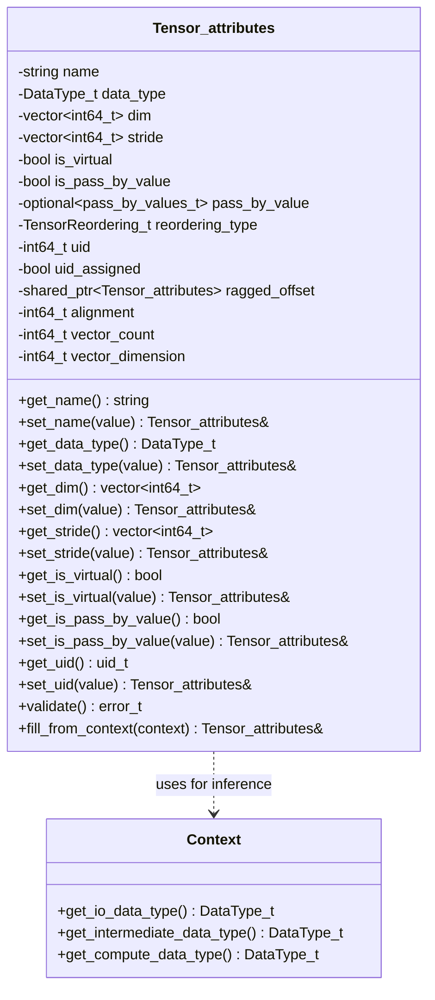

**Sources**: [include/cudnn_frontend/graph_properties.h:24-296]()

## Unique Identifier (UID) System

Each tensor is tracked through a unique identifier system that enables tensor binding during graph execution.

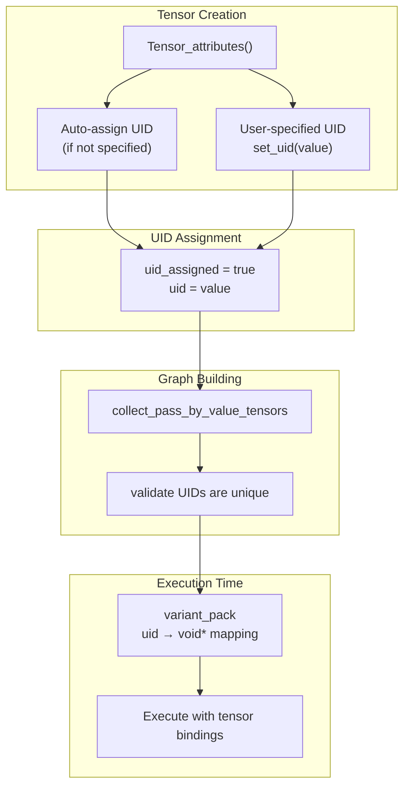

The UID is a 64-bit integer (`uid_t` typedef for `int64_t`) that uniquely identifies tensors. UIDs are either auto-assigned during graph building or explicitly set by users. At execution time, the `variant_pack` maps UIDs to device pointers.

**Sources**: [include/cudnn_frontend/graph_properties.h:26,72-73,267-289](), [python/pygraph/pygraph.cpp:572-588]()

## Data Type System

The tensor system supports a comprehensive set of data types, including modern low-precision formats.

| Data Type | Size (bytes) | Description |
|-----------|--------------|-------------|
| `FLOAT` | 4 | IEEE 754 single precision |
| `DOUBLE` | 8 | IEEE 754 double precision |
| `HALF` | 2 | IEEE 754 half precision (FP16) |
| `BFLOAT16` | 2 | Brain floating point |
| `FP8_E4M3` | 1 | 8-bit float (4-bit exponent, 3-bit mantissa) |
| `FP8_E5M2` | 1 | 8-bit float (5-bit exponent, 2-bit mantissa) |
| `INT8` | 1 | Signed 8-bit integer |
| `INT32` | 4 | Signed 32-bit integer |
| `INT64` | 8 | Signed 64-bit integer |
| `UINT8` | 1 | Unsigned 8-bit integer |
| `BOOLEAN` | 1 | Boolean type |

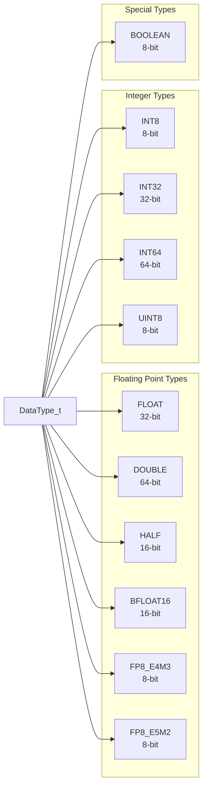

**Sources**: [include/cudnn_frontend_utils.h:679-728](), [include/cudnn_frontend/graph_properties.h:63,149-158]()

## Memory Categories

Tensors are categorized into three types based on their memory management semantics:

### Physical Tensors

Physical tensors represent user-allocated GPU memory that must be provided at execution time.

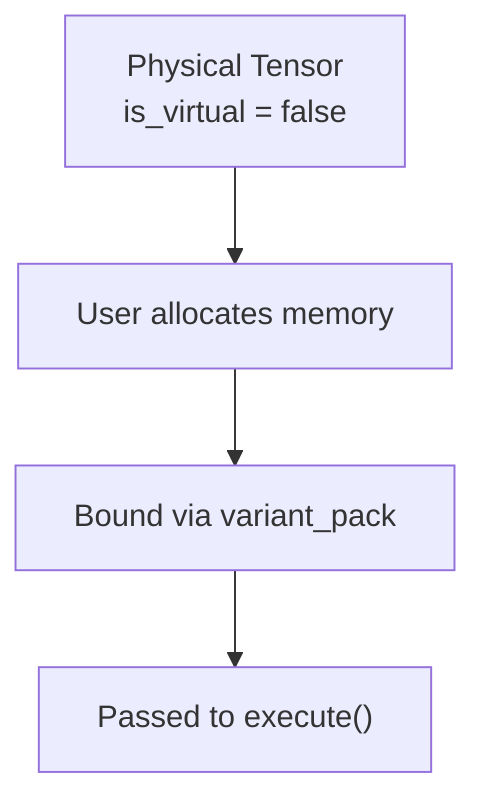

- **Characteristics**: `is_virtual = false`, `is_pass_by_value = false`
- **Memory**: User-managed device pointers
- **Binding**: Via `variant_pack` using UID → device pointer mapping
- **Use cases**: Graph inputs, outputs, and explicitly managed intermediates

### Virtual Tensors

Virtual tensors represent framework-managed intermediate results allocated from workspace.

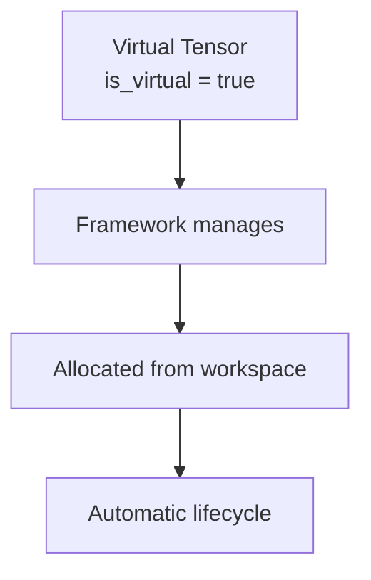

- **Characteristics**: `is_virtual = true`, `is_pass_by_value = false`
- **Memory**: Allocated from workspace buffer provided to `execute()`
- **Binding**: Automatic, no user involvement needed
- **Use cases**: Intermediate results between operations within a graph

### Pass-by-Value Tensors

Pass-by-value tensors represent scalar constants embedded directly in the graph or passed at execution time.

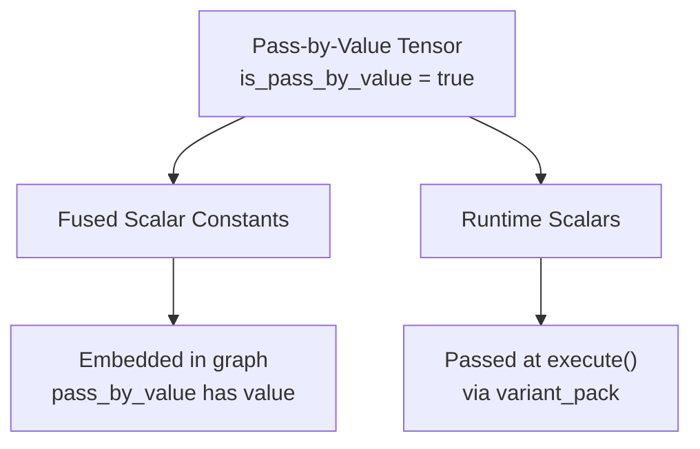

- **Characteristics**: `is_pass_by_value = true`
- **Supported types**: `int64_t`, `int32_t`, `half`, `float`, `nv_bfloat16`
- **Two modes**:
  1. **Fused scalars**: `pass_by_value` contains the actual value
  2. **Runtime scalars**: Value provided via `variant_pack` at execution

**Sources**: [include/cudnn_frontend/graph_properties.h:28-34,66-69,192-226](), [include/cudnn_frontend/node_interface.h:44]()

## Tensor Creation API

### C++ Graph API

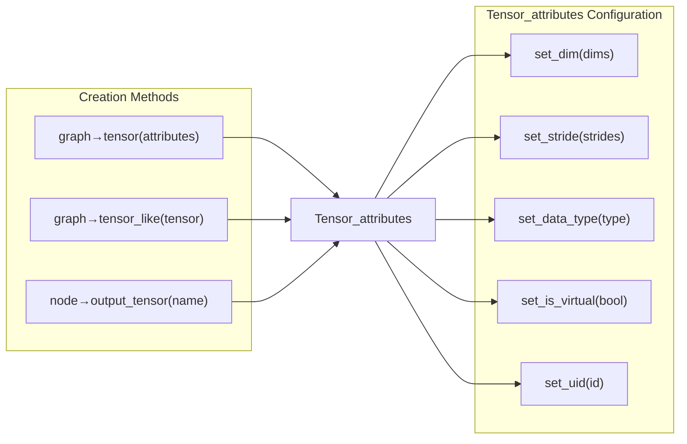

**C++ Example Pattern**:
```cpp
// Create physical input tensor
auto X = graph::Tensor_attributes()
    .set_dim({batch, height, width, channels})
    .set_stride({height*width*channels, width*channels, channels, 1})
    .set_data_type(DataType_t::HALF)
    .set_is_virtual(false);

// Create virtual intermediate tensor
auto intermediate = graph::Tensor_attributes()
    .set_dim({batch, height, width, channels})
    .set_stride({height*width*channels, width*channels, channels, 1})
    .set_data_type(DataType_t::NOT_SET)  // Inferred from context
    .set_is_virtual(true);

// Create pass-by-value scalar
auto alpha = Tensor_attributes(1.0f);  // Constructor for float scalar
```

### Python API

The Python API provides convenience methods for tensor creation:

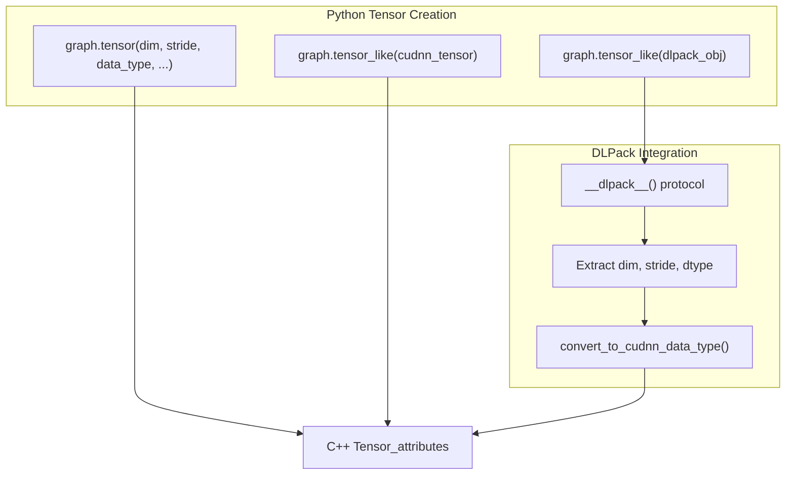

**Python Example**:
```python
# Create from existing PyTorch/NumPy tensor via DLPack
X = graph.tensor_like(torch_tensor)

# Create explicitly
Y = graph.tensor(
    dim=[batch, seq, hidden],
    stride=[seq*hidden, hidden, 1],
    data_type=cudnn.data_type.HALF,
    is_virtual=False
)

# Create virtual intermediate
intermediate = graph.tensor(
    dim=[batch, seq, hidden],
    stride=[seq*hidden, hidden, 1],
    is_virtual=True
)
```

**Sources**: [python/pygraph/pygraph.cpp:80-178](), [python/pygraph/pygraph.h:109-124](), [include/cudnn_frontend/graph_properties.h:103-136]()

## Context-Based Type Inference

The `fill_from_context()` mechanism allows tensors to inherit data types from the graph's global context, simplifying graph construction.

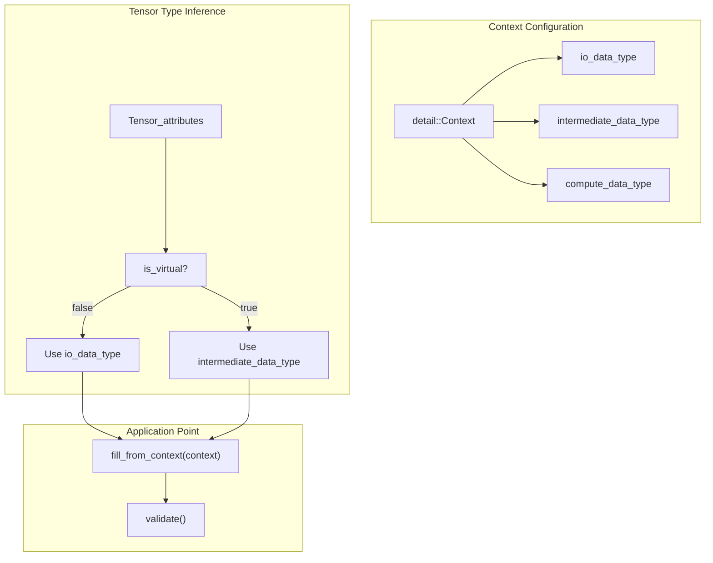

**Inference Rules**:
- If `data_type == NOT_SET` and `is_virtual == true`: Use `context.intermediate_data_type`
- If `data_type == NOT_SET` and `is_virtual == false`: Use `context.io_data_type`
- If `data_type` is already set: No inference performed

**Sources**: [include/cudnn_frontend/graph_properties.h:81-90,389-424](), [include/cudnn_frontend/context.h]()

## Tensor Validation

Validation ensures tensor properties are consistent and complete before graph building.

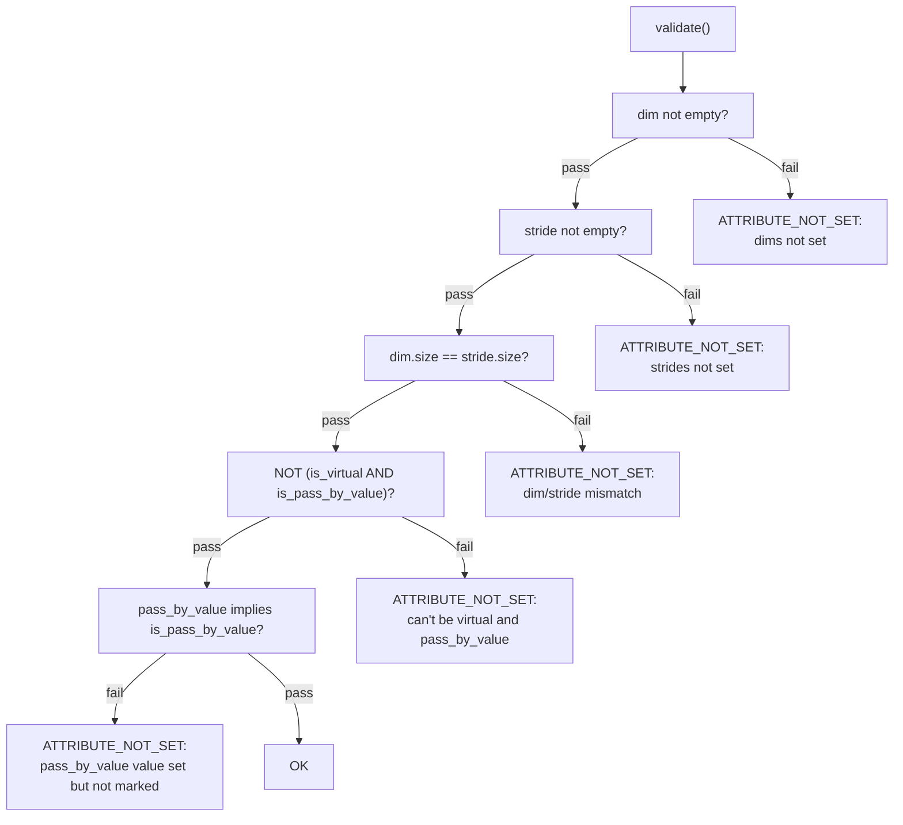

**Validation Checks**:
1. Dimensions vector is non-empty
2. Strides vector is non-empty
3. Dimensions and strides have matching sizes
4. Tensor cannot be both virtual and pass-by-value
5. If `pass_by_value` has a value, `is_pass_by_value` must be true

**Sources**: [include/cudnn_frontend/graph_properties.h:36-56]()

## Tensor Lifecycle in Graph Execution

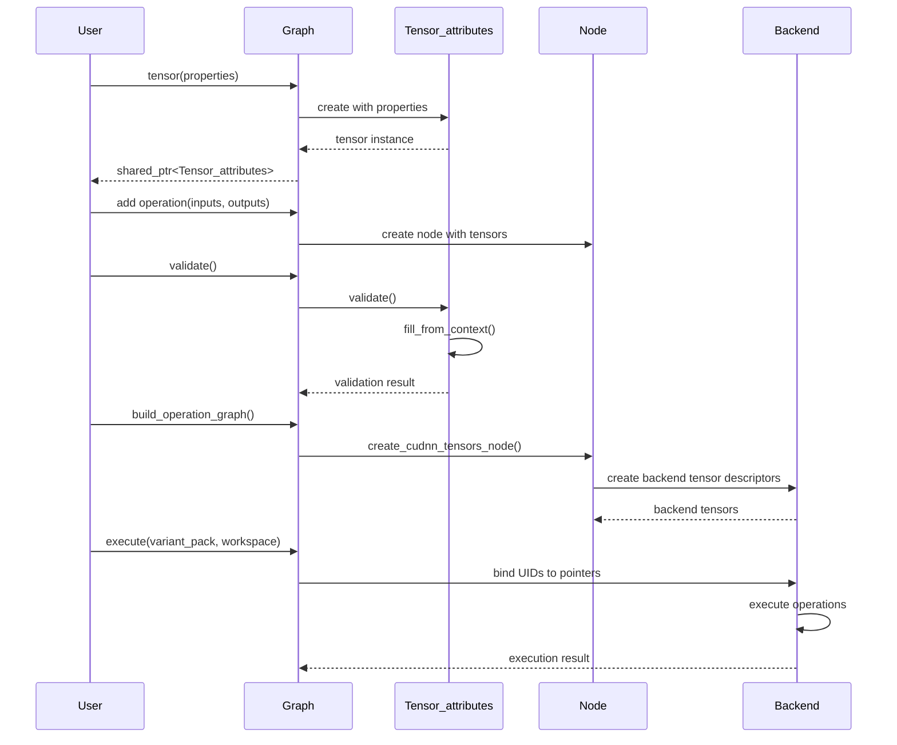

**Lifecycle Phases**:

1. **Creation**: User creates `Tensor_attributes` with properties
2. **Graph Construction**: Tensors attached to operations via nodes
3. **Validation**: Type inference and property validation
4. **Backend Lowering**: Convert to backend tensor descriptors
5. **Execution**: Bind UIDs to device pointers, execute

**Sources**: [include/cudnn_frontend/node_interface.h:414-453](), [python/pygraph/pygraph.cpp:381-395,572-588]()

## Tensor Reordering

Some operations require specific tensor data layouts for optimal performance. The `TensorReordering_t` enum specifies layout transformations.

| Reordering Type | Description |
|-----------------|-------------|
| `NONE` | No reordering required |
| `INT8x32` | INT8 32-element vectorization |
| `F16x16` | FP16 16-element vectorization |
| `F8_128x4` | FP8 128×4 layout |

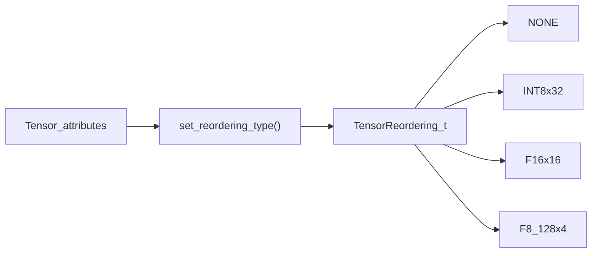

**Sources**: [include/cudnn_frontend_utils.h:346-359](), [include/cudnn_frontend/graph_properties.h:71,228-237]()

## Ragged Tensors

Support for ragged tensors (tensors with variable-length dimensions) is provided through an offset tensor.

```mermaid
graph TD
    MAIN["Main Tensor"]
    RAGGED["ragged_offset tensor"]
    OFFSET["Stores dimension offsets"]
    
    MAIN -->|set_ragged_offset()| RAGGED
    RAGGED --> OFFSET
```

The `ragged_offset` is a shared pointer to another `Tensor_attributes` that specifies how to interpret variable-length dimensions in the main tensor.

**Sources**: [include/cudnn_frontend/graph_properties.h:75,196-199,292-295]()

## Alignment and Vectorization

Tensors support alignment and vectorization hints for performance optimization:

- **Alignment**: Byte alignment of tensor data (default: 16 bytes)
- **Vector Count**: Number of vectorized elements
- **Vector Dimension**: Which dimension is vectorized

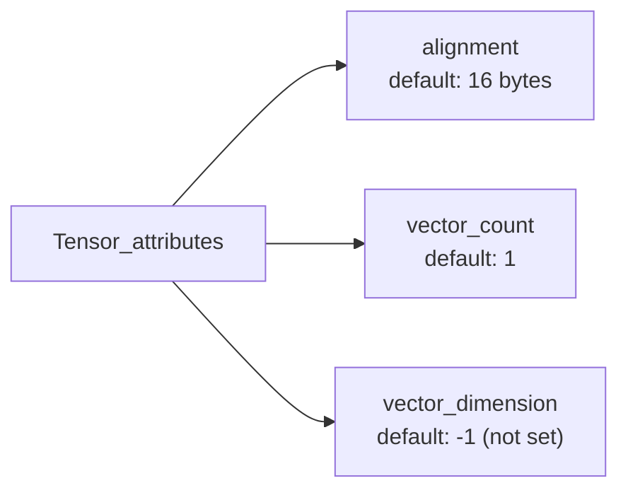

**Sources**: [include/cudnn_frontend/graph_properties.h:76-78,239-265]()

## Integration with Operation Attributes

Tensors are referenced in operation attribute classes through named input/output maps:

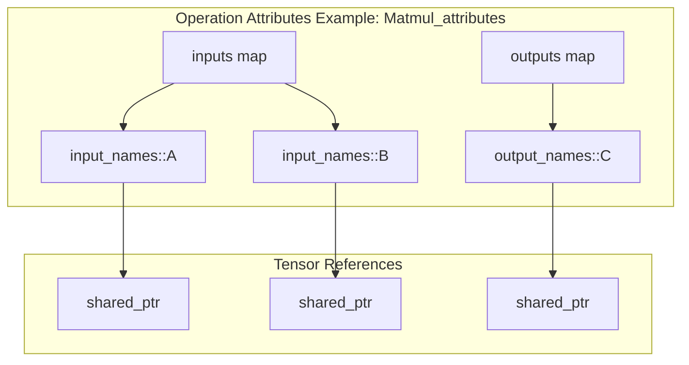

Each operation attributes class defines:
- `input_names` enum for named input ports
- `output_names` enum for named output ports  
- `inputs` map: `unordered_map<input_names, shared_ptr<Tensor_attributes>>`
- `outputs` map: `unordered_map<output_names, shared_ptr<Tensor_attributes>>`

**Sources**: [include/cudnn_frontend/graph_properties.h:809-866](), [include/cudnn_frontend/utils/serialize.h:234-246]()

## Serialization Support

Tensors can be serialized to/from JSON for debugging, caching, and graph persistence.

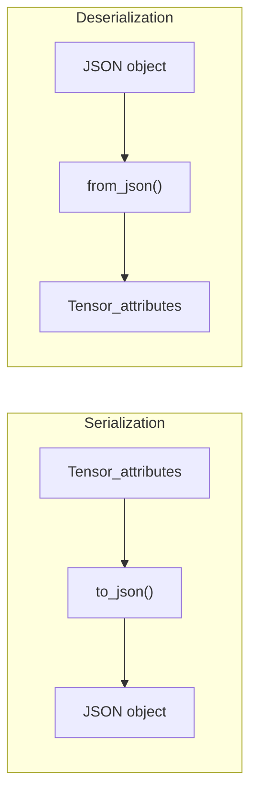

**Serialized Fields**:
- `name`, `data_type`, `dim`, `stride`
- `is_virtual`, `is_pass_by_value`, `pass_by_value`
- `reordering_type`, `uid`
- `ragged_offset`, `alignment`, `vector_count`, `vector_dimension`

**Sources**: [include/cudnn_frontend/graph_properties.h:94-99](), [include/cudnn_frontend/utils/serialize.h:503-547]()

---

