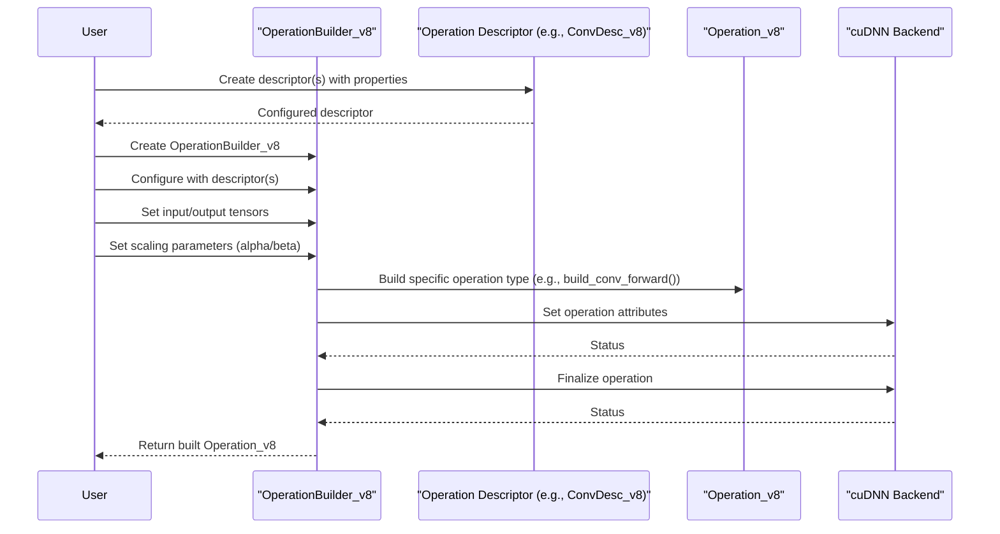
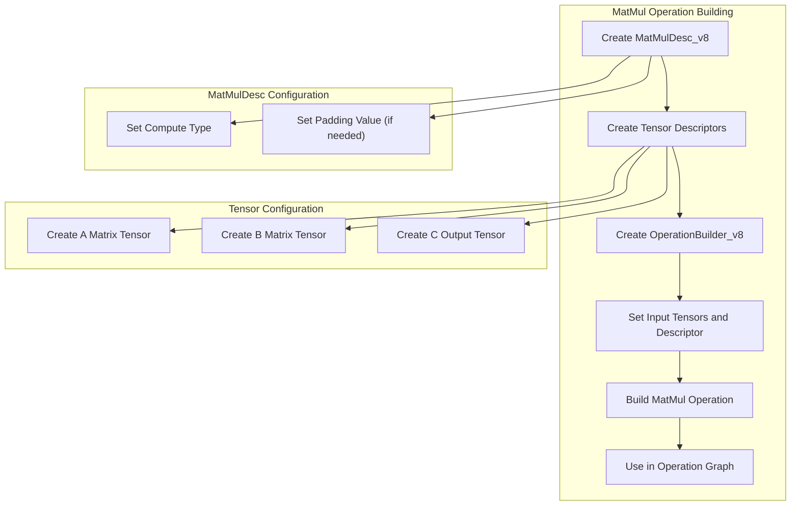
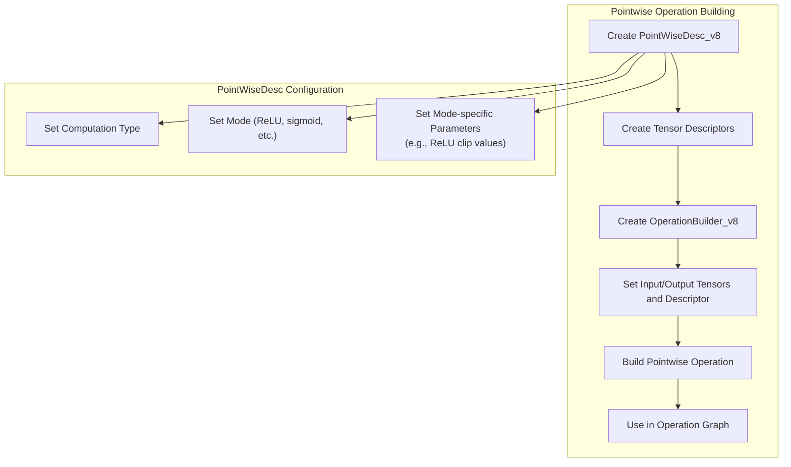
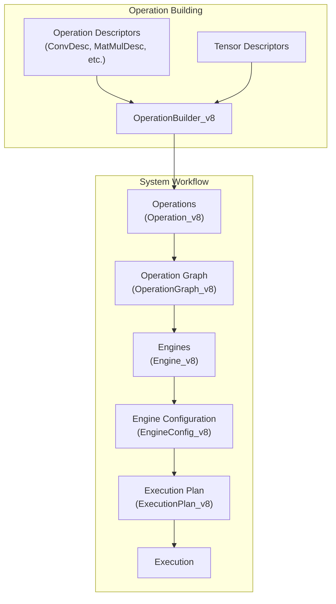

<!-- source: DeepWiki mcp.deepwiki.com · repo NVIDIA/cudnn-frontend · page 2.3 Operation Attributes · fetched 2026-10-26 -->

# Operation Attributes

<details>
<summary>Relevant source files</summary>

The following files were used as context for generating this wiki page:

- [include/cudnn_frontend/graph_properties.h](include/cudnn_frontend/graph_properties.h)
- [include/cudnn_frontend_EngineFallbackList.h](include/cudnn_frontend_EngineFallbackList.h)
- [include/cudnn_frontend_ExecutionPlan.h](include/cudnn_frontend_ExecutionPlan.h)
- [include/cudnn_frontend_Operation.h](include/cudnn_frontend_Operation.h)
- [include/cudnn_frontend_PointWiseDesc.h](include/cudnn_frontend_PointWiseDesc.h)
- [python/pygraph/pygraph.h](python/pygraph/pygraph.h)
- [samples/cpp/CMakeLists.txt](samples/cpp/CMakeLists.txt)
- [test/python/test_matmul_bias_relu.py](test/python/test_matmul_bias_relu.py)

</details>


This page documents the operation attribute classes in the cuDNN Frontend Graph API. Operation attributes define the configuration and parameters for various neural network operations like convolutions, matrix multiplications, and pointwise functions. These attributes are used when creating nodes in the computation graph (see [Node Types](#3)). For information on the tensor system, see [Tensor System](#2.2).

## Core Concepts

Operation attributes in the Graph API use a CRTP-based inheritance model where each operation type has a dedicated attribute class that inherits from `Attributes<DerivedT>`. These classes encapsulate:

- Input and output tensor references
- Operation-specific parameters (padding, stride, dilation, modes, etc.)
- Compute data type configuration
- Named accessors using `enum class` for inputs/outputs

**Attribute Class Hierarchy**

```mermaid
classDiagram
    class "Attributes~DerivedT~" {
        +string name
        +DataType_t compute_data_type
        +set_name(string) DerivedT&
        +set_compute_data_type(DataType_t) DerivedT&
        +fill_from_context(Context)
        #get_non_virtual_uids()
        #fill_pass_by_value()
    }
    
    class "Conv_fprop_attributes" {
        +unordered_map~input_names, Tensor_attributes~ inputs
        +unordered_map~output_names, Tensor_attributes~ outputs
        +vector~int64_t~ pre_padding
        +vector~int64_t~ post_padding
        +vector~int64_t~ stride
        +vector~int64_t~ dilation
        +ConvolutionMode_t math_mode
        +set_padding(vector)
        +set_stride(vector)
        +set_dilation(vector)
    }
    
    class "Matmul_attributes" {
        +unordered_map~input_names, Tensor_attributes~ inputs
        +unordered_map~output_names, Tensor_attributes~ outputs
        +double padding_value
        +set_m_override(Tensor_attributes)
        +set_n_override(Tensor_attributes)
        +set_k_override(Tensor_attributes)
        +set_padding(double)
    }
    
    class "Pointwise_attributes" {
        +unordered_map~input_names, Tensor_attributes~ inputs
        +unordered_map~output_names, Tensor_attributes~ outputs
        +PointwiseMode_t mode
        +optional~int64_t~ axis
        +optional~float~ relu_lower_clip
        +optional~float~ relu_upper_clip
        +set_mode(PointwiseMode_t)
        +set_relu_lower_clip(float)
    }
    
    "Attributes~DerivedT~" <|-- "Conv_fprop_attributes"
    "Attributes~DerivedT~" <|-- "Matmul_attributes"
    "Attributes~DerivedT~" <|-- "Pointwise_attributes"
```

Sources: [include/cudnn_frontend/graph_properties.h:302-490](), [include/cudnn_frontend/graph_properties.h:540-629](), [include/cudnn_frontend/graph_properties.h:809-866](), [include/cudnn_frontend/graph_properties.h:868-924]().

### Base Attributes Class

The `Attributes<DerivedT>` template class provides common functionality for all operation attributes through the CRTP pattern. It handles:

- Tensor management across inputs and outputs
- Context-based data type inference via `fill_from_context()`
- Pass-by-value tensor handling for scalar constants
- UID tracking for non-virtual tensors

Key methods:
- `fill_from_context()` - Propagates data types from `detail::Context` to tensors
- `get_non_virtual_uids()` - Returns UIDs of physical (non-virtual) tensors
- `fill_pass_by_value()` - Extracts embedded scalar values from pass-by-value tensors

Sources: [include/cudnn_frontend/graph_properties.h:302-490]().

## Convolution Attributes

Convolution operations are defined using attribute classes for forward propagation and gradient computation.

**Conv_fprop_attributes**

Defines forward convolution with configurable padding, stride, and dilation:

| Property | Type | Description |
|----------|------|-------------|
| `inputs` | `unordered_map<input_names, Tensor_attributes>` | `X` (input), `W` (weights) |
| `outputs` | `unordered_map<output_names, Tensor_attributes>` | `Y` (output) |
| `pre_padding` | `vector<int64_t>` | Padding before spatial dimensions |
| `post_padding` | `vector<int64_t>` | Padding after spatial dimensions |
| `stride` | `vector<int64_t>` | Stride per spatial dimension |
| `dilation` | `vector<int64_t>` | Dilation per spatial dimension |
| `math_mode` | `ConvolutionMode_t` | `CROSS_CORRELATION` or `CONVOLUTION` |

Key methods:
- `set_padding(vector<int64_t>)` - Sets both pre and post padding
- `set_pre_padding(vector<int64_t>)` - Sets only pre-padding
- `set_post_padding(vector<int64_t>)` - Sets only post-padding
- `set_stride(vector<int64_t>)` - Sets stride
- `set_dilation(vector<int64_t>)` - Sets dilation
- `set_convolution_mode(ConvolutionMode_t)` - Sets math mode

Sources: [include/cudnn_frontend/graph_properties.h:540-629]().

**Conv_dgrad_attributes**

Defines gradient computation with respect to input (data gradient). Has identical structure to `Conv_fprop_attributes` but with different input/output semantics:

| Input/Output | Tensor | Description |
|--------------|--------|-------------|
| `inputs` | `DY` | Loss gradient |
| `inputs` | `W` | Weights |
| `outputs` | `DX` | Input gradient |

Sources: [include/cudnn_frontend/graph_properties.h:673-763]().

**Conv_wgrad_attributes**

Defines gradient computation with respect to weights. Input names: `X` (input), `DY` (loss gradient). Output name: `DW` (weight gradient).

Sources: Referenced in node system, structure follows same pattern.

## Matrix Multiplication Attributes

Matrix multiplication operations support both standard precision and FP8 variants.

**Matmul_attributes**

Defines standard matrix multiplication with optional dimension overrides:

| Property | Type | Description |
|----------|------|-------------|
| `inputs` | `unordered_map<input_names, Tensor_attributes>` | `A`, `B`, `M_override`, `N_override`, `K_override` |
| `outputs` | `unordered_map<output_names, Tensor_attributes>` | `C` (result) |
| `padding_value` | `double` | Value for padding ragged dimensions |

Key methods:
- `set_m_override(Tensor_attributes)` - Override M dimension
- `set_n_override(Tensor_attributes)` - Override N dimension  
- `set_k_override(Tensor_attributes)` - Override K dimension
- `set_padding(double)` - Set padding value

The dimension overrides enable dynamic shapes where the actual matrix dimensions are provided at execution time via scalar tensors.

Sources: [include/cudnn_frontend/graph_properties.h:809-866]().

**Matmul_fp8_attributes**

Extends matrix multiplication for FP8 data types with additional scaling tensors:

| Input | Description |
|-------|-------------|
| `Descale_A` | Descaling factor for matrix A |
| `Descale_B` | Descaling factor for matrix B |
| `A` | Input matrix A (FP8) |
| `B` | Input matrix B (FP8) |
| `Scale_C` | Scaling factor for output |

| Output | Description |
|--------|-------------|
| `C` | Result matrix |
| `Amax_C` | Absolute maximum of C for scaling |

The `clone_fp8_attributes()` method in `Matmul_attributes` enables copying FP8-specific configuration to standard matmul attributes.

Sources: [include/cudnn_frontend/graph_properties.h:765-807](), [include/cudnn_frontend/graph_properties.h:823-841]().

## Pointwise Attributes

Pointwise operations perform element-wise computations with configurable modes and parameters.

**Pointwise_attributes Structure**

| Property | Type | Description |
|----------|------|-------------|
| `inputs` | `unordered_map<input_names, Tensor_attributes>` | `IN_0`, `IN_1`, `IN_2` (up to 3 inputs) |
| `outputs` | `unordered_map<output_names, Tensor_attributes>` | `OUT_0` |
| `mode` | `PointwiseMode_t` | Operation mode (see table below) |
| `axis` | `optional<int64_t>` | Axis for operations like `GEN_INDEX` |

**Activation-Specific Parameters**

| Parameter | Type | Operations | Description |
|-----------|------|------------|-------------|
| `relu_lower_clip` | `optional<float>` | `RELU_FWD`, `RELU_BWD` | Lower clipping value |
| `relu_upper_clip` | `optional<float>` | `RELU_FWD`, `RELU_BWD` | Upper clipping value |
| `relu_lower_clip_slope` | `optional<float>` | `RELU_FWD`, `RELU_BWD` | Slope for negative values |
| `swish_beta` | `optional<float>` | `SWISH_FWD`, `SWISH_BWD` | Swish activation parameter |
| `elu_alpha` | `optional<float>` | `ELU_FWD`, `ELU_BWD` | ELU activation parameter |
| `softplus_beta` | `optional<float>` | `SOFTPLUS_FWD`, `SOFTPLUS_BWD` | Softplus activation parameter |

**Common Pointwise Modes**

The `PointwiseMode_t` enum defines operations including:
- Arithmetic: `ADD`, `SUB`, `MUL`, `DIV`, `MAX`, `MIN`
- Activations: `RELU_FWD`, `RELU_BWD`, `TANH_FWD`, `TANH_BWD`, `SIGMOID_FWD`, `ELU_FWD`, `GELU_FWD`, `SWISH_FWD`
- Comparison: `CMP_EQ`, `CMP_NEQ`, `CMP_GT`, `CMP_GE`, `CMP_LT`, `CMP_LE`
- Math: `SQRT`, `EXP`, `LOG`, `NEG`, `ABS`, `SIN`, `COS`
- Other: `GEN_INDEX`, `BINARY_SELECT`, `LOGICAL_AND`, `LOGICAL_OR`, `LOGICAL_NOT`

Key methods:
- `set_mode(PointwiseMode_t)` - Sets operation mode
- `set_axis(int64_t)` - Sets axis for applicable operations
- `set_relu_lower_clip(float)`, `set_relu_upper_clip(float)` - Configure ReLU clipping
- `set_relu_lower_clip_slope(float)` - Set leaky ReLU slope

Sources: [include/cudnn_frontend/graph_properties.h:868-924]().

## Building Operations Workflow

The typical workflow for building operations involves creating appropriate descriptors, configuring them, and then using the OperationBuilder to assemble the final operation.



Sources: [include/cudnn_frontend_Operation.h:294-390](). [include/cudnn_frontend_Operation.h:392-535](). [include/cudnn_frontend_Operation.h:537-634]().

## Example: Building a Matrix Multiplication Operation

To build a matrix multiplication operation, you typically need to:

1. Create and configure a MatMulDesc descriptor
2. Create tensor descriptors for input matrices and output
3. Use OperationBuilder to build the matmul operation



Sources: [include/cudnn_frontend_MatMulDesc.h:76-188](). [include/cudnn_frontend_Operation.h:294-390]().

## Example: Building a Pointwise Operation

To build a pointwise operation, you typically need to:

1. Create and configure a PointWiseDesc descriptor with appropriate mode
2. Create tensor descriptors for inputs and outputs
3. Use OperationBuilder to build the pointwise operation



Sources: [include/cudnn_frontend_PointWiseDesc.h:106-388](). [include/cudnn_frontend_Operation.h:392-535]().

## Integration with Other Components

Operations built using the Operation Building system are typically combined into operation graphs and executed using execution plans.



Sources: [include/cudnn_frontend_Engine.h:37-340](). [include/cudnn_frontend_EngineConfig.h:35-246](). [include/cudnn_frontend_VariantPack.h:36-202]().

## Key Considerations

When building operations, consider the following:

1. **Data Types**: Ensure the compute type is set appropriately for your needs (precision vs. performance)
2. **Memory Layout**: Pay attention to tensor dimensions and strides for optimal performance
3. **Operation Chaining**: Plan how operations will be combined in the operation graph
4. **Error Handling**: Check return status from build operations to ensure success

## Next Steps

After building operations, you'll typically:

1. Combine them into an operation graph (see [Graph System](#2.3))
2. Create execution plans to run the operations (see [Execution Plans](#2.4))
3. Use heuristics to find optimal execution configurations (see [Heuristics & Engine Configuration](#2.5))

---

