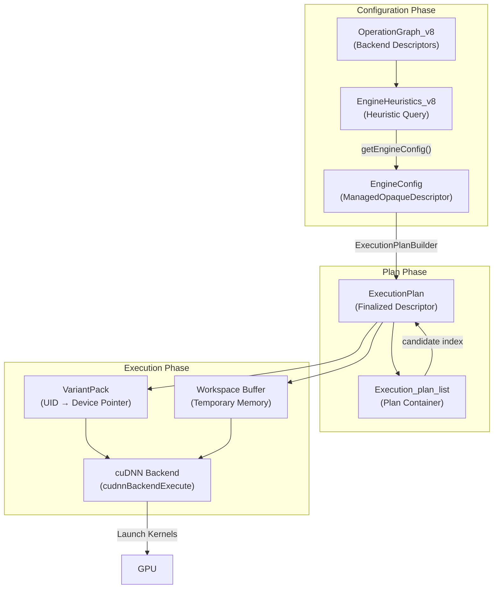
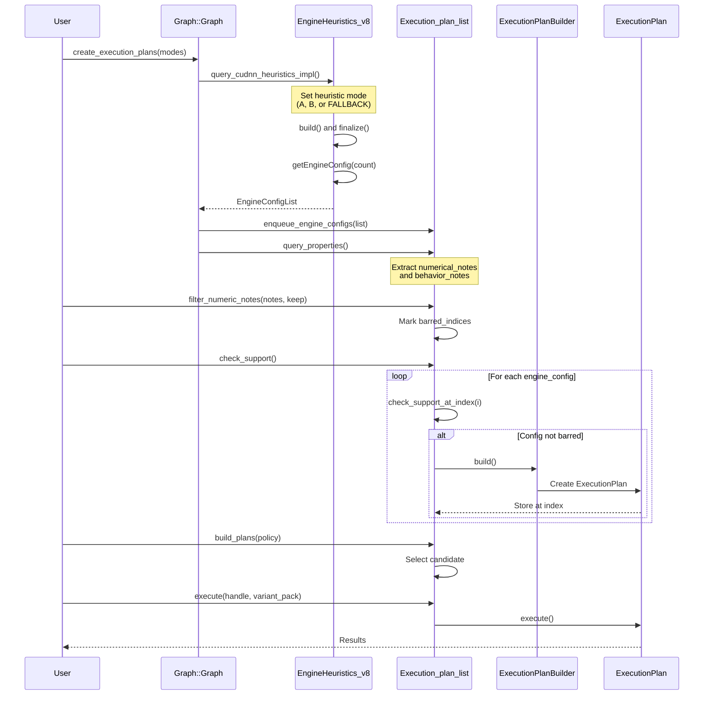
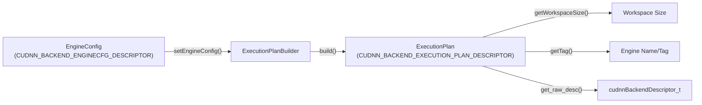
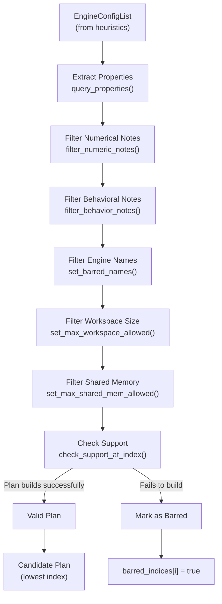
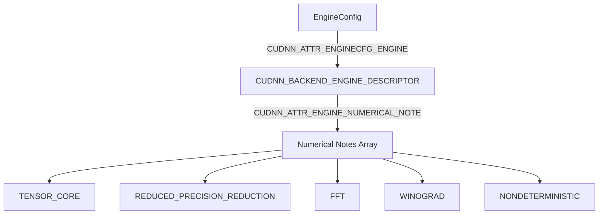
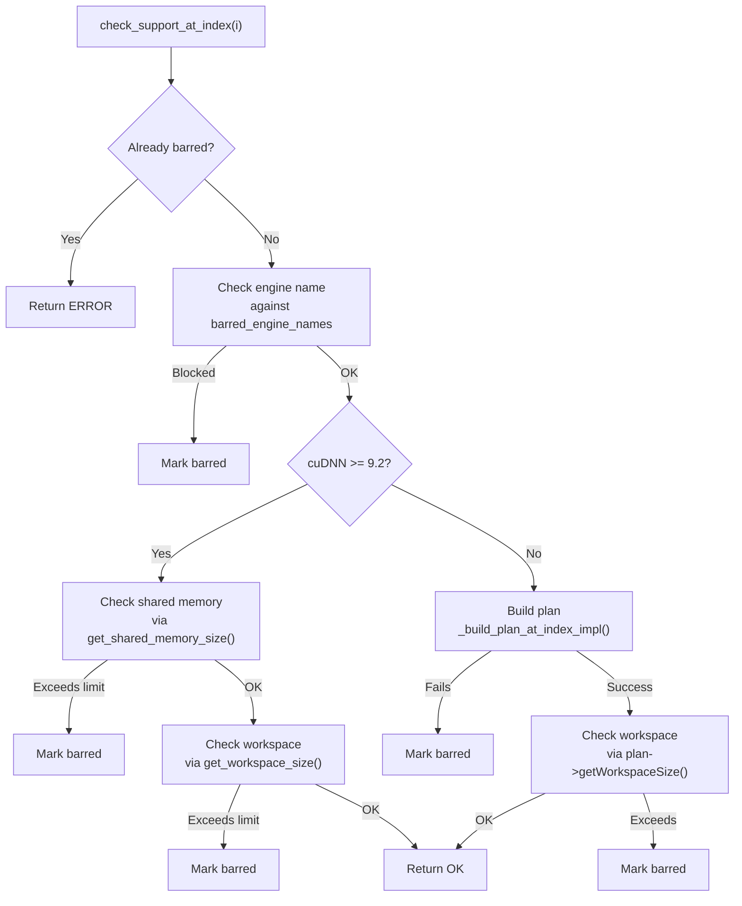
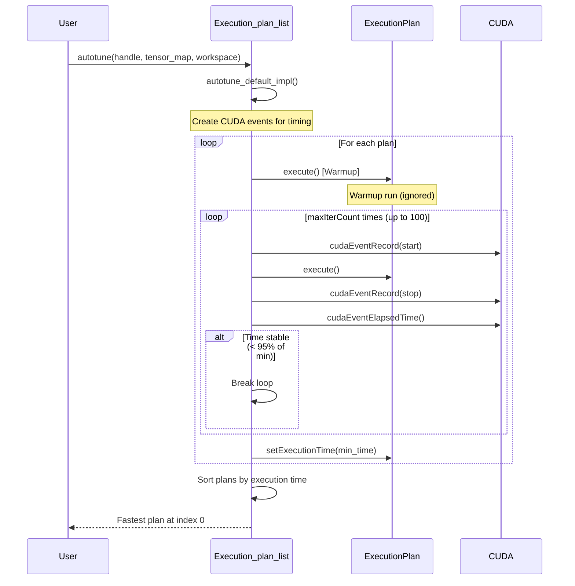
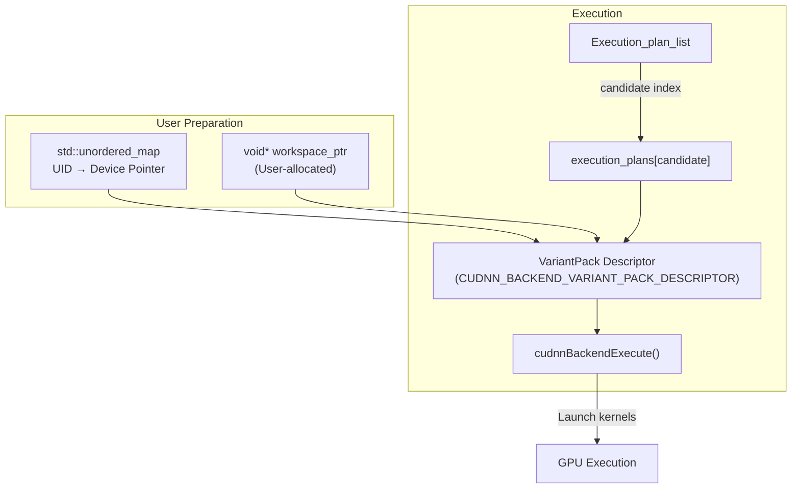

<!-- source: DeepWiki mcp.deepwiki.com · repo NVIDIA/cudnn-frontend · page 2.4 Execution Plans · fetched 2026-10-26 -->

# Execution Plans

<details>
<summary>Relevant source files</summary>

The following files were used as context for generating this wiki page:

- [include/cudnn_frontend/plans.h](include/cudnn_frontend/plans.h)
- [include/cudnn_frontend_EngineConfigGenerator.h](include/cudnn_frontend_EngineConfigGenerator.h)
- [include/cudnn_frontend_Filters.h](include/cudnn_frontend_Filters.h)
- [include/cudnn_frontend_Heuristics.h](include/cudnn_frontend_Heuristics.h)
- [include/cudnn_frontend_get_plan.h](include/cudnn_frontend_get_plan.h)
- [include/cudnn_frontend_shim.h](include/cudnn_frontend_shim.h)

</details>


**Purpose:** This page explains the `ExecutionPlan` concept in cuDNN Frontend, covering plan creation from engine configurations, workspace requirements, filtering strategies, autotuning, and plan caching mechanisms.

**Scope:** This page focuses on the plan building and execution phase. For information about querying heuristics to obtain engine configurations, see [Heuristics & Engine Selection](#2.5). For details about graph construction that precedes plan generation, see [Graph API](#2.1).

---

## Overview

An **Execution Plan** is a finalized, device-ready kernel configuration that can be executed on the GPU. It represents the culmination of the graph construction and heuristic query phases, containing all information needed to launch cuDNN kernels for a specific operation graph.

The execution plan system bridges the gap between high-level graph operations and low-level GPU execution through several stages:

1. **Heuristic Query**: Backend recommends candidate engine configurations
2. **Filtering**: Eliminate unsuitable configurations based on constraints
3. **Plan Building**: Finalize backend descriptors into executable plans
4. **Selection**: Choose best plan (via autotuning or heuristics)
5. **Execution**: Launch kernels with provided device memory

Sources: [include/cudnn_frontend/plans.h:1-668](), [include/cudnn_frontend_get_plan.h:1-62]()

---

## Core Types and Relationships



**Type Definitions:**

| Type | Location | Purpose |
|------|----------|---------|
| `ExecutionPlan` | Legacy Builder API | Wrapper around `CUDNN_BACKEND_EXECUTION_PLAN_DESCRIPTOR` |
| `Execution_plan_list` | [include/cudnn_frontend/plans.h:173]() | Container managing multiple plans with filtering and selection |
| `EngineConfigList` | Type alias for `std::vector<ManagedOpaqueDescriptor>` | List of candidate engine configurations |
| `executionPlans_t` | [include/cudnn_frontend_EngineConfigGenerator.h:30]() | Type alias for `std::vector<ExecutionPlan>` |

Sources: [include/cudnn_frontend/plans.h:173-664](), [include/cudnn_frontend_EngineConfigGenerator.h:29-32](), [include/cudnn_frontend_Heuristics.h:50-145]()

---

## Plan Creation Lifecycle



**Key Methods:**

- **`query_cudnn_heuristics_impl()`** [include/cudnn_frontend/plans.h:42-93](): Queries cuDNN backend for recommended engine configurations using specified heuristic modes.

- **`create_cudnn_execution_plan()`** [include/cudnn_frontend/plans.h:133-168](): Builds an `ExecutionPlan` from an `EngineConfig` using `ExecutionPlanBuilder`.

- **`check_support_at_index()`** [include/cudnn_frontend/plans.h:397-462](): Validates whether a specific engine configuration is supported on the current device, checking workspace limits, shared memory requirements, and building the plan if necessary.

- **`build_plans()`** [include/cudnn_frontend/plans.h:512-548](): Iterates through engine configurations and builds supported plans according to the specified `BuildPlanPolicy_t`.

Sources: [include/cudnn_frontend/plans.h:42-168](), [include/cudnn_frontend/plans.h:397-548]()

---

## Building Execution Plans

### From Engine Configurations

An `ExecutionPlan` is constructed from an `EngineConfig` (a backend descriptor) through the `ExecutionPlanBuilder`:



The `ExecutionPlanBuilder` (from legacy API) performs these steps:

1. Creates a `CUDNN_BACKEND_EXECUTION_PLAN_DESCRIPTOR`
2. Associates it with the engine config
3. Optionally sets a `KernelCache` for dynamic shapes (cuDNN 9.4+)
4. Finalizes the descriptor via `cudnnBackendFinalize`

**Key Classes:**

- **`ExecutionPlanBuilder`**: Builder pattern for creating execution plans from engine configs. Sets engine config, handle, and optional kernel cache.

- **`Execution_plan_list`** [include/cudnn_frontend/plans.h:173](): Manages multiple plans, tracking which are viable (`barred_indices`), workspace requirements, and the selected candidate plan.

Sources: [include/cudnn_frontend/plans.h:133-168](), [include/cudnn_frontend/plans.h:186-222]()

---

### Build Policies

The `build_plans()` method supports different policies via `BuildPlanPolicy_t`:

| Policy | Behavior |
|--------|----------|
| `HEURISTICS_CHOICE` | Builds only the first supported plan (fast) |
| `ALL` | Builds all supported plans (for autotuning) |

**Implementation:** [include/cudnn_frontend/plans.h:512-548]()

```cpp
// Pseudocode for build_plans logic
for (i = 0; i < engine_configs.size(); i++) {
    status = build_plan_at_index(i);
    if (status.is_good() && candidate == -1) {
        candidate = i;  // First successful plan
        if (policy == HEURISTICS_CHOICE) {
            return;  // Stop early
        }
    }
}
```

The `candidate` member [include/cudnn_frontend/plans.h:233]() stores the index of the selected plan for execution.

Sources: [include/cudnn_frontend/plans.h:512-548](), [include/cudnn_frontend/plans.h:233]()

---

## Workspace Management

### Workspace Requirements

Each execution plan requires a **workspace buffer**—a contiguous region of GPU memory for intermediate computations. The workspace size varies by plan and can range from 0 bytes to several gigabytes.

**Querying Workspace Size:**


**Workspace Filtering:**

The `Execution_plan_list` enforces workspace limits through `max_workspace_allowed` [include/cudnn_frontend/plans.h:179]():

- **Pre-cuDNN 9.2**: Workspace check happens after building the plan via `plan->getWorkspaceSize()` [include/cudnn_frontend/plans.h:211]()
- **cuDNN 9.2+**: Workspace check happens at engine config level before building [include/cudnn_frontend/plans.h:446-452]()

**Setting Workspace Limit:**

```cpp
plan_list.set_max_workspace_allowed(max_bytes);  // [plans.h:363]
```

Plans exceeding this limit are marked as barred and excluded from execution.

Sources: [include/cudnn_frontend/plans.h:179](), [include/cudnn_frontend/plans.h:210-216](), [include/cudnn_frontend/plans.h:446-452](), [include/cudnn_frontend/plans.h:363-365]()

---

### Autotuning Workspace Calculation

For autotuning, the framework needs workspace that accommodates the largest plan:

**`get_autotune_workspace()`** [include/cudnn_frontend/plans.h:551-557]():

```cpp
int64_t max_size = 0;
for (auto& plan : execution_plans) {
    max_size = std::max(max_size, plan->getWorkspaceSize());
}
return max_size;
```

This ensures a single workspace allocation can be reused across all plan executions during autotuning.

Sources: [include/cudnn_frontend/plans.h:551-557]()

---

## Plan Filtering and Selection

### Multi-Stage Filtering Pipeline



**Filtering Criteria:**

| Filter Type | Method | Purpose |
|-------------|--------|---------|
| Numerical Notes | `filter_numeric_notes()` [include/cudnn_frontend/plans.h:337]() | Keep/exclude plans with specific compute characteristics (e.g., tensor core usage) |
| Behavioral Notes | `filter_behavior_notes()` [include/cudnn_frontend/plans.h:350]() | Keep/exclude plans with runtime behaviors (e.g., runtime compilation) |
| Engine Names | `set_barred_names()` [include/cudnn_frontend/plans.h:373]() | Exclude plans matching specific engine name patterns |
| Workspace Size | `set_max_workspace_allowed()` [include/cudnn_frontend/plans.h:363]() | Exclude plans exceeding memory limit |
| Shared Memory | `set_max_shared_mem_allowed()` [include/cudnn_frontend/plans.h:368]() | Exclude plans exceeding shared memory limit (cuDNN 9.2+) |

Sources: [include/cudnn_frontend/plans.h:337-375](), [include/cudnn_frontend/plans.h:397-462]()

---

### Numerical and Behavioral Notes

**Numerical Notes** describe computational characteristics:



**Behavioral Notes** describe runtime characteristics:

- `RUNTIME_COMPILATION`: Engine requires JIT compilation
- `REQUIRES_FILTER_INT8x32_REORDER`: Requires weight reordering
- `REQUIRES_BIAS_INT8x32_REORDER`: Requires bias reordering

**Extraction:** [include/cudnn_frontend/plans.h:254-334]()

The `query_properties()` method extracts both note types for all engine configs, storing them in parallel vectors `numeric_notes` and `behavior_notes`.

**Usage Example:**

```cpp
// Keep only plans using tensor cores
plan_list.filter_numeric_notes({NumericalNote_t::TENSOR_CORE}, /*keep=*/true);

// Exclude plans requiring runtime compilation  
plan_list.filter_behavior_notes({BehaviorNote_t::RUNTIME_COMPILATION}, /*keep=*/false);
```

Sources: [include/cudnn_frontend/plans.h:254-334](), [include/cudnn_frontend/plans.h:337-360]()

---

### Support Checking

**`check_support_at_index()`** [include/cudnn_frontend/plans.h:397-462]() performs comprehensive validation:



This method is typically called during `check_support()` [include/cudnn_frontend/plans.h:465-478](), which iterates through all configs and returns success if at least one is supported.

Sources: [include/cudnn_frontend/plans.h:397-478]()

---

## Autotuning

Autotuning measures the actual execution time of each plan to select the fastest one. This is more accurate than relying solely on heuristic ordering.

### Autotuning Process



**Key Constants:** [include/cudnn_frontend/plans.h:581-582]()

- `maxIterCount = 100`: Maximum profiling iterations per plan
- `threshold = 0.95f`: Stability threshold (time must be within 95% of minimum)

**Implementation:** [include/cudnn_frontend/plans.h:560-634]()

The `autotune_default_impl()` static method:

1. Performs a warmup execution for each plan
2. Profiles each plan up to 100 times, tracking minimum time
3. Stops early when time stabilizes (within 95% of minimum)
4. Sorts plans by execution time using `std::multiset`
5. Returns the sorted list with fastest plan first

**Custom Autotuning:**

Users can replace the default implementation:

```cpp
plan_list.autotune_impl = custom_autotune_function;  // [plans.h:641]
```

Sources: [include/cudnn_frontend/plans.h:560-650]()

---

## Plan Caching

### Kernel Cache (cuDNN 9.4+)

For **dynamic shapes**, cuDNN 9.4+ supports kernel caching via the `KernelCache` object. This caches compiled kernels across different tensor shapes, avoiding recompilation.

**Setting Kernel Cache:**

```cpp
auto kernel_cache = std::make_shared<KernelCache>();
plan_list.set_kernel_cache(kernel_cache);  // [plans.h:244]
```

The kernel cache is passed to `ExecutionPlanBuilder` during plan creation [include/cudnn_frontend/plans.h:139]().

**Details:** For more information on kernel caching and dynamic shapes, see [Kernel Cache & Dynamic Shapes](#5.6).

Sources: [include/cudnn_frontend/plans.h:244-246](), [include/cudnn_frontend/plans.h:139]()

---

### Plan Serialization

Execution plans can be serialized to JSON for offline storage and later reconstruction:

**Serialization:**

```cpp
// Build plan from engine config
auto plan = ExecutionPlanBuilder()
    .setHandle(handle)
    .setEngineConfig(config, tag)
    .build();

// Serialize to JSON
std::string json = plan.getJsonRepresentation();
```

**Deserialization:** [include/cudnn_frontend/plans.h:96-130]()

```cpp
auto plan_builder = ExecutionPlanBuilder()
    .setHandle(handle)
    .loadFromJson(serialized_data);
    
auto plan = plan_builder.build();
```

The `create_cudnn_execution_plan()` overload [include/cudnn_frontend/plans.h:96]() accepts serialized JSON and reconstructs the plan.

**Use Cases:**

- Avoid repeated heuristic queries across application runs
- Share optimized plans between similar workloads
- Debug plan selection by inspecting serialized configuration

Sources: [include/cudnn_frontend/plans.h:96-130]()

---

## Executing Plans

### Execution Flow



**Execution Method:** [include/cudnn_frontend/plans.h:19-39]()

```cpp
error_t execute(cudnnHandle_t handle,
                ExecutionPlan* plan,
                std::vector<void*>& device_ptrs,
                std::vector<int64_t> const& uids,
                void* workspace_ptr);
```

**Steps:**

1. Create a `CUDNN_BACKEND_VARIANT_PACK_DESCRIPTOR`
2. Populate it with tensor UIDs and device pointers via `create_variant_pack()` [include/cudnn_frontend/plans.h:33]()
3. Include workspace pointer
4. Call `cudnnBackendExecute(handle, plan_descriptor, variant_pack_descriptor)` [include/cudnn_frontend/plans.h:34]()

Sources: [include/cudnn_frontend/plans.h:19-39]()

---

### Variant Pack Construction

The **Variant Pack** maps logical tensor UIDs to physical device memory:

| Component | Type | Purpose |
|-----------|------|---------|
| Tensor UIDs | `std::vector<int64_t>` | Logical identifiers from graph construction |
| Device Pointers | `std::vector<void*>` | GPU memory addresses for inputs/outputs |
| Workspace Pointer | `void*` | Temporary buffer for intermediate results |

**Backend Descriptor Population:**

The variant pack descriptor requires:
- `CUDNN_ATTR_VARIANT_PACK_UNIQUE_IDS`: Array of UIDs
- `CUDNN_ATTR_VARIANT_PACK_DATA_POINTERS`: Array of device pointers
- `CUDNN_ATTR_VARIANT_PACK_WORKSPACE`: Workspace pointer

This mapping allows the same plan to be executed with different input data by simply updating the variant pack.

Sources: [include/cudnn_frontend/plans.h:28-34]()

---

### Plan Validity

Before execution, verify the plan is valid:

**`is_plan_index_executable()`** [include/cudnn_frontend/plans.h:653-663]()

```cpp
RETURN_CUDNN_FRONTEND_ERROR_IF(
    execution_plans[index] == nullptr,
    error_code_t::GRAPH_EXECUTION_FAILED,
    "Plan index did not build.");
```

This checks that:
1. Index is within bounds
2. Plan was successfully built (not `nullptr`)

A plan may be `nullptr` if it failed support checks or build attempts.

Sources: [include/cudnn_frontend/plans.h:653-663]()

---

## Summary

The execution plan system provides a flexible, multi-stage pipeline for converting high-level graph operations into optimized GPU kernels:

1. **Query heuristics** to obtain candidate engine configurations
2. **Filter configurations** based on workspace, notes, and device constraints  
3. **Build plans** from viable configurations using `ExecutionPlanBuilder`
4. **Select the best plan** via heuristic priority or autotuning
5. **Execute with variant pack** mapping tensors to device memory
6. **Cache plans** for reuse with serialization or kernel caching

**Key Classes:**

- `ExecutionPlan`: Finalized, executable descriptor wrapping `CUDNN_BACKEND_EXECUTION_PLAN_DESCRIPTOR`
- `Execution_plan_list`: Container managing multiple plans with filtering, selection, and autotuning
- `ExecutionPlanBuilder`: Builder pattern for creating plans from engine configs
- `EngineConfigList`: List of candidate configurations from heuristics

**Key Methods:**

- `query_cudnn_heuristics_impl()`: Query backend for engine configs
- `check_support()`: Validate plan support on current device
- `build_plans()`: Construct execution plans with specified policy
- `autotune()`: Profile and select fastest plan
- `execute()`: Run plan with variant pack

Sources: [include/cudnn_frontend/plans.h:1-668](), [include/cudnn_frontend_get_plan.h:1-62](), [include/cudnn_frontend_EngineConfigGenerator.h:1-123]()

---

