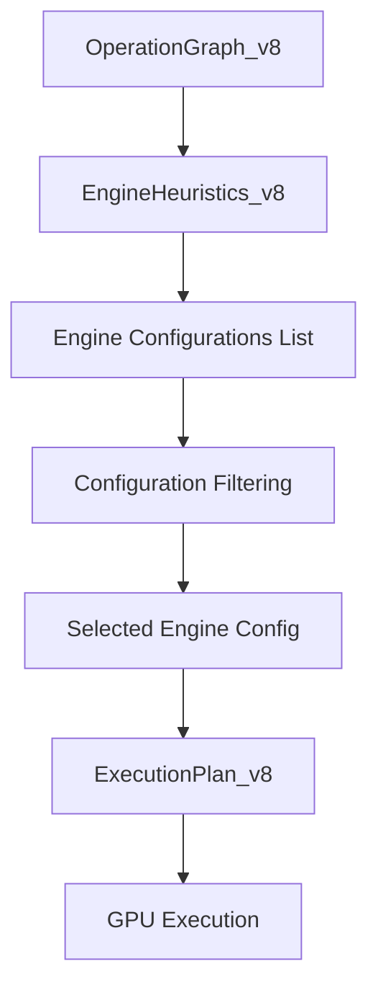
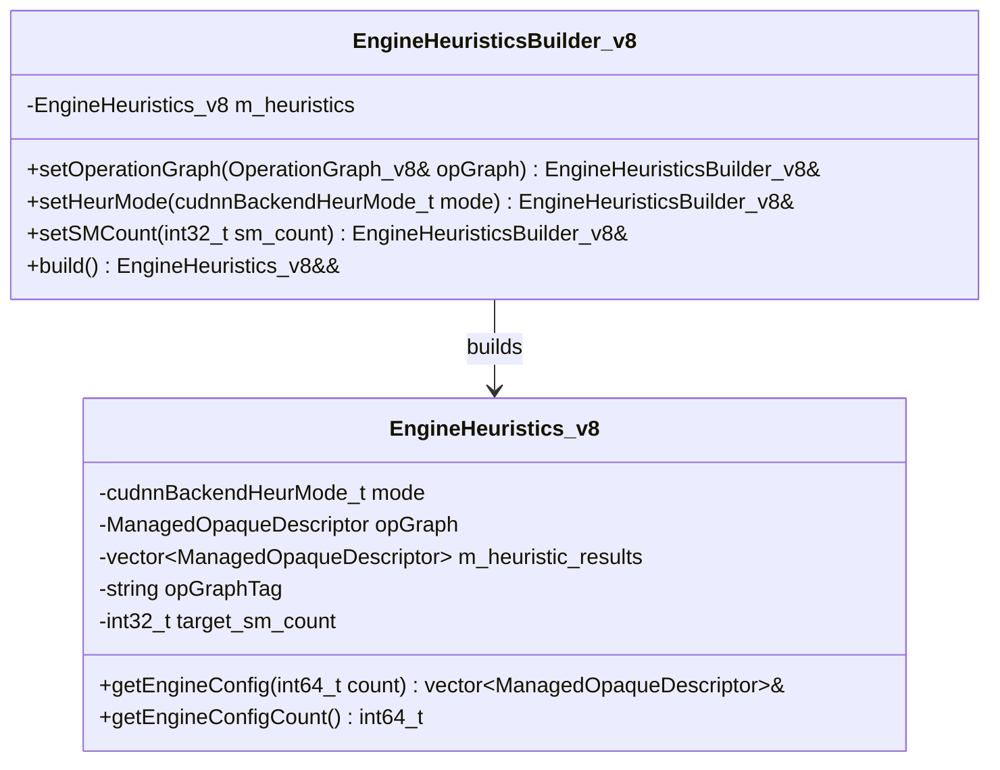
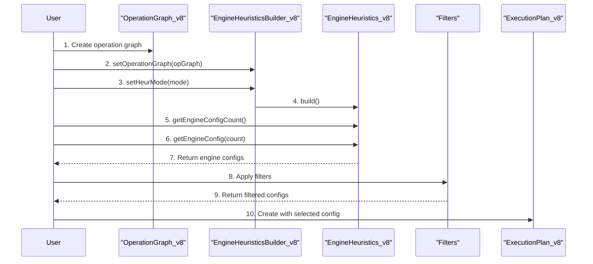
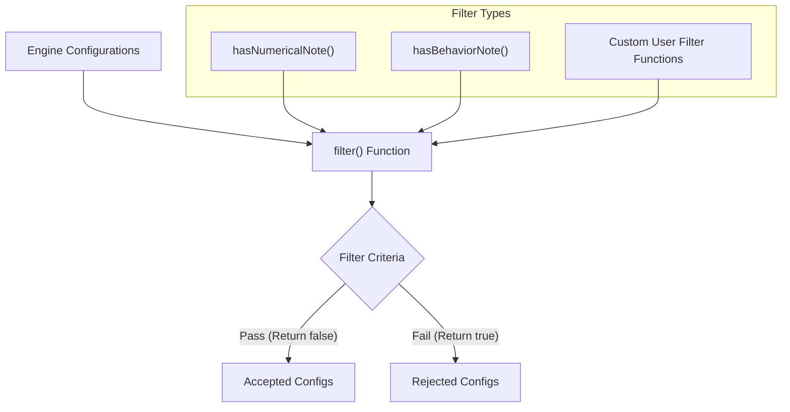

<!-- source: DeepWiki mcp.deepwiki.com · repo NVIDIA/cudnn-frontend · page 2.5 Heuristics & Engine Selection · fetched 2026-10-26 -->

# Heuristics & Engine Configuration

<details>
<summary>Relevant source files</summary>

The following files were used as context for generating this wiki page:

- [include/cudnn_frontend_EngineConfigGenerator.h](include/cudnn_frontend_EngineConfigGenerator.h)
- [include/cudnn_frontend_Errata.h](include/cudnn_frontend_Errata.h)
- [include/cudnn_frontend_Filters.h](include/cudnn_frontend_Filters.h)
- [include/cudnn_frontend_Heuristics.h](include/cudnn_frontend_Heuristics.h)
- [include/cudnn_frontend_find_plan.h](include/cudnn_frontend_find_plan.h)
- [include/cudnn_frontend_get_plan.h](include/cudnn_frontend_get_plan.h)

</details>


This page documents the heuristics and engine configuration components in the cuDNN Frontend library. These components provide mechanisms to select optimal execution engines for operation graphs based on different heuristic modes and filtering criteria. For information about how to use the selected engine configurations with execution plans, see [Execution Plans](#2.4).

## Overview

When executing neural network operations through cuDNN, multiple hardware-specific implementations (engines) may be available for each operation or operation graph. The Heuristics system helps select the most appropriate engine configuration based on various criteria and optimization strategies.



Sources: [include/cudnn_frontend_Heuristics.h:39-143]()

## Core Components

### EngineHeuristics_v8

The `EngineHeuristics_v8` class determines the available engine configurations from an operation graph based on different heuristic modes.

Key functionalities:
- **getEngineConfig**: Retrieves engine configurations based on heuristic analysis
- **getEngineConfigCount**: Returns the total count of available engine configurations

### EngineHeuristicsBuilder_v8

The `EngineHeuristicsBuilder_v8` class helps construct `EngineHeuristics_v8` objects through a builder pattern.

Key builder methods:
- **setOperationGraph**: Sets the operation graph for which to find engines
- **setHeurMode**: Sets the heuristic mode (strategy)
- **setSMCount**: Sets the target SM (Streaming Multiprocessor) count for better hardware-specific selection
- **build**: Creates and returns the `EngineHeuristics_v8` object



Sources: [include/cudnn_frontend_Heuristics.h:39-143](), [include/cudnn_frontend_Heuristics.h:146-277]()

## Heuristic Modes

cuDNN Frontend provides different heuristic modes that represent different strategies for finding engine configurations:

| Mode | Constant | Description |
|------|----------|-------------|
| Mode A | `CUDNN_HEUR_MODE_A` / `CUDNN_HEUR_MODE_INSTANT` | Fast selection strategy, quickly returns viable engines |
| Mode B | `CUDNN_HEUR_MODE_B` | More thorough search, may find better solutions but takes more time |
| Fallback | `CUDNN_HEUR_MODE_FALLBACK` | Used when other modes don't find suitable configurations |

Sources: [include/cudnn_frontend_Heuristics.h:169-172](), [include/cudnn_frontend_Heuristics.h:416-420]()

## Engine Configuration Selection Process

The typical process for selecting engine configurations follows these steps:



Sources: [include/cudnn_frontend_Heuristics.h:278-298](), [include/cudnn_frontend_Heuristics.h:332-348]()

## Utility Functions

The library provides several utility functions to simplify the process of obtaining and filtering engine configurations:

### get_heuristics_list

Multiple overloaded versions of `get_heuristics_list` are available to retrieve engine configurations based on various heuristic modes:

```cpp
// Using an array of heuristic modes
template <std::size_t SIZE>
EngineConfigList get_heuristics_list(
    std::array<cudnnBackendHeurMode_t, SIZE> modes,
    OperationGraph_v8 &opGraph,
    std::function<bool(cudnnBackendDescriptor_t)> filter_fn);

// Using string-based mode names
std::vector<cudnnStatus_t> get_heuristics_list(
    std::vector<std::string> const &modes,
    OperationGraph_v8 &opGraph,
    std::function<bool(cudnnBackendDescriptor_t)> filter_fn,
    EngineConfigList &filtered_configs,
    bool evaluate_all = false,
    int32_t sm_count = -1);
```

Sources: [include/cudnn_frontend_Heuristics.h:279-439]()

## Filtering Engine Configurations

After obtaining engine configurations, you can filter them based on custom criteria:



The library provides the following filtering utilities:

### filter

The `filter` function separates engine configurations based on a filter function:

```cpp
static void filter(
    EngineConfigList &from, 
    EngineConfigList &to, 
    std::function<bool(cudnnBackendDescriptor_t)> filter_fn);
```

**Note**: If the filter function returns `true` for a configuration, it will be filtered out and not included in the result.

### hasNumericalNote and hasBehaviorNote

Helper functions to check for specific engine characteristics:

```cpp
template <cudnnBackendNumericalNote_t NUMERIC_NOTE>
bool hasNumericalNote(cudnnBackendDescriptor_t engine_config);

template <cudnnBackendBehaviorNote_t BEHAVIOR_NOTE>
bool hasBehaviorNote(cudnnBackendDescriptor_t engine_config);
```

Sources: [include/cudnn_frontend_Filters.h:30-95]()

## Usage Example

Here's a typical usage pattern for obtaining and filtering engine configurations:

```cpp
// Create an operation graph
auto opGraph = /* ... */;

// Define a filter function
auto filter_fn = [](cudnnBackendDescriptor_t engine_config) -> bool {
    // Return true to exclude this engine config
    return false; // Accept all configurations for this example
};

// Get engine configurations using multiple heuristic modes
EngineConfigList filtered_configs;
auto modes = std::vector<std::string>{"heuristics_mode_a", "heuristics_mode_b"};
auto statuses = get_heuristics_list(modes, opGraph, filter_fn, filtered_configs);

// Check if we got any valid configurations
if (filtered_configs.empty()) {
    // Handle error
} else {
    // Use one of the engine configurations to create an execution plan
    auto execution_plan = /* create with filtered_configs[0] */;
}
```

Sources: [include/cudnn_frontend_Heuristics.h:350-407]()

## Best Practices

1. **Try multiple heuristic modes**: Different modes may find different optimal solutions
2. **Implement custom filters**: Filter out engines that don't match your specific requirements
3. **Consider fallback modes**: Use fallback modes when primary modes don't yield suitable configurations
4. **Target specific SM count**: For performance-critical applications, target the specific SM count of your deployment hardware using `setSMCount()`
5. **Error handling**: Always check the status codes and handle cases where no configurations are found

Sources: [include/cudnn_frontend_Heuristics.h:332-348](), [include/cudnn_frontend_Heuristics.h:416-428]()

---

