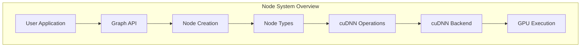
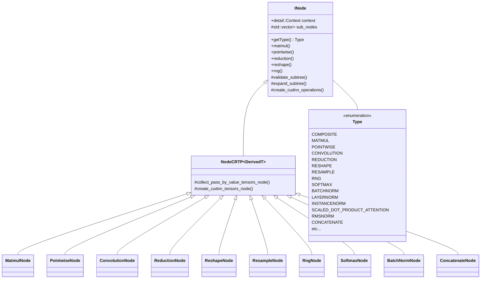
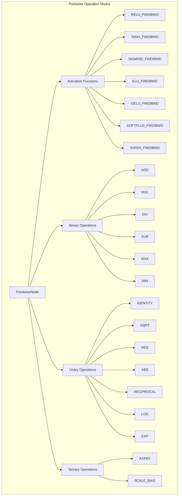
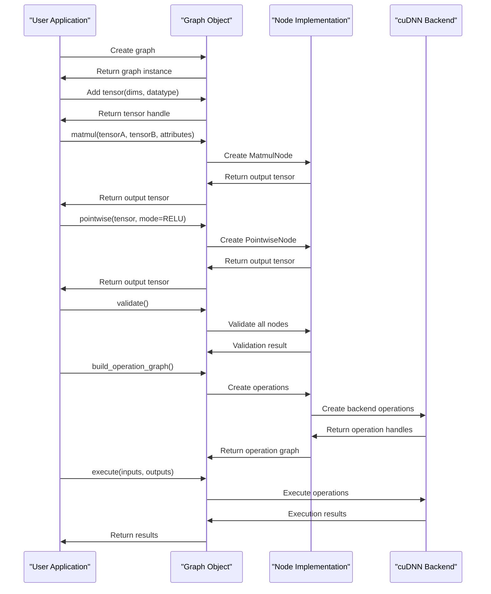
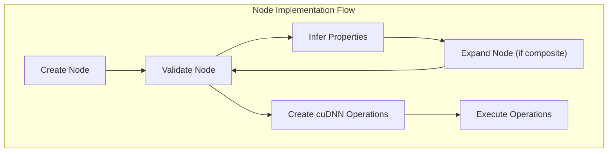
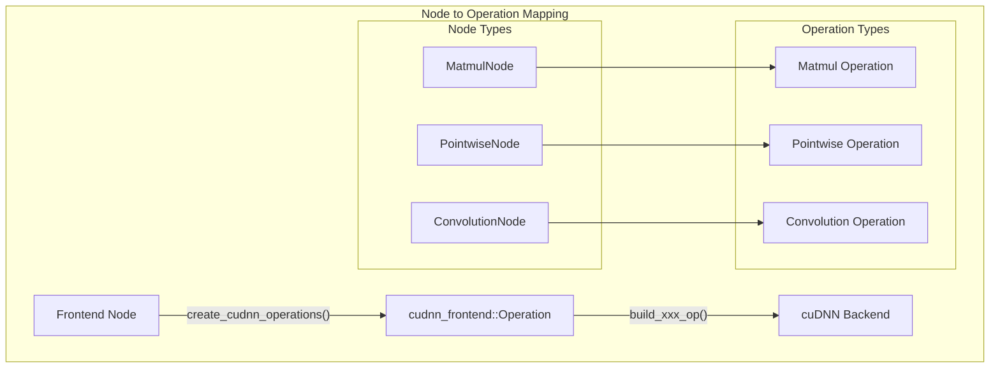

<!-- source: DeepWiki mcp.deepwiki.com · repo NVIDIA/cudnn-frontend · page 3 Node Types · fetched 2026-10-26 -->

# Node Types

<details>
<summary>Relevant source files</summary>

The following files were used as context for generating this wiki page:

- [include/cudnn_frontend/cudnn_interface.h](include/cudnn_frontend/cudnn_interface.h)
- [include/cudnn_frontend/graph_helpers.h](include/cudnn_frontend/graph_helpers.h)
- [include/cudnn_frontend/graph_interface.h](include/cudnn_frontend/graph_interface.h)
- [include/cudnn_frontend/node/sdpa_fp8_bwd.h](include/cudnn_frontend/node/sdpa_fp8_bwd.h)
- [include/cudnn_frontend/node_interface.h](include/cudnn_frontend/node_interface.h)
- [include/cudnn_frontend/utils/serialize.h](include/cudnn_frontend/utils/serialize.h)
- [include/cudnn_frontend_utils.h](include/cudnn_frontend_utils.h)
- [python/pygraph/pygraph.cpp](python/pygraph/pygraph.cpp)
- [python/pygraph/sdpa.cpp](python/pygraph/sdpa.cpp)
- [samples/cpp/convolution/fprop.cpp](samples/cpp/convolution/fprop.cpp)
- [samples/cpp/sdpa/fp16_fwd_with_custom_dropout.cpp](samples/cpp/sdpa/fp16_fwd_with_custom_dropout.cpp)
- [samples/cpp/sdpa/fp8_fwd.cpp](samples/cpp/sdpa/fp8_fwd.cpp)

</details>


This page provides a comprehensive overview of the node types available in the cuDNN Frontend library. Nodes are the fundamental building blocks of computational graphs in cuDNN Frontend, representing different operations that can be performed on tensors. For detailed information about creating and managing graphs, see [Graph System](#2.3).

## What are Nodes?

In the cuDNN Frontend library, nodes are objects that represent specific operations in a neural network computation graph. Each node type corresponds to a particular mathematical operation or data transformation that can be executed on the GPU using cuDNN's optimized kernels.



Sources: [include/cudnn_frontend/node_interface.h:39-366]()

## Node Interface Hierarchy

All node types in the cuDNN Frontend library inherit from the `INode` interface, which defines the common behavior and properties that all nodes must implement. The `NodeCRTP` template provides a Curiously Recurring Template Pattern implementation that most concrete node types use.



Sources: [include/cudnn_frontend/node_interface.h:39-366](), [include/cudnn_frontend/node_interface.h:110-139]()

## Core Node Categories

The cuDNN Frontend library provides several categories of node types to handle different kinds of operations needed in deep learning workloads.

### Basic Operation Nodes

These nodes perform fundamental mathematical operations:

| Node Type | Description | Input Tensors | Output Tensors |
|-----------|-------------|---------------|----------------|
| MatmulNode | Matrix multiplication | A, B | C |
| PointwiseNode | Element-wise operations (activation, binary ops) | IN_0, IN_1, IN_2 (optional) | OUT_0 |
| ReductionNode | Reduction operations (sum, max, etc.) | X | Y |
| ReshapeNode | Reshape tensor to different dimensions | X | Y |

Sources: [include/cudnn_frontend/node_interface.h:142-185](), [include/cudnn_frontend/utils/serialize.h:203-268]()

### Convolution Operation Nodes

Nodes for convolution operations, which are fundamental to convolutional neural networks:

| Node Type | Description | Input Tensors | Output Tensors |
|-----------|-------------|---------------|----------------|
| ConvolutionNode (fprop) | Forward convolution | X, W | Y |
| ConvolutionNode (dgrad) | Gradient w.r.t. input | W, DY | DX |
| ConvolutionNode (wgrad) | Gradient w.r.t. weights | DY, X | DW |

Sources: [include/cudnn_frontend/utils/serialize.h:79-110]()

### Normalization Operation Nodes

Nodes for various normalization techniques:

| Node Type | Description | Input Tensors | Output Tensors |
|-----------|-------------|---------------|----------------|
| BatchNormNode | Batch normalization | X, SCALE, BIAS, etc. | Y, MEAN, INV_VARIANCE, etc. |
| LayerNormNode | Layer normalization | X, SCALE, BIAS, EPSILON | Y, MEAN, INV_VARIANCE |
| InstanceNormNode | Instance normalization | X, SCALE, BIAS, EPSILON | Y, MEAN, INV_VARIANCE |
| RMSNormNode | RMS normalization | X, SCALE, BIAS, EPSILON | Y, INV_VARIANCE |

Sources: [include/cudnn_frontend/utils/serialize.h:31-201](), [include/cudnn_frontend/utils/serialize.h:270-297]()

### Attention Operation Nodes

Nodes for attention mechanisms, critical for transformer-based models:

| Node Type | Description | Input Tensors | Output Tensors |
|-----------|-------------|---------------|----------------|
| SDPANode (Scaled Dot-Product Attention) | Standard attention mechanism | Q, K, V, Attn_scale, etc. | O, Stats |
| SDPA_fp8Node | FP8 precision attention | Q, K, V, Descale_*, Scale_*, etc. | O, Stats, Amax_* |

Sources: [include/cudnn_frontend/utils/serialize.h:319-369]()

## Node Type Details

### Pointwise Nodes

Pointwise nodes perform element-wise operations on tensors. The cuDNN Frontend library supports a wide range of pointwise operations through the `PointwiseMode_t` enumeration.



Sources: [include/cudnn_frontend_PointWiseDesc.h:36-93](), [include/cudnn_frontend_PointWiseDesc.h:132-135]()

### Matmul Nodes

Matrix multiplication nodes perform one of the most fundamental operations in deep learning. The MatmulNode can be configured with various options:

| Property | Description |
|----------|-------------|
| compute_type | Precision of computation (FLOAT, HALF, etc.) |
| transA | Transpose A matrix before multiplication |
| transB | Transpose B matrix before multiplication |
| m_override, n_override, k_override | Optional overrides for matrix dimensions |

In addition to standard matrix multiplication, cuDNN Frontend also supports specialized FP8 matmul operations for improved efficiency with reduced precision.

Sources: [include/cudnn_frontend/node_interface.h:143-156](), [include/cudnn_frontend/utils/serialize.h:203-233]()

### Reduction Nodes

Reduction nodes perform operations that reduce dimensionality, such as sum, max, avg, etc. The reduction operation and axes can be specified.

```mermaid
graph TD
    subgraph "Reduction Operations"
        ReductionNode["ReductionNode"] --> ReductionModes["Reduction Modes"]
        ReductionModes --> SUM["SUM"]
        ReductionModes --> MAX["MAX"]
        ReductionModes --> MIN["MIN"]
        ReductionModes --> AVG["AVG"]
        ReductionModes --> NORM1["NORM1"]
        ReductionModes --> NORM2["NORM2"]
        ReductionModes --> MUL["MUL"]
        ReductionModes --> AMAX["AMAX"]
        ReductionModes --> SUMSQ["SUMSQ"]
        
        ReductionNode --> ReduceDims["Reduce Dimensions"]
        ReduceDims --> "One Dimension"
        ReduceDims --> "Multiple Dimensions"
        ReduceDims --> "All Dimensions"
    end
```

Sources: [include/cudnn_frontend/node_interface.h:183-185](), [include/cudnn_frontend/utils/serialize.h:247-252]()

## Node Creation and Usage

Nodes in cuDNN Frontend are typically created through the Graph API, which provides a convenient interface for defining computational graphs.



Sources: [include/cudnn_frontend/node_interface.h:325-344]()

## Node Type Implementation

Each node type in the cuDNN Frontend library is implemented as a concrete class that derives from `NodeCRTP<DerivedType>`, which in turn inherits from `INode`. The node implementation handles:

1. Storing input and output tensor attributes
2. Validating node configuration
3. Inferring output properties
4. Creating the corresponding cuDNN operations



Sources: [include/cudnn_frontend/node_interface.h:217-240](), [include/cudnn_frontend/node_interface.h:304-315]()

## Type Enumeration

The node system uses a Type enumeration to categorize the various node types available in the library:

```cpp
enum class Type {
    COMPOSITE,
    BATCHNORM,
    BATCHNORM_INFERENCE,
    BN_FINALIZE,
    CONVOLUTION,
    DBN,
    DBN_WEIGHT,
    DLN,
    DIN,
    DGRAD,
    DRMSNorm,
    GENSTATS,
    LAYERNORM,
    INSTANCENORM,
    MATMUL,
    POINTWISE,
    REDUCTION,
    RESAMPLE,
    RESHAPE,
    RMSNORM,
    RNG,
    SCALED_DOT_PRODUCT_ATTENTION,
    SLICE,
    WGRAD,
    PAGED_CACHE_LOAD,
    BLOCK_SCALE_QUANTIZE,
    BLOCK_SCALE_DEQUANTIZE,
    CONCATENATE
};
```

Sources: [include/cudnn_frontend/node_interface.h:110-139]()

## Relationship Between Nodes and cuDNN Operations

Nodes in the Frontend library are abstractions over cuDNN operations. When a graph is built, each node creates one or more corresponding cuDNN operations.



Sources: [include/cudnn_frontend_Operation.h:33-201](), [include/cudnn_frontend_Operation.h:293-390](), [include/cudnn_frontend_Operation.h:392-535]()

## Summary

The Node Types system in cuDNN Frontend provides a powerful abstraction for building complex neural network computations as graphs. By representing operations as nodes, the library enables users to define, validate, and execute complex computational graphs on NVIDIA GPUs with high performance.

Each node type corresponds to a specific operation category, such as matrix multiplication, convolution, pointwise operations, or normalization. The node system handles all the details of configuring and executing these operations efficiently using the cuDNN backend.

---

