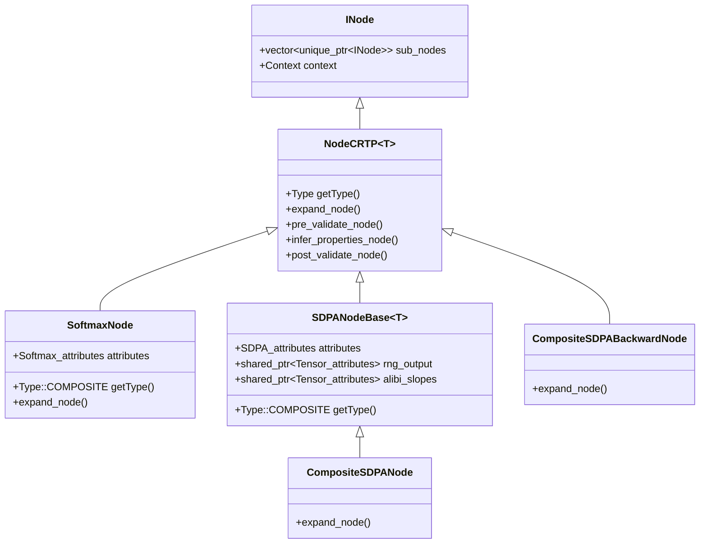
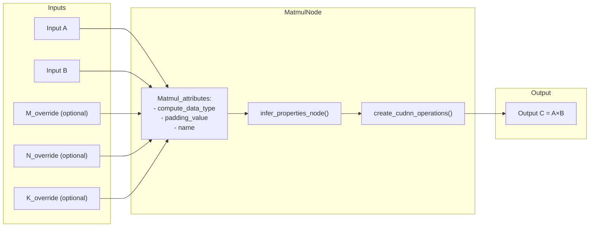
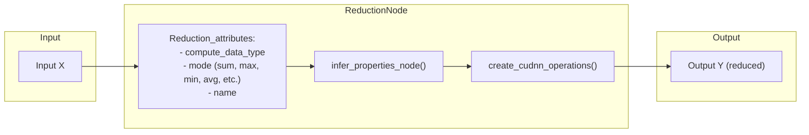
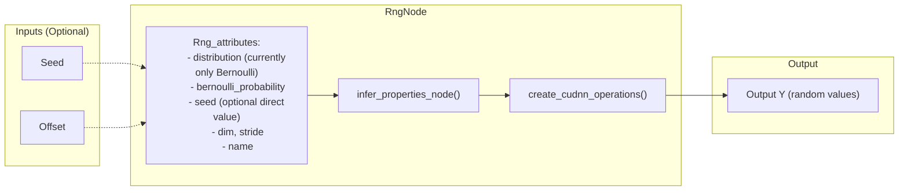
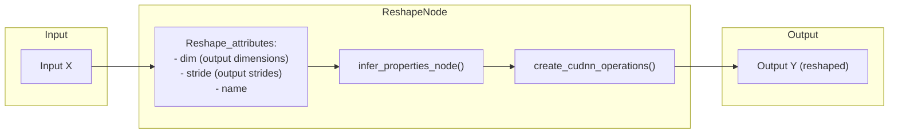
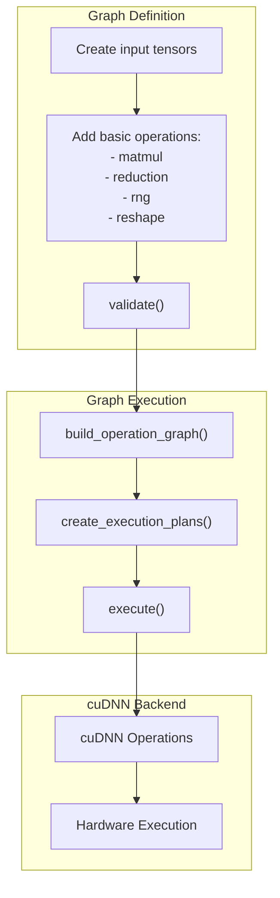

<!-- source: DeepWiki mcp.deepwiki.com · repo NVIDIA/cudnn-frontend · page 3.1 Composite Nodes · fetched 2026-10-26 -->

# Composite Nodes

<details>
<summary>Relevant source files</summary>

The following files were used as context for generating this wiki page:

- [include/cudnn_frontend/node/pointwise.h](include/cudnn_frontend/node/pointwise.h)
- [include/cudnn_frontend/node/scaled_dot_product_flash_attention.h](include/cudnn_frontend/node/scaled_dot_product_flash_attention.h)
- [include/cudnn_frontend/node/softmax.h](include/cudnn_frontend/node/softmax.h)
- [include/cudnn_frontend_version.h](include/cudnn_frontend_version.h)
- [python/cudnn/__init__.py](python/cudnn/__init__.py)
- [python/pygraph/pointwise.cpp](python/pygraph/pointwise.cpp)

</details>


This document provides technical documentation for composite nodes in the cuDNN Frontend library. Composite nodes are high-level operations that expand into multiple primitive operations during graph construction. This abstraction allows the frontend to support complex operations (like Flash Attention) that don't exist as single primitives in the cuDNN backend.

For information about primitive nodes, see [Primitive Nodes](#3.2). For details on specific attention implementations, see [Attention Operations](#3.5).

## Overview of Composite Nodes

Composite nodes are operations that implement complex functionality by decomposing into sequences of primitive operations. During the graph building phase, each composite node's `expand_node()` method creates a subgraph of primitive operations that implements the desired computation.

**Composite Node Architecture**



Sources: [include/cudnn_frontend/node/softmax.h:14-154](), [include/cudnn_frontend/node/scaled_dot_product_flash_attention.h:73-335](), [include/cudnn_frontend/node/scaled_dot_product_flash_attention.h:337-702](), [include/cudnn_frontend/node/scaled_dot_product_flash_attention.h:704-1836]()

Key characteristics of composite nodes:

1. **Type Identification**: Return `Type::COMPOSITE` from `getType()`
2. **Expansion**: Implement `expand_node()` to create primitive operation subgraph
3. **Validation**: Perform validation before and after expansion
4. **Property Inference**: Infer output tensor properties during expansion
5. **Sub-nodes**: Store expanded operations in the `sub_nodes` vector

## Matrix Multiplication (MatmulNode)

Matrix multiplication is a fundamental operation that computes the product of two input matrices.

### MatmulNode Structure and Flow



Sources: [include/cudnn_frontend/node/matmul.h:12-140]()

### Key Components

- **Inputs**:
  - `A`: First input matrix tensor
  - `B`: Second input matrix tensor
  - Optional dimension override tensors: `M_override`, `N_override`, `K_override`
  
- **Outputs**:
  - `C`: Result matrix tensor (C = A × B)
  
- **Attributes**:
  - `compute_data_type`: Data type used for computations
  - `padding_value`: Value used for padding
  - `name`: Name identifier for the node

### Property Inference

The `infer_properties_node()` method automatically determines the output dimensions:
- Output M dimension is taken from the M dimension of A
- Output N dimension is taken from the N dimension of B
- Batch dimensions are broadcast
- Default stride ordering is generated if not specified

Sources: [include/cudnn_frontend/node/matmul.h:24-63]()

### Usage

MatmulNode can be created through the `INode` interface using either of these methods:

```
// Method 1: Pass pre-created output tensor
void INode::matmul(std::shared_ptr<Tensor_attributes> a,
                  std::shared_ptr<Tensor_attributes> b,
                  Matmul_attributes attributes,
                  std::shared_ptr<Tensor_attributes> c);

// Method 2: Auto-create output tensor
std::shared_ptr<Tensor_attributes> INode::matmul(
    std::shared_ptr<Tensor_attributes> a,
    std::shared_ptr<Tensor_attributes> b,
    Matmul_attributes attributes);
```

Sources: [include/cudnn_frontend/node/matmul.h:142-197]()

## Reduction Operations (ReductionNode)

Reduction operations compute aggregate values (like sum, max, min, avg) across dimensions of input tensors.

### ReductionNode Structure and Flow



Sources: [include/cudnn_frontend/node/reduction.h:11-106]()

### Key Components

- **Input**:
  - `X`: Input tensor to be reduced
  
- **Output**:
  - `Y`: Output tensor containing reduction result
  
- **Attributes**:
  - `compute_data_type`: Data type for computation
  - `mode`: Reduction operation (sum, max, min, avg)
  - `name`: Name identifier for the node

### Property Inference

The `infer_properties_node()` method sets the output tensor properties:
- By default, output dimensions match input dimensions
- Default stride ordering is NHWC when not specified

Sources: [include/cudnn_frontend/node/reduction.h:23-47]()

### Usage

ReductionNode can be created through the `INode` interface:

```
// Method 1: Pass pre-created output tensor
void INode::reduction(std::shared_ptr<Tensor_attributes> a,
                     Reduction_attributes attributes,
                     std::shared_ptr<Tensor_attributes> c);

// Method 2: Auto-create output tensor
std::shared_ptr<Tensor_attributes> INode::reduction(
    std::shared_ptr<Tensor_attributes> input, 
    Reduction_attributes attributes);
```

Sources: [include/cudnn_frontend/node/reduction.h:108-124]()

## Random Number Generation (RngNode)

RngNode generates random values according to a specified probability distribution.

### RngNode Structure and Flow



Sources: [include/cudnn_frontend/node/rng.h:11-123]()

### Key Components

- **Inputs** (Optional - either use tensor inputs or direct seed value):
  - `Seed`: Tensor containing seed value
  - `Offset`: Tensor containing offset value

- **Output**:
  - `Y`: Tensor with generated random values

- **Attributes**:
  - `distribution`: Type of distribution (currently only Bernoulli is supported)
  - `bernoulli_probability`: For Bernoulli distribution, the probability of 1s
  - `seed`: Direct seed value (alternative to tensor input)
  - `dim`: Output dimensions (when not specified in output tensor)
  - `stride`: Output strides (when not specified in output tensor)
  - `name`: Name identifier for the node

### Property Inference

The `infer_properties_node()` method determines output tensor properties:
- Uses dimensions from attributes if not set in output tensor
- Uses strides from attributes or generates default NHWC strides

Sources: [include/cudnn_frontend/node/rng.h:23-55]()

### Usage

RngNode can be created through the `INode` interface:

```
// Method 1: Pass pre-created output tensor
void INode::rng(std::shared_ptr<Tensor_attributes> seed,
               std::shared_ptr<Tensor_attributes> offset,
               Rng_attributes attributes,
               std::shared_ptr<Tensor_attributes> y);

// Method 2: Auto-create output tensor
std::shared_ptr<Tensor_attributes> INode::rng(
    std::shared_ptr<Tensor_attributes> seed,
    std::shared_ptr<Tensor_attributes> offset,
    Rng_attributes attributes);
```

Sources: [include/cudnn_frontend/node/rng.h:125-146]()

## Reshape Operations (ReshapeNode)

ReshapeNode transforms an input tensor into a different shape without changing the data.

### ReshapeNode Structure and Flow



Sources: [include/cudnn_frontend/node/reshape.h:10-106]()

### Key Components

- **Input**:
  - `X`: Input tensor to be reshaped
  
- **Output**:
  - `Y`: Reshaped output tensor
  
- **Attributes**:
  - `dim`: Target dimensions for the output tensor
  - `stride`: Target strides for the output tensor
  - `name`: Name identifier for the node

### Property Inference

The `infer_properties_node()` method sets the output tensor properties:
- Uses dimensions from attributes if not set in output tensor
- Uses strides from attributes or generates default NHWC strides

Sources: [include/cudnn_frontend/node/reshape.h:22-54]()

### Usage

ReshapeNode can be created through the `INode` interface:

```
// Auto-create output tensor
std::shared_ptr<Tensor_attributes> INode::reshape(
    std::shared_ptr<Tensor_attributes> input,
    Reshape_attributes attributes);
```

Sources: [include/cudnn_frontend/node/reshape.h:108-115]()

## Basic Operations Within Graph Execution Context

When building neural network models with cuDNN Frontend, basic operations are typically used as part of a larger computational graph. The following diagram illustrates how basic operations fit into the graph execution flow:



Sources: [include/cudnn_frontend/node/matmul.h:142-197](), [include/cudnn_frontend/node/reduction.h:108-124](), [include/cudnn_frontend/node/rng.h:125-146](), [include/cudnn_frontend/node/reshape.h:108-115]()

## Operation Creation Process

All basic operations follow a similar pattern for creating the corresponding cuDNN backend operations:

1. Build operation-specific descriptor (e.g., MatMulDesc, ReductionDesc, RngDesc)
2. Create operation builder with appropriate descriptor type
3. Set input and output tensor descriptors
4. Set operation-specific parameters
5. Build the operation
6. Add the operation to the operation collection

This standardized process makes it easy to understand and extend the basic operations available in the cuDNN Frontend library.

---

