<!-- source: DeepWiki mcp.deepwiki.com · repo NVIDIA/cudnn-frontend · page 3.2 Primitive Nodes · fetched 2026-10-26 -->

# Primitive Nodes

<details>
<summary>Relevant source files</summary>

The following files were used as context for generating this wiki page:

- [include/cudnn_frontend/node/matmul.h](include/cudnn_frontend/node/matmul.h)
- [include/cudnn_frontend/node/pointwise.h](include/cudnn_frontend/node/pointwise.h)
- [include/cudnn_frontend/node/reduction.h](include/cudnn_frontend/node/reduction.h)
- [include/cudnn_frontend/node/reshape.h](include/cudnn_frontend/node/reshape.h)
- [include/cudnn_frontend/node/rng.h](include/cudnn_frontend/node/rng.h)
- [include/cudnn_frontend/node/softmax.h](include/cudnn_frontend/node/softmax.h)
- [python/pygraph/pointwise.cpp](python/pygraph/pointwise.cpp)

</details>


This page documents primitive nodes in the cudnn-frontend library. Primitive nodes are operations that map directly to cuDNN backend operations without requiring expansion into multiple sub-operations. For composite nodes that expand into sequences of primitive operations, see [Composite Nodes](#3.1). For specialized operation types like convolution and normalization, see [Convolution Operations](#3.3) and [Normalization Operations](#3.4).

## Overview

Primitive nodes implement the `NodeCRTP<T>` pattern and directly create cuDNN backend descriptors during the `create_cudnn_operations` phase. Unlike composite nodes, they do not have an `expand_node` method and their `getType()` returns a non-COMPOSITE type.

The five core primitive node types are:

| Node Type | Purpose | Backend Descriptor Type |
|-----------|---------|------------------------|
| `PointwiseNode` | Element-wise operations (add, mul, activations) | `OPERATION_POINTWISE_DESCRIPTOR` |
| `ReductionNode` | Reduction operations (sum, max, min) | `OPERATION_REDUCTION_DESCRIPTOR` |
| `MatmulNode` | Matrix multiplication | `OPERATION_MATMUL_DESCRIPTOR` |
| `ReshapeNode` | Tensor reshaping | `OPERATION_RESHAPE_DESCRIPTOR` |
| `RngNode` | Random number generation | `OPERATION_RNG_DESCRIPTOR` |

**Sources:** [include/cudnn_frontend/node/pointwise.h:12-23](), [include/cudnn_frontend/node/reduction.h:11-21](), [include/cudnn_frontend/node/matmul.h:12-22](), [include/cudnn_frontend/node/reshape.h:10-20](), [include/cudnn_frontend/node/rng.h:11-21]()

## Node Lifecycle

All primitive nodes follow a common lifecycle during graph construction and execution:

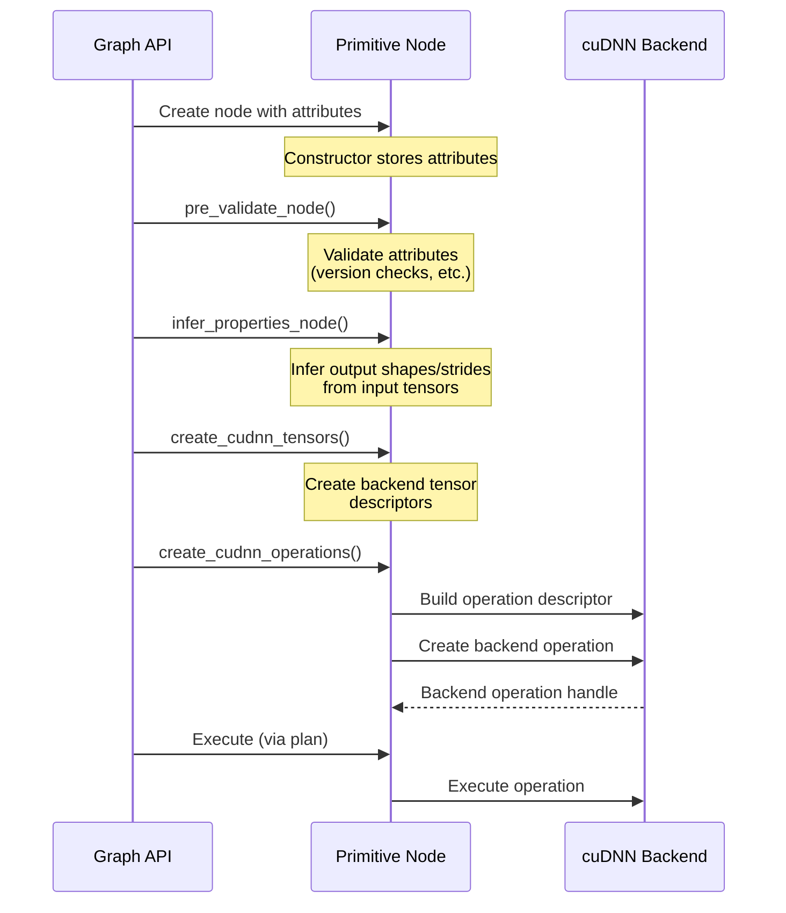

**Sources:** [include/cudnn_frontend/node/pointwise.h:24-73](), [include/cudnn_frontend/node/reduction.h:24-57]()

## PointwiseNode

The `PointwiseNode` performs element-wise operations on tensors, supporting broadcasting for inputs with different shapes. It is the most versatile primitive node with support for mathematical operations, activations, and comparisons.

### Architecture

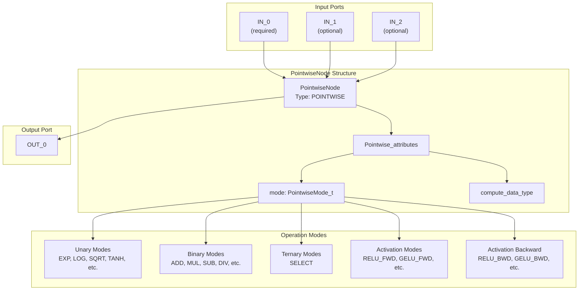

**Sources:** [include/cudnn_frontend/node/pointwise.h:12-183]()

### Port Count and Mode Mapping

The number of required input ports depends on the `PointwiseMode_t`:

| Mode Category | Input Ports | Example Modes |
|--------------|-------------|---------------|
| Unary | 1 (IN_0) | `EXP`, `LOG`, `SQRT`, `TANH_FWD`, `RELU_FWD` |
| Binary | 2 (IN_0, IN_1) | `ADD`, `MUL`, `SUB`, `DIV`, `MAX`, `MIN` |
| Ternary | 3 (IN_0, IN_1, IN_2) | `SELECT` |
| Activation Backward | 2 (IN_0=dy, IN_1=x) | `RELU_BWD`, `TANH_BWD`, `GELU_BWD` |

**Sources:** [include/cudnn_frontend/node/pointwise.h:118-149]()

### Property Inference

The `infer_properties_node` method implements broadcasting logic:

1. Collects input shapes from all non-null input tensors
2. Computes broadcast output shape using `detail::compute_broadcast_shape`
3. Infers output strides from matching input dimension or generates default strides

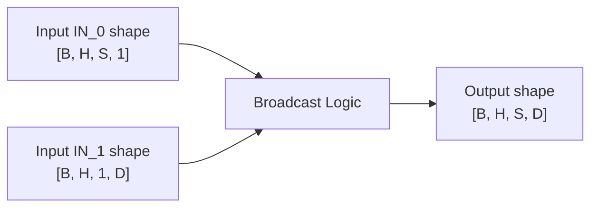

**Sources:** [include/cudnn_frontend/node/pointwise.h:25-73]()

### Backend Operation Creation

The `create_cudnn_operations` method:

1. Creates `PointwiseDescBuilder` with mode and compute type
2. Sets optional attributes (axis, relu clips, swish beta, etc.)
3. Maps input/output ports to backend tensor UIDs
4. Builds `OPERATION_POINTWISE_DESCRIPTOR`

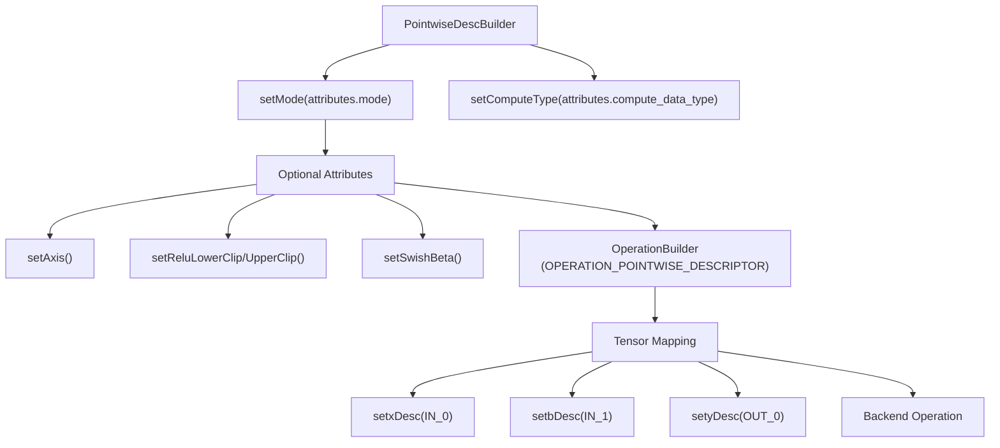

**Sources:** [include/cudnn_frontend/node/pointwise.h:76-174]()

### Python Bindings

The Python interface provides convenient wrappers for common pointwise operations:

| Python Function | Underlying Mode | Arity |
|----------------|-----------------|-------|
| `add(a, b)` | `PointwiseMode_t::ADD` | Binary |
| `mul(a, b)` | `PointwiseMode_t::MUL` | Binary |
| `relu(input)` | `PointwiseMode_t::RELU_FWD` | Unary |
| `gelu(input)` | `PointwiseMode_t::GELU_FWD` | Unary |
| `exp(input)` | `PointwiseMode_t::EXP` | Unary |
| `log(input)` | `PointwiseMode_t::LOG` | Unary |

**Sources:** [python/pygraph/pointwise.cpp:15-52](), [python/pygraph/pointwise.cpp:180-788]()

## ReductionNode

The `ReductionNode` performs reduction operations along tensor dimensions, such as sum, max, or min. It preserves tensor rank by reducing dimensions to size 1.

### Node Structure

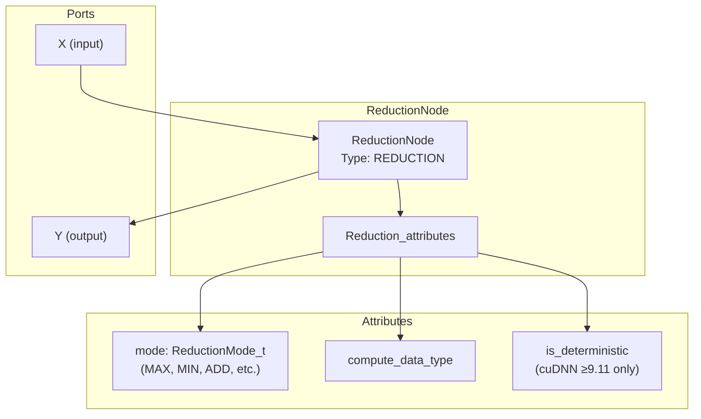

**Sources:** [include/cudnn_frontend/node/reduction.h:11-136]()

### Reduction Modes

Available reduction modes:

| Mode | Operation | Example |
|------|-----------|---------|
| `ReductionMode_t::ADD` | Sum reduction | `sum([1,2,3]) = 6` |
| `ReductionMode_t::MAX` | Maximum value | `max([1,2,3]) = 3` |
| `ReductionMode_t::MIN` | Minimum value | `min([1,2,3]) = 1` |
| `ReductionMode_t::MUL` | Product reduction | `prod([1,2,3]) = 6` |

**Sources:** [include/cudnn_frontend/node/reduction.h:68-72]()

### Property Inference

Reduction nodes copy input dimensions to output by default. Applications typically create virtual intermediate tensors for reductions:

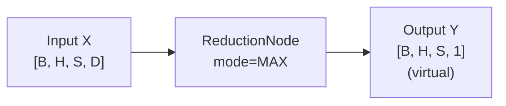

**Sources:** [include/cudnn_frontend/node/reduction.h:34-56]()

### Version Constraints

The `pre_validate_node` method checks for deterministic mode support:

- `is_deterministic` requires cuDNN version ≥ 9.11.0
- Version check performed via `detail::get_backend_version()`

**Sources:** [include/cudnn_frontend/node/reduction.h:24-31]()

### Backend Operation Creation

Creates `ReductionDescBuilder` and `CUDNN_BACKEND_OPERATION_REDUCTION_DESCRIPTOR`:

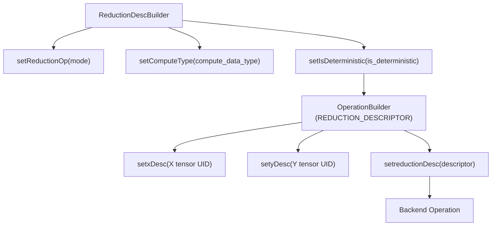

**Sources:** [include/cudnn_frontend/node/reduction.h:60-108]()

## MatmulNode

The `MatmulNode` performs matrix multiplication with support for batched operations and dimension overrides.

### Node Structure

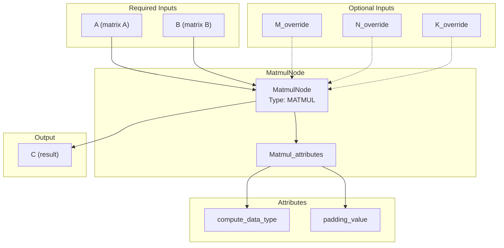

**Sources:** [include/cudnn_frontend/node/matmul.h:12-199]()

### Dimension Inference

The `infer_properties_node` computes output dimensions from inputs A and B:

1. Extract M from A's last-2 dimension
2. Extract N from B's last-1 dimension
3. Broadcast batch dimensions (all dimensions except last 2)

Example:
- A shape: `[4, 128, 512]` (batch=4, M=128, K=512)
- B shape: `[4, 512, 256]` (batch=4, K=512, N=256)
- C shape: `[4, 128, 256]` (batch=4, M=128, N=256)

**Sources:** [include/cudnn_frontend/node/matmul.h:25-63]()

### Override Tensors

The `M_override`, `N_override`, and `K_override` inputs support dynamic dimension overriding for variable-length sequences. These are typically pass-by-value scalar tensors.

**Sources:** [include/cudnn_frontend/node/matmul.h:93-106]()

### Backend Operation Creation

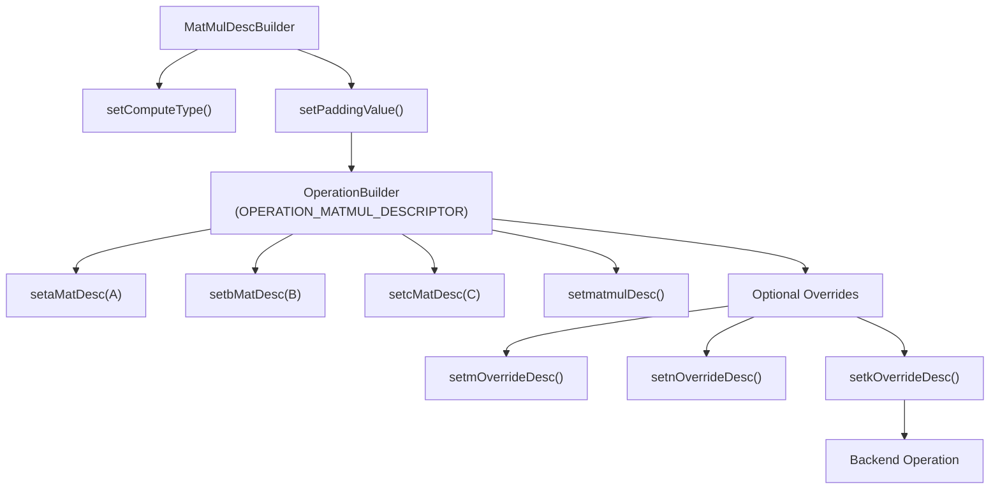

**Sources:** [include/cudnn_frontend/node/matmul.h:66-131]()

## ReshapeNode

The `ReshapeNode` changes tensor dimensions without modifying data. It is a lightweight operation that reinterprets tensor shape and stride.

### Node Structure

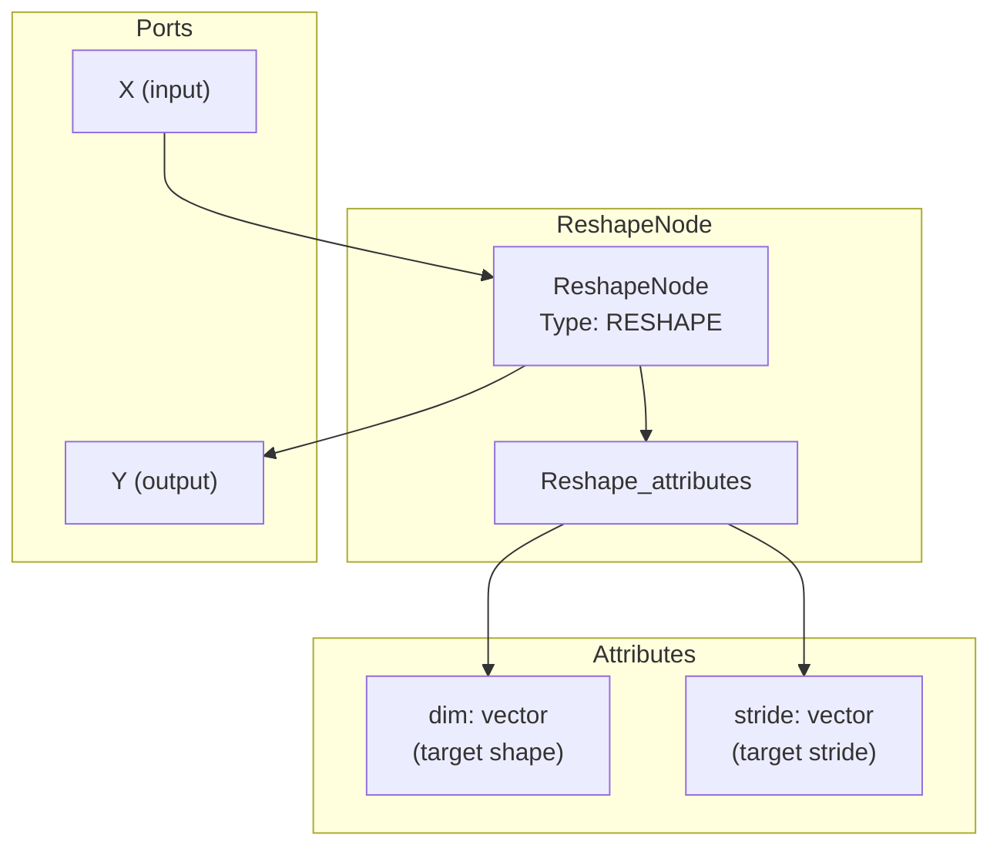

**Sources:** [include/cudnn_frontend/node/reshape.h:10-117]()

### Property Inference

The node infers output shape from attributes if not explicitly set:

1. If `y_tensor->get_dim()` is empty, copy from `attributes.dim`
2. If `y_tensor->get_stride()` is empty, copy from `attributes.stride` or generate default NHWC strides
3. Error if both remain empty after inference

**Sources:** [include/cudnn_frontend/node/reshape.h:23-54]()

### Backend Operation Creation

Creates a simple `OPERATION_RESHAPE_DESCRIPTOR`:

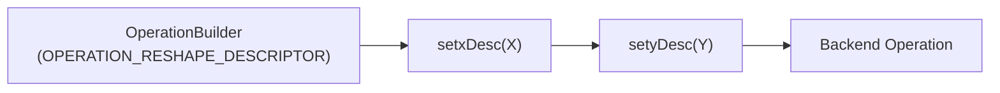

**Sources:** [include/cudnn_frontend/node/reshape.h:57-97]()

## RngNode

The `RngNode` generates random numbers on the GPU. Currently supports only Bernoulli distribution for dropout operations.

### Node Structure

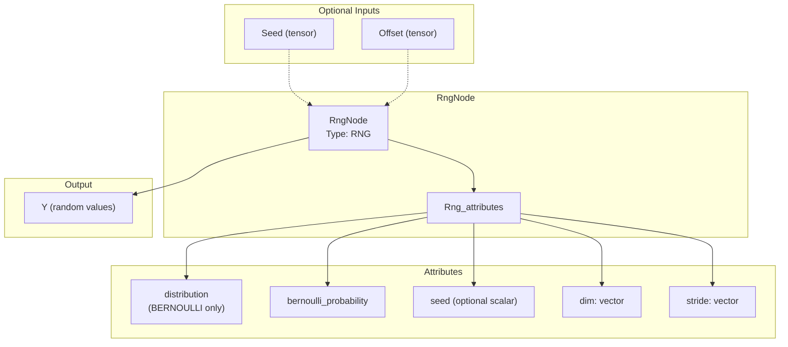

**Sources:** [include/cudnn_frontend/node/rng.h:11-147]()

### Seed Modes

The RngNode supports two seeding modes:

| Mode | Inputs | Use Case |
|------|--------|----------|
| Scalar seed | `attributes.seed` value | Simple deterministic dropout |
| Tensor seed | `Seed` and `Offset` tensors | Advanced seed management |

**Sources:** [include/cudnn_frontend/node/rng.h:82-90]()

### Property Inference

Output shape inference follows this priority:

1. User-provided `y_tensor->get_dim()`
2. `attributes.dim` from node attributes
3. Error if neither is set

**Sources:** [include/cudnn_frontend/node/rng.h:24-55]()

### Backend Operation Creation

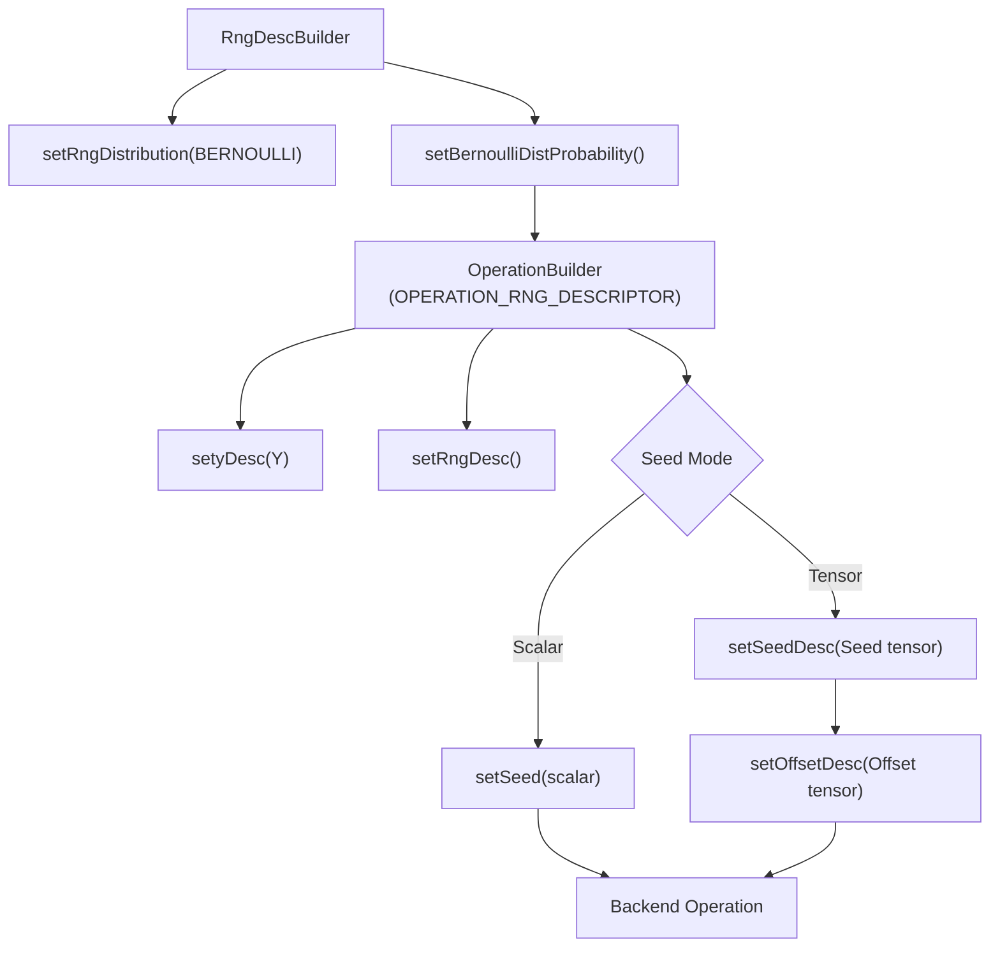

**Sources:** [include/cudnn_frontend/node/rng.h:58-114]()

## Primitive Node Comparison

The following table summarizes key characteristics of each primitive node type:

| Feature | PointwiseNode | ReductionNode | MatmulNode | ReshapeNode | RngNode |
|---------|--------------|---------------|------------|-------------|---------|
| **Type enum** | `POINTWISE` | `REDUCTION` | `MATMUL` | `RESHAPE` | `RNG` |
| **Min cuDNN version** | 8.0 | 8.0 (9.11 for deterministic) | 8.0 | 8.0 | 8.0 |
| **Input count** | 1-3 | 1 | 2-5 | 1 | 0-2 |
| **Output count** | 1 | 1 | 1 | 1 | 1 |
| **Supports broadcasting** | Yes | No | Yes (batch dims) | No | No |
| **Virtual tensor support** | Yes | Yes | Yes | Yes | Yes |
| **Common use cases** | Activations, arithmetic | Softmax internals, pooling | Attention, FC layers | Batch/sequence reshaping | Dropout masks |

**Sources:** [include/cudnn_frontend/node/pointwise.h:20-22](), [include/cudnn_frontend/node/reduction.h:18-20](), [include/cudnn_frontend/node/matmul.h:19-21](), [include/cudnn_frontend/node/reshape.h:17-19](), [include/cudnn_frontend/node/rng.h:18-20]()

## Common Patterns

### Functional-Style Creation

All primitive nodes support functional-style creation via `INode` helper methods:

```cpp
// Unary pointwise
auto output = pointwise(input, Pointwise_attributes().set_mode(PointwiseMode_t::EXP));

// Binary pointwise
auto sum = pointwise(a, b, Pointwise_attributes().set_mode(PointwiseMode_t::ADD));

// Reduction
auto max_val = reduction(input, Reduction_attributes().set_mode(ReductionMode_t::MAX));

// Matmul
auto result = matmul(a, b, Matmul_attributes());

// Reshape
auto reshaped = reshape(input, Reshape_attributes().set_dim({B, H*S, D}));

// RNG
auto dropout_mask = rng(seed, offset, Rng_attributes().set_bernoulli_probability(0.9));
```

**Sources:** [include/cudnn_frontend/node/pointwise.h:205-268](), [include/cudnn_frontend/node/reduction.h:128-135](), [include/cudnn_frontend/node/matmul.h:153-197](), [include/cudnn_frontend/node/reshape.h:108-115](), [include/cudnn_frontend/node/rng.h:136-146]()

### Non-Functional Creation

When output tensors are pre-created (e.g., for user visibility), use the non-functional overload:

```cpp
auto output = std::make_shared<Tensor_attributes>();
output->set_is_virtual(false); // User-managed

pointwise(input, Pointwise_attributes().set_mode(PointwiseMode_t::RELU_FWD), output);
```

**Sources:** [include/cudnn_frontend/node/pointwise.h:185-192]()

### Virtual vs. Physical Tensors

Primitive nodes commonly use virtual tensors for intermediate results:

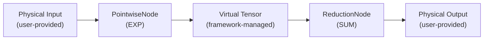

Virtual tensors are allocated from workspace and not visible to users.

**Sources:** [include/cudnn_frontend/node/softmax.h:50-54](), [include/cudnn_frontend/node/softmax.h:87-91]()

---

