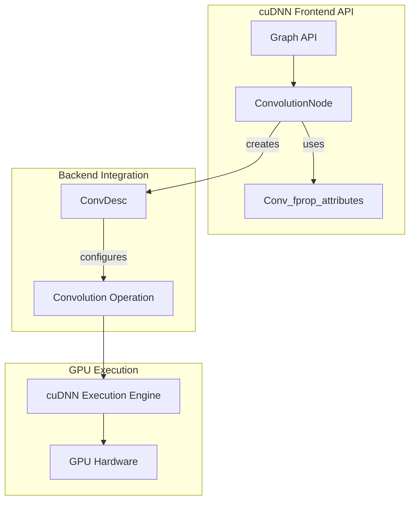
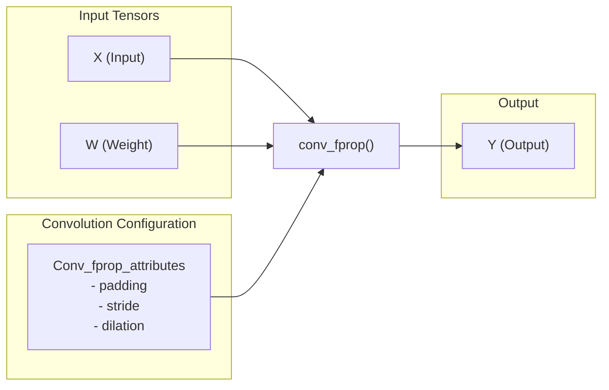
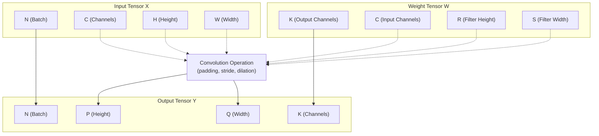
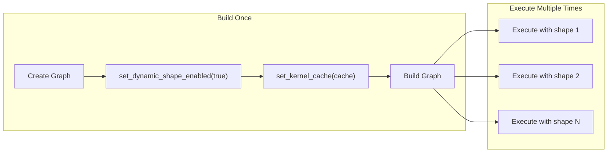
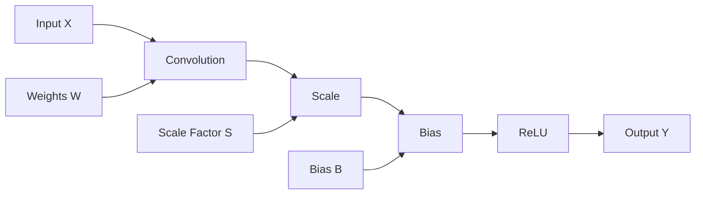
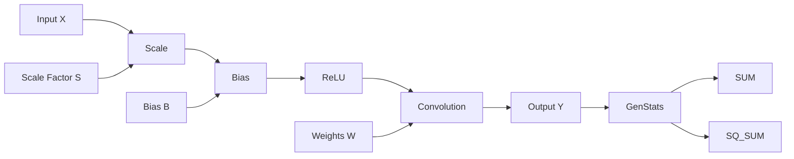
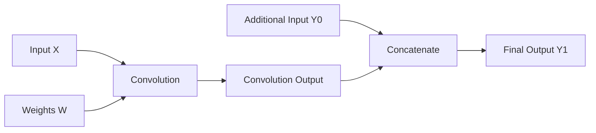
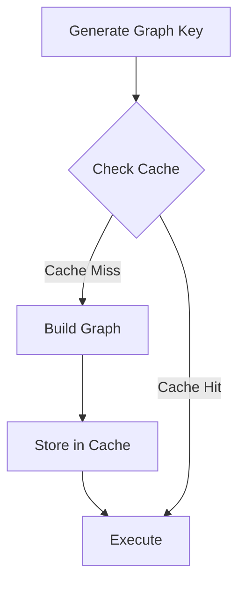

<!-- source: DeepWiki mcp.deepwiki.com · repo NVIDIA/cudnn-frontend · page 3.3 Convolution Operations · fetched 2026-10-26 -->

# Convolution Operations

<details>
<summary>Relevant source files</summary>

The following files were used as context for generating this wiki page:

- [include/cudnn_frontend/cudnn_interface.h](include/cudnn_frontend/cudnn_interface.h)
- [include/cudnn_frontend/graph_helpers.h](include/cudnn_frontend/graph_helpers.h)
- [include/cudnn_frontend/graph_interface.h](include/cudnn_frontend/graph_interface.h)
- [include/cudnn_frontend/node/sdpa_fp8_bwd.h](include/cudnn_frontend/node/sdpa_fp8_bwd.h)
- [include/cudnn_frontend_ConvDesc.h](include/cudnn_frontend_ConvDesc.h)
- [include/cudnn_frontend_OperationGraph.h](include/cudnn_frontend_OperationGraph.h)
- [include/cudnn_frontend_ReductionDesc.h](include/cudnn_frontend_ReductionDesc.h)
- [samples/cpp/convolution/fprop.cpp](samples/cpp/convolution/fprop.cpp)
- [samples/cpp/sdpa/fp16_fwd_with_custom_dropout.cpp](samples/cpp/sdpa/fp16_fwd_with_custom_dropout.cpp)
- [samples/cpp/sdpa/fp8_fwd.cpp](samples/cpp/sdpa/fp8_fwd.cpp)

</details>


## Purpose and Scope

This document covers the convolution operations available in the cuDNN Frontend library, focusing on forward (fprop), backward data (dgrad), and backward filter (wgrad) convolution operations. It explains how to configure and use these operations effectively, both standalone and in fusion with other operations. For information about basic operations like matmul and pointwise, see [Basic Operations](#3.1).

## Overview of Convolution Operations

Convolution operations are fundamental building blocks in deep neural networks, especially for computer vision applications. The cuDNN Frontend library provides a high-level interface to efficiently execute convolution operations on NVIDIA GPUs through the underlying cuDNN backend.



Sources: [include/cudnn_frontend/node/conv_fprop.h:11-151]()

## Convolution Types

The cuDNN Frontend library supports three main types of convolution operations:

| Type | Description | Primary Use Case |
|------|-------------|------------------|
| Forward (fprop) | Forward pass of convolution | Inference and training forward pass |
| Backward Data (dgrad) | Gradient with respect to input | Training backward pass |
| Backward Filter (wgrad) | Gradient with respect to weights | Training backward pass |

This document primarily focuses on forward convolution, which is the most commonly used operation, but many concepts apply to the backward operations as well.

## Creating Basic Convolution Operations

### Forward Convolution (fprop)

To create a forward convolution operation, you need to define:
1. Input tensor (X)
2. Weight tensor (W)
3. Output tensor (Y)
4. Convolution attributes (padding, stride, dilation)



Sources: [samples/cpp/convolution/fprop.cpp:37-68]()

### Example Usage

Here's an example of how to create a basic forward convolution operation using the Graph API:

1. Create a Graph object and set data types
2. Define input and weight tensors with appropriate dimensions and strides
3. Configure convolution attributes (padding, stride, dilation)
4. Create the convolution operation
5. Validate, build, and execute the graph

The code typically follows this pattern:

```
auto graph = std::make_shared<fe::graph::Graph>();
graph->set_io_data_type(fe::DataType_t::HALF).set_compute_data_type(fe::DataType_t::FLOAT);

auto X = graph->tensor(fe::graph::Tensor_attributes()
                            .set_name("image")
                            .set_dim({n, c, h, w})
                            .set_stride({c * h * w, 1, c * w, c}));

auto W = graph->tensor(fe::graph::Tensor_attributes()
                            .set_name("filter")
                            .set_dim({k, c, r, s})
                            .set_stride({c * r * s, 1, c * s, c}));

auto conv_options =
    fe::graph::Conv_fprop_attributes().set_padding({0, 0}).set_stride({1, 1}).set_dilation({1, 1});
auto Y = graph->conv_fprop(X, W, conv_options);

Y->set_output(true);
```

Sources: [samples/cpp/convolution/fprop.cpp:37-56]()

## Key Convolution Attributes

When creating a convolution operation, you need to configure several key attributes:

| Attribute | Description | Method |
|-----------|-------------|--------|
| Padding | Space added to input borders | `set_padding()`, `set_pre_padding()`, `set_post_padding()` |
| Stride | Step size for filter movement | `set_stride()` |
| Dilation | Spacing between filter elements | `set_dilation()` |
| Data Types | Precision for I/O and computation | Graph methods: `set_io_data_type()`, `set_compute_data_type()` |

Sources: [include/cudnn_frontend/node/conv_fprop.h:92-102](), [samples/cpp/convolution/fprop.cpp:50-52]()

## Tensor Dimension Handling

### Input and Output Dimensions

For 2D convolution operations:
- Input tensor X: dimensions [N, C, H, W] (batch, channels, height, width)
- Weight tensor W: dimensions [K, C, R, S] (output channels, input channels, filter height, filter width)
- Output tensor Y: dimensions [N, K, P, Q] where:
  - P = 1 + (H - dilation_h * (R - 1) - 1 + pre_padding_h + post_padding_h) / stride_h
  - Q = 1 + (W - dilation_w * (S - 1) - 1 + pre_padding_w + post_padding_w) / stride_w

For 3D convolution operations, there's an additional dimension for depth.



Sources: [include/cudnn_frontend/node/conv_fprop.h:54-72]()

### Auto-Inferring Output Dimensions

If you don't explicitly set the output tensor dimensions, the library can infer them based on the input tensor, weight tensor, and convolution attributes:

```
// Output tensor dimension inference
y_tensor_dim[0] = x_tensor_dim[0];  // N remains the same
for (size_t dim = 2; dim < x_tensor_dim.size(); ++dim) {
    y_tensor_dim[dim] = 1 + (x_tensor_dim[dim] - dilation[dim - 2] * (w_tensor_dim[dim] - 1) - 1 +
                            pre_padding[dim - 2] + post_padding[dim - 2]) /
                            stride[dim - 2];
}
y_tensor_dim[1] = w_tensor_dim[0];  // K is the number of output channels
```

Sources: [include/cudnn_frontend/node/conv_fprop.h:54-72]()

## Advanced Features

### Convolution with Dynamic Shapes

Dynamic shapes allow you to build a graph once and execute it with different tensor dimensions:



Sources: [samples/cpp/convolution/fprop.cpp:92-212]()

To enable dynamic shapes:

```
graph->set_dynamic_shape_enabled(true)
     .set_kernel_cache(kernel_cache);
```

Sources: [samples/cpp/convolution/fprop.cpp:126-129]()

### Convolution Fusion Patterns

You can fuse convolution operations with other operations to improve performance. Common fusion patterns include:

#### 1. CSBR (Convolution-Scale-Bias-Relu)



Sources: [samples/cpp/convolution/fprop.cpp:573-608]()

#### 2. SBRCS (Scale-Bias-Relu-Conv-GenStats)



Sources: [samples/cpp/convolution/fprop.cpp:456-554]()

### Epilogue Fusion with Concatenation

You can fuse a concatenation operation after convolution to efficiently combine multiple feature maps:



Sources: [samples/cpp/convolution/fprop.cpp:740-830](), [include/cudnn_frontend/node/concatenate.h:1-166]()

## Performance Optimization

### Execution Plan Caching

To avoid redundant graph building, you can cache execution plans:



Sources: [samples/cpp/convolution/fprop.cpp:231-325]()

### Large Tensor Support

For very large tensors (beyond int32_t range), the library provides support for 3D convolutions with large dimensions:

```
int64_t n = 1, c = 128, d = 128, h = 363, w = 363, k = 128, t = 3, r = 3, s = 3;
```

Sources: [samples/cpp/convolution/fprop.cpp:673-738]()

## Data Type Support

The convolution operations support various data types:

| Data Type | Description | Usage |
|-----------|-------------|-------|
| FP32 (FLOAT) | 32-bit floating point | High precision computation |
| FP16 (HALF) | 16-bit floating point | Common for I/O with FP32 computation |
| FP8 | 8-bit floating point | Low precision for certain workloads |
| INT8 | 8-bit integer | Quantized inference |

You can set different data types for I/O and computation:

```
graph->set_io_data_type(fe::DataType_t::HALF)
     .set_compute_data_type(fe::DataType_t::FLOAT);
```

Sources: [samples/cpp/convolution/fprop.cpp:39-40]()

## Summary

The cuDNN Frontend library provides a powerful and flexible interface for creating and executing convolution operations on NVIDIA GPUs. By leveraging the Graph API, you can define, configure, and execute convolution operations with various fusion patterns and optimization techniques. The library supports dynamic shapes, execution plan caching, and multiple data types to optimize performance for different use cases.

For examples of specific convolution use cases, see [Convolution Examples](#6.1).

---

