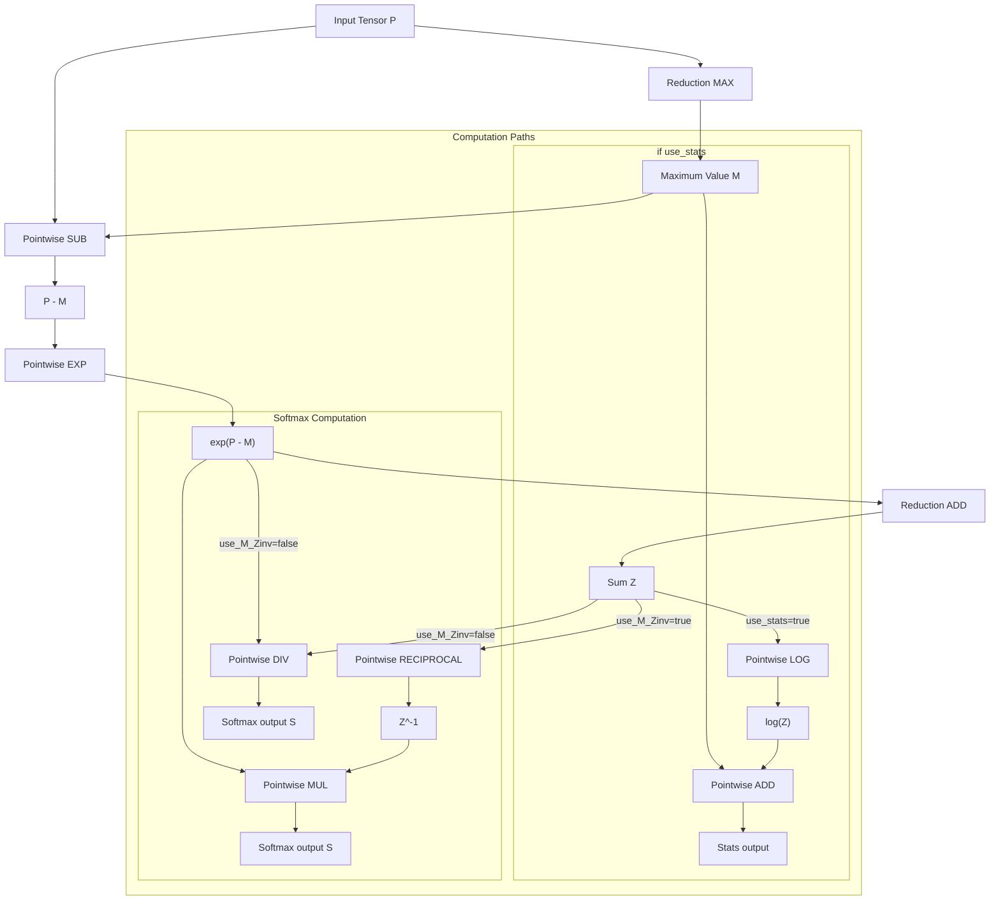
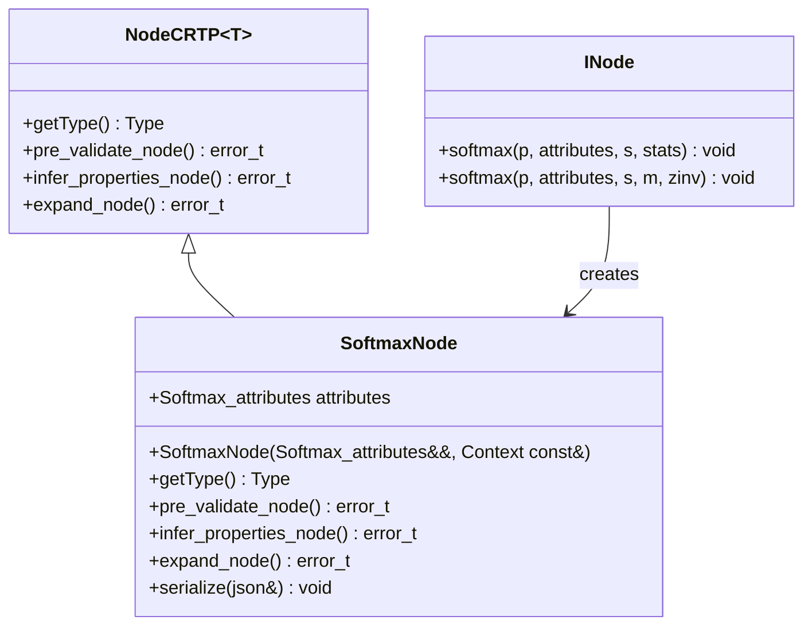

<!-- source: DeepWiki mcp.deepwiki.com · repo NVIDIA/cudnn-frontend · page 3.4 Normalization Operations · fetched 2026-10-26 -->

# Normalization Operations

<details>
<summary>Relevant source files</summary>

The following files were used as context for generating this wiki page:

- [include/cudnn_frontend/graph_properties.h](include/cudnn_frontend/graph_properties.h)
- [include/cudnn_frontend/node_interface.h](include/cudnn_frontend/node_interface.h)
- [include/cudnn_frontend/utils/serialize.h](include/cudnn_frontend/utils/serialize.h)
- [include/cudnn_frontend_utils.h](include/cudnn_frontend_utils.h)
- [python/pygraph/pygraph.cpp](python/pygraph/pygraph.cpp)
- [python/pygraph/pygraph.h](python/pygraph/pygraph.h)
- [python/pygraph/sdpa.cpp](python/pygraph/sdpa.cpp)
- [samples/cpp/CMakeLists.txt](samples/cpp/CMakeLists.txt)
- [test/python/test_matmul_bias_relu.py](test/python/test_matmul_bias_relu.py)

</details>


This document provides technical details about normalization operations in the cuDNN Frontend library, focusing on the Softmax implementation. Normalization operations are essential components in neural networks that standardize inputs or activations to improve training stability and performance.

## Supported Operations

Currently, the primary normalization operation provided by the cuDNN Frontend library is the Softmax operation. The Softmax function transforms a vector of real values into a probability distribution and is typically used in neural networks as the final activation function for classification tasks.

### Softmax Implementation Architecture

The Softmax implementation in cuDNN Frontend is a composite operation composed of several primitive operations. It doesn't directly map to a single cuDNN backend operation but instead expands into a series of pointwise and reduction operations.



Sources: [include/cudnn_frontend/node/softmax.h:45-113]()

## Class Structure

The Softmax operation is implemented through the `SoftmaxNode` class which inherits from `NodeCRTP<SoftmaxNode>`. 



Sources: [include/cudnn_frontend/node/softmax.h:14-124]()

## Configuration Options

The `SoftmaxNode` behavior is controlled through the following configuration options:

| Option | Type | Description |
|--------|------|-------------|
| `use_stats` | bool | When true, computes additional statistics (M + log(Z)) which are useful for gradient computation in backpropagation |
| `use_M_Zinv` | bool | When true, uses reciprocal and multiplication instead of division for the final step, which can be more efficient on some hardware |

These options must be set before using the Softmax node, as verified in the `pre_validate_node()` method.

Sources: [include/cudnn_frontend/node/softmax.h:27-37]()

## Implementation Details

The Softmax operation is implemented with the following mathematical steps:

1. Find the maximum value M across the input tensor P (for numerical stability)
2. Subtract M from P to get P - M
3. Compute the exponential of P - M to get exp(P - M)
4. Sum the exponential values to get Z
5. Based on the configuration:
   - If `use_stats` is true: compute log(Z) and add M to get statistics output
   - If `use_M_Zinv` is true: compute 1/Z and multiply by exp(P - M)
   - Otherwise: divide exp(P - M) by Z

This implementation ensures numerical stability by subtracting the maximum value before computing exponentials, preventing overflow issues that can occur with large input values.

Sources: [include/cudnn_frontend/node/softmax.h:45-113]()

## Usage Examples

There are two overloaded methods for creating Softmax nodes:

### 1. Standard Softmax with Statistics

```cpp
// Create input tensor
auto p = tensor("input").set_dim({batch, heads, seq_len, 1});

// Create output tensors
auto s = tensor("softmax_output");
auto stats = tensor("statistics_output");

// Create and add softmax node
auto softmax_attributes = Softmax_attributes()
    .set_name("softmax")
    .set_use_stats(true)
    .set_use_M_Zinv(false);

graph.softmax(p, softmax_attributes, s, stats);
```

Sources: [include/cudnn_frontend/node/softmax.h:126-135]()

### 2. Softmax with Maximum and Reciprocal Sum

```cpp
// Create input tensor
auto p = tensor("input").set_dim({batch, heads, seq_len, 1});

// Create output tensors
auto s = tensor("softmax_output");
auto m = tensor("max_values");
auto zinv = tensor("reciprocal_sum");

// Create and add softmax node
auto softmax_attributes = Softmax_attributes()
    .set_name("softmax")
    .set_use_stats(false)
    .set_use_M_Zinv(true);

graph.softmax(p, softmax_attributes, s, m, zinv);
```

Sources: [include/cudnn_frontend/node/softmax.h:137-148]()

## Integration with Other Operations

The Softmax operation is commonly used in:

1. Classification networks as the final activation layer
2. Attention mechanisms in transformer models
3. Sequence modeling tasks

When used in these contexts, it's often combined with other operations like convolutions, matrix multiplications, and other activation functions to form a complete neural network architecture.

## Performance Considerations

1. **Numerical Stability**: The implementation subtracts maximum values before exponentiation, ensuring numerical stability even with large inputs.

2. **Computation Options**: The `use_M_Zinv` option allows for using multiplication instead of division in the final step, which can be more efficient on some GPU architectures.

3. **Memory Usage**: The composite nature of the implementation means several intermediate tensors are created. These are typically marked as virtual tensors, allowing the cuDNN backend to optimize memory usage.

For more detailed information about:
- Basic operations that compose the Softmax implementation, see [Basic Operations](#3.1)
- Using Softmax in attention mechanisms, see [Attention Operations](#3.4)
- Building and executing computation graphs, see [Graph System](#2.3)

---

