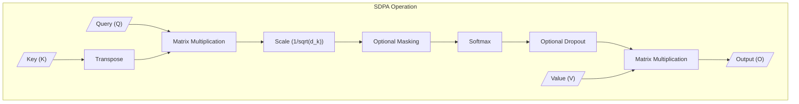
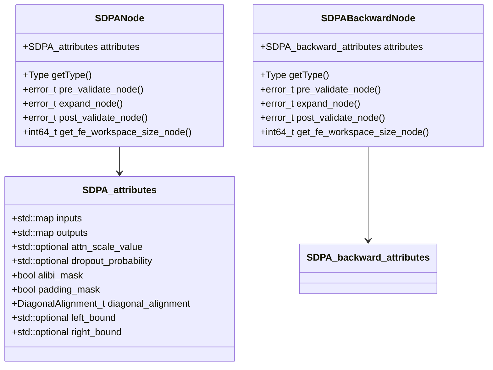
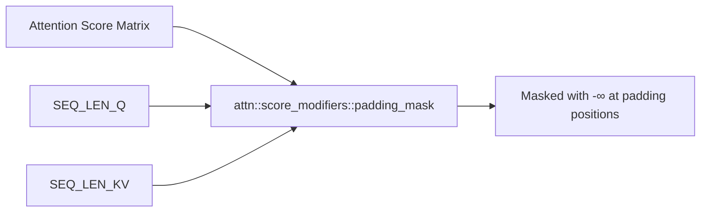
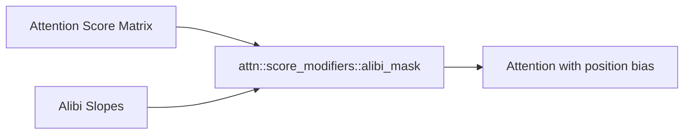
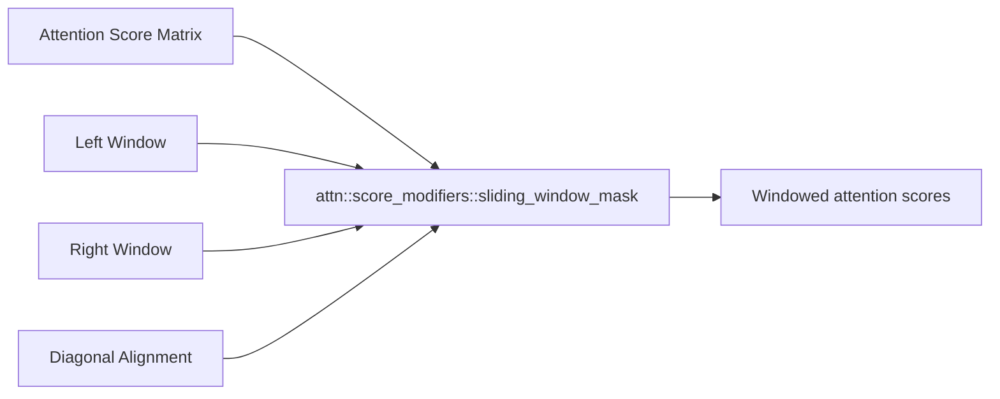
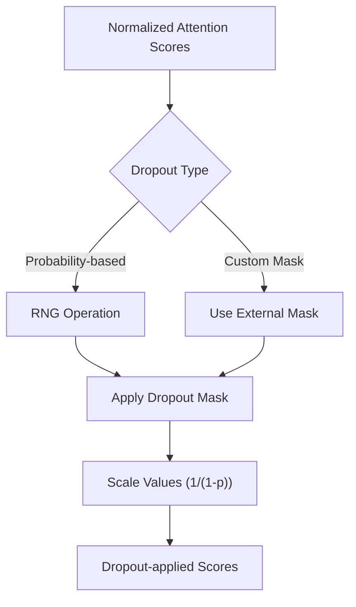
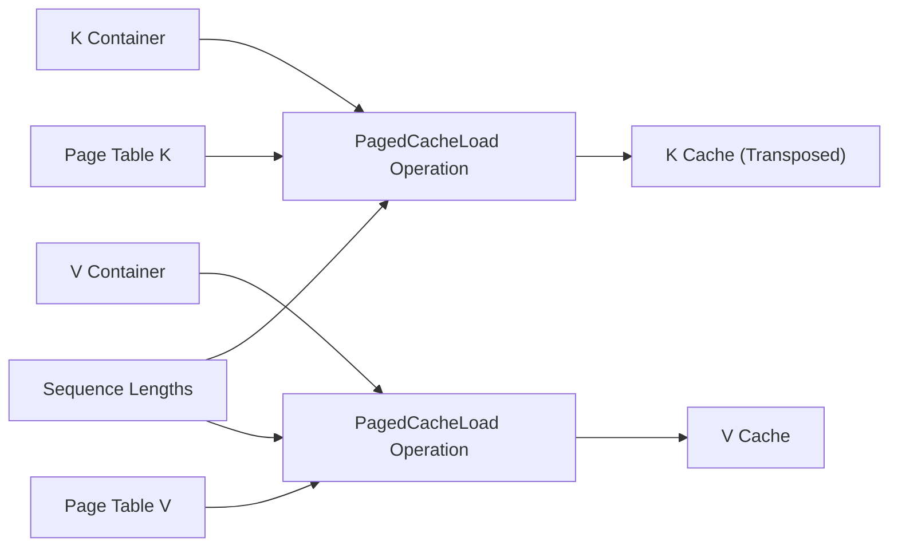
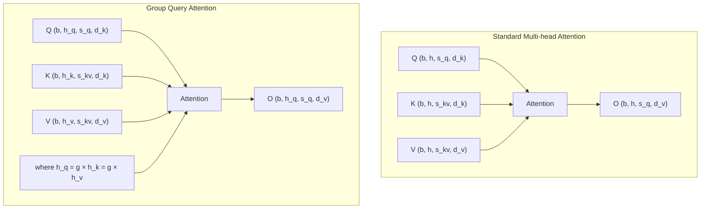
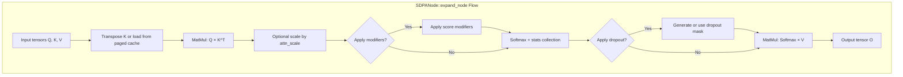
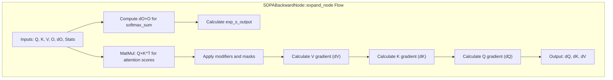

<!-- source: DeepWiki mcp.deepwiki.com · repo NVIDIA/cudnn-frontend · page 3.5 Attention Operations · fetched 2026-10-26 -->

# Attention Operations

<details>
<summary>Relevant source files</summary>

The following files were used as context for generating this wiki page:

- [include/cudnn_frontend/cudnn_interface.h](include/cudnn_frontend/cudnn_interface.h)
- [include/cudnn_frontend/graph_helpers.h](include/cudnn_frontend/graph_helpers.h)
- [include/cudnn_frontend/graph_interface.h](include/cudnn_frontend/graph_interface.h)
- [include/cudnn_frontend/node/scaled_dot_product_flash_attention.h](include/cudnn_frontend/node/scaled_dot_product_flash_attention.h)
- [include/cudnn_frontend/node/sdpa_fp8_bwd.h](include/cudnn_frontend/node/sdpa_fp8_bwd.h)
- [include/cudnn_frontend_version.h](include/cudnn_frontend_version.h)
- [python/cudnn/__init__.py](python/cudnn/__init__.py)
- [samples/cpp/convolution/fprop.cpp](samples/cpp/convolution/fprop.cpp)
- [samples/cpp/sdpa/fp16_fwd_with_custom_dropout.cpp](samples/cpp/sdpa/fp16_fwd_with_custom_dropout.cpp)
- [samples/cpp/sdpa/fp8_fwd.cpp](samples/cpp/sdpa/fp8_fwd.cpp)

</details>


This document details the attention operations available in the cuDNN Frontend library. It covers scaled dot-product attention (SDPA) implementations for both forward and backward computations, along with features like various masking techniques, dropout, paged key-value caches, and group query attention. For general information about neural network operations, see [Basic Operations](#3.1).

## Overview of Attention Mechanisms

Attention mechanisms, particularly scaled dot-product attention, are fundamental building blocks in Transformer-based architectures. The core computation follows this formula:

```
Attention(Q, K, V) = softmax(QK^T / sqrt(d_k)) × V
```

Where:
- Q: Query tensor
- K: Key tensor
- V: Value tensor
- d_k: Dimensionality of the query/key vectors

The cuDNN Frontend implements this operation through specialized classes that handle both the forward pass (for inference and training) and backward pass (for training only).



Sources: [include/cudnn_frontend/node/scaled_dot_product_flash_attention.h:56-768]()

## SDPA Implementation

The implementation consists of two main classes:

1. `SDPANode`: Handles forward computation
2. `SDPABackwardNode`: Handles backward computation for gradient calculation

### Key Components



Sources: [include/cudnn_frontend/node/scaled_dot_product_flash_attention.h:56-69](), [include/cudnn_frontend/node/scaled_dot_product_flash_attention.h:804-822]()

### Tensor Layouts

The attention operations work with 4D tensors in the following format:

| Tensor | Dimensions | Description |
|--------|------------|-------------|
| Q | [b, h_q, s_q, d_qk] | Batch size, query heads, query sequence length, embedding dimension |
| K | [b, h_k, s_kv, d_qk] | Batch size, key heads, key-value sequence length, embedding dimension |
| V | [b, h_v, s_kv, d_v] | Batch size, value heads, key-value sequence length, value dimension |
| O | [b, h_q, s_q, d_v] | Batch size, query heads, query sequence length, value dimension |
| Stats | [b, h_q, s_q, 1] | Statistics for backward pass (when training) |

Note that internally K is transposed to [b, h_k, d_qk, s_kv] for efficient matrix multiplication.

Sources: [include/cudnn_frontend/node/scaled_dot_product_flash_attention.h:457-467](), [include/cudnn_frontend/node/scaled_dot_product_flash_attention.h:474-491]()

## Masking Techniques

The SDPA implementation supports several masking techniques to control attention patterns:

### Causal Masking

Ensures tokens can only attend to previous positions, essential for autoregressive models like GPT.


Sources: [include/cudnn_frontend/node/scaled_dot_product_flash_attention.h:21]()

### Padding Masking

Used for variable-length sequences to prevent attending to padding tokens.



Sources: [include/cudnn_frontend/node/scaled_dot_product_flash_attention.h:32-35](), [include/cudnn_frontend/node/scaled_dot_product_flash_attention.h:568-576]()

### Alibi Masking

Adds position-dependent biases to attention scores based on their relative positions.



Sources: [include/cudnn_frontend/node/scaled_dot_product_flash_attention.h:48-53](), [include/cudnn_frontend/node/scaled_dot_product_flash_attention.h:562-563]()

### Sliding Window Masking

Restricts attention to a window of tokens around the current position.



Sources: [include/cudnn_frontend/node/scaled_dot_product_flash_attention.h:37-46](), [include/cudnn_frontend/node/scaled_dot_product_flash_attention.h:615-623]()

## Advanced Features

### Dropout Support

Implements dropout for regularization during training:

1. **Probability-based dropout**: Generate random mask internally based on provided probability
2. **Custom dropout mask**: Use externally provided dropout mask



Sources: [include/cudnn_frontend/node/scaled_dot_product_flash_attention.h:648-712]()

### Paged Attention (KV Cache)

Efficiently manages key-value caches during inference, particularly for long sequences or when using sampling techniques:



Sources: [include/cudnn_frontend/node/scaled_dot_product_flash_attention.h:494-508](), [include/cudnn_frontend/node/scaled_dot_product_flash_attention.h:724-740]()

### Group Query Attention (GQA)

Supports Group Query Attention where multiple query heads share the same key and value heads, reducing memory and computation requirements. This is implemented by allowing different head dimensions for Q, K, and V.



Sources: [include/cudnn_frontend/node/scaled_dot_product_flash_attention.h:240-242](), [include/cudnn_frontend/node/scaled_dot_product_flash_attention.h:1432-1473]()

## Forward Computation Details

The forward pass is implemented as a composite node that expands into a subgraph of primitive operations:



Sources: [include/cudnn_frontend/node/scaled_dot_product_flash_attention.h:445-747]()

## Backward Computation Details

The backward pass calculates gradients with respect to Q, K, and V:



Sources: [include/cudnn_frontend/node/scaled_dot_product_flash_attention.h:1074-1642]()

## Hardware and Version Considerations

The implementation includes optimizations and limitations based on:

1. **CUDA device architecture**:
   - SM 80+ (Ampere): Hidden dimensions ≤ 128 and multiples of 8
   - SM 90+ (Hopper): Hidden dimensions ≤ 256 and multiples of 8
   - Some features like THD (ragged offset) only supported on Hopper and above

2. **cuDNN backend version**:
   - Basic SDPA requires cuDNN 8.9.3+
   - Bias + padding/causal mask requires cuDNN 8.9.6+
   - Sliding window attention requires cuDNN 9.2.0+
   - Paged caches require cuDNN 9.5.0+

3. **Tensor dimension requirements**:
   - Hidden dimensions must be multiples of 8
   - Some operations require sequence lengths to be multiples of 64

Sources: [include/cudnn_frontend/node/scaled_dot_product_flash_attention.h:358-418](), [include/cudnn_frontend/node/scaled_dot_product_flash_attention.h:1001-1031]()

## Usage Example

Below is a conceptual example of how to use the SDPA operation in a cuDNN Frontend graph:

1. Create tensors with appropriate dimensions
2. Configure the SDPA attributes
3. Create the SDPA node
4. Add it to a graph
5. Execute the graph

The validation functions in the node will check compatibility with your hardware and cuDNN version, ensuring that the operation will work correctly on your system.

For specific code examples using attention operations, see [Attention Examples](#6.2).

Sources: [include/cudnn_frontend/node/scaled_dot_product_flash_attention.h:152-425]()

---

