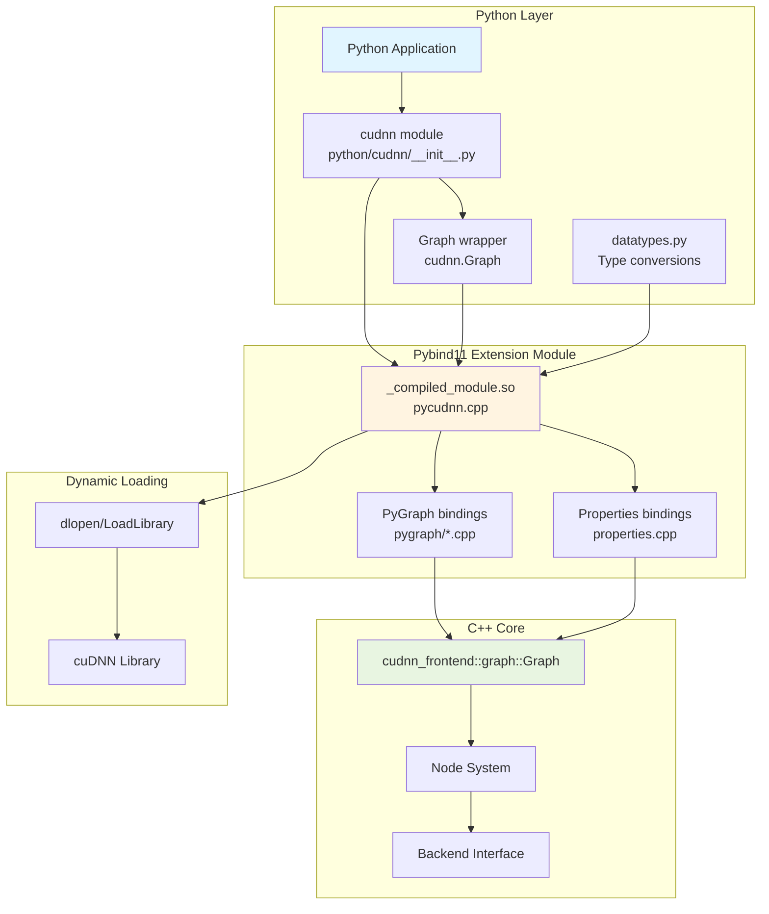
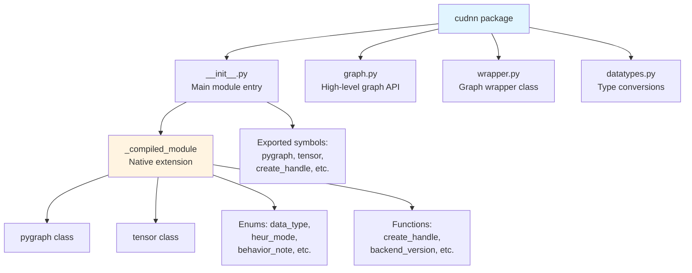
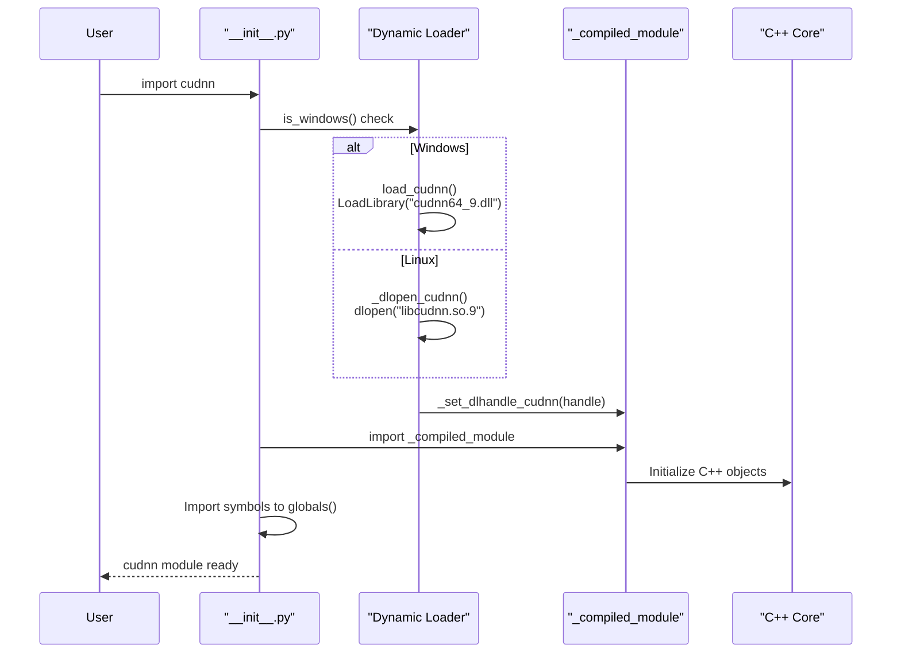
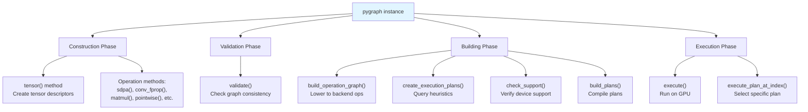
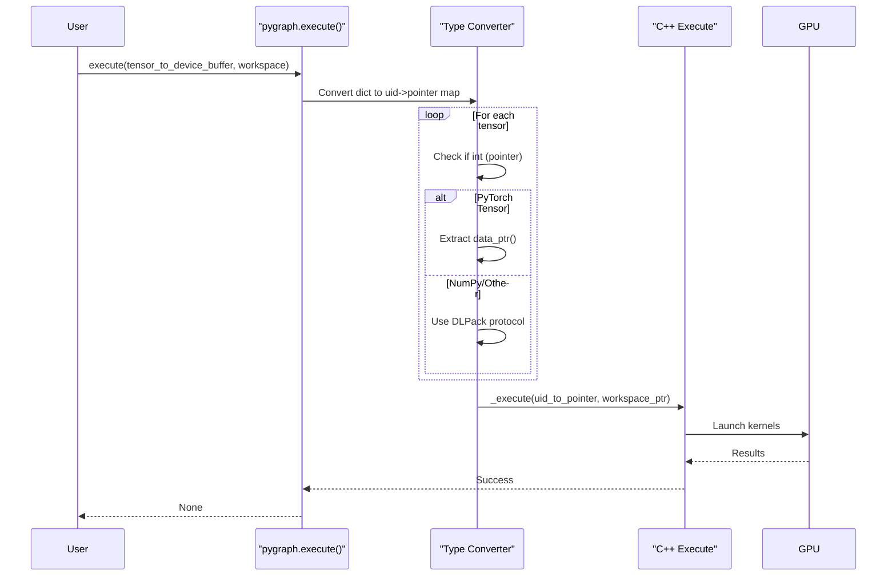
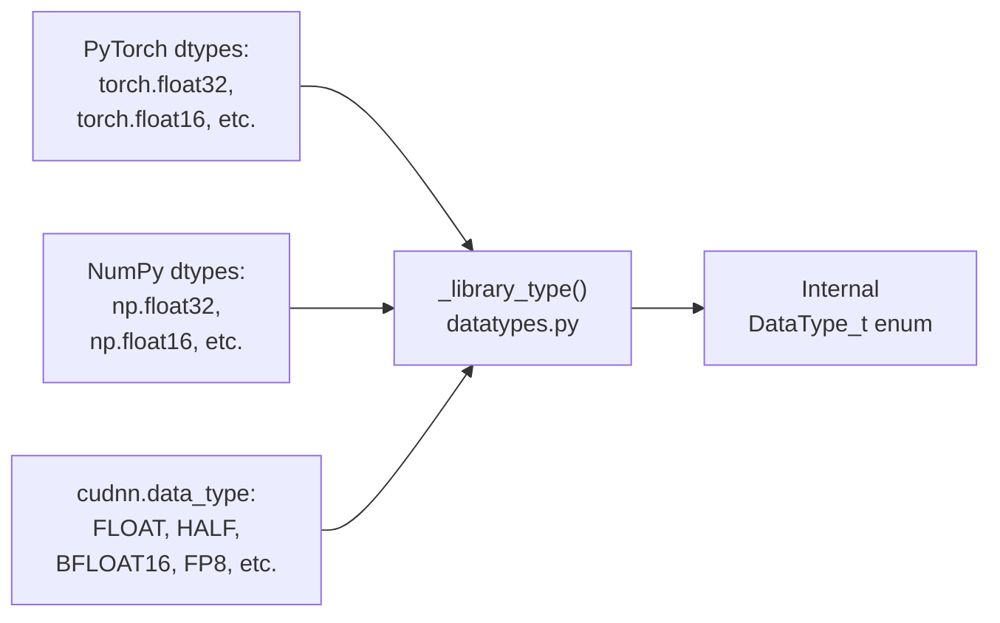
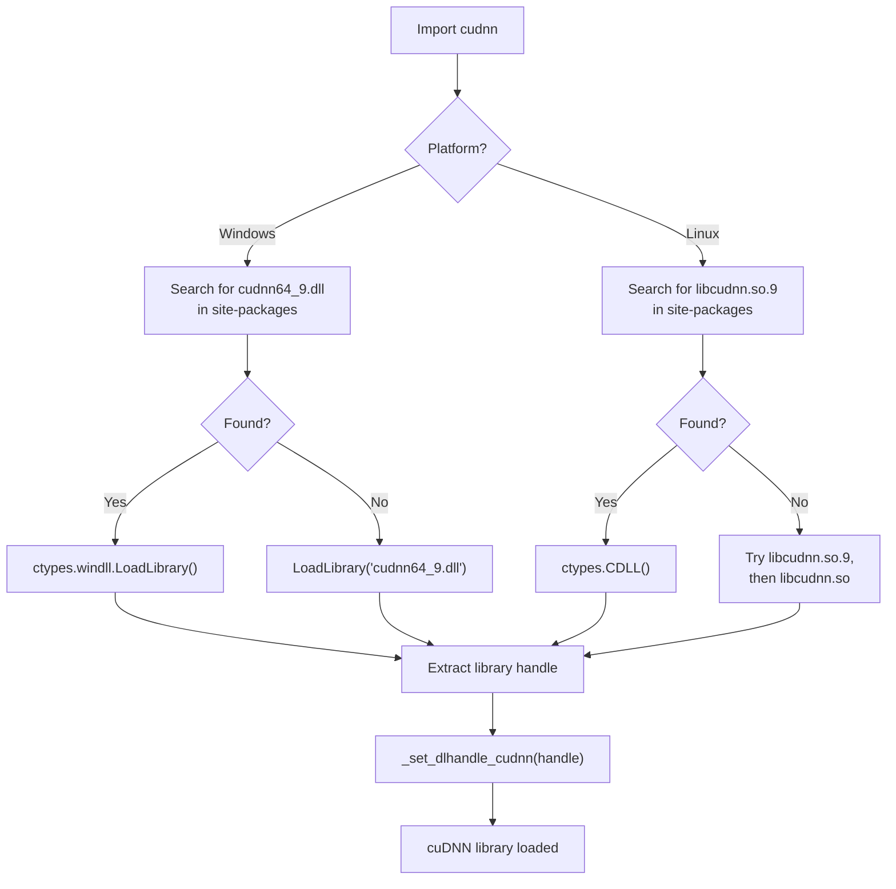
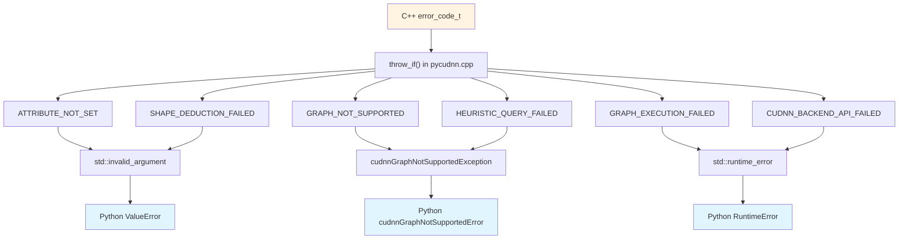
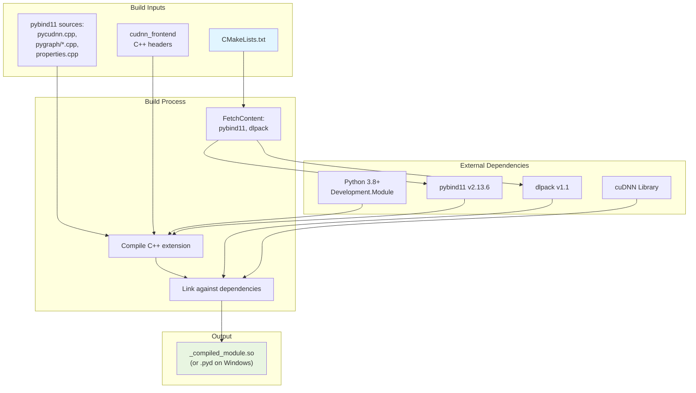
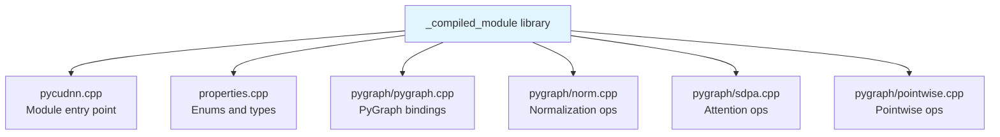

<!-- source: DeepWiki mcp.deepwiki.com · repo NVIDIA/cudnn-frontend · page 4 Python Interface · fetched 2026-10-26 -->

# Python Interface

<details>
<summary>Relevant source files</summary>

The following files were used as context for generating this wiki page:

- [dlpack_version.txt](dlpack_version.txt)
- [include/cudnn_frontend/node/moe_grouped_matmul.h](include/cudnn_frontend/node/moe_grouped_matmul.h)
- [include/cudnn_frontend/node/scaled_dot_product_flash_attention.h](include/cudnn_frontend/node/scaled_dot_product_flash_attention.h)
- [include/cudnn_frontend_version.h](include/cudnn_frontend_version.h)
- [python/CMakeLists.txt](python/CMakeLists.txt)
- [python/cudnn/__init__.py](python/cudnn/__init__.py)
- [python/pycudnn.cpp](python/pycudnn.cpp)
- [requirements.txt](requirements.txt)
- [samples/CMakeLists.txt](samples/CMakeLists.txt)

</details>


## Purpose and Scope

This page documents the Python interface to the cuDNN Frontend library, including the module structure, binding architecture, and Python-specific APIs. The Python bindings provide a Pythonic wrapper around the C++ Graph API, enabling deep learning frameworks written in Python to access cuDNN's graph-based operations.

For information about the underlying C++ Graph API that these bindings wrap, see [Graph API](#2.1). For details about building the Python package from source, see [Building Python Bindings](#4.3). For practical usage examples, see [Python Examples](#4.4).

## Architecture Overview

The Python interface is built using pybind11 to wrap the C++ Graph API. The architecture follows a layered approach where Python code delegates to compiled C++ extension modules.



**Sources:** [python/cudnn/__init__.py:1-284](), [python/pycudnn.cpp:1-97](), [python/CMakeLists.txt:1-128]()

The Python interface consists of three primary layers:

| Layer | Component | Purpose |
|-------|-----------|---------|
| Python API | `cudnn.pygraph` | Low-level direct wrapper of C++ Graph API |
| Python API | `cudnn.Graph` | High-level Pythonic wrapper with convenience methods |
| Extension Module | `_compiled_module` | pybind11-generated native extension containing C++ bindings |
| C++ Core | `cudnn_frontend::graph::Graph` | Underlying C++ implementation |

**Sources:** [python/cudnn/__init__.py:13-46](), [python/pycudnn.cpp:83-93]()

## Module Structure

The `cudnn` Python module provides access to all cuDNN Frontend functionality through a carefully organized package structure.



**Sources:** [python/cudnn/__init__.py:17-46]()

### Exported Symbols

The main `cudnn` module exports the following categories of symbols:

| Category | Symbols | Description |
|----------|---------|-------------|
| **Core Classes** | `pygraph`, `tensor`, `knob` | Primary user-facing classes |
| **Enumerations** | `data_type`, `heur_mode`, `behavior_note`, `numerical_note`, `build_plan_policy`, `tensor_reordering`, `diagonal_alignment`, `attention_implementation` | Type-safe enum classes |
| **Handle Management** | `create_handle`, `destroy_handle`, `get_stream`, `set_stream` | cuDNN handle lifecycle |
| **Device Properties** | `create_device_properties`, `create_kernel_cache` | Device and cache management |
| **Version Info** | `backend_version`, `backend_version_string` | Query cuDNN version |
| **Error Handling** | `get_last_error_string`, `cudnnGraphNotSupportedError` | Exception handling |
| **Advanced** | `norm_forward_phase`, `reduction_mode`, `knob_type` | Operation-specific types |

**Sources:** [python/cudnn/__init__.py:17-45]()

### Import Process

The module initialization follows this sequence:



**Sources:** [python/cudnn/__init__.py:9-220](), [python/pycudnn.cpp:75-81]()

## PyGraph Class

The `pygraph` class is the primary low-level interface for constructing and executing cuDNN computation graphs from Python. It directly wraps the C++ `cudnn_frontend::graph::Graph` class.

### Class Overview



**Sources:** [python/cudnn/__init__.py:36](), [python/pygraph/pygraph.cpp]()

### Tensor Creation

Tensors in Python are created through the `pygraph.tensor()` method, which is enhanced with Python-specific functionality:

| Parameter | Type | Description |
|-----------|------|-------------|
| `dim` | `List[int]` | Tensor dimensions |
| `stride` | `List[int]` | Memory strides |
| `data_type` | `cudnn.data_type` | Data type (FP32, FP16, FP8, etc.) |
| `is_virtual` | `bool` | Whether tensor is framework-managed |
| `is_pass_by_value` | `bool` | Whether tensor contains scalar constant |
| `ragged_offset` | `cudnn_tensor` | Ragged tensor offset descriptor |
| `reordering_type` | `cudnn.tensor_reordering` | Memory layout reordering |
| `name` | `str` | Human-readable name for debugging |
| `uid` | `int` | Optional unique identifier |

**Sources:** [python/cudnn/__init__.py:52-90]()

The Python wrapper automatically converts framework-specific data types:

```python
# Defined in __init__.py
def _tensor(self, dim, stride, data_type=data_type.NOT_SET, ...):
    return self._make_tensor(
        dim=dim,
        stride=stride,
        data_type=_library_type(data_type),  # Convert to internal type
        is_virtual=is_virtual,
        ...
    )
```

**Sources:** [python/cudnn/__init__.py:52-90]()

### Execution Model

The `execute()` method accepts Python tensors, NumPy arrays, or device pointers:



**Sources:** [python/cudnn/__init__.py:116-135]()

The conversion logic handles multiple tensor types:

| Input Type | Extraction Method | Source |
|------------|-------------------|--------|
| `int` | Direct use as pointer | [python/cudnn/__init__.py:106-107]() |
| PyTorch Tensor | `.data_ptr()` method | [python/cudnn/__init__.py:109-110]() |
| NumPy/DLPack | `_get_data_ptr()` via DLPack | [python/cudnn/__init__.py:112-113]() |

**Sources:** [python/cudnn/__init__.py:104-114]()

### Variant Pack

The variant pack is a Python dictionary mapping tensors (or UIDs) to device memory pointers:

```python
# User provides mapping
tensor_to_device_buffer = {
    q_tensor: q_gpu_ptr,      # Can use tensor object as key
    123: k_gpu_ptr,           # Or use UID directly
    output_tensor: output_ptr
}

# Internally converted to UID->pointer map
uid_to_tensor_pointer = {
    x if type(x) is int else x.get_uid(): _library_device_pointer(pointer)
    for x, pointer in tensor_to_device_buffer.items()
    if x is not None
}
```

**Sources:** [python/cudnn/__init__.py:127-131]()

## Graph Wrapper

The high-level `cudnn.Graph` wrapper class (distinct from `cudnn.pygraph`) provides additional Pythonic conveniences and is defined in `python/cudnn/wrapper.py`.

**Note:** The high-level `Graph` wrapper is separate from the low-level `pygraph` class. Users can choose either interface depending on their needs.

**Sources:** [python/cudnn/__init__.py:223]()

## Tensor and Data Type Management

### Type Conversion System

Python data types are automatically converted to cuDNN internal types:



**Sources:** [python/cudnn/__init__.py:47](), [python/cudnn/datatypes.py]()

### Supported Data Types

The `cudnn.data_type` enumeration includes:

| Enumeration Value | Description | Bit Width |
|-------------------|-------------|-----------|
| `FLOAT` | IEEE 754 single precision | 32 |
| `HALF` | IEEE 754 half precision | 16 |
| `BFLOAT16` | Brain floating point | 16 |
| `FP8_E4M3` | 8-bit float, 4-bit exponent, 3-bit mantissa | 8 |
| `FP8_E5M2` | 8-bit float, 5-bit exponent, 2-bit mantissa | 8 |
| `INT32` | 32-bit signed integer | 32 |
| `INT64` | 64-bit signed integer | 64 |
| `NOT_SET` | Uninitialized/inferred | - |

**Sources:** [python/cudnn/__init__.py:33]()

### DLPack Integration

The Python bindings support tensor exchange via the DLPack protocol for framework interoperability:

```python
def _library_device_pointer(input_tensor):
    # either pass in pointers directly
    if type(input_tensor) is int:
        return input_tensor
    # directly extract data pointer for torch tensors
    elif _is_torch_tensor(input_tensor):
        return input_tensor.data_ptr()
    # fall back to dlpack support by library
    else:
        return _pybind_module._get_data_ptr(input_tensor)
```

**Sources:** [python/cudnn/__init__.py:104-113]()

This enables zero-copy tensor sharing between:
- PyTorch tensors
- JAX arrays
- TensorFlow tensors
- NumPy arrays (via `__dlpack__` protocol)
- Raw device pointers (as `int`)

## Dynamic Library Loading

The Python module dynamically loads the cuDNN library at import time to avoid static linking dependencies.

### Loading Sequence



**Sources:** [python/cudnn/__init__.py:165-220]()

### Search Paths

| Platform | Primary Path | Fallback |
|----------|--------------|----------|
| **Windows** | `nvidia/cudnn/bin/cudnn64_9.dll` in site-packages | System PATH lookup for `cudnn64_9.dll` |
| **Linux** | `nvidia/cudnn/lib/libcudnn.so.*` or `nvidia/cudnn_jit/lib/libcudnn.so.*` | System library path for `libcudnn.so.9` or `libcudnn.so` |

**Sources:** [python/cudnn/__init__.py:165-220]()

### Handle Storage

The loaded library handle is stored in the C++ extension module:

```cpp
// In pycudnn.cpp
#ifdef _WIN32
HMODULE cudnn_dlhandle = nullptr;
#else
void *cudnn_dlhandle = nullptr;
#endif

void set_dlhandle_cudnn(std::intptr_t dlhandle) {
    #ifdef _WIN32
    cudnn_dlhandle = reinterpret_cast<HMODULE>(dlhandle);
    #else
    cudnn_dlhandle = reinterpret_cast<void *>(dlhandle);
    #endif
}
```

**Sources:** [python/pycudnn.cpp:14-81]()

This handle is then used by the C++ backend for dynamic symbol resolution when calling cuDNN API functions.

## Error Handling

The Python bindings implement automatic conversion of C++ exceptions to Python exceptions.

### Exception Mapping



**Sources:** [python/pycudnn.cpp:24-60]()

### Error Code Mapping Table

| C++ Error Code | C++ Exception | Python Exception |
|----------------|---------------|------------------|
| `ATTRIBUTE_NOT_SET` | `std::invalid_argument` | `ValueError` |
| `SHAPE_DEDUCTION_FAILED` | `std::invalid_argument` | `ValueError` |
| `INVALID_TENSOR_NAME` | `std::invalid_argument` | `ValueError` |
| `INVALID_VARIANT_PACK` | `std::invalid_argument` | `ValueError` |
| `GRAPH_NOT_SUPPORTED` | `cudnnGraphNotSupportedException` | `cudnnGraphNotSupportedError` |
| `HEURISTIC_QUERY_FAILED` | `cudnnGraphNotSupportedException` | `cudnnGraphNotSupportedError` |
| `GRAPH_EXECUTION_PLAN_CREATION_FAILED` | `cudnnGraphNotSupportedException` | `cudnnGraphNotSupportedError` |
| `GRAPH_EXECUTION_FAILED` | `std::runtime_error` | `RuntimeError` |
| `CUDNN_BACKEND_API_FAILED` | `std::runtime_error` | `RuntimeError` |
| `CUDA_API_FAILED` | `std::runtime_error` | `RuntimeError` |

**Sources:** [python/pycudnn.cpp:28-59]()

### Custom Exception Registration

The `cudnnGraphNotSupportedError` is registered as a custom Python exception:

```cpp
py::register_exception<cudnnGraphNotSupportedException>(m, "cudnnGraphNotSupportedError");
```

**Sources:** [python/pycudnn.cpp:92](), [python/cudnn/__init__.py:39]()

This allows Python code to catch graph-specific errors:

```python
try:
    graph.build_operation_graph(handle)
except cudnn.cudnnGraphNotSupportedError as e:
    # Handle unsupported graph configuration
    print(f"Graph not supported: {e}")
```

## Build System Integration

The Python bindings are built using CMake with pybind11 integration, producing a native extension module.

### Build Dependencies



**Sources:** [python/CMakeLists.txt:1-128](), [dlpack_version.txt:1]()

### CMake Configuration

Key configuration options:

| Option | Default | Description |
|--------|---------|-------------|
| `CUDNN_FRONTEND_USE_SYSTEM_DLPACK` | OFF | Use system dlpack instead of fetching |
| `CUDNN_FRONTEND_FETCH_PYBINDS_IN_CMAKE` | ON | Fetch pybind11 via CMake |
| `CUDNN_FRONTEND_KEEP_PYBINDS_IN_BINARY_DIR` | ON | Copy to `build/cudnn/` for testing |

**Sources:** [python/CMakeLists.txt:10-127]()

### Compilation Units

The extension module compiles the following source files:



**Sources:** [python/CMakeLists.txt:56-69]()

### Compiler Flags

| Platform | Flag | Purpose |
|----------|------|---------|
| **All** | `-std=c++20` | Require C++20 standard |
| **All** | `-DNV_CUDNN_FRONTEND_USE_DYNAMIC_LOADING` | Enable dynamic library loading |
| **MSVC** | `/wd4127 /wd4244 /wd4458 /wd4505 /bigobj` | Disable specific warnings, enable big object files |
| **GCC/Clang** | `-fvisibility=hidden` | Hide symbols by default |

**Sources:** [python/CMakeLists.txt:72-104]()

### RPATH Configuration

On Linux, the module is built with RPATH settings to locate cuDNN libraries:

```cmake
set_target_properties(
    _compiled_module
    PROPERTIES
    LINK_FLAGS "-Wl,--no-as-needed"
    LINK_FLAGS "-Wl,--enable-new-dtags"
    LINK_FLAGS "-Wl,-rpath,'$ORIGIN',-rpath,'$ORIGIN/../lib',-rpath,'$ORIGIN/../nvidia/cudnn/lib'"
)
```

**Sources:** [python/CMakeLists.txt:106-114]()

This allows the extension to find cuDNN in standard pip package locations.

## Version Management

Both Python and C++ track version information independently.

### Python Package Version

The Python package version is defined in the module:

```python
__version__ = "1.17.0"
```

**Sources:** [python/cudnn/__init__.py:49]()

### C++ Frontend Version

The underlying C++ frontend has its own version defined in macros:

```cpp
#define CUDNN_FRONTEND_MAJOR_VERSION 1
#define CUDNN_FRONTEND_MINOR_VERSION 17
#define CUDNN_FRONTEND_PATCH_VERSION 0
```

**Sources:** [include/cudnn_frontend_version.h:25-27]()

### cuDNN Backend Version

The actual cuDNN library version can be queried at runtime:

```python
import cudnn

# Get version as integer (e.g., 90300 for 9.3.0)
version = cudnn.backend_version()

# Get version as string (e.g., "9.3.0")
version_str = cudnn.backend_version_string()
```

**Sources:** [python/cudnn/__init__.py:18-19](), [python/pycudnn.cpp:84-85]()

These version checks are critical for feature detection and compatibility validation.

---

