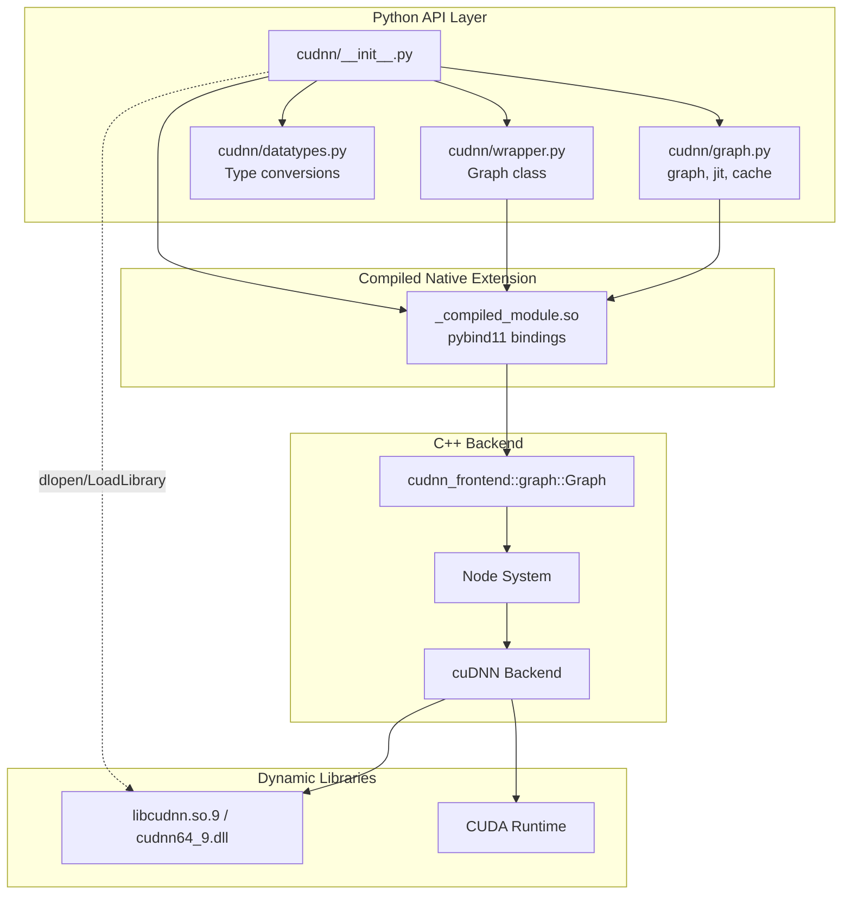
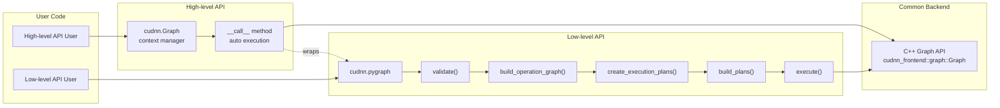
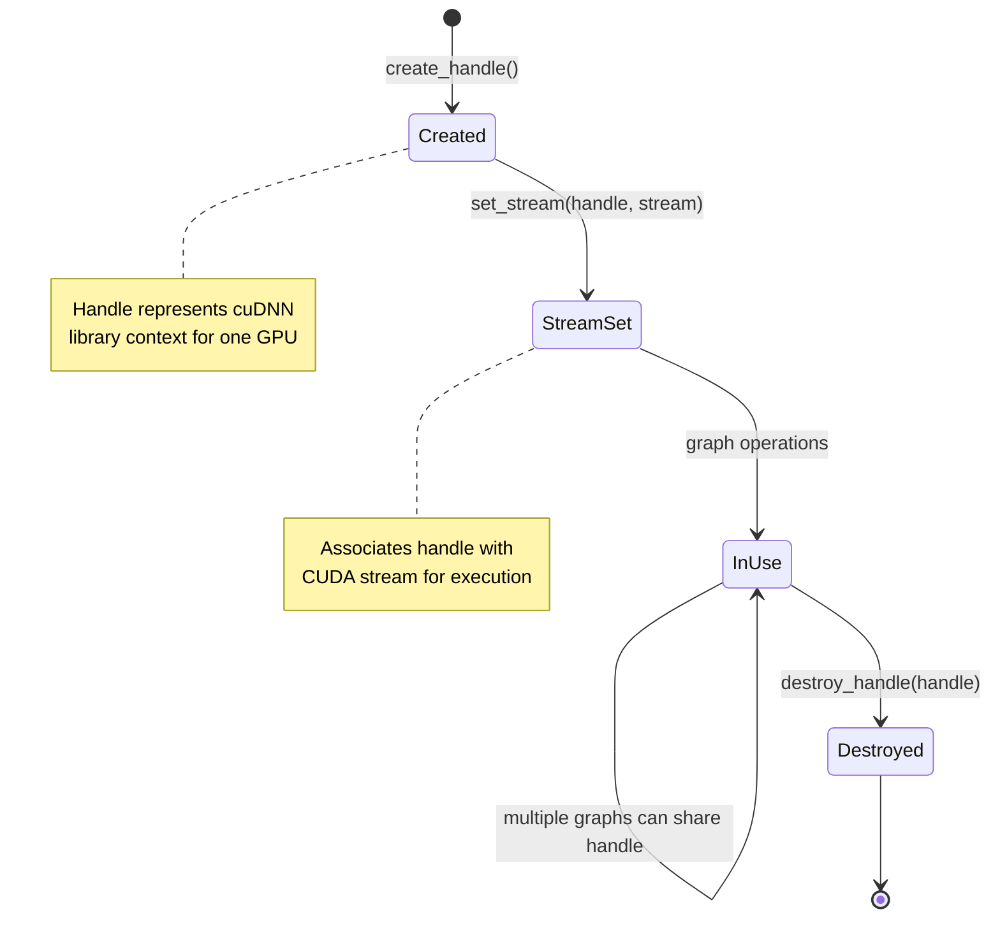
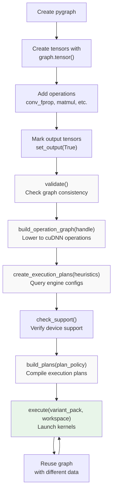

<!-- source: DeepWiki mcp.deepwiki.com · repo NVIDIA/cudnn-frontend · page 4.1 Python API Overview · fetched 2026-10-26 -->

# Python API Overview

<details>
<summary>Relevant source files</summary>

The following files were used as context for generating this wiki page:

- [cmake/cuDNN.cmake](cmake/cuDNN.cmake)
- [include/cudnn_frontend/node/scaled_dot_product_flash_attention.h](include/cudnn_frontend/node/scaled_dot_product_flash_attention.h)
- [include/cudnn_frontend_version.h](include/cudnn_frontend_version.h)
- [python/cudnn/__init__.py](python/cudnn/__init__.py)
- [samples/python/00_introduction.ipynb](samples/python/00_introduction.ipynb)

</details>


This page documents the structure and organization of the cuDNN Frontend Python API, including the module initialization process, available API styles, and core object lifecycle patterns. It focuses on the Python-specific interfaces and how they wrap the underlying C++ Graph API.

For detailed documentation of the `PyGraph` class methods and operations, see [PyGraph Class](#4.2). For build instructions for Python bindings, see [Building Python Bindings](#4.3). For usage examples, see [Python Examples](#4.4).

## Purpose and Scope

The Python API provides two distinct interfaces to cuDNN functionality:

1. **High-level Graph wrapper** (`cudnn.Graph`) - A context manager-based interface that simplifies graph construction and execution with automatic memory management
2. **Low-level pygraph bindings** (`cudnn.pygraph`) - Direct pybind11 bindings to the C++ Graph API offering fine-grained control over all graph operations

Both interfaces ultimately use the same underlying C++ `cudnn_frontend::graph::Graph` implementation but differ in their level of abstraction and convenience features.

Sources: [python/cudnn/__init__.py:1-284](), [samples/python/00_introduction.ipynb:1-440]()

## Module Structure and Initialization

The `cudnn` Python module is organized with a layered architecture:



**Module Initialization Sequence**

The module initialization performs the following steps at import time:

1. **Platform detection**: Determines operating system to load the correct compiled module
2. **Native module import**: Loads `_compiled_module.so` (Linux/macOS) or `Release/_compiled_module.pyd` (Windows)
3. **Symbol export**: Imports and exposes key symbols from the compiled module to the `cudnn` namespace
4. **Dynamic library loading**: Locates and loads cuDNN shared libraries using `dlopen`/`LoadLibrary`
5. **Wrapper import**: Imports high-level Python wrappers (`Graph`, `graph`, `jit`)

Sources: [python/cudnn/__init__.py:9-46](), [python/cudnn/__init__.py:165-220]()

### Symbol Exports

The module exposes the following categories of symbols from the compiled native extension:

| Category | Symbols | Purpose |
|----------|---------|---------|
| **Version Info** | `backend_version`, `backend_version_string` | Query cuDNN backend version |
| **Handle Management** | `create_handle`, `destroy_handle`, `get_stream`, `set_stream` | Manage cuDNN context and CUDA streams |
| **Graph Classes** | `pygraph`, `tensor`, `knob` | Core graph building primitives |
| **Enumerations** | `data_type`, `heur_mode`, `behavior_note`, `numerical_note` | Configuration enums |
| **Utilities** | `get_last_error_string`, `create_kernel_cache` | Error handling and caching |
| **Exceptions** | `cudnnGraphNotSupportedError` | Python exception types |

Sources: [python/cudnn/__init__.py:17-42]()

## Dual API Architecture



Sources: [samples/python/00_introduction.ipynb:63-213](), [samples/python/00_introduction.ipynb:218-429]()

### High-level Graph Wrapper

The `cudnn.Graph` class provides a simplified interface using Python context managers:

**Key Features:**
- Automatic graph validation and building
- Dynamic output tensor allocation
- Integrated workspace management
- Named input/output tensors with string-based references
- Support for both PyTorch tensors and cuDNN tensors as input templates

**Typical Usage Pattern:**
```python
with cudnn.Graph(inputs=["conv2d::image", "conv2d::weight"], 
                 outputs=["conv_out"]) as graph:
    Y = graph.conv_fprop(image=X_gpu, weight=W_gpu, ...)
    Y.set_output(True).set_data_type(cudnn.data_type.HALF)

# Execute with automatic workspace allocation
Y_result = graph(X_gpu, W_gpu, handle=handle)
```

The wrapper automatically handles:
- Graph finalization on context exit
- Execution plan creation with default heuristics
- Workspace allocation based on graph requirements
- Output tensor creation with inferred shapes

Sources: [samples/python/00_introduction.ipynb:133-184](), [python/cudnn/__init__.py:222-224]()

### Low-level PyGraph Bindings

The `cudnn.pygraph` class provides direct access to the C++ Graph API with explicit control over all phases:

**Key Features:**
- Explicit phase control (validate, build_operation_graph, create_execution_plans, build_plans, execute)
- Manual workspace management
- Variant pack mapping between cuDNN tensors and device pointers
- Fine-grained execution plan selection
- Access to all graph attributes and statistics

**Typical Usage Pattern:**
```python
graph = cudnn.pygraph(handle=handle, 
                      io_data_type=cudnn.data_type.HALF)

X = graph.tensor(dim=[8, 64, 56, 56], stride=[...])
W = graph.tensor(dim=[32, 64, 3, 3], stride=[...])
Y = graph.conv_fprop(X, W, ...)
Y.set_output(True)

graph.build([cudnn.heur_mode.A, cudnn.heur_mode.FALLBACK])

workspace = torch.empty(graph.get_workspace_size(), device="cuda", dtype=torch.uint8)
variant_pack = {X: X_gpu, W: W_gpu, Y: Y_gpu}
graph.execute(variant_pack, workspace, handle=handle)
```

The low-level API exposes:
- Separate validation and compilation phases
- Multiple heuristic modes for plan selection
- Plan caching and reuse mechanisms
- Detailed error reporting

Sources: [samples/python/00_introduction.ipynb:225-392]()

## Core Object Lifecycle

### Handle Management



The `cudnnHandle_t` is an opaque pointer to the cuDNN context. Key properties:

- **One handle per GPU device**: Created on the current CUDA device at creation time
- **Stream association**: Can be associated with a specific CUDA stream via `set_stream()`
- **Thread safety**: Not thread-safe; use separate handles for concurrent operations
- **Lifecycle**: Must be explicitly destroyed with `destroy_handle()` to free resources

**Handle Functions:**
- `cudnn.create_handle()` - Creates and returns a new handle
- `cudnn.destroy_handle(handle)` - Destroys the handle and frees resources
- `cudnn.set_stream(handle, stream)` - Associates handle with a CUDA stream
- `cudnn.get_stream(handle)` - Retrieves the associated CUDA stream

Sources: [samples/python/00_introduction.ipynb:105-126](), [python/cudnn/__init__.py:26-29]()

### Tensor Creation and Properties

Tensors in the Python API are created through the `pygraph.tensor()` method or automatically inferred by the high-level wrapper:

**Tensor Creation API:**
```python
def tensor(self, dim, stride, data_type=data_type.NOT_SET, 
           is_virtual=False, is_pass_by_value=False, 
           ragged_offset=None, reordering_type=tensor_reordering.NONE,
           name="", uid=-1)
```

**Tensor Categories:**

| Category | `is_virtual` | `is_pass_by_value` | Usage |
|----------|--------------|---------------------|-------|
| **Physical** | `False` | `False` | Graph inputs/outputs requiring device memory |
| **Virtual** | `True` | `False` | Intermediate results managed by framework |
| **Scalar** | `False` | `True` | Constant values embedded in graph |

**Key Properties:**
- **dim**: Logical dimensions (e.g., `[N, C, H, W]`)
- **stride**: Physical memory layout (e.g., `[C*H*W, 1, W*C, C]` for NHWC)
- **data_type**: Element type (FP32, FP16, INT8, FP8, etc.)
- **uid**: Unique identifier for variant pack mapping

Sources: [python/cudnn/__init__.py:52-91](), [samples/python/00_introduction.ipynb:256-279]()

### Graph Building Phases

The low-level API exposes distinct phases of graph construction and execution:



**Convenience Method:**
The `build()` method combines multiple phases:
```python
graph.build([cudnn.heur_mode.A, cudnn.heur_mode.FALLBACK])
# Equivalent to:
# graph.validate()
# graph.build_operation_graph(handle)
# graph.create_execution_plans([cudnn.heur_mode.A, cudnn.heur_mode.FALLBACK])
# graph.check_support()
# graph.build_plans()
```

Sources: [samples/python/00_introduction.ipynb:329-351]()

## Execution Model

### Variant Pack and Workspace

Execution requires mapping cuDNN tensor UIDs to actual device memory pointers:

```mermaid
graph TB
    subgraph "Python Objects"
        CUDNN_TENSOR_X["cudnn.tensor X<br/>uid=12345"]
        CUDNN_TENSOR_W["cudnn.tensor W<br/>uid=67890"]
        CUDNN_TENSOR_Y["cudnn.tensor Y<br/>uid=11111"]
    end
    
    subgraph "Device Memory"
        PTR_X["torch.Tensor X_gpu<br/>data_ptr=0xABCD"]
        PTR_W["torch.Tensor W_gpu<br/>data_ptr=0xEF01"]
        PTR_Y["torch.Tensor Y_gpu<br/>data_ptr=0x2345"]
        WORKSPACE["workspace buffer<br/>data_ptr=0x6789"]
    end
    
    subgraph "Variant Pack Mapping"
        PACK["{<br/>  12345: 0xABCD,<br/>  67890: 0xEF01,<br/>  11111: 0x2345<br/>}"]
    end
    
    CUDNN_TENSOR_X -.->|get_uid()| PACK
    CUDNN_TENSOR_W -.->|get_uid()| PACK
    CUDNN_TENSOR_Y -.->|get_uid()| PACK
    
    PTR_X -.->|data_ptr()| PACK
    PTR_W -.->|data_ptr()| PACK
    PTR_Y -.->|data_ptr()| PACK
    
    PACK --> EXECUTE["graph.execute()"]
    WORKSPACE --> EXECUTE
```

**Variant Pack Construction:**
The module provides automatic device pointer extraction supporting multiple tensor types:

- **PyTorch tensors**: Directly calls `tensor.data_ptr()`
- **Integer pointers**: Passes through unchanged
- **DLPack tensors**: Extracts pointer via `_get_data_ptr()` helper

The wrapper function constructs the UID-to-pointer mapping:

```python
uid_to_tensor_pointer = {
    x if type(x) is int else x.get_uid(): _library_device_pointer(pointer)
    for x, pointer in tensor_to_device_buffer.items()
    if x is not None
}
```

**Workspace Management:**
- Temporary memory buffer for internal computations
- Size determined by `graph.get_workspace_size()`
- Must be allocated on the same device as input/output tensors
- Can be reused across multiple executions of the same graph

Sources: [python/cudnn/__init__.py:104-134](), [samples/python/00_introduction.ipynb:379-391]()

### Execution Methods

The `pygraph` class provides two execution methods:

**Standard Execution:**
```python
def execute(self, tensor_to_device_buffer, workspace, handle=None)
```
Executes the graph using the first available execution plan. Suitable for most use cases.

**Indexed Execution:**
```python
def execute_plan_at_index(self, tensor_to_device_buffer, workspace, index, handle=None)
```
Executes a specific plan by index. Useful when multiple plans are available and you want to benchmark or select a particular implementation.

Both methods:
- Accept variant pack as dictionary mapping tensors to device buffers
- Require workspace buffer of sufficient size
- Optionally accept a handle (uses handle from graph construction if not provided)
- Launch kernels asynchronously on the associated CUDA stream

Sources: [python/cudnn/__init__.py:116-162]()

## Integration with Deep Learning Frameworks

The Python API seamlessly integrates with popular deep learning frameworks through multiple mechanisms:

### PyTorch Integration

**Direct Tensor Support:**
- PyTorch tensors automatically provide `data_ptr()` method for device pointer extraction
- Memory format support via `tensor.to(memory_format=torch.channels_last)`
- Gradient tracking disabled during cuDNN operations (requires manual backward implementation)

**Usage Pattern:**
```python
X_gpu = torch.randn(8, 64, 56, 56, device="cuda", dtype=torch.float16).to(memory_format=torch.channels_last)
Y_result = graph(X_gpu, handle=handle)  # Y_result is a PyTorch tensor
```

Sources: [samples/python/00_introduction.ipynb:99-114]()

### DLPack Protocol

The module includes DLPack support for framework-agnostic tensor interchange:

**Supported via `_get_data_ptr()`:**
Any object implementing `__dlpack__` protocol can be used as input/output tensor, including:
- JAX arrays
- TensorFlow tensors
- NumPy arrays (when using DLPack-compatible wrappers)
- CuPy arrays

Sources: [python/cudnn/__init__.py:112-113](), [python/cudnn/datatypes.py:1-50]()

### Data Type Conversion

The `datatypes.py` module provides automatic type conversion between framework types and cuDNN types:

**Conversion Function:**
```python
def _library_type(data_type)
```
Maps framework-specific types (e.g., `torch.float16`) to `cudnn.data_type` enums.

**Type Detection:**
```python
def _is_torch_tensor(input_tensor)
```
Identifies PyTorch tensors for optimized pointer extraction.

Sources: [python/cudnn/__init__.py:47-48](), [python/cudnn/__init__.py:93-100]()

## Error Handling

The Python API provides exception handling that wraps C++ errors:

**Primary Exception Type:**
- `cudnn.cudnnGraphNotSupportedError`: Raised when a graph configuration is not supported by the backend

**Error Retrieval:**
- `cudnn.get_last_error_string()`: Returns detailed error message from the last failed operation

**Common Error Scenarios:**
- Unsupported operation combinations for cuDNN version
- Invalid tensor dimensions or strides
- Insufficient workspace size
- Unsupported data type combinations
- Device capability mismatches

For detailed error handling patterns, see [Error Handling](#5.1).

Sources: [python/cudnn/__init__.py:20](), [python/cudnn/__init__.py:39]()

## Version Compatibility

**Backend Version Queries:**
- `cudnn.backend_version()`: Returns integer version (e.g., `90500` for cuDNN 9.5.0)
- `cudnn.backend_version_string()`: Returns human-readable version string

**Version-specific Features:**
Different cuDNN versions support different operations and features. The backend version can be checked at runtime to enable conditional functionality.

For comprehensive version compatibility information, see [Version Compatibility](#1.3).

Sources: [python/cudnn/__init__.py:18-19](), [samples/python/00_introduction.ipynb:79-88]()

## Advanced Features

### Kernel Cache Management

For cuDNN 9.4+, the API supports persistent kernel caching for dynamic shapes:

```python
kernel_cache = cudnn.create_kernel_cache(max_cache_size_bytes)
```

Caches compiled kernels across graph executions to improve performance with dynamic shapes. See [Kernel Cache & Dynamic Shapes](#5.6) for details.

Sources: [python/cudnn/__init__.py:27]()

### Device Properties

```python
device_props = cudnn.create_device_properties()
```

Query device capabilities to determine supported operations and features.

Sources: [python/cudnn/__init__.py:28]()

### Build Policy Configuration

```python
cudnn.build_plan_policy  # Enum for plan building strategies
```

Control execution plan compilation strategy for optimization trade-offs between compilation time and runtime performance.

Sources: [python/cudnn/__init__.py:32]()

---

