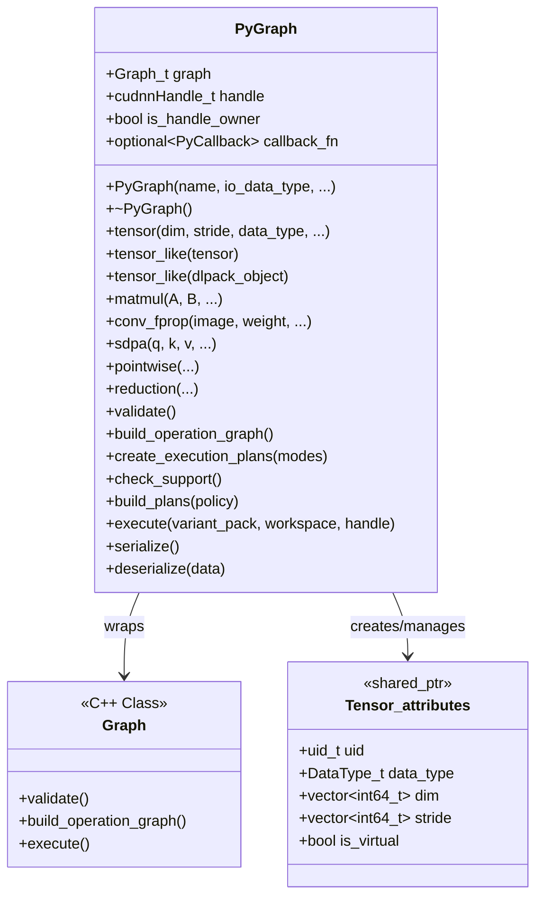
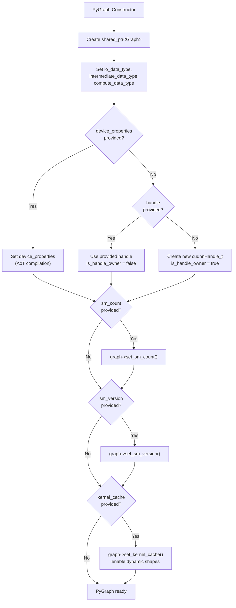
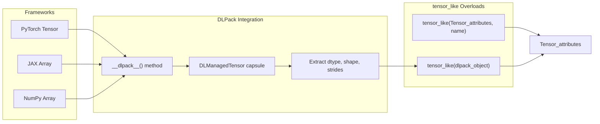
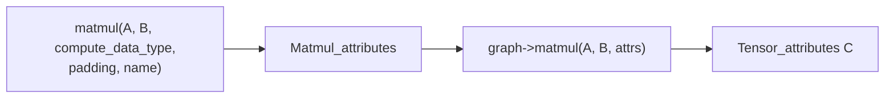
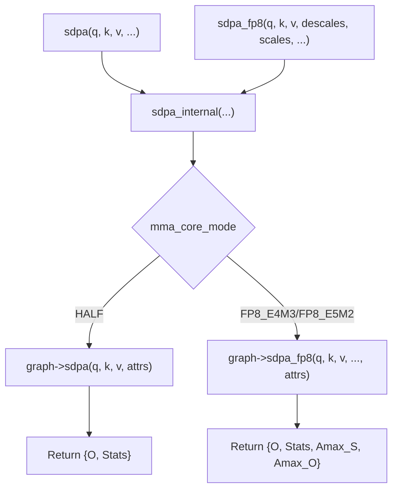
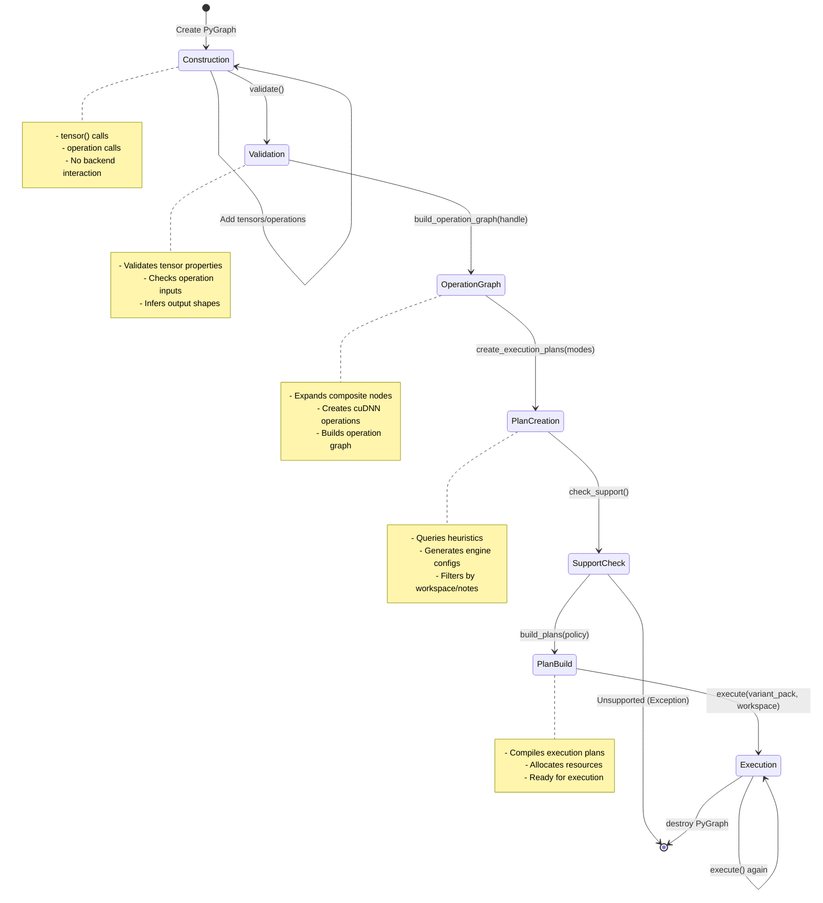
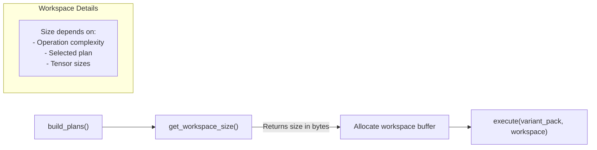
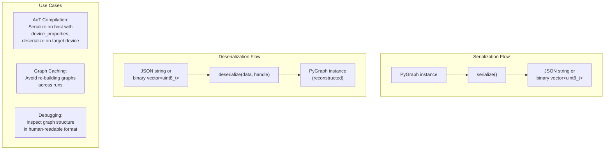
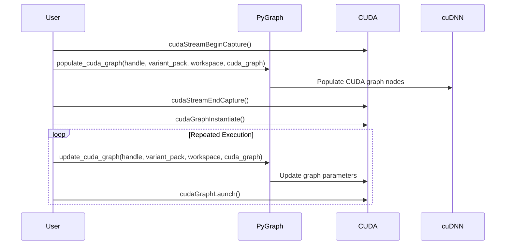
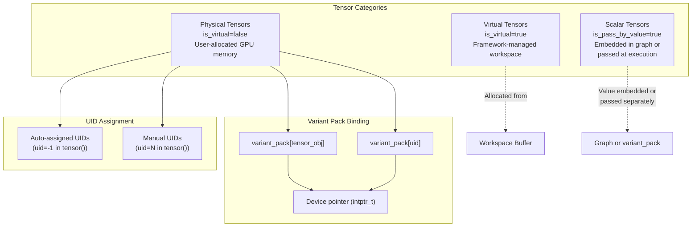

<!-- source: DeepWiki mcp.deepwiki.com · repo NVIDIA/cudnn-frontend · page 4.2 PyGraph Class · fetched 2026-10-26 -->

# PyGraph Class

<details>
<summary>Relevant source files</summary>

The following files were used as context for generating this wiki page:

- [include/cudnn_frontend/graph_properties.h](include/cudnn_frontend/graph_properties.h)
- [include/cudnn_frontend/node_interface.h](include/cudnn_frontend/node_interface.h)
- [include/cudnn_frontend/utils/serialize.h](include/cudnn_frontend/utils/serialize.h)
- [include/cudnn_frontend_utils.h](include/cudnn_frontend_utils.h)
- [python/pygraph/pygraph.cpp](python/pygraph/pygraph.cpp)
- [python/pygraph/pygraph.h](python/pygraph/pygraph.h)
- [python/pygraph/sdpa.cpp](python/pygraph/sdpa.cpp)
- [samples/cpp/CMakeLists.txt](samples/cpp/CMakeLists.txt)
- [test/python/test_matmul_bias_relu.py](test/python/test_matmul_bias_relu.py)

</details>


## Purpose and Scope

The `PyGraph` class provides Python bindings to the C++ Graph API, enabling Python applications to construct, validate, and execute cuDNN computation graphs. It serves as the primary interface for Python users to access cuDNN's graph-based execution model through a Pythonic functional API.

For information about the underlying C++ Graph API, see [2.1](#2.1). For high-level Python API wrapper classes, see [4.1](#4.1).

**Sources:** [python/pygraph/pygraph.h:15-673](), [python/pygraph/pygraph.cpp:21-1298]()

---

## Class Architecture

### Core Components

The `PyGraph` class wraps the C++ `cudnn_frontend::graph::Graph` and manages the cuDNN handle lifecycle.



**Key Members:**
- `graph`: Shared pointer to `cudnn_frontend::graph::Graph` instance
- `handle`: cuDNN handle for execution (may be owned or borrowed)
- `is_handle_owner`: Boolean indicating if PyGraph should destroy the handle on cleanup
- `callback_fn`: Optional Python callback for score modification in SDPA operations

**Sources:** [python/pygraph/pygraph.h:18-97](), [python/pygraph/pygraph.cpp:23-528]()

---

## Constructor and Initialization



**Constructor Parameters:**
- `name`: Graph name (for debugging/logging)
- `io_data_type`: Data type for input/output tensors (default: NOT_SET)
- `intermediate_data_type`: Data type for intermediate tensors (default: NOT_SET)
- `compute_data_type`: Data type for computation (default: NOT_SET)
- `handle`: Optional existing cudnnHandle_t (as intptr_t)
- `sm_count`: Optional SM count for device targeting
- `sm_version`: Optional SM version for device targeting
- `kernel_cache`: Optional KernelCache for dynamic shape support
- `device_properties`: Optional DeviceProperties for AoT compilation

**Sources:** [python/pygraph/pygraph.h:55-91](), [python/pygraph/pygraph.cpp:633-653]()

---

## Tensor Creation API

### tensor() Method

Creates a tensor with explicit dimension, stride, and data type specifications.

| Parameter | Type | Default | Description |
|-----------|------|---------|-------------|
| `dim` | `vector<int64_t>` | - | Tensor dimensions |
| `stride` | `vector<int64_t>` | - | Tensor strides |
| `data_type` | `DataType_t` | NOT_SET | Data type |
| `is_virtual` | `bool` | false | Whether tensor is virtual (framework-managed) |
| `is_pass_by_value` | `bool` | false | Whether tensor is passed by value (scalar) |
| `ragged_offset` | `Tensor_attributes*` | nullptr | Ragged offset tensor for variable-length sequences |
| `reordering_type` | `TensorReordering_t` | NONE | Tensor reordering type |
| `name` | `string` | "" | Tensor name |
| `uid` | `int64_t` | -1 | Unique identifier (auto-assigned if -1) |

**Sources:** [python/pygraph/pygraph.h:109-118](), [python/pygraph/pygraph.cpp:80-105]()

### tensor_like() Methods



**DLPack Support:**
The `tensor_like(py::object)` overload uses DLPack protocol to interoperate with Python tensor libraries:
1. Calls `__dlpack__()` on the Python object
2. Extracts `DLManagedTensor` from the capsule
3. Converts DLDataType to `cudnn_frontend::DataType_t`
4. Extracts dimensions and strides
5. Creates `Tensor_attributes` with appropriate properties

**Sources:** [python/pygraph/pygraph.h:120-124](), [python/pygraph/pygraph.cpp:107-178]()

---

## Operation Methods

The PyGraph class provides methods for various cuDNN operations. Each method creates the appropriate operation attributes and adds the operation to the graph.

### Matrix Multiplication



**Parameters:**
- `A`, `B`: Input tensors
- `compute_data_type`: Computation data type
- `padding`: Padding value for non-multiple-of-tile sizes
- `name`: Operation name

**Sources:** [python/pygraph/pygraph.h:232-237](), [python/pygraph/pygraph.cpp:312-325]()

### Convolution Operations

| Method | Inputs | Outputs | Description |
|--------|--------|---------|-------------|
| `conv_fprop` | image, weight | Y | Forward convolution |
| `conv_dgrad` | loss, filter | DX | Data gradient (backward) |
| `conv_wgrad` | image, loss | DW | Weight gradient (backward) |

**Common Parameters:**
- `pre_padding`, `post_padding`: Padding before/after each dimension
- `stride`: Convolution stride
- `dilation`: Dilation factor
- `conv_mode`: CONVOLUTION or CROSS_CORRELATION
- `compute_data_type`: Computation data type

**Sources:** [python/pygraph/pygraph.h:199-230](), [python/pygraph/pygraph.cpp:205-270]()

### Scaled Dot-Product Attention (SDPA)

The SDPA methods support both standard and FP8 variants:



**Key SDPA Features:**
- **Masking**: Causal masks, padding masks, alibi masks, block masks, diagonal banding
- **Dropout**: Supports both stochastic (probability, seed, offset) and deterministic (mask, scale) dropout
- **Paged Attention**: K/V cache paging for efficient memory management
- **Score Modification**: Custom callback for modifying attention scores
- **FP8 Support**: Quantized attention with descaling/scaling tensors

**Sources:** [python/pygraph/pygraph.h:356-450](), [python/pygraph/sdpa.cpp:15-696]()

### Normalization Operations

| Method | Type | Outputs |
|--------|------|---------|
| `layernorm` | Layer Normalization | [Y, Mean, InvVariance] |
| `layernorm_backward` | Layer Norm Backward | [DX, DScale, DBias] |
| `rmsnorm` | RMS Normalization | [Y, InvVariance] |
| `rmsnorm_backward` | RMS Norm Backward | [DX, DScale, DBias] |
| `instancenorm` | Instance Normalization | [Y, Mean, InvVariance] |
| `batchnorm` | Batch Normalization | [Y, Mean, InvVariance, ...] |

**Sources:** [python/pygraph/pygraph.h:127-192]()

### Pointwise and Reduction Operations

**Pointwise Operations:**
- Binary: `add`, `sub`, `mul`, `div`, `max`, `min`, etc.
- Unary: `relu`, `gelu`, `tanh`, `sigmoid`, `exp`, `log`, `sqrt`, etc.
- Ternary: `binary_select`

**Reduction Operations:**
- Modes: `ADD`, `MUL`, `MIN`, `MAX`, `AMAX`, `AVG`, `NORM1`, `NORM2`

**Sources:** [python/pygraph/pygraph.h:240-317]()

---

## Graph Lifecycle

The graph execution follows a strict multi-phase lifecycle:



### Phase Details

#### 1. Graph Construction Phase

During construction, users call tensor and operation methods. No backend interaction occurs yet.

```python
graph = cudnn.pygraph(handle=cudnn_handle)
A = graph.tensor_like(A_gpu)
B = graph.tensor_like(B_gpu)
C = graph.matmul(A=A, B=B)
C.set_output(True)
```

**Sources:** [test/python/test_matmul_bias_relu.py:268-296]()

#### 2. Validation Phase

```python
graph.validate()
```

**Actions:**
- Calls `graph->validate()` on the C++ Graph object
- Validates tensor attributes (dimensions, strides, data types)
- Pre-validates all nodes
- Infers properties (shapes, data types)
- Post-validates all nodes

**Sources:** [python/pygraph/pygraph.cpp:380-384]()

#### 3. Operation Graph Building Phase

```python
graph.build_operation_graph()
```

**Actions:**
- Expands composite nodes into primitive operations
- Creates cuDNN backend descriptors for tensors
- Creates cuDNN backend descriptors for operations
- Builds the operation graph descriptor

**Sources:** [python/pygraph/pygraph.cpp:392-395]()

#### 4. Execution Plan Creation Phase

```python
graph.create_execution_plans([cudnn.heur_mode.A, cudnn.heur_mode.FALLBACK])
```

**Heuristic Modes:**
- `HeurMode_t::A`: Fast heuristics (recommended first choice)
- `HeurMode_t::B`: Exhaustive search (slower but more thorough)
- `HeurMode_t::FALLBACK`: Guaranteed valid plan (fallback option)

**Actions:**
- Queries cuDNN heuristics for engine configurations
- Filters engines by workspace size, numerical notes, behavioral notes
- Checks errata database for known issues
- Generates list of candidate execution plans

**Sources:** [python/pygraph/pygraph.cpp:414-417]()

#### 5. Support Checking Phase

```python
graph.check_support()
```

**Actions:**
- Verifies that at least one valid plan exists
- Throws `cudnnGraphNotSupportedError` if no plan is supported

**Sources:** [python/pygraph/pygraph.cpp:470-473]()

#### 6. Plan Building Phase

```python
graph.build_plans(cudnn.build_plan_policy.HEURISTICS_CHOICE)
```

**Build Policies:**
- `BuildPlanPolicy_t::HEURISTICS_CHOICE`: Build first successful plan (fast)
- `BuildPlanPolicy_t::ALL`: Build all successful plans (for autotuning)

**Actions:**
- Finalizes execution plans
- Allocates internal resources
- Prepares for execution

**Sources:** [python/pygraph/pygraph.cpp:442-446]()

#### 7. Execution Phase

```python
workspace = torch.empty(graph.get_workspace_size(), device="cuda", dtype=torch.uint8)
graph.execute({A: A_gpu, B: B_gpu, C: C_gpu}, workspace, handle=cudnn_handle)
```

**Variant Pack Format:**
The variant pack is a dictionary mapping tensor UIDs (or tensor objects) to device pointers:

```python
variant_pack = {
    tensor_uid: device_pointer,  # as intptr_t
    # or
    tensor_object: device_pointer
}
```

**Actions:**
- Binds user-provided device pointers to tensor UIDs
- Executes the compiled plan on the GPU
- Returns after kernel completion (or launches async)

**Sources:** [python/pygraph/pygraph.cpp:571-589](), [test/python/test_matmul_bias_relu.py:312-320]()

---

## Workspace Management

The graph requires workspace memory for intermediate results and internal operations:



**Workspace Size Query:**
```python
workspace_size = graph.get_workspace_size()
workspace_size_for_plan = graph.get_workspace_size_plan_at_index(plan_idx)
```

**Sources:** [python/pygraph/pygraph.cpp:475-493]()

---

## Plan Selection and Autotuning

### Querying Available Plans

```python
engine_count = graph.get_engine_count()
for i in range(engine_count):
    plan_name = graph.get_plan_name_at_index(i)
    workspace = graph.get_workspace_size_plan_at_index(i)
    behavior_notes = graph.get_behavior_notes_for_plan_at_index(i)
```

### Custom Plan Selection

```python
# Query knobs for specific engine
engine_id = 0
knobs = graph.get_knobs_for_engine(engine_id)

# Create plan with custom knob settings
knob_values = {cudnn.knob_type.TILE_SIZE: 128}
graph.create_execution_plan(engine_id, knob_values)
graph.build_plan_at_index(0)
```

### Executing Specific Plans

```python
# Execute a specific plan by index
graph.execute_plan_at_index(variant_pack, workspace, index=2)
```

**Sources:** [python/pygraph/pygraph.cpp:425-452](), [python/pygraph/pygraph.cpp:591-609]()

---

## Behavioral and Numerical Notes

Plans can have notes indicating special behaviors or numerical properties:

### Behavioral Notes

| Note | Meaning |
|------|---------|
| `RUNTIME_COMPILATION` | Plan requires runtime kernel compilation |
| `REQUIRES_FILTER_INT8x32_REORDER` | Filter tensor needs reordering |
| `REQUIRES_BIAS_INT8x32_REORDER` | Bias tensor needs reordering |
| `SUPPORTS_CUDA_GRAPH_NATIVE_API` | Compatible with CUDA graphs |
| `CUBLASLT_DEPENDENCY` | Uses cuBLASLt library |

### Numerical Notes

| Note | Meaning |
|------|---------|
| `TENSOR_CORE` | Uses tensor core operations |
| `DOWN_CONVERT_INPUTS` | Converts inputs to lower precision |
| `REDUCED_PRECISION_REDUCTION` | Uses reduced precision for reductions |
| `NONDETERMINISTIC` | Results may vary between runs |
| `WINOGRAD` | Uses Winograd algorithm |

**Querying Notes:**
```python
# Get notes for built plans
notes = graph.get_behavior_notes()

# Get notes for specific plan
notes = graph.get_behavior_notes_for_plan_at_index(plan_idx)
```

**Sources:** [python/pygraph/pygraph.cpp:397-411](), [test/python/test_matmul_bias_relu.py:302-310]()

---

## Serialization and Deserialization

The PyGraph supports serialization for caching and debugging:



### Serialization

```python
# Binary serialization
binary_data = graph.serialize()  # Returns vector<uint8_t>

# JSON serialization (via C++ Graph)
json_str = graph.graph.serialize()  # Returns JSON string
```

### Deserialization

```python
# From binary
graph = cudnn.pygraph()
graph.deserialize(binary_data, handle=optional_handle)

# From JSON string
graph = cudnn.pygraph()
graph.deserialize(json_string)
```

**AoT Compilation Example:**
```python
# On compilation host (no GPU needed)
device_props = cudnn.DeviceProperties(sm_version=90, sm_count=132)
graph = cudnn.pygraph(device_property=device_props)
# ... build graph ...
data = graph.serialize()

# On target device
graph = cudnn.pygraph(handle=cudnn_handle)
graph.deserialize(data, handle=cudnn_handle)
graph.execute(...)
```

**Sources:** [python/pygraph/pygraph.cpp:495-528]()

---

## CUDA Graph Integration

PyGraph supports CUDA graph capture for reduced launch overhead:



**Usage:**
```python
# Capture phase
cuda_graph = torch.cuda.CUDAGraph()
with torch.cuda.graph(cuda_graph):
    graph.populate_cuda_graph(
        handle=cudnn_handle,
        var_pack={A: A_ptr, B: B_ptr, C: C_ptr},
        workspace=workspace_ptr,
        cuda_graph=cuda_graph_handle
    )

# Execution phase (repeated)
graph.update_cuda_graph(handle, var_pack, workspace, cuda_graph_handle)
cuda_graph.replay()
```

**Sources:** [python/pygraph/pygraph.cpp:530-569]()

---

## Error Handling

PyGraph methods throw exceptions on errors:

```python
try:
    graph.validate()
    graph.build_operation_graph()
    graph.create_execution_plans([cudnn.heur_mode.A])
    graph.check_support()
    graph.build_plans()
except cudnn.cudnnGraphNotSupportedError as e:
    print(f"Graph not supported: {e}")
    # Handle unsupported graph
except cudnn.cudnnException as e:
    print(f"cuDNN error: {e.get_cudnn_status()}")
    # Handle other cuDNN errors
```

**Exception Types:**
- `cudnn.cudnnException`: Base exception for cuDNN errors
- `cudnn.cudnnGraphNotSupportedError`: Specific to unsupported graphs

**Sources:** [python/pygraph/pygraph.cpp:23-24](), [test/python/test_matmul_bias_relu.py:82-87]()

---

## Memory Model and Tensor UIDs



**UID-based Execution:**
Physical (non-virtual) tensors must be bound to device pointers at execution time via the variant pack. The PyGraph class accepts either tensor objects or UIDs as dictionary keys:

```python
# Using tensor objects as keys
graph.execute({A: A_gpu.data_ptr(), B: B_gpu.data_ptr(), C: C_gpu.data_ptr()}, workspace)

# Using UIDs as keys (if known)
graph.execute({0: A_ptr, 1: B_ptr, 2: C_ptr}, workspace)
```

**Sources:** [python/pygraph/pygraph.cpp:571-589](), [include/cudnn_frontend/graph_properties.h:24-296]()

---

## Integration with Python Frameworks

### PyTorch Integration Example

```python
import torch
import cudnn

# Create PyTorch tensors
A_torch = torch.randn(16, 32, 64, device='cuda', dtype=torch.float16)
B_torch = torch.randn(16, 64, 128, device='cuda', dtype=torch.float16)

# Create cuDNN graph
graph = cudnn.pygraph(handle=cudnn_handle)

# Create cuDNN tensors from PyTorch tensors (via DLPack)
A = graph.tensor_like(A_torch)
B = graph.tensor_like(B_torch)

# Build graph
C = graph.matmul(A=A, B=B)
C.set_output(True).set_data_type(cudnn.data_type.HALF)

# Execute
graph.validate()
graph.build_operation_graph()
graph.create_execution_plans([cudnn.heur_mode.A])
graph.check_support()
graph.build_plans()

C_torch = torch.zeros(16, 32, 128, device='cuda', dtype=torch.float16)
workspace = torch.empty(graph.get_workspace_size(), device='cuda', dtype=torch.uint8)

graph.execute(
    {A: A_torch.data_ptr(), B: B_torch.data_ptr(), C: C_torch.data_ptr()},
    workspace.data_ptr()
)
```

**DLPack Protocol Support:**
The `tensor_like(py::object)` method works with any object implementing `__dlpack__()`:
- PyTorch tensors
- JAX arrays  
- NumPy arrays (with CUDA support)
- CuPy arrays
- Other array libraries supporting DLPack

**Sources:** [python/pygraph/pygraph.cpp:138-178](), [test/python/test_matmul_bias_relu.py:254-327]()

---

## Helper Methods

### Tensor Property Queries

```python
# Query tensor attributes by UID
tensor_attrs = graph.query_tensor_attributes_of_uid(tensor_uid)

# Access properties
dims = tensor_attrs.get_dim()
strides = tensor_attrs.get_stride()
dtype = tensor_attrs.get_data_type()
is_virtual = tensor_attrs.get_is_virtual()
```

### Graph Inspection

```python
# Get unique key for graph caching
cache_key = graph.key()

# Get plan information
plan_count = graph.get_engine_count()
for i in range(plan_count):
    name = graph.get_plan_name_at_index(i)
    workspace = graph.get_workspace_size_plan_at_index(i)
    notes = graph.get_behavior_notes_for_plan_at_index(i)
```

**Sources:** [python/pygraph/pygraph.cpp:386-390](), [python/pygraph/pygraph.cpp:611-625]()

---

## Advanced Features

### Score Modification Callbacks (SDPA)

For custom attention score modifications:

```python
def score_mod_fn(graph: cudnn.pygraph, q_kt: cudnn.tensor) -> cudnn.tensor:
    # Custom score modification logic
    modified_score = graph.mul(q_kt, scale_tensor)
    return modified_score

# Use in SDPA
o, stats = graph.sdpa(q, k, v, score_mod=score_mod_fn)
```

**Sources:** [python/pygraph/pygraph.h:22-107]()

### Dynamic Shape Support

Enable kernel caching for dynamic shapes:

```python
kernel_cache = cudnn.KernelCache()
graph = cudnn.pygraph(kernel_cache=kernel_cache)

# First execution with shape [16, 64, 128]
# ... execute ...

# Second execution with shape [32, 64, 128]
# Reuses cached kernels if possible
```

**Sources:** [python/pygraph/pygraph.h:87-90]()

### Block Scale Quantization

For structured quantization:

```python
# Quantize
y, scale = graph.block_scale_quantize(
    input=x,
    block_size=128,
    axis=1,
    transpose=False
)

# Dequantize
x_reconstructed = graph.block_scale_dequantize(
    input=y,
    descale=scale,
    block_size=[128],
    is_negative_scale=False
)
```

**Sources:** [python/pygraph/pygraph.cpp:272-310]()

---

## Complete Example: Matmul with Bias

```python
import torch
import cudnn

# Setup
cudnn_handle = cudnn.create_handle()
cudnn.set_stream(handle=cudnn_handle, stream=torch.cuda.current_stream().cuda_stream)

# Create input tensors
X = torch.randn(1, 128, 768, device='cuda', dtype=torch.float16)
W = torch.randn(1, 768, 3072, device='cuda', dtype=torch.float16)
B = torch.randn(1, 1, 3072, device='cuda', dtype=torch.float16)

# Create graph
graph = cudnn.pygraph(
    io_data_type=cudnn.data_type.HALF,
    intermediate_data_type=cudnn.data_type.FLOAT,
    compute_data_type=cudnn.data_type.FLOAT,
    handle=cudnn_handle
)

# Build graph
X_tensor = graph.tensor_like(X)
W_tensor = graph.tensor_like(W)
B_tensor = graph.tensor_like(B)

matmul_out = graph.matmul(name="matmul", A=X_tensor, B=W_tensor)
Y = graph.bias(name="bias", input=matmul_out, bias=B_tensor)
Y.set_output(True).set_data_type(cudnn.data_type.HALF)

# Compile
graph.validate()
graph.build_operation_graph()
graph.create_execution_plans([cudnn.heur_mode.A, cudnn.heur_mode.FALLBACK])
graph.check_support()
graph.build_plans(cudnn.build_plan_policy.HEURISTICS_CHOICE)

# Execute
Y_actual = torch.zeros(1, 128, 3072, device='cuda', dtype=torch.float16)
workspace = torch.empty(graph.get_workspace_size(), device='cuda', dtype=torch.uint8)

graph.execute(
    {X_tensor: X.data_ptr(), W_tensor: W.data_ptr(), B_tensor: B.data_ptr(), Y: Y_actual.data_ptr()},
    workspace.data_ptr(),
    handle=cudnn_handle
)

torch.cuda.synchronize()
```

**Sources:** [test/python/test_matmul_bias_relu.py:242-327]()

---

