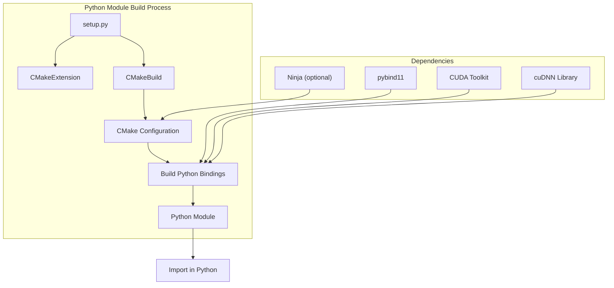
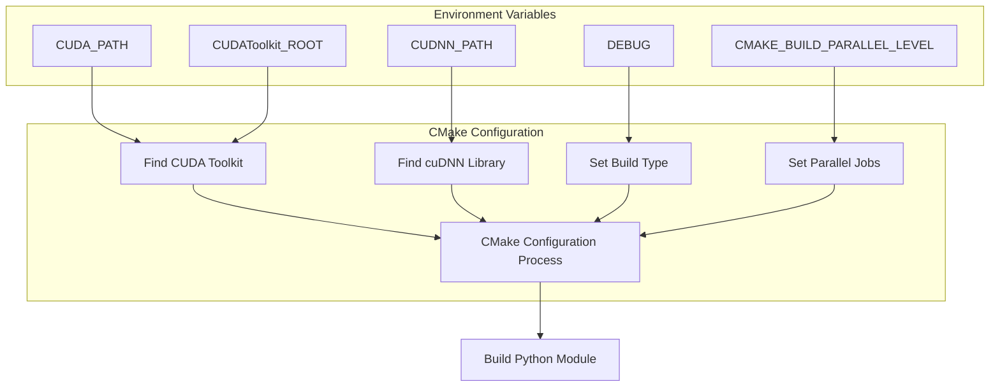
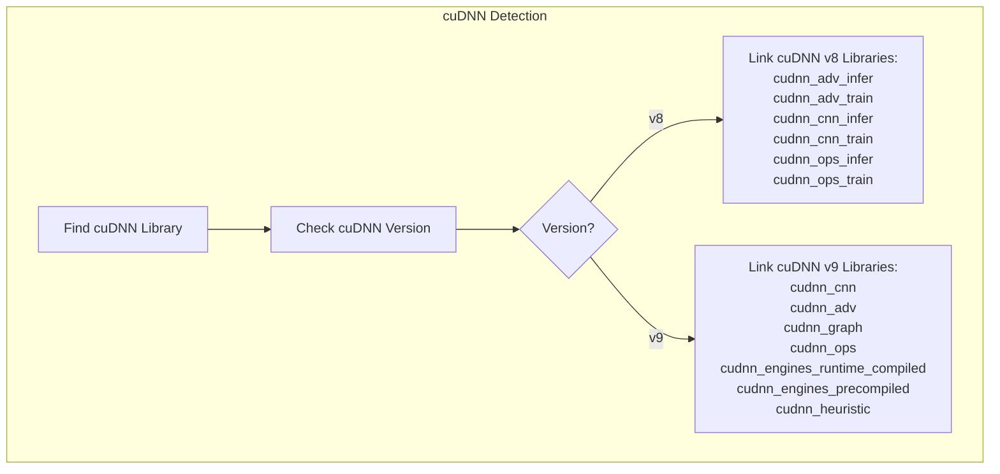

<!-- source: DeepWiki mcp.deepwiki.com · repo NVIDIA/cudnn-frontend · page 4.3 Building Python Bindings · fetched 2026-10-26 -->

# Building the Python Module

<details>
<summary>Relevant source files</summary>

The following files were used as context for generating this wiki page:

- [CMakeLists.txt](CMakeLists.txt)
- [dlpack_version.txt](dlpack_version.txt)
- [include/cudnn_frontend.h](include/cudnn_frontend.h)
- [include/cudnn_frontend/node/moe_grouped_matmul.h](include/cudnn_frontend/node/moe_grouped_matmul.h)
- [python/CMakeLists.txt](python/CMakeLists.txt)
- [python/pycudnn.cpp](python/pycudnn.cpp)
- [requirements.txt](requirements.txt)
- [samples/CMakeLists.txt](samples/CMakeLists.txt)
- [setup.py](setup.py)

</details>


This document provides detailed instructions for building the Python bindings for the cuDNN Frontend library. The Python module provides a convenient Python interface to the functionality offered by the C++ cuDNN Frontend library. For information about the Python API itself, see [Python API Overview](#4.1).

## Overview

The cuDNN Frontend library provides Python bindings using the pybind11 library to expose its functionality to Python users. The build system uses CMake and setuptools to compile the C++ library and generate Python bindings that can be imported as a Python module.



Sources: [setup.py:1-113](), [requirements.txt:1-8]()

## Prerequisites

Before building the Python module, ensure you have the following dependencies installed:

| Dependency | Purpose | Required/Optional |
|------------|---------|------------------|
| Python 3.x | Runtime environment | Required |
| CMake (3.15+) | Build system | Required |
| CUDA Toolkit | GPU acceleration | Required |
| cuDNN Library | Deep learning operations | Required |
| pybind11 | Python binding generation | Required |
| Ninja | Build system (faster builds) | Optional |

The Python package dependencies can be installed using the included `requirements.txt` file:

```bash
pip install -r requirements.txt
```

Sources: [requirements.txt:1-8](), [setup.py:71-83]()

## Build Process Architecture

The following diagram illustrates how the Python build system integrates with the cuDNN Frontend C++ library:

```mermaid
classDiagram
    class setup.py {
        +CMakeExtension
        +CMakeBuild
        +build_extension()
    }
    
    class CMakeExtension {
        +sourcedir
        +__init__(name, sourcedir)
    }
    
    class CMakeBuild {
        +build_extension(ext)
        -configure_cmake_args()
        -run_cmake_build()
    }
    
    class pycudnn.cpp {
        +PYBIND11_MODULE()
        +init_pygraph_submodule()
        +init_properties()
        +throw_if()
    }
    
    class "cudnn Python Module" {
        +_compiled_module
        +Graph class
        +Properties
    }
    
    setup.py --> CMakeExtension
    setup.py --> CMakeBuild
    CMakeBuild --> pycudnn.cpp: builds
    pycudnn.cpp --> "cudnn Python Module": generates
    "cudnn Python Module" --> "C++ cuDNN Frontend": wraps
    
    class "C++ cuDNN Frontend" {
        +Graph class
        +Operation class
        +ExecutionPlan class
    }
```

Sources: [setup.py:10-107](), [python/pycudnn.cpp:1-96]()

## Building the Module

You can build and install the Python module using pip:

### Direct Installation

```bash
pip install .
```

This command will:
1. Run the `setup.py` script
2. Configure CMake with the appropriate options
3. Build the C++ extension
4. Install the resulting Python module

### Development Installation

For development purposes, you may want to install the module in editable mode:

```bash
pip install -e .
```

Sources: [setup.py:110-113]()

## Configuration Options

The build process can be configured through environment variables:

| Environment Variable | Description | Default |
|----------------------|-------------|---------|
| `CUDA_PATH` | Path to CUDA installation | Auto-detected |
| `CUDAToolkit_ROOT` | Alternative path to CUDA Toolkit | Auto-detected |
| `CUDNN_PATH` | Path to cuDNN installation | Auto-detected |
| `DEBUG` | Build in debug mode | 0 (Release) |
| `CMAKE_BUILD_PARALLEL_LEVEL` | Number of parallel build jobs | Auto-detected |

These environment variables are checked during the CMake configuration process and used to locate necessary dependencies and configure the build.



Sources: [setup.py:59-66](), [setup.py:28-31](), [setup.py:90-95]()

## Platform-Specific Considerations

The build system handles platform-specific differences between Windows and other platforms:

### Windows

- Uses `CUDNN_FRONTEND_FETCH_PYBINDS_IN_CMAKE=ON`
- Has different configuration for linking and finding dependencies
- Uses different build command format

### Linux/macOS

- Uses `CUDNN_FRONTEND_FETCH_PYBINDS_IN_CMAKE=OFF`
- Optional Ninja build system integration for faster builds
- Sets Python executable explicitly

Sources: [setup.py:31-58](), [setup.py:73-83]()

## CMake Configuration Details

During the build process, CMake is configured with the following important options:

```
-DCMAKE_BUILD_TYPE=Release/Debug
-DCUDNN_FRONTEND_BUILD_PYTHON_BINDINGS=ON
-DCUDNN_FRONTEND_BUILD_SAMPLES=OFF
-DCUDNN_FRONTEND_BUILD_TESTS=OFF
-DCMAKE_LIBRARY_OUTPUT_DIRECTORY=<output_dir>
-DCUDNN_FRONTEND_KEEP_PYBINDS_IN_BINARY_DIR=OFF
```

These options ensure that only the Python bindings are built and that the output is correctly placed for the Python package structure.

Sources: [setup.py:40-49]()

## cuDNN Library Detection

The build system searches for the cuDNN library in several locations:

1. Path specified by `CUDNN_PATH` environment variable
2. Path specified by `CUDNN_INCLUDE_PATH` environment variable
3. Python site packages directory (for nvidia/cudnn)
4. CUDA Toolkit include directories

Once found, it determines the cuDNN version (8 or 9) and links against the appropriate library components.



Sources: [cmake/cuDNN.cmake:1-109]()

## Troubleshooting Common Issues

### Missing CUDA or cuDNN

If the build process fails to find CUDA or cuDNN, set the appropriate environment variables:

```bash
export CUDA_PATH=/path/to/cuda
export CUDNN_PATH=/path/to/cudnn
```

### Linking Errors

If you encounter linking errors, ensure that:
1. The cuDNN version is compatible with your CUDA version
2. All required cuDNN libraries are available in the library path
3. The Python module is being built for the correct architecture

### Import Errors After Installation

If you encounter import errors after installation, verify that:
1. The build completed successfully
2. The module was installed correctly
3. There are no conflicts with other installed packages

Sources: [python/pycudnn.cpp:21-59](), [cmake/cuDNN.cmake:71-109]()

## Generated Module Structure

After successful build and installation, the Python module will have the following structure:

```
cudnn/
├── __init__.py
├── _compiled_module.so (or .pyd on Windows)
└── [other Python files]
```

The extension module `_compiled_module` is imported by the Python package and exposed through a more Pythonic interface.

Sources: [setup.py:111](), [python/pycudnn.cpp:83-93]()

---

