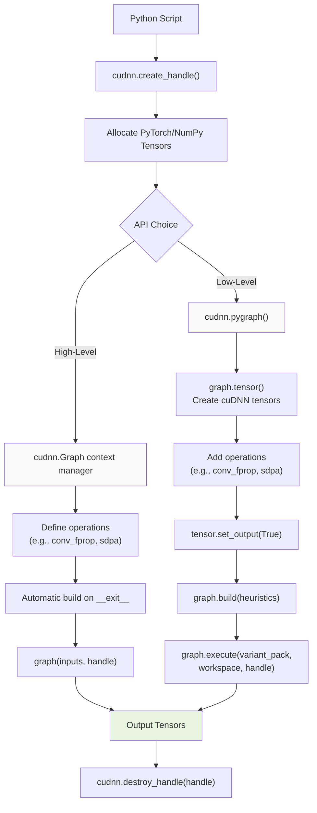
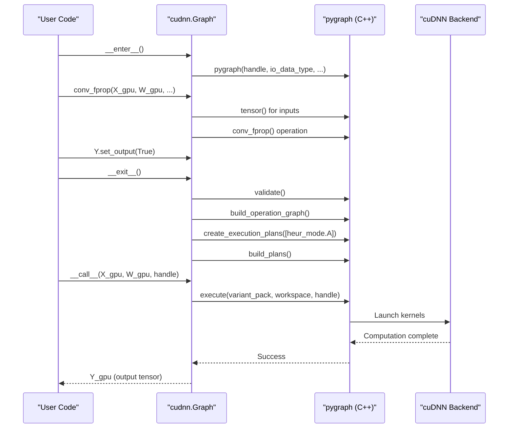
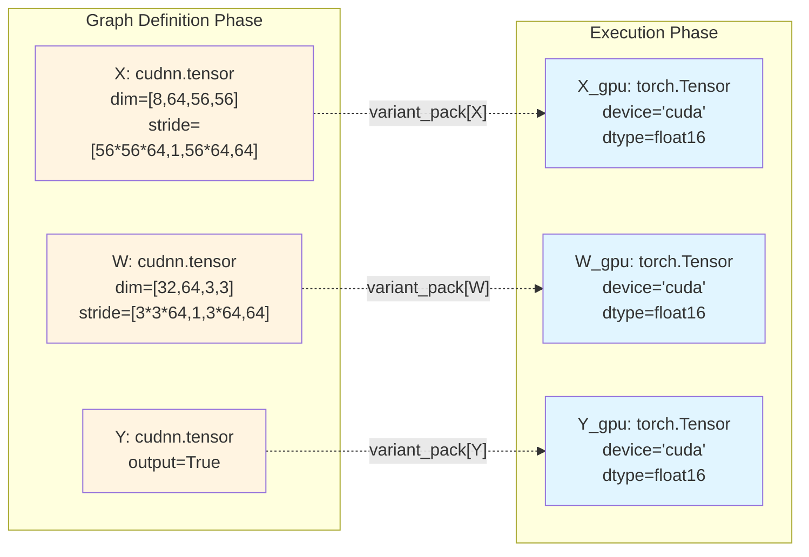
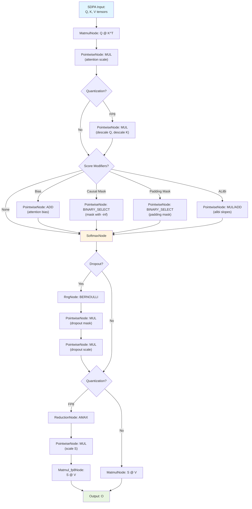
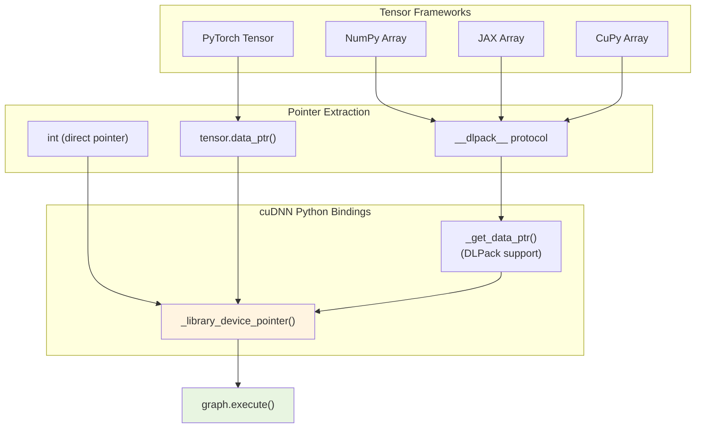

<!-- source: DeepWiki mcp.deepwiki.com · repo NVIDIA/cudnn-frontend · page 4.4 Python Examples · fetched 2026-10-26 -->

# Python Examples

<details>
<summary>Relevant source files</summary>

The following files were used as context for generating this wiki page:

- [cmake/cuDNN.cmake](cmake/cuDNN.cmake)
- [include/cudnn_frontend/node/scaled_dot_product_flash_attention.h](include/cudnn_frontend/node/scaled_dot_product_flash_attention.h)
- [include/cudnn_frontend_version.h](include/cudnn_frontend_version.h)
- [python/cudnn/__init__.py](python/cudnn/__init__.py)
- [samples/python/00_introduction.ipynb](samples/python/00_introduction.ipynb)

</details>


This page provides walkthroughs of Python examples demonstrating how to use the cuDNN Frontend Python API for various operations including convolution, scaled dot-product attention (SDPA), serialization, and mixed precision computations. These examples illustrate both the high-level `Graph` wrapper and the low-level `pygraph` API.

For information about the Python API architecture and module structure, see [Python API Overview](#4.1). For detailed documentation of the `PyGraph` class methods, see [PyGraph Class](#4.2).

## Available Example Notebooks

The repository includes Jupyter notebooks in the `samples/python/` directory that demonstrate various cuDNN operations:

| Notebook | Purpose | Key Operations |
|----------|---------|----------------|
| `00_introduction.ipynb` | Basic cuDNN usage patterns | Convolution forward, handle management, graph building |
| SDPA examples | Attention mechanisms | Flash attention, backward passes, masking |
| Serialization examples | Graph persistence | JSON export/import, debugging workflows |
| Mixed precision examples | FP8 and quantization | FP8 SDPA, scaled operations, AMAX reduction |

Sources: [samples/python/00_introduction.ipynb:1-440]()

## Example Workflow Overview

The following diagram illustrates the typical workflow for executing a cuDNN operation from Python:



Sources: [samples/python/00_introduction.ipynb:63-172](), [samples/python/00_introduction.ipynb:218-428]()

## Example 1: Convolution Using Graph Wrapper

The `cudnn.Graph` wrapper provides the simplest interface for creating and executing cuDNN operations. This example demonstrates a 2D convolution forward pass.

### Code Walkthrough

**Step 1: Create Handle and Input Tensors**

The handle is a required context object associated with a GPU device:

[samples/python/00_introduction.ipynb:99-114]()

The tensors are created in PyTorch with NHWC physical layout (channels last) but NCHW logical layout through permutation. cuDNN expects this format for convolution operations.

**Step 2: Define the Graph**

[samples/python/00_introduction.ipynb:139-154]()

Key aspects:
- The `Graph` context manager automatically finalizes and builds the graph on exit
- `inputs` parameter specifies tensor names using `"node_name::argument_name"` syntax
- `outputs` parameter specifies which tensors to return
- `conv_fprop` creates a convolution forward operation node
- PyTorch tensors are used as placeholders to infer dimensions and strides
- `set_output(True)` marks the tensor as a graph output
- `set_data_type()` specifies the output tensor's data type

**Step 3: Execute the Graph**

[samples/python/00_introduction.ipynb:177-184]()

The graph is called like a function. Input tensors must match the order specified in the `inputs` parameter. The output is automatically allocated as a PyTorch tensor.

**Step 4: Verification**

[samples/python/00_introduction.ipynb:199-205]()

### Graph Wrapper Data Flow



Sources: [samples/python/00_introduction.ipynb:139-184](), [python/cudnn/__init__.py:116-135]()

## Example 2: Convolution Using PyGraph

The low-level `pygraph` API provides more explicit control over graph construction and execution.

### Code Walkthrough

**Step 1: Create PyGraph Object**

[samples/python/00_introduction.ipynb:230-240]()

The `pygraph` object represents a subgraph. Optional parameters include:
- `name`: Identifier for the graph
- `io_data_type`: Default data type for inputs/outputs
- `compute_data_type`: Data type for computation

**Step 2: Create cuDNN Tensors**

[samples/python/00_introduction.ipynb:259-270]()

Unlike the wrapper API, you must explicitly create `cudnn.tensor` objects with:
- `dim`: Logical dimensions (NCHW format)
- `stride`: Physical strides (NHWC layout)
- `data_type`: Tensor data type (or inherited from `io_data_type`)

The stride `[56*56*64, 1, 56*64, 64]` represents channels-last layout for tensor `X` with shape `[8, 64, 56, 56]`.

**Step 3: Add Operation Node**

[samples/python/00_introduction.ipynb:285-297]()

The operation returns a cuDNN tensor representing the output.

**Step 4: Mark Output and Build Graph**

[samples/python/00_introduction.ipynb:313-336]()

The `build()` method accepts heuristic modes:
- `heur_mode.A`: Fast heuristic
- `heur_mode.FALLBACK`: Guaranteed valid plan

**Step 5: Allocate Actual Tensors and Workspace**

[samples/python/00_introduction.ipynb:357-389]()

The variant pack maps cuDNN tensors (graph placeholders) to actual GPU memory pointers.

**Step 6: Execute**

[samples/python/00_introduction.ipynb:384-392]()

### Tensor and Variant Pack Mapping



Sources: [samples/python/00_introduction.ipynb:259-392](), [python/cudnn/__init__.py:52-91](), [python/cudnn/__init__.py:116-135]()

## Example 3: Scaled Dot-Product Attention (SDPA)

SDPA is a composite operation that implements the attention mechanism used in transformers. The operation computes:

```
Attention(Q, K, V) = softmax((Q @ K^T) / sqrt(d_k)) @ V
```

### Basic SDPA Usage Pattern

```python
import cudnn
import torch

handle = cudnn.create_handle()

with cudnn.Graph(
    inputs=["sdpa::Q", "sdpa::K", "sdpa::V"],
    outputs=["attn_out"],
) as graph:
    # Create attention operation
    O = graph.sdpa(
        q=Q_gpu,  # [batch, heads, seq_q, dim_qk]
        k=K_gpu,  # [batch, heads, seq_kv, dim_qk]
        v=V_gpu,  # [batch, heads, seq_kv, dim_v]
        is_inference=True,
        attn_scale=1.0 / math.sqrt(dim_qk),
        name="sdpa"
    )
    O.set_output(True).set_name("attn_out")

# Execute
O_gpu = graph(Q_gpu, K_gpu, V_gpu, handle=handle)
```

### SDPA Node Expansion

The `SDPANode` is a composite node that expands into multiple primitive operations:



Sources: [include/cudnn_frontend/node/scaled_dot_product_flash_attention.h:348-701]()

### SDPA with Masking and Dropout

```python
# Training mode SDPA with causal masking and dropout
with cudnn.Graph(
    inputs=["sdpa::Q", "sdpa::K", "sdpa::V", 
            "sdpa::Seed", "sdpa::Offset"],
    outputs=["attn_out", "stats"],
) as graph:
    O = graph.sdpa(
        q=Q_gpu,
        k=K_gpu,
        v=V_gpu,
        is_inference=False,  # Training mode
        attn_scale=1.0 / math.sqrt(dim_qk),
        use_causal_mask=True,  # Apply causal attention mask
        dropout=0.1,  # 10% dropout
        compute_data_type=cudnn.data_type.FLOAT,
        name="sdpa"
    )
    
    Stats = graph.tensor_like(O)  # Stats for backward pass
    O.set_output(True).set_name("attn_out")
    Stats.set_output(True).set_name("stats")

# Execute with seed and offset for dropout RNG
import numpy as np
seed_gpu = torch.tensor(np.random.randint(0, 2**31), 
                        device='cuda', dtype=torch.int64)
offset_gpu = torch.tensor(0, device='cuda', dtype=torch.int64)

O_gpu, Stats_gpu = graph(Q_gpu, K_gpu, V_gpu, 
                          seed_gpu, offset_gpu, 
                          handle=handle)
```

### FP8 SDPA with Quantization

For FP8 mixed precision, additional scale and descale tensors are required:

```python
with cudnn.Graph(
    inputs=["sdpa::Q", "sdpa::K", "sdpa::V",
            "sdpa::Descale_Q", "sdpa::Descale_K",
            "sdpa::Descale_S", "sdpa::Descale_V",
            "sdpa::Scale_S", "sdpa::Scale_O"],
    outputs=["attn_out", "amax_s", "amax_o"],
) as graph:
    O = graph.sdpa_fp8(
        q=Q_fp8_gpu,  # FP8 tensor
        k=K_fp8_gpu,
        v=V_fp8_gpu,
        descale_q=descale_q_gpu,  # Descaling factors
        descale_k=descale_k_gpu,
        descale_s=descale_s_gpu,
        descale_v=descale_v_gpu,
        scale_s=scale_s_gpu,      # Scaling factors
        scale_o=scale_o_gpu,
        attn_scale=1.0 / math.sqrt(dim_qk),
        name="sdpa"
    )
    
    # Additional outputs for FP8
    Amax_S = graph.tensor_like(O)  # Max absolute value of S
    Amax_O = graph.tensor_like(O)  # Max absolute value of O
    
    O.set_output(True).set_name("attn_out")
    Amax_S.set_output(True).set_name("amax_s")
    Amax_O.set_output(True).set_name("amax_o")
```

Sources: [include/cudnn_frontend/node/scaled_dot_product_flash_attention.h:447-459](), [include/cudnn_frontend/node/scaled_dot_product_flash_attention.h:637-695]()

## Common Patterns and Best Practices

### Pattern 1: Handle Management

Always create and destroy handles properly:

```python
handle = cudnn.create_handle()
try:
    # Use handle for graph operations
    graph.execute(variant_pack, workspace, handle=handle)
finally:
    cudnn.destroy_handle(handle)
```

Sources: [samples/python/00_introduction.ipynb:99-106](), [samples/python/00_introduction.ipynb:424-429]()

### Pattern 2: Workspace Allocation

Query workspace size after building the graph:

```python
graph.build([cudnn.heur_mode.A, cudnn.heur_mode.FALLBACK])
workspace_size = graph.get_workspace_size()
workspace = torch.empty(workspace_size, device='cuda', dtype=torch.uint8)
```

Sources: [samples/python/00_introduction.ipynb:384-389]()

### Pattern 3: Tensor Layout Specification

cuDNN requires explicit stride specification for non-contiguous layouts:

```python
# NHWC layout for [N=8, C=64, H=56, W=56]
# Physical memory order: N, H, W, C
# Strides: [H*W*C, W*C, C, 1]
X = graph.tensor(
    dim=[8, 64, 56, 56],           # Logical NCHW
    stride=[56*56*64, 1, 56*64, 64],  # Physical NHWC
    data_type=cudnn.data_type.HALF
)
```

Sources: [samples/python/00_introduction.ipynb:259-270]()

### Pattern 4: Virtual vs Physical Tensors

Mark intermediate tensors as virtual to save memory:

```python
# Input tensor: physical (requires device pointer)
X = graph.tensor(dim=[...], stride=[...], is_virtual=False)

# Intermediate result: virtual (managed by cuDNN)
intermediate = graph.pointwise(X, mode=cudnn.pointwise_mode.RELU)
# intermediate is virtual by default

# Output tensor: physical (mark with set_output)
Y = graph.matmul(intermediate, W)
Y.set_output(True)  # Makes it physical
```

Sources: [samples/python/00_introduction.ipynb:307-317](), [python/cudnn/__init__.py:52-91]()

### Pattern 5: Heuristic Selection

Specify multiple heuristics for robustness:

```python
# Try fast heuristic first, fall back to guaranteed valid plan
graph.build([
    cudnn.heur_mode.A,        # Fast heuristic
    cudnn.heur_mode.B,        # Exhaustive search
    cudnn.heur_mode.FALLBACK  # Guaranteed valid
])
```

Sources: [samples/python/00_introduction.ipynb:330-336]()

## Execution Model Comparison

The following table summarizes the differences between the two Python APIs:

| Aspect | `cudnn.Graph` Wrapper | `cudnn.pygraph` Direct |
|--------|----------------------|------------------------|
| **Tensor Creation** | PyTorch/NumPy tensors as placeholders | Explicit `graph.tensor()` calls |
| **Input Specification** | `inputs=["node::arg", ...]` | Tensor objects passed to operations |
| **Graph Building** | Automatic on context exit | Manual `graph.build()` call |
| **Output Allocation** | Automatic tensor creation | Pre-allocated tensors in variant pack |
| **Execution** | `graph(inputs, handle=handle)` | `graph.execute(variant_pack, workspace, handle)` |
| **Use Case** | Quick prototyping, simple graphs | Performance-critical, complex graphs |

Sources: [samples/python/00_introduction.ipynb:63-172](), [samples/python/00_introduction.ipynb:218-428](), [python/cudnn/__init__.py:116-162]()

## Data Type Interoperability

cuDNN Python bindings support multiple tensor frameworks through DLPack:



Sources: [python/cudnn/__init__.py:104-114](), [python/cudnn/__init__.py:116-135]()

## Error Handling

Python bindings translate C++ exceptions to Python exceptions:

```python
try:
    graph.build([cudnn.heur_mode.A])
except cudnn.cudnnGraphNotSupportedError as e:
    print(f"Graph not supported: {e}")
    # Fallback to alternative implementation
except Exception as e:
    error_msg = cudnn.get_last_error_string()
    print(f"cuDNN error: {error_msg}")
```

Sources: [python/cudnn/__init__.py:39]()

## Performance Considerations

### Plan Caching

cuDNN automatically caches execution plans. Reusing the same graph with different data leverages this cache:

```python
# Build graph once
with cudnn.Graph(...) as graph:
    # Define operations
    pass

# Execute multiple times (plans are cached)
for batch in data_loader:
    output = graph(batch, handle=handle)
```

### Autotuning

For performance-critical applications, use `heur_mode.B` for exhaustive search:

```python
graph.build([cudnn.heur_mode.B])  # Slower build, faster execution
```

### Memory Management

Minimize workspace size by building with workspace constraints:

```python
# Limit workspace to 1GB
graph.build(
    [cudnn.heur_mode.A],
    max_workspace_size=1024*1024*1024
)
```

Sources: [samples/python/00_introduction.ipynb:330-336]()

---

