<!-- source: DeepWiki mcp.deepwiki.com · repo NVIDIA/cudnn-frontend · page 5 Advanced Topics · fetched 2026-10-26 -->

# Advanced Topics

<details>
<summary>Relevant source files</summary>

The following files were used as context for generating this wiki page:

- [include/cudnn_frontend/plans.h](include/cudnn_frontend/plans.h)
- [include/cudnn_frontend_EngineConfigGenerator.h](include/cudnn_frontend_EngineConfigGenerator.h)
- [include/cudnn_frontend_Filters.h](include/cudnn_frontend_Filters.h)
- [include/cudnn_frontend_Heuristics.h](include/cudnn_frontend_Heuristics.h)
- [include/cudnn_frontend_get_plan.h](include/cudnn_frontend_get_plan.h)
- [include/cudnn_frontend_shim.h](include/cudnn_frontend_shim.h)

</details>


## Purpose and Scope

This section covers advanced usage patterns, optimization techniques, and specialized features in cuDNN Frontend beyond basic graph construction and execution. These topics enable production-level optimization, deployment flexibility, and sophisticated memory management strategies.

**Topics covered:**
- Performance optimization through heuristics, filtering, and autotuning
- Error handling and propagation
- Dynamic library loading for deployment flexibility  
- Serialization for debugging and caching
- Advanced memory management
- Kernel caching for dynamic shapes (cuDNN 9.4+)

For basic graph API usage, see [Graph API](#2.1). For operation-specific features, see [Node Types](#3). For Python-specific topics, see [Python Interface](#4).

## Execution Planning System Overview

The execution planning system is the core advanced feature of cuDNN Frontend, responsible for selecting and optimizing execution strategies for operation graphs. This multi-stage pipeline transforms an operation graph into executable plans through heuristics, filtering, and optional autotuning.

### Execution Planning Pipeline

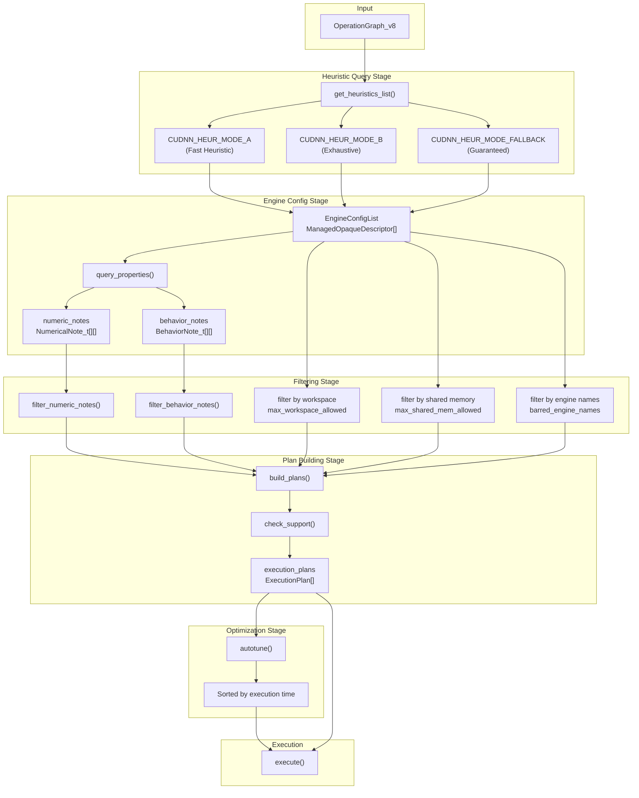

**Sources:** [include/cudnn_frontend_Heuristics.h:359-467](), [include/cudnn_frontend/plans.h:173-664](), [include/cudnn_frontend_Filters.h:30-96]()

### Key Classes and Interfaces

| Class | Purpose | Key Methods |
|-------|---------|-------------|
| `EngineHeuristics_v8` | Queries backend for engine recommendations | `getEngineConfig()`, `getEngineConfigCount()` |
| `Execution_plan_list` | Manages plan lifecycle and filtering | `query_properties()`, `filter_numeric_notes()`, `build_plans()`, `autotune()` |
| `ExecutionPlan` | Individual compiled execution plan | `getWorkspaceSize()`, `getTag()`, `getExecutionTime()` |
| `EngineConfigGenerator` | Generates configs from multiple sources | `generate_engine_config()`, `cudnnGetPlan()`, `cudnnFindPlan()` |

**Sources:** [include/cudnn_frontend_Heuristics.h:50-145](), [include/cudnn_frontend/plans.h:173-224](), [include/cudnn_frontend_EngineConfigGenerator.h:40-102]()

## Heuristic Modes

The cuDNN backend provides three heuristic modes for engine selection, each with different performance and reliability characteristics:

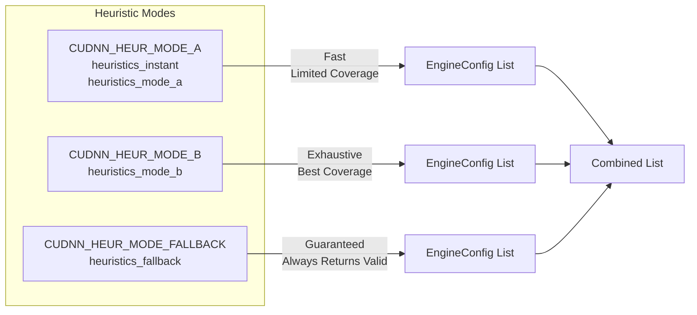

### Mode Characteristics

| Mode | String Identifier | Characteristics | Use Case |
|------|------------------|-----------------|----------|
| `CUDNN_HEUR_MODE_A` | `"heuristics_mode_a"`, `"heuristics_instant"` | Fast query, returns top recommendations | Interactive development, quick iteration |
| `CUDNN_HEUR_MODE_B` | `"heuristics_mode_b"` | Exhaustive search, may take longer, serialized with mutex | Production optimization, benchmarking |
| `CUDNN_HEUR_MODE_FALLBACK` | `"heuristics_fallback"` | Guaranteed to return valid engines | Fallback when other modes fail |

**Sources:** [include/cudnn_frontend_Heuristics.h:274-283](), [include/cudnn_frontend_Heuristics.h:396-440]()

### Heuristic Query Implementation

The `get_heuristics_list()` function queries multiple modes in sequence and accumulates results:

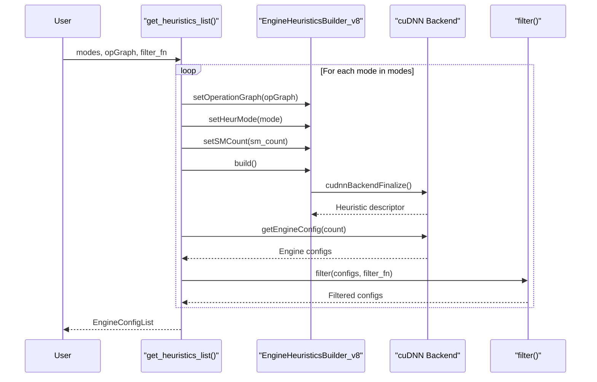

**Sources:** [include/cudnn_frontend_Heuristics.h:383-444]()

**Version-Specific Behavior:**
- cuDNN 8.3-8.5: Mode B does not automatically fallback to Mode A on failure [include/cudnn_frontend_Heuristics.h:420-425]()
- cuDNN 8.9.5+: Supports `CUDNN_ATTR_ENGINEHEUR_SM_COUNT_TARGET` for multi-GPU scenarios [include/cudnn_frontend_Heuristics.h:252-271]()
- cuDNN 9.8+: Supports `CUDNN_ATTR_ENGINEHEUR_DEVICEPROP` for device-specific optimization [include/cudnn_frontend_Heuristics.h:235-249]()

## Filtering and Selection

After obtaining engine configurations from heuristics, the system applies multiple filtering stages to select suitable plans based on constraints and requirements.

### Filter Types and Architecture

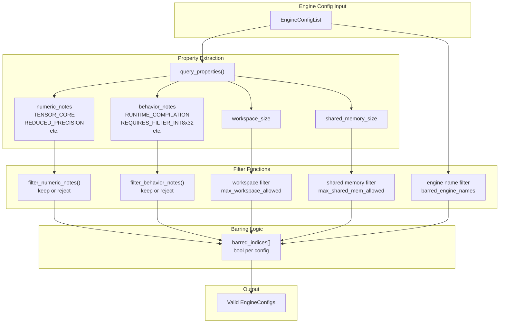

**Sources:** [include/cudnn_frontend/plans.h:254-361](), [include/cudnn_frontend/plans.h:397-462](), [include/cudnn_frontend_Filters.h:30-96]()

### Numerical and Behavioral Notes

Engine configurations carry metadata about their characteristics and requirements:

**Numerical Notes** indicate computational properties:
- `CUDNN_NUMERICAL_NOTE_TENSOR_CORE`: Uses Tensor Cores
- `CUDNN_NUMERICAL_NOTE_DOWN_CONVERT_INPUTS`: Converts inputs to lower precision
- `CUDNN_NUMERICAL_NOTE_REDUCED_PRECISION_REDUCTION`: Uses reduced precision for reductions
- `CUDNN_NUMERICAL_NOTE_FFT`: Uses FFT operations
- `CUDNN_NUMERICAL_NOTE_NONDETERMINISTIC`: Non-deterministic results

**Behavioral Notes** indicate runtime requirements:
- `CUDNN_BEHAVIOR_NOTE_RUNTIME_COMPILATION`: Requires JIT compilation
- `CUDNN_BEHAVIOR_NOTE_REQUIRES_FILTER_INT8x32_REORDER`: Requires filter reordering
- `CUDNN_BEHAVIOR_NOTE_REQUIRES_BIAS_INT8x32_REORDER`: Requires bias reordering

**Sources:** [include/cudnn_frontend/plans.h:254-333](), [include/cudnn_frontend_Filters.h:41-95]()

### Workspace and Memory Filtering

Memory constraints are enforced differently based on cuDNN version:

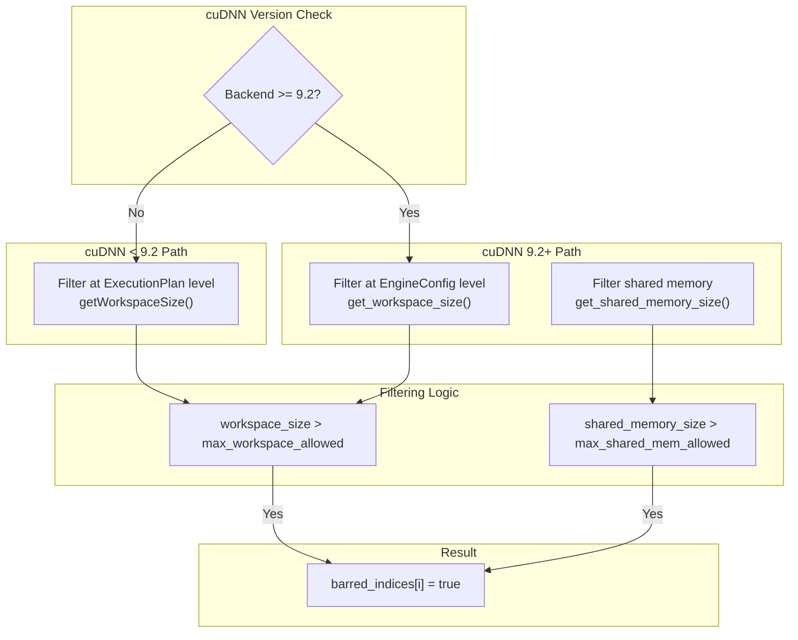

**Sources:** [include/cudnn_frontend/plans.h:209-216](), [include/cudnn_frontend/plans.h:430-453]()

## Autotuning

Autotuning empirically measures execution time for multiple plans and selects the fastest. This is more accurate than heuristics alone but requires actual execution.

### Autotuning Process

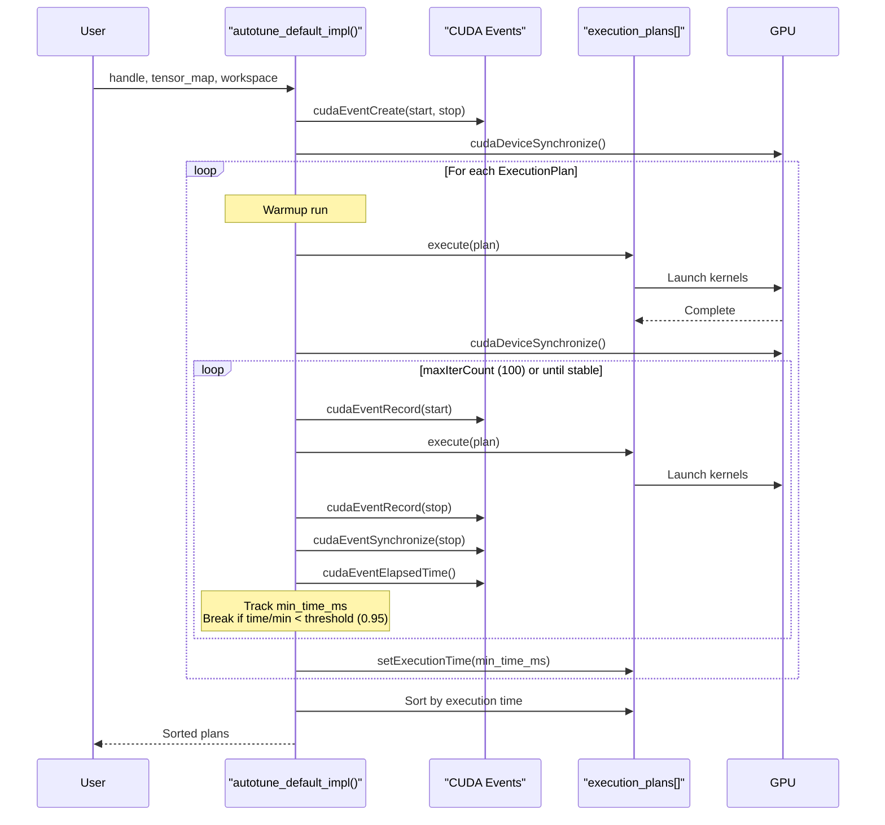

**Sources:** [include/cudnn_frontend/plans.h:559-634]()

### Autotuning Configuration

| Parameter | Default | Purpose |
|-----------|---------|---------|
| `maxIterCount` | 100 | Maximum iterations per plan |
| `threshold` | 0.95 | Stability threshold for early exit |
| Warmup runs | 1 | Initial run to eliminate cold-start effects |

The autotuning implementation can be customized by setting `autotune_impl` to a user-provided function with signature:
```cpp
error_t (*)(std::vector<std::shared_ptr<ExecutionPlan>>&,
            cudnnHandle_t,
            std::unordered_map<int64_t, void*> const&,
            void*,
            void*)
```

**Sources:** [include/cudnn_frontend/plans.h:636-650]()

## Dynamic Loading Architecture

The dynamic loading system allows cuDNN Frontend to resolve cuDNN and CUDA functions at runtime rather than link-time, enabling flexible deployment scenarios.

### Dynamic Loading Components

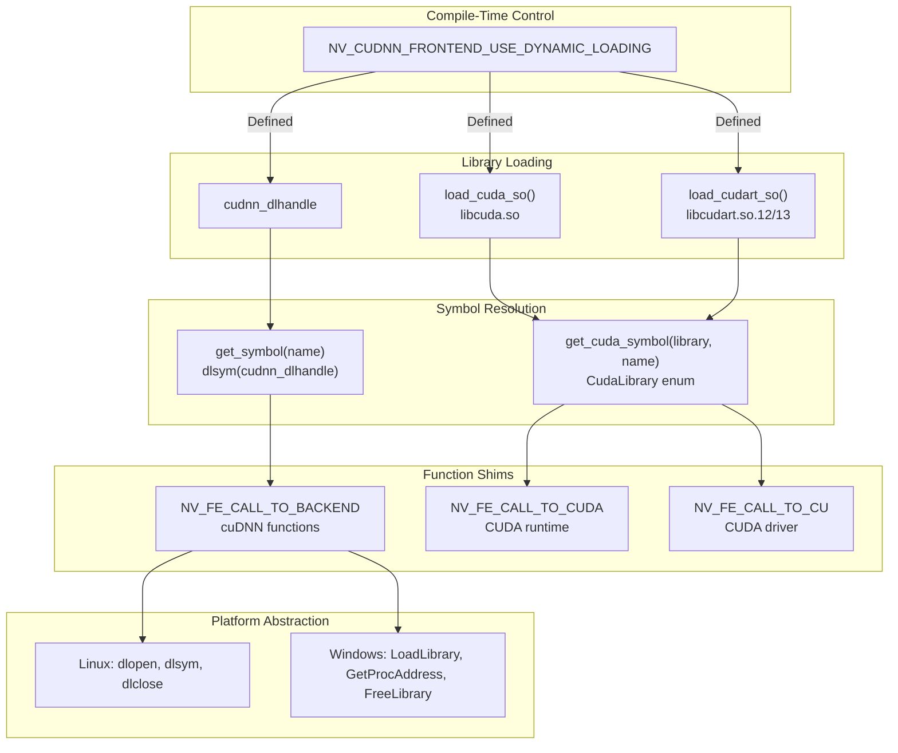

**Sources:** [include/cudnn_frontend_shim.h:27-194]()

### Symbol Resolution Macros

Three macros handle function calls with appropriate dynamic/static dispatch:

**`NV_FE_CALL_TO_BACKEND`**: Calls cuDNN backend functions
```cpp
// With dynamic loading:
static void *fptr = get_symbol("cudnnBackendCreateDescriptor");
return reinterpret_cast<decltype(create_descriptor) *>(fptr)(...);

// Without dynamic loading:
return cudnnBackendCreateDescriptor(...);
```

**`NV_FE_CALL_TO_CUDA`**: Calls CUDA runtime functions
```cpp
// With dynamic loading:
return reinterpret_cast<decltype(cuda_malloc) *>(
    get_cuda_symbol(CudaLibrary::CUDART, "cudaMalloc"))(...);

// Without dynamic loading:
return cudaMalloc(...);
```

**`NV_FE_CALL_TO_CU`**: Calls CUDA driver functions
```cpp
// With dynamic loading:
return reinterpret_cast<decltype(cu_graph_create) *>(
    get_cuda_symbol(CudaLibrary::CUDA, "cuGraphCreate"))(...);

// Without dynamic loading:
return cuGraphCreate(...);
```

**Sources:** [include/cudnn_frontend_shim.h:172-194]()

### Platform-Specific Loading

The system handles platform differences transparently:

| Platform | Library Loading | Symbol Resolution | Close Function |
|----------|----------------|-------------------|----------------|
| **Linux** | `dlopen(name, RTLD_NOW)` | `dlsym(handle, symbol)` | `dlclose(handle)` |
| **Windows** | `LoadLibrary(name)` | `GetProcAddress(handle, symbol)` | `FreeLibrary(handle)` |

**CUDA Runtime Version Handling:**
The system attempts to load `libcudart.so.12` or `libcudart.so.13` and throws an error if multiple versions are found, ensuring version consistency [include/cudnn_frontend_shim.h:83-116]().

**Thread Safety:**
Symbol resolution is protected by a static mutex to ensure thread-safe initialization [include/cudnn_frontend_shim.h:118-148]().

**Sources:** [include/cudnn_frontend_shim.h:28-148]()

## Plan Building Policies

The system supports different strategies for building execution plans:

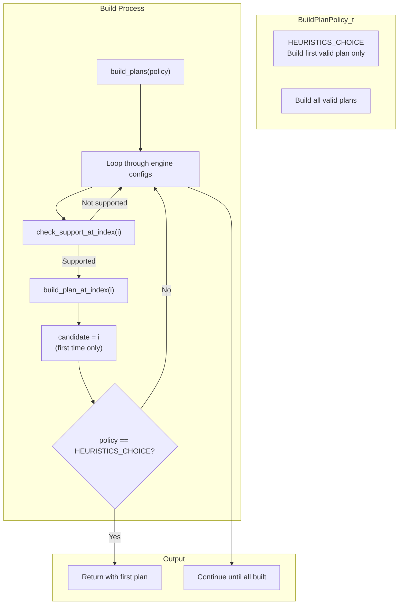

**Key Optimization:**
For cuDNN versions < 9.2, `check_support()` already builds the plan as a side effect, so `build_plans()` with `HEURISTICS_CHOICE` policy returns immediately if a candidate already exists [include/cudnn_frontend/plans.h:517-521]().

**Sources:** [include/cudnn_frontend/plans.h:503-548]()

## Error Handling in Advanced Features

Advanced operations integrate with the error handling system described in [Error Handling](#5.1):

### Error Propagation Pattern

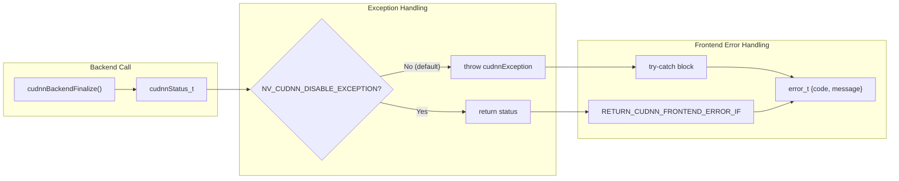

**Example from Heuristics:**
```cpp
auto status = detail::finalize(m_heuristics.pointer->get_backend_descriptor());
if (status != CUDNN_STATUS_SUCCESS) {
    set_error_and_throw_exception(
        &m_heuristics, status, "CUDNN_BACKEND_ENGINEHEUR_DESCRIPTOR: cudnn Finalize failed");
    return std::move(m_heuristics);
}
```

**Sources:** [include/cudnn_frontend_Heuristics.h:278-289](), [include/cudnn_frontend/plans.h:29-38]()

## Cross-Cutting Concerns

### Version Compatibility Checks

The system uses macros to conditionally compile or check features based on cuDNN version:

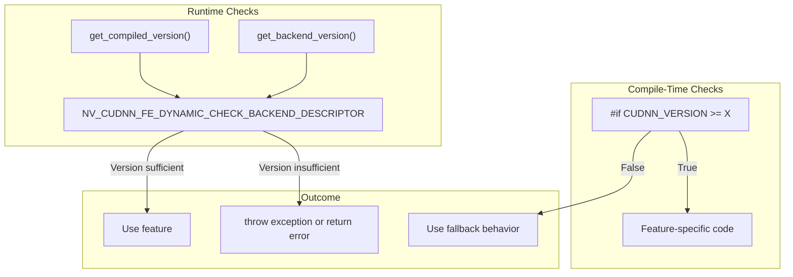

**Examples:**
- SM count targeting requires cuDNN 8.9.5+ [include/cudnn_frontend_Heuristics.h:252-271]()
- Device properties requires cuDNN 9.8+ [include/cudnn_frontend_Heuristics.h:235-249]()
- Shared memory queries require cuDNN 9.2+ [include/cudnn_frontend/plans.h:430-453]()

**Sources:** [include/cudnn_frontend_shim.h:153-169]()

### Logging and Debugging

The system uses logging macros throughout advanced features:

| Macro | Purpose | Example Usage |
|-------|---------|---------------|
| `CUDNN_FE_LOG_LABEL_ENDL` | Log labeled message with newline | Plan selection, heuristic counts |
| `CUDNN_FE_LOG_LABEL` | Log labeled message without newline | Filtering progress |
| `CUDNN_FE_LOG` | Log continuation message | Error details |

**Sources:** [include/cudnn_frontend/plans.h:26](), [include/cudnn_frontend_Heuristics.h:375]()

## Workspace Management

Workspace is temporary GPU memory required during execution:

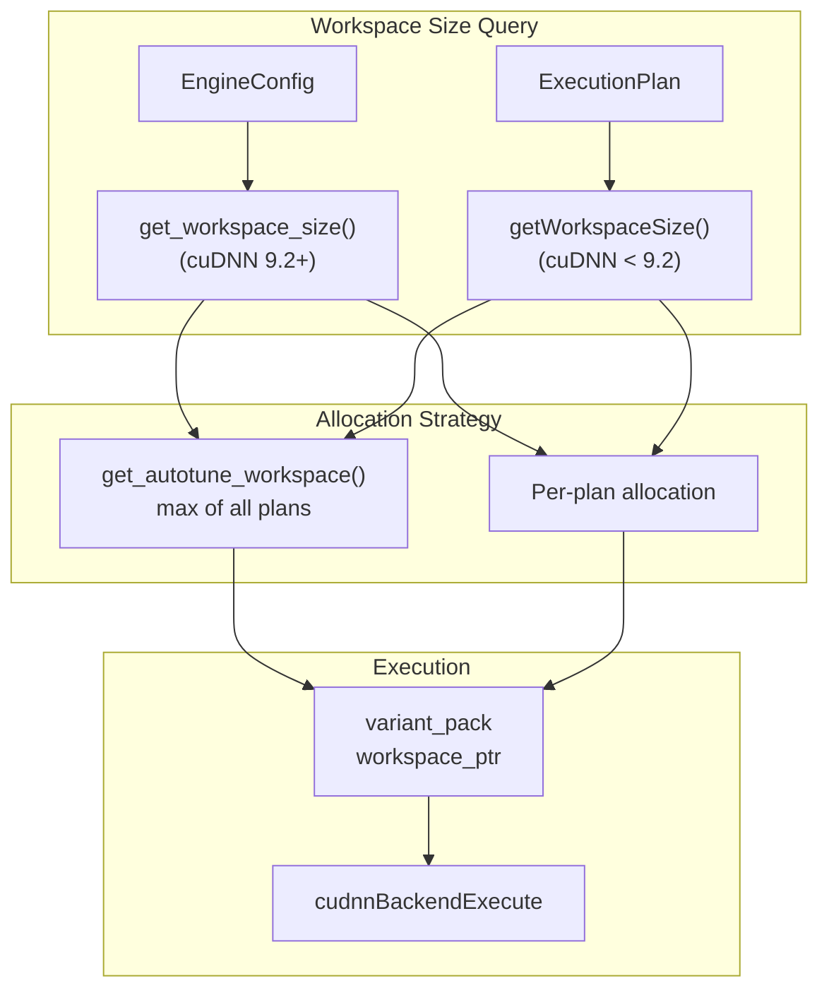

**Workspace Query Methods:**

For cuDNN 9.2+:
```cpp
int64_t workspace_size;
CHECK_CUDNN_FRONTEND_ERROR(
    detail::get_workspace_size(engine_configs[index], workspace_size));
```

For cuDNN < 9.2:
```cpp
int64_t workspace_size = execution_plan->getWorkspaceSize();
```

**Autotuning Workspace:**
When autotuning multiple plans, allocate the maximum workspace required by any plan:
```cpp
int64_t max_size = 0;
for (auto& plan : execution_plans) {
    max_size = std::max(max_size, plan->getWorkspaceSize());
}
```

**Sources:** [include/cudnn_frontend/plans.h:443-453](), [include/cudnn_frontend/plans.h:550-557]()

## Summary

The advanced features in cuDNN Frontend provide production-level capabilities:

1. **Execution Planning** - Multi-stage pipeline with heuristics, filtering, and optimization
2. **Performance Tuning** - Autotuning with empirical measurement and plan selection strategies  
3. **Deployment Flexibility** - Dynamic loading for runtime library resolution
4. **Memory Optimization** - Workspace management and filtering by memory constraints
5. **Quality Assurance** - Filtering by numerical and behavioral notes for reliability

For detailed information on specific topics:
- **Error Handling**: [Error Handling](#5.1)
- **Dynamic Loading**: [Dynamic Loading](#5.2)  
- **Serialization**: [Serialization](#5.3)
- **Performance Optimization**: [Performance Optimization](#5.4)
- **Memory Management**: [Memory Management](#5.5)
- **Kernel Caching**: [Kernel Cache & Dynamic Shapes](#5.6)

**Sources:** [include/cudnn_frontend_Heuristics.h](), [include/cudnn_frontend/plans.h](), [include/cudnn_frontend_shim.h](), [include/cudnn_frontend_Filters.h](), [include/cudnn_frontend_EngineConfigGenerator.h](), [include/cudnn_frontend_get_plan.h]()

---

