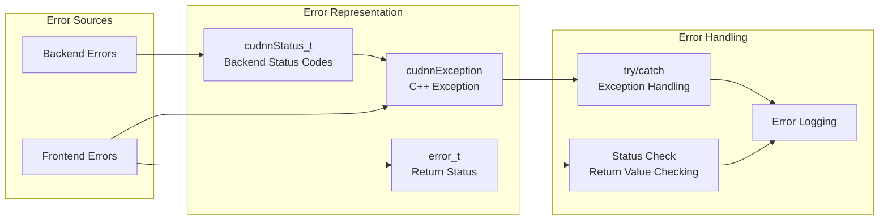
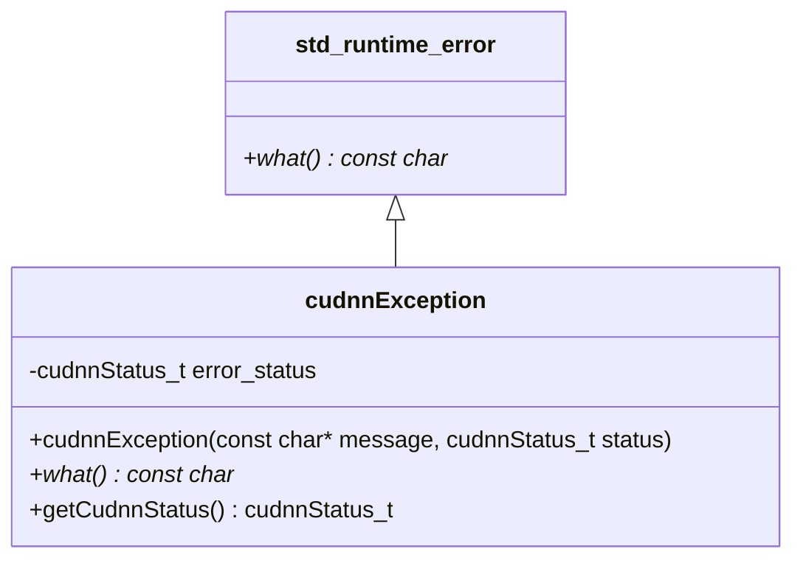
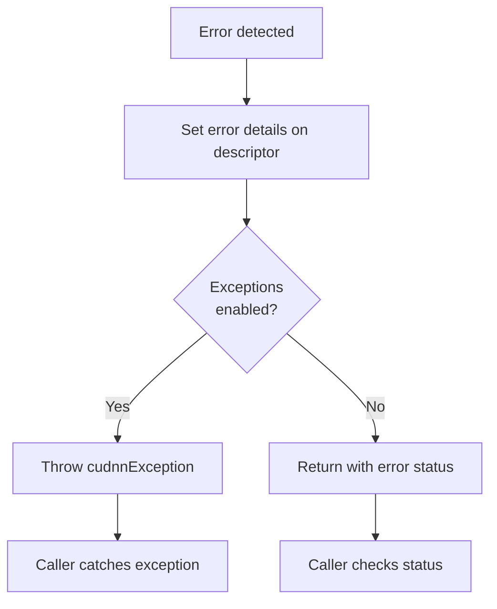
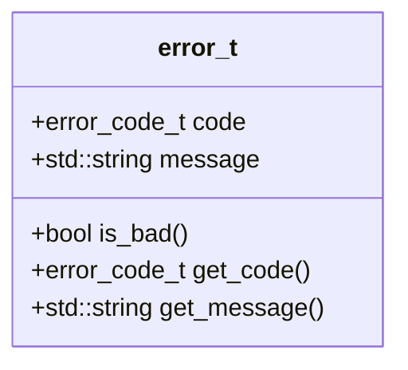
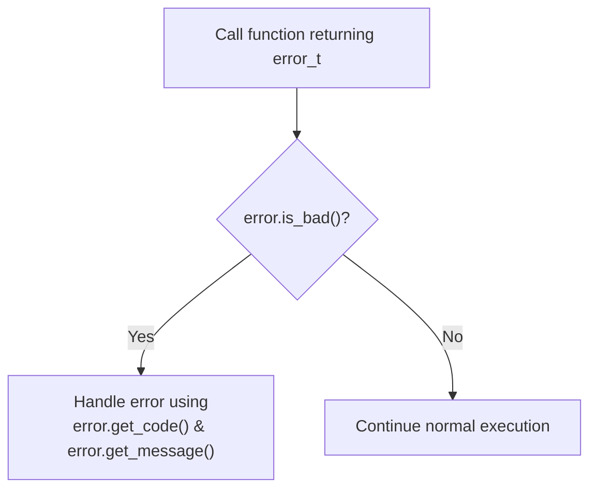
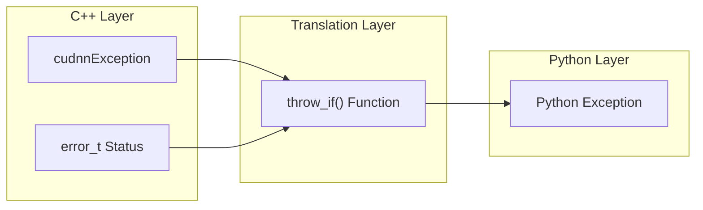
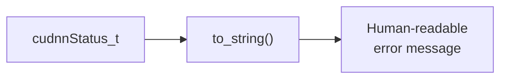
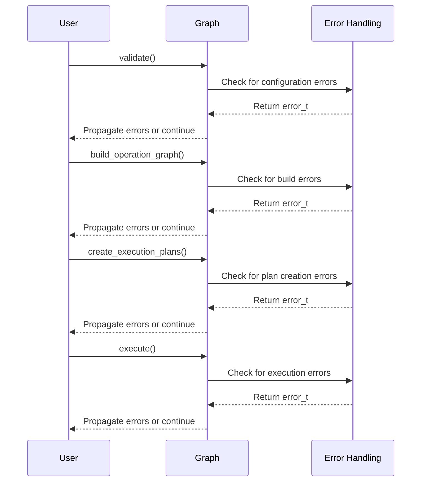
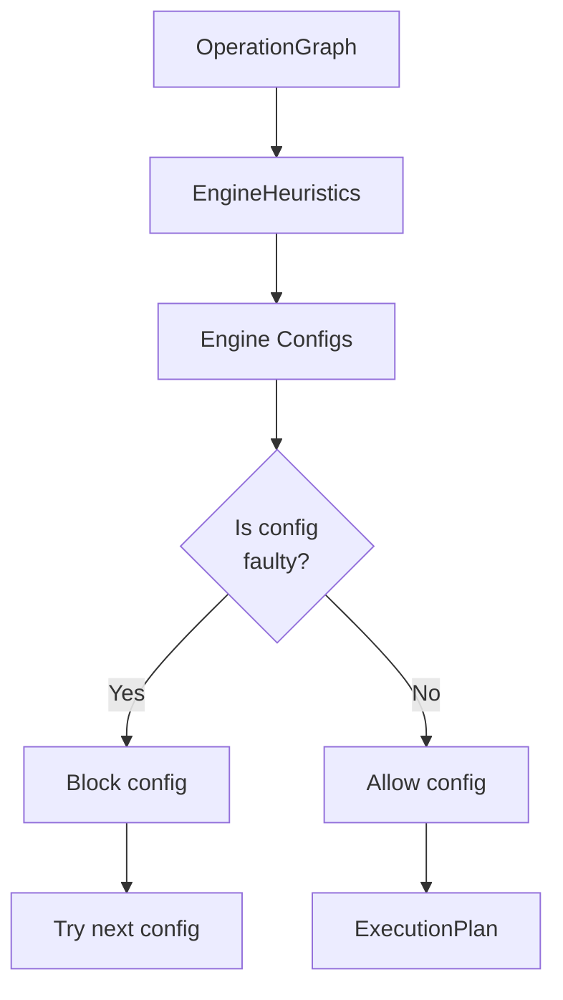

<!-- source: DeepWiki mcp.deepwiki.com · repo NVIDIA/cudnn-frontend · page 5.1 Error Handling · fetched 2026-10-26 -->

# Error Handling

<details>
<summary>Relevant source files</summary>

The following files were used as context for generating this wiki page:

- [include/cudnn_frontend/node_interface.h](include/cudnn_frontend/node_interface.h)
- [include/cudnn_frontend/utils/serialize.h](include/cudnn_frontend/utils/serialize.h)
- [include/cudnn_frontend_Errata.h](include/cudnn_frontend_Errata.h)
- [include/cudnn_frontend_find_plan.h](include/cudnn_frontend_find_plan.h)
- [include/cudnn_frontend_utils.h](include/cudnn_frontend_utils.h)
- [python/pygraph/pygraph.cpp](python/pygraph/pygraph.cpp)
- [python/pygraph/sdpa.cpp](python/pygraph/sdpa.cpp)

</details>


This document describes the error handling mechanisms in the cuDNN Frontend library. The library provides a dual approach to error handling: exception-based for C++ applications and status code returns that can be used in both exception and non-exception environments. This page covers how errors are represented, thrown, detected, and handled throughout the library.

## Error Handling Mechanisms

The cuDNN Frontend library provides two main mechanisms for error handling:

1. **Exception-based error handling** - Uses C++ exceptions to signal errors (default behavior)
2. **Status-based error handling** - Returns error statuses that need to be checked explicitly



Sources: [include/cudnn_frontend_utils.h:202-217](), [include/cudnn_frontend_utils.h:233-245]()

### cudnnException Class

The core of the exception-based error handling is the `cudnnException` class, which encapsulates both an error message and the original cuDNN status code.



Sources: [include/cudnn_frontend_utils.h:202-217]()

The `cudnnException` class inherits from `std::runtime_error` and adds a specific cuDNN status code. This allows catching and handling cuDNN-specific errors while preserving the full error context.

## Error Throwing and Setting

The library provides a centralized mechanism for setting errors and optionally throwing exceptions, controlled by the `NV_CUDNN_DISABLE_EXCEPTION` compilation flag.



Sources: [include/cudnn_frontend_utils.h:233-245]()

The key function for this process is `set_error_and_throw_exception()`:

```cpp
static inline void
set_error_and_throw_exception(BackendDescriptor const* desc, cudnnStatus_t status, const char* message) {
    std::string padded_message = std::string(message) + detail::get_last_error_string_();
    if (desc != nullptr) {
        desc->set_status(status);
        desc->set_error(padded_message.c_str());
    }
#ifndef NV_CUDNN_DISABLE_EXCEPTION
    throw cudnnException(
        std::string(std::string(padded_message) + std::string(" cudnn_status: ") + to_string(status)).c_str(), status);
#endif
}
```

## Status-Based Error Handling

For environments where exceptions are not suitable (such as C interfaces or if exceptions are disabled), the library provides a status-based error reporting mechanism.

### error_t Structure

The error_t structure combines an error code with a descriptive message:



Sources: [include/cudnn_frontend/graph_properties.h:35-55]()

This allows functions to return detailed error information without relying on exceptions. The `error_t` structure includes helper methods like `is_bad()` to easily check for errors.

### Error Checking Pattern

The typical pattern for checking errors in the status-based approach is:



This pattern is used extensively in the library's internal implementations and can be seen in methods like `validate()` in the `Tensor_attributes` class:

```cpp
error_t
validate() const {
    RETURN_CUDNN_FRONTEND_ERROR_IF(
        dim.empty(), error_code_t::ATTRIBUTE_NOT_SET, "Tensor '" + name + "' dims not set.");
    RETURN_CUDNN_FRONTEND_ERROR_IF(
        stride.empty(), error_code_t::ATTRIBUTE_NOT_SET, "Tensor '" + name + "' strides not set.");
    // ... more validation checks ...
    return {error_code_t::OK, ""};
}
```

Sources: [include/cudnn_frontend/graph_properties.h:35-55]()

## Python Error Handling

The Python bindings for cuDNN Frontend convert C++ errors into Python exceptions for a more Pythonic interface.



Sources: [python/pygraph/pygraph.cpp:316-317](). [python/pygraph/pygraph.cpp:404-406]()

The Python bindings use a helper function `throw_if()` to check error conditions and convert them to Python exceptions:

```cpp
void
PyGraph::validate() {
    auto status = graph->validate();
    throw_if(status.is_bad(), status.get_code(), status.get_message());
}
```

This pattern is used consistently throughout the Python bindings to ensure that Python users get appropriate exceptions when errors occur.

## Error Status Conversion

The library provides utility functions to convert between different error representations, particularly for converting cuDNN status codes to human-readable strings.



Sources: [include/cudnn_frontend_utils.h:225-228]()

Key conversion functions include:

- `to_string(cudnnStatus_t status)` - Converts a cuDNN status code to a string message
- `to_string(cudnnBackendBehaviorNote_t note)` - Converts behavior notes to strings
- `to_string(cudnnBackendNumericalNote_t note)` - Converts numerical notes to strings

## Error Checking in Graph Operations

The Graph API provides a comprehensive way to build and execute neural network operations. Error handling is integrated throughout the Graph API's lifecycle.



Sources: [python/pygraph/pygraph.h:410-445]()

## Error Handling with Engine Compatibility

The library includes specialized error handling for compatibility issues with different engines and configurations.



Sources: [include/cudnn_frontend_Errata.h:254-290]()

The `check_errata()` function is used to verify if a given execution plan configuration is problematic:

```cpp
template <typename T>
static bool
check_errata(const json &json_handle, const std::string &executionPlanTag, cudnnHandle_t handle, T fn) {
    CUDNN_FE_LOG_LABEL("Verifying " << executionPlanTag);
    for (auto const &rule : json_handle["rules"]) {
        if (check_rule<T>(rule, executionPlanTag, handle, fn)) {
            CUDNN_FE_LOG(". Blocking." << std::endl);
            return true;  // Plan is faulty
        }
    }
    CUDNN_FE_LOG(". Passed." << std::endl);
    return false;  // Plan is not faulty
}
```

## Best Practices for Error Handling

When developing applications using the cuDNN Frontend library, the following error handling practices are recommended:

### Using Exception-Based Error Handling (C++)

```cpp
try {
    // Create and configure graph
    auto graph = std::make_shared<cudnn_frontend::graph::Graph>();
    
    // ... configure operations ...
    
    // Build and execute
    graph->validate();
    graph->build_operation_graph(handle);
    graph->create_execution_plans({cudnn_frontend::HeurMode_t::A});
    graph->execute(handle, variant_pack, workspace);
} catch (const cudnn_frontend::cudnnException& e) {
    std::cerr << "cuDNN error: " << e.what() << std::endl;
    std::cerr << "Status code: " << e.getCudnnStatus() << std::endl;
    // Handle error or exit
}
```

### Using Status-Based Error Handling (C++)

```cpp
auto graph = std::make_shared<cudnn_frontend::graph::Graph>();

// ... configure operations ...

auto status = graph->validate();
if (status.is_bad()) {
    std::cerr << "Validation error: " << status.get_message() << std::endl;
    // Handle error or exit
    return;
}

status = graph->build_operation_graph(handle);
if (status.is_bad()) {
    std::cerr << "Build error: " << status.get_message() << std::endl;
    // Handle error or exit
    return;
}

// ... and so on for other operations
```

### Python Error Handling

```python
import cudnn

try:
    graph = cudnn.pygraph()
    
    # ... configure operations ...
    
    graph.validate()
    graph.build_operation_graph()
    graph.create_execution_plans([cudnn.heur_mode.A])
    graph.execute(var_pack, workspace)
except RuntimeError as e:
    print(f"Error: {e}")
    # Handle error or exit
```

## Conclusion

The cuDNN Frontend library provides a flexible dual approach to error handling, allowing developers to choose between exception-based and status-based error reporting based on their application needs. By understanding and properly implementing error handling, developers can build more robust applications that gracefully handle errors in GPU acceleration operations.

---

