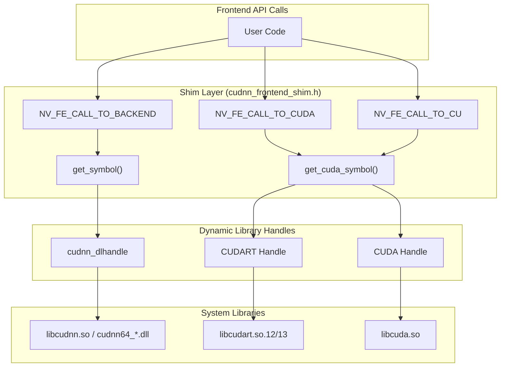
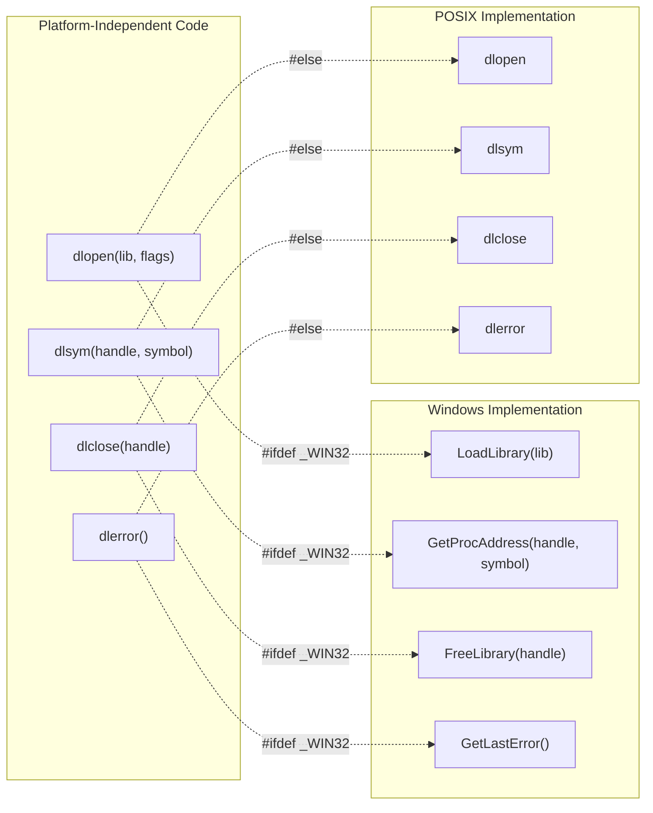
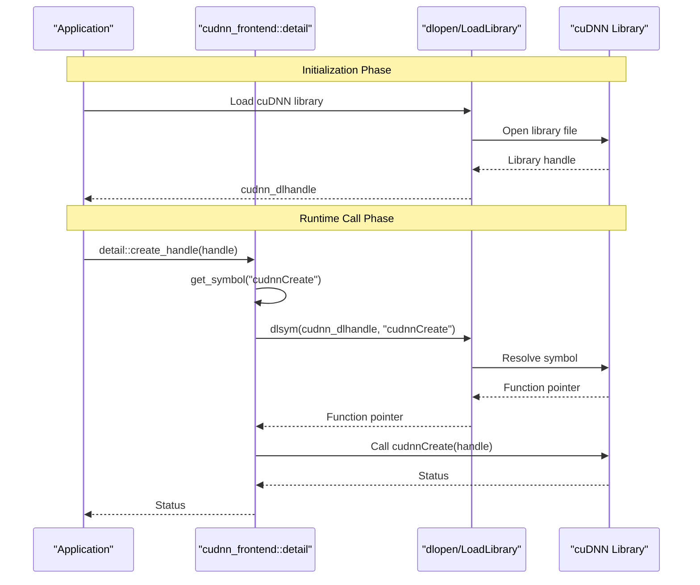
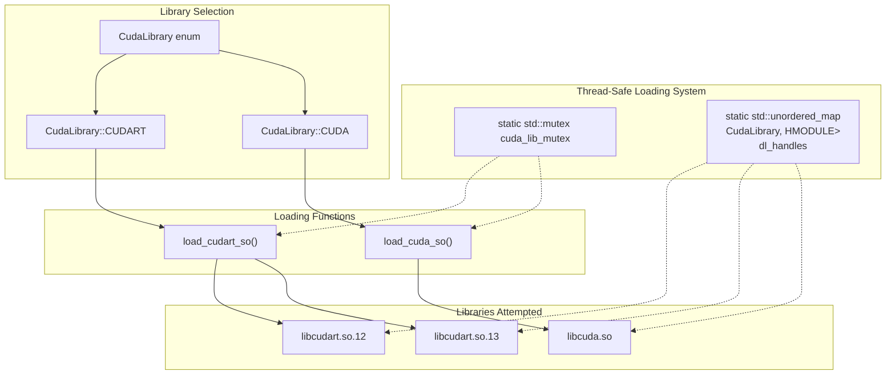
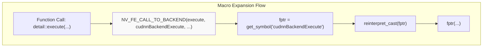
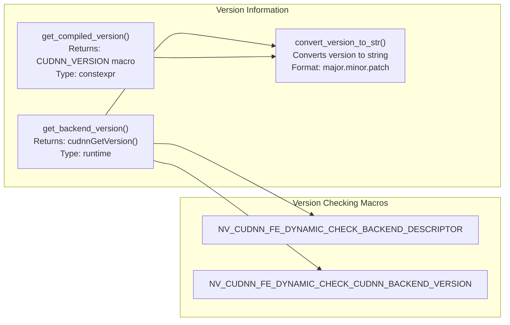
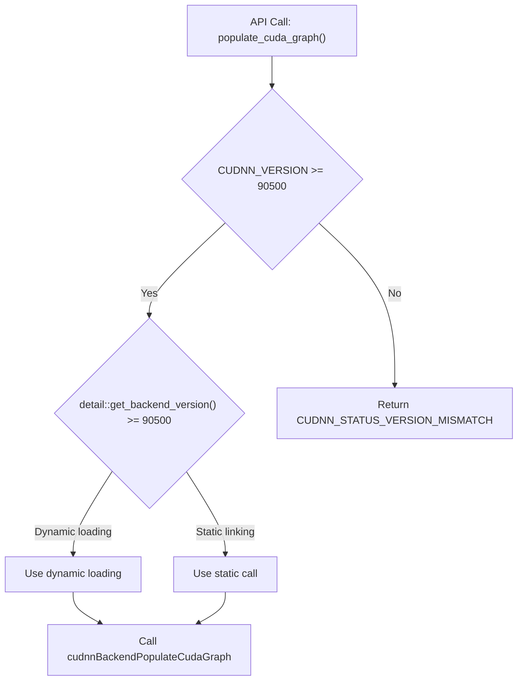
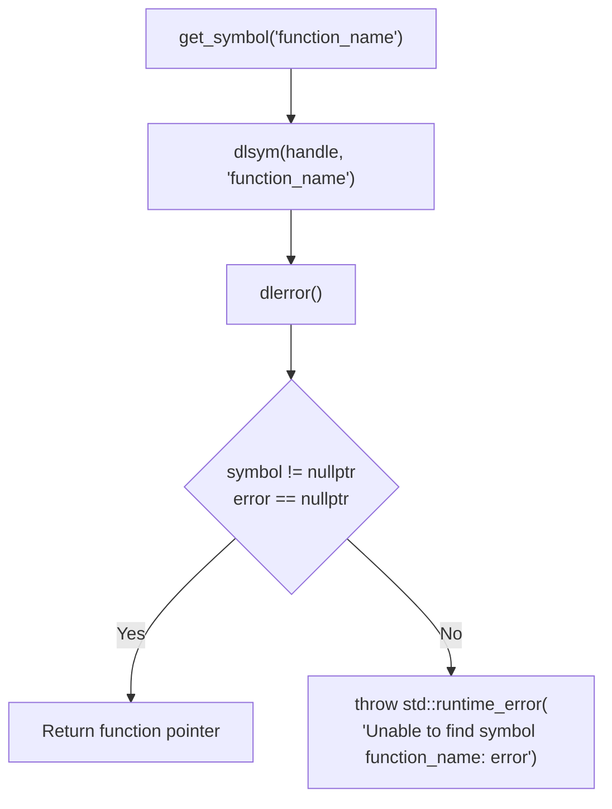
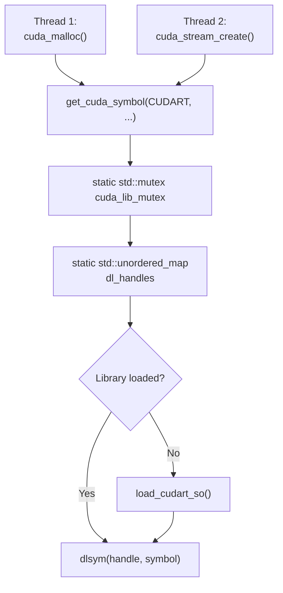

<!-- source: DeepWiki mcp.deepwiki.com · repo NVIDIA/cudnn-frontend · page 5.2 Dynamic Loading · fetched 2026-10-26 -->

# Dynamic Loading

<details>
<summary>Relevant source files</summary>

The following files were used as context for generating this wiki page:

- [CMakeLists.txt](CMakeLists.txt)
- [include/cudnn_frontend.h](include/cudnn_frontend.h)
- [include/cudnn_frontend/plans.h](include/cudnn_frontend/plans.h)
- [include/cudnn_frontend_shim.h](include/cudnn_frontend_shim.h)
- [setup.py](setup.py)

</details>


This document explains the dynamic loading system in cudnn-frontend, which provides runtime symbol resolution for cuDNN and CUDA libraries. This enables the frontend to operate as a header-only library without requiring link-time dependencies.

For information about error handling during dynamic loading failures, see [Error Handling](#5.1). For details on how the backend interface uses these symbols, see [API Reference](#2).

**Sources:** [include/cudnn_frontend_shim.h:1-643]()

## Purpose and Benefits

The dynamic loading shim allows cudnn-frontend to resolve cuDNN and CUDA function symbols at runtime using `dlopen`/`dlsym` (Linux) or `LoadLibrary`/`GetProcAddress` (Windows). This architecture provides several advantages:

| Benefit | Description |
|---------|-------------|
| **Header-Only Distribution** | No link-time dependencies on cuDNN libraries |
| **Version Flexibility** | Works with multiple cuDNN versions without recompilation |
| **Simplified Python Packaging** | Avoids linking complexities in pip packages |
| **Multi-Version Support** | Can coexist with other libraries using different cuDNN versions |
| **Deployment Flexibility** | End users can swap cuDNN libraries without rebuilding |

Dynamic loading is controlled by the `NV_CUDNN_FRONTEND_USE_DYNAMIC_LOADING` preprocessor macro. When disabled, the library falls back to direct function calls.

**Sources:** [include/cudnn_frontend_shim.h:27-41](), [include/cudnn_frontend_shim.h:172-194]()

## Architecture Overview

### Symbol Resolution System

The dynamic loading system resolves symbols from three distinct libraries:



**Sources:** [include/cudnn_frontend_shim.h:58-62](), [include/cudnn_frontend_shim.h:118-148](), [include/cudnn_frontend_shim.h:172-194]()

### Platform Abstraction Layer

The shim provides a unified interface across Windows and POSIX systems:



**Sources:** [include/cudnn_frontend_shim.h:28-38]()

## Symbol Resolution Implementation

### cuDNN Library Loading

The global handle `cudnn_dlhandle` stores the loaded cuDNN library. The Python package initializes this during import, while C++ users must load it explicitly:



**Sources:** [include/cudnn_frontend_shim.h:46-52](), [include/cudnn_frontend_shim.h:58-62](), [include/cudnn_frontend_shim.h:425-428]()

### CUDA Runtime and Driver Loading

The system maintains separate handles for CUDA runtime (`libcudart.so`) and CUDA driver (`libcuda.so`) libraries, using thread-safe lazy initialization:



The `load_cudart_so()` function attempts to load multiple versions and throws an error if multiple are found:

**Sources:** [include/cudnn_frontend_shim.h:64-116](), [include/cudnn_frontend_shim.h:118-148]()

### Call Forwarding Macros

Three macros route calls to the appropriate library based on the function being invoked:

| Macro | Purpose | Target Library | Example Usage |
|-------|---------|----------------|---------------|
| `NV_FE_CALL_TO_BACKEND` | cuDNN backend functions | `cudnn_dlhandle` | `cudnnCreate`, `cudnnBackendExecute` |
| `NV_FE_CALL_TO_CUDA` | CUDA runtime functions | `CudaLibrary::CUDART` | `cudaMalloc`, `cudaMemcpyAsync` |
| `NV_FE_CALL_TO_CU` | CUDA driver functions | `CudaLibrary::CUDA` | `cuGraphCreate`, `cuGraphGetNodes` |



When `NV_CUDNN_FRONTEND_USE_DYNAMIC_LOADING` is not defined, these macros simply forward to direct function calls:

**Sources:** [include/cudnn_frontend_shim.h:172-194]()

## Wrapper Functions

### cuDNN Backend Wrappers

The shim provides type-safe wrappers for all cuDNN backend functions. Each wrapper uses `NV_FE_CALL_TO_BACKEND` to resolve and invoke the actual cuDNN function:

| Wrapper Function | Backend Symbol | Purpose |
|------------------|----------------|---------|
| `detail::create_handle()` | `cudnnCreate` | Create cuDNN handle |
| `detail::destroy_handle()` | `cudnnDestroy` | Destroy cuDNN handle |
| `detail::create_descriptor()` | `cudnnBackendCreateDescriptor` | Create backend descriptor |
| `detail::set_attribute()` | `cudnnBackendSetAttribute` | Set descriptor attribute |
| `detail::finalize()` | `cudnnBackendFinalize` | Finalize descriptor |
| `detail::execute()` | `cudnnBackendExecute` | Execute operation |
| `detail::get_backend_version()` | `cudnnGetVersion` | Query cuDNN version |

**Sources:** [include/cudnn_frontend_shim.h:425-639]()

### CUDA Runtime Wrappers

The system wraps essential CUDA runtime functions for memory management, events, streams, and CUDA graphs:

```mermaid
graph TB
    subgraph "Memory Operations"
        MALLOC["cuda_malloc()"]
        FREE["cuda_free()"]
        MEMCPY["cuda_mem_cpy_async()"]
        MEMSET["cuda_mem_set_async()"]
    end
    
    subgraph "Event Operations"
        EVCREATE["cuda_event_create()"]
        EVDESTROY["cuda_event_destroy()"]
        EVRECORD["cuda_event_record()"]
        EVSYNC["cuda_event_synchronize()"]
        EVELAPSED["cuda_event_elapsed_time()"]
    end
    
    subgraph "Stream Operations"
        STRCREATE["cuda_stream_create()"]
        STRDESTROY["cuda_stream_destroy()"]
        STRSYNC["cuda_stream_synchronize()"]
        STRCAPTURE["cuda_stream_is_capturing()"]
    end
    
    subgraph "Graph Operations"
        GRAPHCREATE["cuda_graph_begin_capture()"]
        GRAPHEND["cuda_graph_end_capture()"]
        GRAPHDESTROY["cuda_graph_destroy()"]
        GRAPHADDNODE["cuda_graph_add_child_graph_node()"]
    end
    
    subgraph "NV_FE_CALL_TO_CUDA Macro"
        MACRO["Resolves and invokes<br/>CUDA runtime symbols"]
    end
    
    MALLOC --> MACRO
    FREE --> MACRO
    MEMCPY --> MACRO
    MEMSET --> MACRO
    EVCREATE --> MACRO
    EVDESTROY --> MACRO
    EVRECORD --> MACRO
    EVSYNC --> MACRO
    EVELAPSED --> MACRO
    STRCREATE --> MACRO
    STRDESTROY --> MACRO
    STRSYNC --> MACRO
    STRCAPTURE --> MACRO
    GRAPHCREATE --> MACRO
    GRAPHEND --> MACRO
    GRAPHDESTROY --> MACRO
    GRAPHADDNODE --> MACRO
```



**Sources:** [include/cudnn_frontend_shim.h:196-424]()

### CUDA Driver Wrappers

CUDA driver functions (prefix `cu`) are wrapped separately for graph operations:

- `detail::cu_graph_create()` → `cuGraphCreate`
- `detail::cu_graph_get_nodes()` → `cuGraphGetNodes`
- `detail::cu_get_error_string()` → `cuGetErrorString`

**Sources:** [include/cudnn_frontend_shim.h:196-204](), [include/cudnn_frontend_shim.h:400-403]()

## Version Compatibility System

### Version Query Functions

The shim provides functions to query and compare cuDNN versions at both compile-time and runtime:



The version checking macros conditionally execute code based on minimum version requirements:

```cpp
// Only enabled when dynamic loading is active
NV_CUDNN_FE_DYNAMIC_CHECK_BACKEND_DESCRIPTOR(90000, descriptor, "Requires cuDNN 9.0+")
NV_CUDNN_FE_DYNAMIC_CHECK_CUDNN_BACKEND_VERSION(90500, CUDNN_STATUS_VERSION_MISMATCH)
```

**Sources:** [include/cudnn_frontend_shim.h:435-470](), [include/cudnn_frontend_shim.h:152-169]()

### Conditional API Support

Functions introduced in newer cuDNN versions use preprocessor guards and runtime version checks:



**Sources:** [include/cudnn_frontend_shim.h:524-556]()

## Configuration and Usage

### Enabling Dynamic Loading

To enable dynamic loading, define `NV_CUDNN_FRONTEND_USE_DYNAMIC_LOADING` before including cudnn-frontend headers:

```cpp
#define NV_CUDNN_FRONTEND_USE_DYNAMIC_LOADING
#include <cudnn_frontend.h>
```

The Python bindings always use dynamic loading and handle library initialization automatically during module import.

**Sources:** [include/cudnn_frontend_shim.h:27]()

### Library Discovery Process

The dynamic loading system follows this discovery process for each library type:

| Library Type | Search Order | Error Behavior |
|--------------|--------------|----------------|
| **cuDNN** | User-specified path in `cudnn_dlhandle` | Throws if handle is invalid |
| **CUDA Runtime** | `libcudart.so.12`, then `libcudart.so.13` | Throws if none found or multiple found |
| **CUDA Driver** | `libcuda.so` | Throws if not found |

On Windows, the search uses `cudnn64_*.dll` naming conventions.

**Sources:** [include/cudnn_frontend_shim.h:67-116]()

### Build System Integration

The CMake build system does not explicitly enable dynamic loading for C++ targets. Users must define the macro manually. The Python package build in `setup.py` relies on runtime loading without compile-time linking:

**Sources:** [setup.py:1-119](), [CMakeLists.txt:38-44]()

## Error Handling

### Symbol Resolution Failures

When symbol resolution fails, the shim throws `std::runtime_error` with descriptive messages:



Common error scenarios:

| Error Condition | Error Message | Likely Cause |
|----------------|---------------|--------------|
| Library not loaded | "Unable to dlopen libcudnn.so: ..." | Missing or incompatible cuDNN installation |
| Symbol not found | "Unable to find symbol cudnnCreate: ..." | Version mismatch or corrupted library |
| Multiple libraries | "Multiple libcudart libraries found: ..." | Conflicting CUDA installations |

**Sources:** [include/cudnn_frontend_shim.h:59-62](), [include/cudnn_frontend_shim.h:137-144]()

### Version Mismatch Handling

When the backend version is insufficient for an API, version check macros return early with `CUDNN_STATUS_VERSION_MISMATCH`:

**Sources:** [include/cudnn_frontend_shim.h:529-538]()

### Error Message Retrieval

The `get_last_error_string()` wrapper provides detailed error messages from cuDNN 9.0+:

**Sources:** [include/cudnn_frontend_shim.h:563-589]()

## Fallback to Static Linking

When `NV_CUDNN_FRONTEND_USE_DYNAMIC_LOADING` is not defined, all macros expand to direct function calls:

```cpp
// Dynamic loading enabled:
#define NV_FE_CALL_TO_BACKEND(function_name, backend_symbol, ...) \
    static void *fptr = get_symbol(#backend_symbol); \
    return reinterpret_cast<decltype(function_name) *>(fptr)(__VA_ARGS__);

// Dynamic loading disabled:
#define NV_FE_CALL_TO_BACKEND(function_name, backend_symbol, ...) \
    return backend_symbol(__VA_ARGS__);
```

This allows the same codebase to support both deployment modes without code duplication.

**Sources:** [include/cudnn_frontend_shim.h:172-194]()

## Thread Safety

The CUDA library loading system uses a static mutex to ensure thread-safe initialization:



Once a library is loaded, subsequent symbol lookups are lock-protected but the handle is cached for efficiency.

**Sources:** [include/cudnn_frontend_shim.h:118-148]()

---

