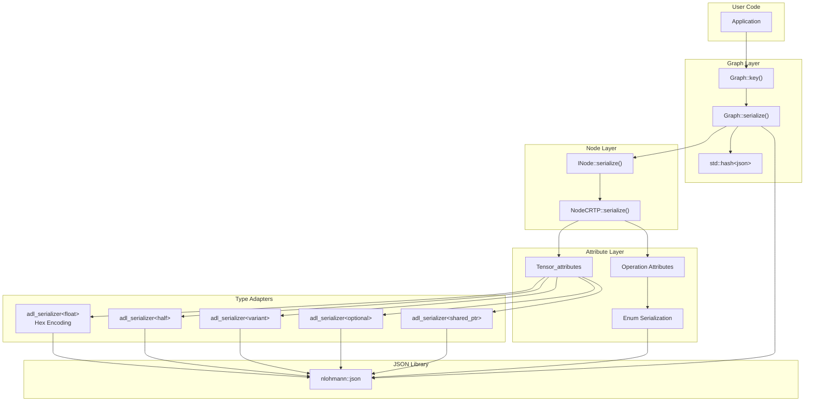
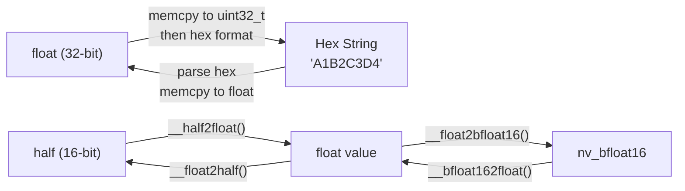
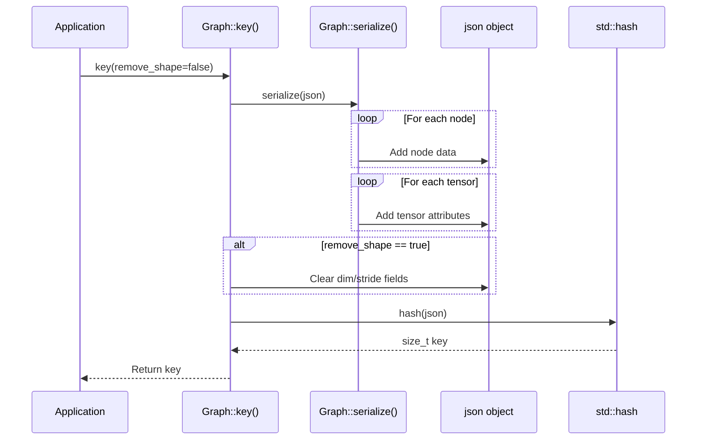
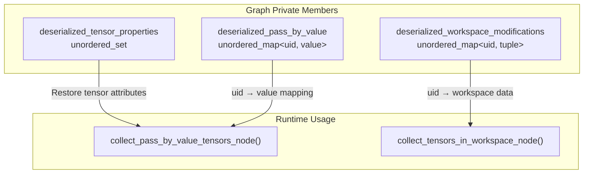
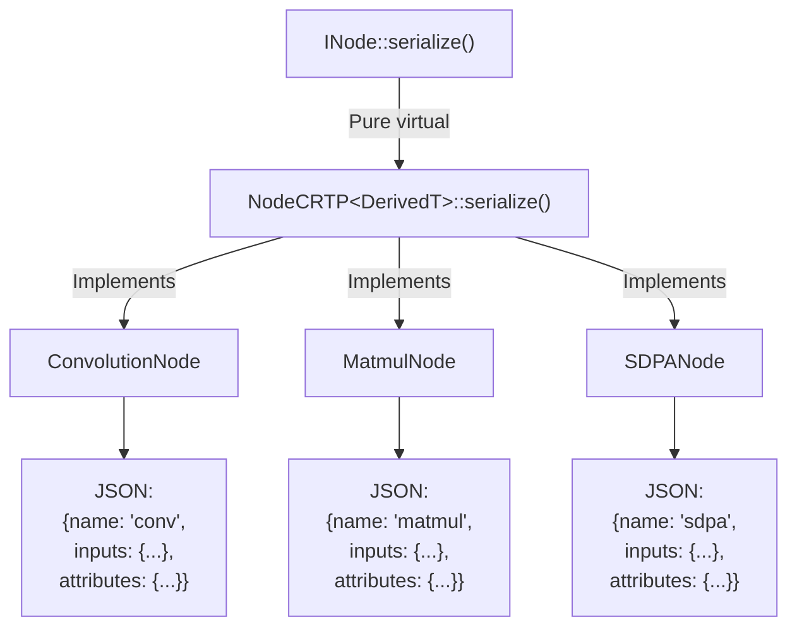

<!-- source: DeepWiki mcp.deepwiki.com · repo NVIDIA/cudnn-frontend · page 5.3 Serialization · fetched 2026-10-26 -->

# Serialization

<details>
<summary>Relevant source files</summary>

The following files were used as context for generating this wiki page:

- [include/cudnn_frontend/cudnn_interface.h](include/cudnn_frontend/cudnn_interface.h)
- [include/cudnn_frontend/graph_helpers.h](include/cudnn_frontend/graph_helpers.h)
- [include/cudnn_frontend/graph_interface.h](include/cudnn_frontend/graph_interface.h)
- [include/cudnn_frontend/node/sdpa_fp8_bwd.h](include/cudnn_frontend/node/sdpa_fp8_bwd.h)
- [include/cudnn_frontend/node_interface.h](include/cudnn_frontend/node_interface.h)
- [include/cudnn_frontend/utils/serialize.h](include/cudnn_frontend/utils/serialize.h)
- [include/cudnn_frontend_utils.h](include/cudnn_frontend_utils.h)
- [python/pygraph/pygraph.cpp](python/pygraph/pygraph.cpp)
- [python/pygraph/sdpa.cpp](python/pygraph/sdpa.cpp)
- [samples/cpp/convolution/fprop.cpp](samples/cpp/convolution/fprop.cpp)
- [samples/cpp/sdpa/fp16_fwd_with_custom_dropout.cpp](samples/cpp/sdpa/fp16_fwd_with_custom_dropout.cpp)
- [samples/cpp/sdpa/fp8_fwd.cpp](samples/cpp/sdpa/fp8_fwd.cpp)

</details>


## Purpose and Scope

The cuDNN Frontend library provides JSON-based serialization capabilities for graphs, tensors, and operation attributes. Serialization enables several key workflows:

- **Graph Caching**: Generating unique keys for graphs to cache execution plans across program runs
- **Dynamic Shape Support**: Creating shape-independent graph identifiers for kernel caching (see [5.6](#5.6) for details on kernel caching)
- **Debugging**: Inspecting graph structure and configuration in human-readable format
- **Persistence**: Saving and loading graph configurations (less common)

All serialization functionality depends on the `nlohmann/json` library and can be disabled by defining `CUDNN_FRONTEND_SKIP_JSON_LIB` at compile time.

**Sources:** [include/cudnn_frontend/graph_interface.h:228-243](), [include/cudnn_frontend_utils.h:37-43]()

---

## Serialization Architecture



**Serialization Flow**: Applications call `Graph::key()` which internally calls `serialize()` to produce JSON, then hashes it. The serialization recursively processes nodes, tensors, and attributes, using custom type adapters for CUDA types.

**Sources:** [include/cudnn_frontend/graph_interface.h:228-243](), [include/cudnn_frontend/node_interface.h:369-383](), [include/cudnn_frontend_utils.h:45-180]()

---

## Custom Type Adapters

The library provides specialized JSON serializers for CUDA and cuDNN types that don't have default JSON support:

### Floating-Point Types

| Type | Serialization Strategy | Rationale |
|------|----------------------|-----------|
| `float` | Hexadecimal string (8 hex digits) | Preserves exact bit representation without precision loss |
| `half` | Convert to `float` via `__half2float()` | No precision loss in conversion to float |
| `nv_bfloat16` | Convert to `float` via `__bfloat162float()` | No precision loss in conversion to float |



**Implementation Details:**
- **Float Hex Encoding**: [include/cudnn_frontend_utils.h:45-68]() - Uses `std::memcpy` to reinterpret float bits as `uint32_t`, then formats as 8-character hex string
- **Half Conversion**: [include/cudnn_frontend_utils.h:71-82]() - Uses CUDA intrinsics for lossless conversion
- **BFloat16 Conversion**: [include/cudnn_frontend_utils.h:85-96]() - Uses CUDA intrinsics for lossless conversion

**Sources:** [include/cudnn_frontend_utils.h:45-96]()

### Container Types

```cpp
// Variant serialization - stores type index and value
// Example JSON: {"index": 3, "value": "3F800000"}
std::variant<int64_t, int32_t, half, float, nv_bfloat16>

// Optional serialization - null for empty, value otherwise
// Example JSON: 42 or null
std::optional<T>

// Shared pointer serialization - dereferences or null
// Example JSON: {"dim": [1,2,3], "stride": [6,3,1]} or null
std::shared_ptr<T>
```

**Sources:** [include/cudnn_frontend_utils.h:99-166]()

---

## Graph Serialization and Caching

### The key() Method

The `Graph::key()` method is the primary interface for serialization-based caching:

```cpp
size_t Graph::key(bool remove_shape);
```

**Parameters:**
- `remove_shape`: When `true`, removes tensor dimension and stride information from serialization. Used for dynamic shape support where the same graph structure handles multiple shapes.

**Process Flow:**



**Sources:** [include/cudnn_frontend/graph_interface.h:228-243]()

### Practical Caching Example

The convolution sample demonstrates user-maintained caching using graph serialization:

```cpp
std::unordered_map<std::size_t, graph_and_tensors> user_maintained_cache;

auto key = graph->key();
auto it = user_maintained_cache.find(key);

if (it != user_maintained_cache.end()) {
    // Cache hit - reuse existing graph
    return it->second;
}

// Cache miss - build new graph and store
graph->build_operation_graph(handle);
graph->create_execution_plans({fe::HeurMode_t::A});
graph->check_support();
graph->build_plans();

user_maintained_cache.insert({key, std::make_tuple(graph, X, W, S, B, Y)});
```

**Sources:** [samples/cpp/convolution/fprop.cpp:228-289]()

### Dynamic Shape Caching

For dynamic shapes (cuDNN 9.4+), graphs can be cached with shape information removed:

```cpp
// Create shape-independent key
size_t key = graph->key(/*remove_shape=*/true);

// Multiple shapes can reuse the same cached plan
for (auto& shape : different_shapes) {
    // Same graph key despite different tensor dimensions
    graph->execute(handle, variant_pack, workspace);
}
```

**Use Case**: When the same operation sequence needs to handle varying batch sizes or sequence lengths, shape-independent keys enable kernel reuse across shapes.

**Sources:** [include/cudnn_frontend/graph_interface.h:228-243]()

---

## Deserialization Support

While less commonly used than serialization, the Graph class supports loading pre-serialized configurations:

### Deserialized Data Storage



**Deserialized Fields:**

| Field | Type | Purpose |
|-------|------|---------|
| `deserialized_tensor_properties` | `unordered_set<shared_ptr<Tensor_attributes>>` | Tensor configuration loaded from JSON |
| `deserialized_pass_by_value` | `unordered_map<uid_t, pass_by_values_t>` | Scalar values embedded in graph |
| `deserialized_workspace_modifications` | `unordered_map<uid_t, tuple<int64_t, int64_t, vector<float>>>` | Workspace initialization data |

**Sources:** [include/cudnn_frontend/graph_interface.h:46-48](), [include/cudnn_frontend/graph_interface.h:110-127]()

---

## Enum and Attribute Serialization

All operation attributes and their input/output port names have corresponding enum serializations:

### Operation Attribute Enums

The `utils/serialize.h` header defines JSON serialization for all attribute enums using the `NLOHMANN_JSON_SERIALIZE_ENUM` macro:

**Examples:**

```cpp
// Conv_fprop_attributes input/output names
NLOHMANN_JSON_SERIALIZE_ENUM(Conv_fprop_attributes::input_names,
    {
        {Conv_fprop_attributes::input_names::X, "X"},
        {Conv_fprop_attributes::input_names::W, "W"},
    })

NLOHMANN_JSON_SERIALIZE_ENUM(Conv_fprop_attributes::output_names,
    {
        {Conv_fprop_attributes::output_names::Y, "Y"},
    })

// SDPA_attributes input/output names  
NLOHMANN_JSON_SERIALIZE_ENUM(SDPA_attributes::input_names,
    {
        {SDPA_attributes::input_names::Q, "Q"},
        {SDPA_attributes::input_names::K, "K"},
        {SDPA_attributes::input_names::V, "V"},
        {SDPA_attributes::input_names::Attn_scale, "Attn_scale"},
        {SDPA_attributes::input_names::Bias, "Bias"},
        // ... more inputs
    })
```

### Serialized Operations

| Operation | Input Names File | Output Names File | Lines |
|-----------|-----------------|-------------------|-------|
| Convolution Forward | `serialize.h` | `serialize.h` | [90-99]() |
| Convolution Backward Data | `serialize.h` | `serialize.h` | [79-88]() |
| Matmul | `serialize.h` | `serialize.h` | [234-246]() |
| SDPA (Attention) | `serialize.h` | `serialize.h` | [327-362]() |
| Pointwise | `serialize.h` | `serialize.h` | [266-276]() |
| Reduction | `serialize.h` | `serialize.h` | [278-283]() |
| Batchnorm | `serialize.h` | `serialize.h` | [31-49]() |
| Layernorm | `serialize.h` | `serialize.h` | [172-201]() |

**Sources:** [include/cudnn_frontend/utils/serialize.h:8-400]()

---

## Node Serialization Interface

All nodes implement the `INode::serialize()` interface:

```cpp
class INode {
public:
    // Make sure each node implements a public serialize function
    #ifndef CUDNN_FRONTEND_SKIP_JSON_LIB
    virtual void serialize(json& j) const = 0;
    #endif
    
    virtual size_t key() {
        #ifndef CUDNN_FRONTEND_SKIP_JSON_LIB
        json j;
        serialize(j);
        return std::hash<json>{}(j);
        #else
        return 1;
        #endif
    }
};
```

**Node Serialization Pattern:**



Each node's `serialize()` method outputs:
- Node name
- Input tensor references (by UID)
- Output tensor references (by UID)
- Operation-specific attributes

**Sources:** [include/cudnn_frontend/node_interface.h:369-383]()

---

## Performance Considerations

### Hash Performance

- **JSON Construction**: Serializing a graph to JSON has linear cost in the number of nodes and tensors
- **Hash Computation**: `std::hash<json>` provides fast key generation for caching
- **Cache Lookup**: Hash-based map lookups are O(1) average case

### When to Use Serialization

| Use Case | Recommended | Rationale |
|----------|-------------|-----------|
| Plan caching across runs | ✓ | Amortizes serialization cost over many executions |
| Dynamic shape support | ✓ | Essential for kernel cache functionality |
| Single-use graphs | ✗ | Serialization overhead not justified |
| Real-time applications | △ | Consider caching strategy carefully |

### Memory Impact

Serialization creates temporary JSON objects but does not persistently increase memory usage. The `key()` method destroys the JSON after hashing.

**Sources:** [include/cudnn_frontend/graph_interface.h:228-243]()

---

## Compilation Without JSON

The library can be built without JSON support by defining `CUDNN_FRONTEND_SKIP_JSON_LIB`:

```cpp
#ifdef CUDNN_FRONTEND_SKIP_JSON_LIB
// Serialization disabled - key() returns constant
size_t Graph::key(bool remove_shape) {
    return 1;  // No caching possible
}
#endif
```

**Impact:**
- Graph caching unavailable
- Dynamic shape caching unavailable  
- Debugging via JSON inspection unavailable
- Reduced binary size and compilation time

**Sources:** [include/cudnn_frontend/graph_interface.h:229-242](), [include/cudnn_frontend_utils.h:37-43]()

---

